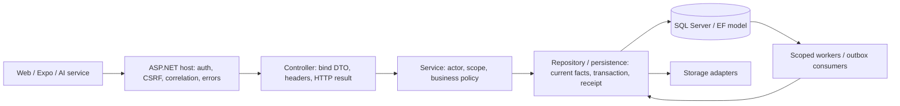

# ASP.NET architecture, DI và module boundaries

**Phase 2B · 15/10/2026 · source pin `1b577d703cda203c6066eba98ff005341739849e` · independent JEV review pending.**

[Canonical entrance](../README.md) · [Phase 2A workflows (owner PASS)](../02_Business-Workflows/README.md) · [Phase 2B review](PHASE2B_REVIEW_REPORT.md) · [Open status/GAP registry](../00_Governance/03_Implementation-and-Verification-Status.md).

`CURRENT_VERIFIED` ở đây = observed source/static metadata, không deployed acceptance. Owner decisions và latest [HUY specification](../../../planning/development/HUY-FINAL-INTEGRATION.md) xác định `TARGET_CONFIRMED`; [confirmed decisions](../../product/confirmed-decisions.md) giữ qualifiers. `PROPOSED`, `HISTORICAL`, `NOT_VERIFIED` theo [authority/legend](../00_Governance/01_Authority-and-Source-of-Truth.md). Phase 0 model/API capture được dùng sau recheck 1334 source hashes, không gọi SQL hay tuyên bố fresh runtime capture. Technical identifiers RoadGuardSystem và routes hiện hữu được giữ; product HoangHaiWarrantySystem, Supervisor/PM Web, Reporter/Operator/Crew Mobile React Native Expo.

## Composition và request path

Host ASP.NET Core `net8.0` ở `RoadGuardSystem.API/RoadGuardSystem.eAPI.csproj`; EF Core/SqlServer/NetTopologySuite references 8.0.17 ở repository project. Đây là phiên bản package trong source, không cam kết SDK/runtime đã cài trên server. Legacy aBusinessObjects/bDTOs/cRepositories/dServices/eAPI assembly names vẫn còn; không rename namespace/database vì đổi product name.

Đường Controller→Service→Repository là surveyed convention, không một kiến trúc thuần tuyệt đối. Có controller gọi query repository/service trực tiếp và projection/static consumer; không đổi code để làm sơ đồ đúng. BusinessObjects chứa domain state/invariants; DTOs là wire types, không đồng nhất EF entity. Services orchestrate; Repositories tổ chức EF/SQL, authoritative facts, storage và durability. Helper trong source index là call candidates, không execution trace. Không có yêu cầu tách microservice mỗi module.

`Program.cs` composition: optional Development.local → controller/activity filter → AddApiPlatformServices/auth/persistence/seeding → conditional workers → Build → optional Development database initialization. Request pipeline: correlation → exception/status pages → API version validation → Development Swagger → HTTPS redirection → authentication → authorization → WebCookieRequestMiddleware → health/controllers. Activity filter và per-command repository guards bổ sung kiểm tra hiện tại, không thay JWT validation/CSRF.

## Module ownership và producer/consumer seams

| Module | Orchestration / durable seam | Technical responsibility | Canonical workflow |
|---|---|---|---|
| Identity / staff | [AuthService](../../../RoadGuardSystem.Services/Implementations/Authentication/AuthService.cs#L13), [IdentityRepository](../../../RoadGuardSystem.Repositories/Implementations/Identity/IdentityRepository.AccountUpdates.cs#L10), [IdentityOnboardingService](../../../RoadGuardSystem.Services/Implementations/Authentication/IdentityOnboardingService.cs#L14), [StaffReadRepository](../../../RoadGuardSystem.Repositories/Implementations/Staff/StaffReadRepository.cs#L6) | Session/token/OTP/invitation/account and effective membership; token claim alone is not resource authority | [01_Authentication-Users-and-Memberships](../02_Business-Workflows/01_Authentication-Users-and-Memberships.md) |
| Project / GIS / pavement | [ProjectCreationService](../../../RoadGuardSystem.Services/Implementations/Projects/ProjectCreationService.cs#L7), [GeometryWorkflowPersistenceService](../../../RoadGuardSystem.Repositories/Implementations/Projects/GeometryWorkflowPersistenceService.cs#L14), [PavementWorkflowService](../../../RoadGuardSystem.Services/Implementations/Projects/PavementWorkflowService.cs#L7) | Confirmed versions, published segment sets/slab pins, lifecycle/basis; GIS is not image segmentation | [02_Project-Road-Geometry-and-Pavement](../02_Business-Workflows/02_Project-Road-Geometry-and-Pavement.md) |
| Reporter / Case | [ReporterReportService](../../../RoadGuardSystem.Services/Implementations/Reports/ReporterReportService.cs#L12), [ReporterReportRepository](../../../RoadGuardSystem.Repositories/Implementations/Reports/ReporterReportRepository.cs#L13), [CaseWorkflowRepository](../../../RoadGuardSystem.Repositories/Implementations/Cases/CaseWorkflowRepository.cs#L15) | Private verified evidence, independent intake/unassigned Case, Supervisor triage, explicit publication recipients | [03_Reporter-Evidence-and-IncidentCase](../02_Business-Workflows/03_Reporter-Evidence-and-IncidentCase.md) |
| Candidate / Defect | [CandidateDecisionService](../../../RoadGuardSystem.Services/Implementations/Defects/CandidateDecisionService.cs#L16), [CandidateDecisionRepository](../../../RoadGuardSystem.Repositories/Implementations/Defects/CandidateDecisionRepository.cs#L16), [CandidateMatchingService](../../../RoadGuardSystem.Services/Implementations/Defects/CandidateMatchingService.cs#L14) | PM KEEP_NEW/LINK_EXISTING/REJECT; matching suggestions do not create Defect | [04_Candidate-Decisions-and-Defect](../02_Business-Workflows/04_Candidate-Decisions-and-Defect.md) |
| Survey / processing | [SurveyV2Service](../../../RoadGuardSystem.Services/Implementations/Surveys/SurveyV2Service.cs#L11), [SurveyV2PersistenceService](../../../RoadGuardSystem.Repositories/Implementations/Surveys/SurveyV2PersistenceService.Dataset.cs#L12), [ProcessingV2PersistenceService](../../../RoadGuardSystem.Repositories/Implementations/Processing/ProcessingV2PersistenceService.cs#L17) | Operator assignment, verified video/telemetry dataset, immutable model/attempt manifest, candidate output | [05_Drone-Survey-Dataset-and-Processing](../02_Business-Workflows/05_Drone-Survey-Dataset-and-Processing.md) |
| FIELD | [FieldInspectionWorkflowService](../../../RoadGuardSystem.Services/Implementations/Inspections/FieldInspectionWorkflowService.cs#L10), [FieldInspectionWorkflowRepository](../../../RoadGuardSystem.Repositories/Implementations/Inspections/FieldInspectionWorkflowRepository.Business.cs#L17) | Assigned Crew measurement and immutable formal intake/provenance; no AI physical dimensions | [06_FIELD-Inspection-and-Measurements](../02_Business-Workflows/06_FIELD-Inspection-and-Measurements.md) |
| NORMAL repair | [RepairWorkflowRepository](../../../RoadGuardSystem.Repositories/Implementations/Repairs/RepairWorkflowRepository.Execution.cs#L13), [RepairExecutionService](../../../RoadGuardSystem.Services/Implementations/Repairs/RepairExecutionService.cs#L8) | PM proposal/assignment/review, Supervisor approval/final, actual Crew start/finish distinct from assessment | [07_NORMAL-Repair-and-Acceptance](../02_Business-Workflows/07_NORMAL-Repair-and-Acceptance.md) |
| Fast Track | [RepairPolicyService](../../../RoadGuardSystem.Services/Implementations/Repairs/RepairPolicyService.cs#L8), [RepairEligibilityRepository](../../../RoadGuardSystem.Repositories/Implementations/Repairs/RepairEligibilityRepository.cs#L12), [RoadCoverageRepository](../../../RoadGuardSystem.Repositories/Implementations/Repairs/RoadCoverageRepository.cs#L15) | PM policy, Supervisor coverage, current eligibility/original window, PM final | [08_FastTrack-Policy-and-Confirmation](../02_Business-Workflows/08_FastTrack-Policy-and-Confirmation.md) |
| Offline | [OfflineWorkflowService](../../../RoadGuardSystem.Services/Implementations/Offline/OfflineWorkflowService.cs#L8), [OfflineWorkflowRepository](../../../RoadGuardSystem.Repositories/Implementations/Offline/OfflineWorkflowRepository.Sync.cs#L13) | Public-key registry, snapshot, canonical signed operations, per-item admission, encrypted scoped handover | [09_Offline-Snapshots-Sync-and-Handover](../02_Business-Workflows/09_Offline-Snapshots-Sync-and-Handover.md) |
| Messaging / reporting / export / retention | [BusinessDutyRepository](../../../RoadGuardSystem.Repositories/Implementations/Messaging/BusinessDutyRepository.cs#L16), [ReportingService](../../../RoadGuardSystem.Services/Implementations/Reporting/ReportingService.cs#L10), [ExportService](../../../RoadGuardSystem.Services/Implementations/Exports/ExportService.cs#L16), [RetentionRepository](../../../RoadGuardSystem.Repositories/Implementations/Retention/RetentionRepository.cs#L12) | Source/recipient adapters, business ACK and clocks, immutable export source, basis/hold review gates | [10_Notifications-Publication-Reporting-and-Retention](../02_Business-Workflows/10_Notifications-Publication-Reporting-and-Retention.md) |

## Dependency injection và lifetimes

AddApiPlatformServices registers application services, auth schemes/policies, workers and invokes persistence composition; AddRoadGuardPersistence registers repositories/DbContext and adapters. Current source index contains **201 static registration entries**, including conditional/composition calls: not 201 instantiated singleton services. Most business services/repos and EF DbContext are scoped; TimeProvider/crypto/storage adapters have explicit singleton lifetimes. Hosted workers create scopes; don't capture a scoped DbContext in singleton state.

IIdentityRepository/IIdentityV2Repository share IdentityRepository implementation; H6ProtectedNotificationRepository is resolved for both notification read interfaces within scope. Multiple IH6NotificationSourceAdapter implementations are intended for enumeration/catalog matching, not “last registration is the only recipient adapter”. IFileContentStore uses LocalFileContentStore; IUploadObjectStorage uses MinioUploadObjectStorage; IAnh02ArtifactStore is separately TryAddSingleton-bound to MinioAnh02ArtifactStore by Huy01ReporterPersistenceExtensions; local temporary spool is not a durable local-store fallback. Registration doesn't prove a configured MinIO endpoint or live SMTP/provider.

## Transaction, retry, outbox và errors

Command repositories commonly execute strategy-owned transaction + durable idempotency receipt + current-source locks + domain effects/audit/outbox. Some paths choose Serializable, others explicit isolation/current facts; don't call all writes serializable or all source checks atomic. SQL transient retry isn't business permission or a safe external-effect replay by itself. A storage await can cross a security-sensitive time boundary; download must apply its actual current-rights policy (P1-04 in security/storage chapter).

Outbox is persisted business intent, not evidence an external message was sent. H6 has hosted source-aware dispatcher; legacy NotificationOutboxConsumer is scoped and requires a caller. Static reporting capture consumers run synchronously under ReportingService, not independently hosted. Worker scheduling and lease fences are in chapter 05.

Platform configures `application/problem+json`, validation errors, correlationId and code, generic 500 with internal detail/stack stripping; specific controllers also map typed results to status/errors. Don't assume one uniform error code/status/ETag or JSON error envelope across every compatibility endpoint. Clients use current controller/DTO/OpenAPI plus [241-operation inventory](../../audit/HHWS-DOCS-REBUILD-01/02_FULL_API_INVENTORY.md), not guessed routes. GET `/health` is process liveness separate from 47 controllers/241 operations/223 paths, not dependency readiness.

## Current limits / JEV

**PARTIAL**: source seams/composition exist; API/schema/source checks do not prove Web/Expo/AI deployment (P1-05). P1-01 provider, P1-02 callback fence, P1-03 matching, P1-04 Reporter download and P2-06/P2-07 remain open. Existing architecture/test/contract debt stays in registry; no refactor or lock refresh here. No SfM/orthomosaic/DSM/3D/AI measurement module is reintroduced. Next chapters detail actual EF/security/storage/offline boundaries; API rewrite Phase 2C is NOT_STARTED.

## Source evidence và verification boundary

Symbol/line dưới đây tại `1b577d703cda203c6066eba98ff005341739849e`. Partial declarations được bổ sung bằng method locator; không coi một interface/DI entry là bằng chứng mọi runtime branch đã chạy.

- [ServiceCollectionExtensions](../../../RoadGuardSystem.API/Extensions/ServiceCollectionExtensions.cs#L39): source declaration.
- [RoadGuardPersistenceExtensions](../../../RoadGuardSystem.Repositories/Extensions/RoadGuardPersistenceExtensions.cs#L32): source declaration.
- [RoadGuardDbContext](../../../RoadGuardSystem.Repositories/RoadGuardDbContext.cs#L35): source declaration.
- [CorrelationIdMiddleware](../../../RoadGuardSystem.API/Middlewares/CorrelationIdMiddleware.cs#L11): source declaration.
- [ApiVersioningValidationMiddleware](../../../RoadGuardSystem.API/Middlewares/ApiVersioningValidationMiddleware.cs#L16): source declaration.
- [WebCookieActivityFilter](../../../RoadGuardSystem.API/Authentication/WebCookieActivityFilter.cs#L11): source declaration.
- [IdempotencyOperationService](../../../RoadGuardSystem.Repositories/Idempotency/IdempotencyOperationService.cs#L8): source declaration.
- [ServiceCollectionExtensions.AddApiPlatformServices](../../../RoadGuardSystem.API/Extensions/ServiceCollectionExtensions.cs#L41): method source.
- [RoadGuardPersistenceExtensions.AddRoadGuardPersistence](../../../RoadGuardSystem.Repositories/Extensions/RoadGuardPersistenceExtensions.cs#L39): method source.

Business/SQL/HTTP/native/external tests Phase 2B **NOT_RUN** (docs-only). Fresh static link/reference/hash/diff checks nằm trong [review report](PHASE2B_REVIEW_REPORT.md). Test source/checkpoint cũ chỉ `HISTORICAL` theo revision, không runtime PASS mới. Independent JEV **PENDING**.
