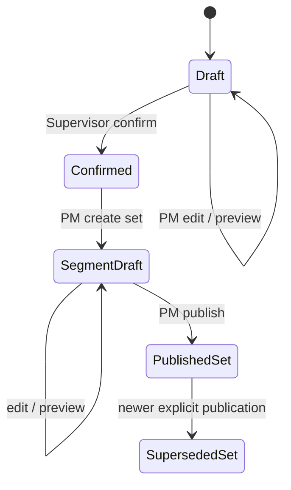

# Đường, hình học, phân đoạn và tấm mặt đường

> Baseline source: `cdeb1ca1037744d06995058af13d0582f6273c0a`, nhánh `huy-review`; BE-DOC-02, ngày 13/10/2026. `CURRENT_VERIFIED` ở đây nghĩa là đối chiếu source, không phải chứng nhận runtime. Build/tests trong phần việc này: **NOT_RUN**. Kết quả thực thi DOC-AUDIT-01/các checkpoint spec trước là **HISTORICAL**; quyết định owner có hiệu lực vẫn là **TARGET_CONFIRMED**.

Nghiệp vụ: [quyết định 32–44](../../../docs/product/confirmed-decisions.md) và [HUY-FINAL-INTEGRATION](../../../planning/development/HUY-FINAL-INTEGRATION.md), ưu tiên các mục owner clarification/activation mới nhất hơn checkpoint cũ. Audit dùng để định vị rủi ro, không thay authority: [DOC-AUDIT-01 gaps](../../../docs/audit/DOC-AUDIT-01-OPEN-GAPS.md). Mọi giao tiếp bên ngoài được mô tả là boundary; chưa xác minh FE/Android/FastAPI/deployment.

## EXPECTED_BUSINESS_BEHAVIOR — TARGET_CONFIRMED

PR39A cho segment gợi ý 100 m, PM có thể thay đổi và giữ/gộp phần dư; đây không phải chuẩn xây dựng hay kết luận video đủ phủ. H2 owner clarification 06/10 xác nhận chưa có nguồn CRS chính thức. Backend vẫn xây profile/version/provenance/transform seam, LINE/ARC, tuyến chính/nhánh, segment, slab và map package với nhãn `sampleOnly`/`CANDIDATE`; tọa độ thật và độ chính xác cần nguồn profile/operation/control points/tolerance độc lập. Không tự đổi EPSG:32648/32649 thành VN2000. LD01 ngày 07/10 giữ gate nguồn thật ở đúng phần phụ thuộc.

Road identity, route version và segment-set là ba tầng khác nhau: đổi hình học tạo version; phân đoạn lại tạo set của version; phân đoạn không tự đổi bản đồ/tấm đã ban hành. Bằng chứng và task cũ phải tiếp tục tham chiếu đúng phiên bản đã dùng. R01 loại quản lý vật liệu/bảo dưỡng/tính thời gian mở giao thông; pavement layout ở đây chỉ là cấu trúc hình học và nguồn định vị, không tái đưa các module ấy vào.

## CURRENT_IMPLEMENTATION — nguồn điều phối

[GeometryWorkflowController.cs · public sealed class L15](../../../RoadGuardSystem.API/Controllers/GeometryWorkflowController.cs#L15) chuyển action vào `IGeometryWorkflowService`; service kiểm role/project/header rồi ánh xạ DTO sang persistence facts. [GeometryWorkflowService.cs · var read L11](../../../RoadGuardSystem.Services/Implementations/Projects/GeometryWorkflowService.cs#L11) tách read, PM write và Supervisor confirm. Repository giữ transaction/receipt, profile/system/draft/version/set, source file và audit. [GeometryWorkflowPersistenceService.cs · ExecuteAsync L30](../../../RoadGuardSystem.Repositories/Implementations/Projects/GeometryWorkflowPersistenceService.cs#L30) dùng serializable cho read khi không có transaction sẵn và nhận caller-owned transaction khi đã có.

[PavementWorkflowController.cs · public sealed class L16](../../../RoadGuardSystem.API/Controllers/PavementWorkflowController.cs#L16) → `PavementWorkflowService` → `PavementWorkflowRepository`; các engine `PavementLayoutEngine`, `PavementFootprintEngine`, `NativeAlignment`, `GeometryMapPageEngine` xử lý layout/footprint/layer paging. Legacy `ProjectRoadSectionsController` → `RoadSectionVersionService` → `RoadSectionVersionPersistenceService` vẫn tồn tại; không được coi legacy create là tương đương geometry approval mới.

## Actor và điều kiện trước

| Actor | Quyền thực tế | Điều kiện bổ sung |
|---|---|---|
| PM | Tạo CRS profile/route system/draft, edit, preview, segment set/publish; tạo pavement/as-built/map/impact decision | Current active user/role; scope project, membership còn hiệu lực; project không đóng khi mutation |
| Supervisor | Đọc geometry/pavement; confirm draft | Current scope; confirm cần bản draft đúng ETag và expected current version |
| Operator | Chỉ geometry package theo nhánh service | Đúng route/set của task được giao qua `CanReadAssignedGeometryAsync` |
| Crew/Reporter | Không có quyền vào các controller này chỉ nhờ membership | FIELD/offline phải đi task-bound package riêng |

`PavementWorkflowService` chỉ cho PM/Supervisor đọc, PM ghi; comment cũ về H3 không được dùng để suy cấp quyền Crew. API geometry/pavement có `WebCookieEligible`; legacy road-section API không có attribute đó. Xem [PavementWorkflowService.cs · var read L12](../../../RoadGuardSystem.Services/Implementations/Projects/PavementWorkflowService.cs#L12).

## Luồng chính và API sequence chính xác

Các đường bên dưới bắt đầu `/api/v1/projects/{projectId}`. Lấy ETag trả về, giữ nguyên dấu ngoặc kép khi gửi `If-Match`; key phải riêng cho một ý định mutation.

1. PM `POST /crs-profiles` (`CrsProfileInput`) rồi `GET /crs-profiles/{profileId}`; profile tạo ra có status `CANDIDATE`, revision tăng theo code/project, không tự thành official. PM `POST /route-systems` để định danh mạng tuyến.
2. PM `POST /road-geometry-drafts` hoặc alias `/road-sections/{roadSectionId}/geometry-drafts` với `GeometryDraftInput`: nguồn, CRS, tọa độ/file/track, width profile, station origin, alignment, system/kind/parent/junction và calibration nếu có. `GET .../{draftId}/readiness`, `POST .../{draftId}/preview` cho biết readiness/warnings trước xác nhận; preview không ghi approved version.
3. PM `PUT /road-geometry-drafts/{draftId}` với key + draft ETag nếu sửa. Supervisor `POST /road-geometry-drafts/{draftId}/confirm` với key + ETag + `GeometryConfirmInput(ExpectedCurrentVersionId, EffectiveFrom, Reason)` tạo route version. Alias scoped road-section tồn tại cho edit/get/preview/confirm.
4. `GET /road-sections/{roadSectionId}/versions/{routeVersionId}/geometry` trả metric geometry, WGS84 optional, metadata/hash/provenance. PM `POST .../segment-sets/preview` rồi `POST .../segment-sets` với `SegmentDefinition`; sửa qua `PUT .../segment-sets/{setId}`; publish qua `POST .../{setId}/publish` với key + ETag + expected published set.
5. `GET /geometry-package?routeVersionId=...&segmentSetId=...` cung cấp đúng pins đã chọn; thiếu query GUID trả 400.
6. PM `POST /route-versions/{routeVersionId}/segment-sets/{segmentSetId}/pavement-plans` để tạo layout kế hoạch, `GET /pavement-layouts/{layoutId}` để xem; `POST /pavement-layouts/as-built` để ghi thực tế.
7. PM `POST /geometry-map-publications`; đọc manifest `GET /geometry-map-publications/{publicationId}`, đọc layer `GET .../{publicationId}/layers/{layer}?limit=...&bbox=...&cursor=...`. `POST /geometry-location-impacts`, `GET /geometry-location-impacts` hoặc `/{impactId}`, `POST /{impactId}/decisions` quản lý ảnh hưởng thay geometry một cách tường minh.

Legacy bổ sung (chỉ Supervisor theo `RoadSectionVersionService`, khác PM draft authoring): `POST /api/v1/projects/{projectId}/road-sections` và `POST .../{roadSectionId}/versions`; request dùng `OperationId` và `ExpectedCurrentVersionId`, không dùng cùng giao thức key/ETag của geometry workflow. Response 201 `RoadSectionVersionResponseDto`; stale legacy trả 409 `road_section_concurrency_conflict`.

## State machine và persistence

Sơ đồ là tổng hợp nhiều resource, không phải một enum chung. Draft chỉ edit/confirm khi `DRAFT`; published set không sửa như draft. Confirm tạo `RoadSectionVersion`, `RoadGeometryMetadata`, native route facts và actor/time/source hash; profile/route system/topology/calibration giữ trong facts có version. Set giữ definition, segments, geometry hash; publish đối chiếu `ExpectedPublishedSetId`, thay current publication một cách có kiểm tra. Pavement lưu plan/as-built/publication snapshots và impact/decision history; task/map đọc snapshot/pins thay vì tự suy nguồn mới. Xem [GeometryWorkflowPersistenceService.cs · var previous = L267](../../../RoadGuardSystem.Repositories/Implementations/Projects/GeometryWorkflowPersistenceService.cs#L267) và [PavementWorkflowRepository.cs · public sealed class L18](../../../RoadGuardSystem.Repositories/Implementations/Projects/PavementWorkflowRepository.cs#L18).

CRS source được giữ ở `CrsProfileRevision`/native alignment; engineering geometry có SRID; WGS84 geometry optional. `NativeAlignment` giữ analytic length/offset LINE/ARC, tessellation phục vụ render; `DeclaredLengthMeters` và chainage calibration không được tự thay canonical geometric length. Current executable transform adapter trong `CrsProfileEngine.TryTransformCanonical` chỉ hỗ trợ `SAMPLE_AFFINE_TO_WGS84` khi `SampleOnly=true`; official profile/operation metadata không tự làm transform executable. Operation khác trả không có WGS84 transform. [Source adapter L31](../../../RoadGuardSystem.Services/Implementations/Projects/CrsProfileEngine.cs#L31). Legacy metadata thiếu trả `LEGACY_INCOMPLETE`. Không điền độ rộng/transform/geometry giả để đổi thành `COMPLETE`.

## DTO, lỗi, concurrency và alternative flows

`GeometryDraftInput` có optional coordinates/sourceFile/native alignment nhưng các tổ hợp hợp lệ do engine/repository quyết định; null không đồng nghĩa dữ liệu tốt. `SegmentDefinition` mặc định target 100 và remainder `KEEP`; không biến default thành bắt buộc. `GeometryPreview` trả metric/wgs84/surface/survey area/warnings/profile/sampleOnly; `RoadGeometryVersionView` trả hash, metadata, source actor/time; `SegmentSetView`/package giữ pins. DTO đầy đủ trong appendix bên dưới và catalog chung.

Geometry mutations cần key tối đa 200; edit/confirm/set-edit/publish cần expected version. Header `If-Match` không được quote đúng trả 412 từ controller. Repository revalidates current rights trước receipt replay; key đổi payload trả 409 `duplicate_request`. Geometry invalid/missing metadata trả 422; wrong project/current rights 403; closed project 409; stale pins/competing publish 409 hoặc 412 theo action. Pavement key là ASCII printable tối đa 150; `page`, `publish`, `asbuilt-create` cần content hash. Map cursor gắn snapshot/hash/query/layer; trộn publication/layer/filter không cho phân trang tiếp; unavailable layer và version mismatch là 409, missing layer 404, invalid cursor/page 400. [PavementWorkflowService.cs · content_hash_required L23](../../../RoadGuardSystem.Services/Implementations/Projects/PavementWorkflowService.cs#L23).

## Tests và gaps

Test source cần đọc gồm `Anh01GeometryTests`, `Anh01GeometryAuthorizationTests`, `H2PavementLayoutTests`, `H2PavementFootprintTests`, `H2GeometryMapPageTests`, `H2PavementWorkflowServiceTests`, `Anh01GeometryWorkflowTests`, `Anh01LegacyGeometryCorrectionTests`, `AnhHuyGeometrySourceTests`, `H2PavementWorkflowHttpTests`, `H2PavementWorkflowSqlTests`. Appendix ghi đường dẫn chính xác; **NOT_RUN** trong BE-DOC-02. Test source có policy/current role, topology, nullable/error inputs, hash/cursor, revision, SQL atomicity; sự tồn tại của assertion không được gán PASS.

| Gap | Phân loại và hướng tối thiểu |
|---|---|
| Official CRS/control/tolerance | TARGET_CONFIRMED localized external gate LD01; cung cấp profile/operation và independent controls trước real-coordinate accuracy/publication acceptance |
| Crew vào map controller | CURRENT_VERIFIED denial; dùng FIELD/offline producer, không cấp project-wide read từ suy đoán |
| Live SQL/real survey geometry/client rendering | NOT_VERIFIED; migration/model và source algorithms không là deployed schema hoặc survey accuracy |
| Tài liệu routing RF nói branch/slab absent | HISTORICAL stale guidance; dùng controllers/engines hiện tại, không chép lại absence |

## Toàn bộ HTTP actions của controller trong workflow

`SOURCE_DERIVED_NOT_RUNTIME_VERIFIED`. Paths giữ source constraints; API version được thay1. Một action có nhiều route được ghi từng operation. Tham số/status/headers đầy đủ trong endpoint catalog chung.

| Method | Full route | Controller.Action / source |
|---|---|---|
| POST | `/api/v1/projects/{projectId:guid}/road-sections` | [ProjectRoadSectionsController.Create](../../../RoadGuardSystem.API/Controllers/ProjectRoadSectionsController.cs#L27) |
| POST | `/api/v1/projects/{projectId:guid}/road-sections/{roadSectionId:guid}/versions` | [ProjectRoadSectionsController.CreateVersion](../../../RoadGuardSystem.API/Controllers/ProjectRoadSectionsController.cs#L81) |
| POST | `/api/v1/projects/{projectId:guid}/crs-profiles` | [GeometryWorkflowController.CreateProfile](../../../RoadGuardSystem.API/Controllers/GeometryWorkflowController.cs#L17) |
| GET | `/api/v1/projects/{projectId:guid}/crs-profiles` | [GeometryWorkflowController.Profiles](../../../RoadGuardSystem.API/Controllers/GeometryWorkflowController.cs#L19) |
| GET | `/api/v1/projects/{projectId:guid}/crs-profiles/{profileId:guid}` | [GeometryWorkflowController.Profile](../../../RoadGuardSystem.API/Controllers/GeometryWorkflowController.cs#L21) |
| POST | `/api/v1/projects/{projectId:guid}/route-systems` | [GeometryWorkflowController.CreateSystem](../../../RoadGuardSystem.API/Controllers/GeometryWorkflowController.cs#L23) |
| GET | `/api/v1/projects/{projectId:guid}/route-systems` | [GeometryWorkflowController.Systems](../../../RoadGuardSystem.API/Controllers/GeometryWorkflowController.cs#L25) |
| GET | `/api/v1/projects/{projectId:guid}/road-geometry-drafts/{draftId:guid}/readiness` | [GeometryWorkflowController.Readiness](../../../RoadGuardSystem.API/Controllers/GeometryWorkflowController.cs#L27) |
| POST | `/api/v1/projects/{projectId:guid}/road-geometry-drafts` | [GeometryWorkflowController.CreateDraft](../../../RoadGuardSystem.API/Controllers/GeometryWorkflowController.cs#L29) |
| POST | `/api/v1/projects/{projectId:guid}/road-sections/{roadSectionId:guid}/geometry-drafts` | [GeometryWorkflowController.CreateDraft](../../../RoadGuardSystem.API/Controllers/GeometryWorkflowController.cs#L30) |
| PUT | `/api/v1/projects/{projectId:guid}/road-geometry-drafts/{draftId:guid}` | [GeometryWorkflowController.EditDraft](../../../RoadGuardSystem.API/Controllers/GeometryWorkflowController.cs#L32) |
| PUT | `/api/v1/projects/{projectId:guid}/road-sections/{roadSectionId:guid}/geometry-drafts/{draftId:guid}` | [GeometryWorkflowController.EditDraft](../../../RoadGuardSystem.API/Controllers/GeometryWorkflowController.cs#L33) |
| GET | `/api/v1/projects/{projectId:guid}/road-geometry-drafts/{draftId:guid}` | [GeometryWorkflowController.Draft](../../../RoadGuardSystem.API/Controllers/GeometryWorkflowController.cs#L35) |
| GET | `/api/v1/projects/{projectId:guid}/road-sections/{roadSectionId:guid}/geometry-drafts/{draftId:guid}` | [GeometryWorkflowController.Draft](../../../RoadGuardSystem.API/Controllers/GeometryWorkflowController.cs#L36) |
| POST | `/api/v1/projects/{projectId:guid}/road-geometry-drafts/{draftId:guid}/preview` | [GeometryWorkflowController.Preview](../../../RoadGuardSystem.API/Controllers/GeometryWorkflowController.cs#L38) |
| POST | `/api/v1/projects/{projectId:guid}/road-sections/{roadSectionId:guid}/geometry-drafts/{draftId:guid}/preview` | [GeometryWorkflowController.Preview](../../../RoadGuardSystem.API/Controllers/GeometryWorkflowController.cs#L39) |
| POST | `/api/v1/projects/{projectId:guid}/road-geometry-drafts/{draftId:guid}/confirm` | [GeometryWorkflowController.Confirm](../../../RoadGuardSystem.API/Controllers/GeometryWorkflowController.cs#L41) |
| POST | `/api/v1/projects/{projectId:guid}/road-sections/{roadSectionId:guid}/geometry-drafts/{draftId:guid}/confirm` | [GeometryWorkflowController.Confirm](../../../RoadGuardSystem.API/Controllers/GeometryWorkflowController.cs#L42) |
| GET | `/api/v1/projects/{projectId:guid}/road-sections/{roadSectionId:guid}/versions/{routeVersionId:guid}/geometry` | [GeometryWorkflowController.Geometry](../../../RoadGuardSystem.API/Controllers/GeometryWorkflowController.cs#L44) |
| POST | `/api/v1/projects/{projectId:guid}/road-sections/{roadSectionId:guid}/versions/{routeVersionId:guid}/segment-sets/preview` | [GeometryWorkflowController.PreviewSet](../../../RoadGuardSystem.API/Controllers/GeometryWorkflowController.cs#L46) |
| POST | `/api/v1/projects/{projectId:guid}/road-sections/{roadSectionId:guid}/versions/{routeVersionId:guid}/segment-sets` | [GeometryWorkflowController.CreateSet](../../../RoadGuardSystem.API/Controllers/GeometryWorkflowController.cs#L48) |
| PUT | `/api/v1/projects/{projectId:guid}/road-sections/{roadSectionId:guid}/versions/{routeVersionId:guid}/segment-sets/{setId:guid}` | [GeometryWorkflowController.EditSet](../../../RoadGuardSystem.API/Controllers/GeometryWorkflowController.cs#L50) |
| POST | `/api/v1/projects/{projectId:guid}/road-sections/{roadSectionId:guid}/versions/{routeVersionId:guid}/segment-sets/{setId:guid}/publish` | [GeometryWorkflowController.Publish](../../../RoadGuardSystem.API/Controllers/GeometryWorkflowController.cs#L52) |
| GET | `/api/v1/projects/{projectId:guid}/road-sections/{roadSectionId:guid}/versions/{routeVersionId:guid}/segment-sets/{setId:guid}` | [GeometryWorkflowController.Set](../../../RoadGuardSystem.API/Controllers/GeometryWorkflowController.cs#L54) |
| GET | `/api/v1/projects/{projectId:guid}/geometry-package` | [GeometryWorkflowController.Package](../../../RoadGuardSystem.API/Controllers/GeometryWorkflowController.cs#L56) |
| POST | `/api/v1/projects/{projectId:guid}/route-versions/{routeVersionId:guid}/segment-sets/{segmentSetId:guid}/pavement-plans` | [PavementWorkflowController.CreatePlan](../../../RoadGuardSystem.API/Controllers/PavementWorkflowController.cs#L19) |
| GET | `/api/v1/projects/{projectId:guid}/pavement-layouts/{layoutId:guid}` | [PavementWorkflowController.GetLayout](../../../RoadGuardSystem.API/Controllers/PavementWorkflowController.cs#L22) |
| POST | `/api/v1/projects/{projectId:guid}/pavement-layouts/as-built` | [PavementWorkflowController.CreateAsBuilt](../../../RoadGuardSystem.API/Controllers/PavementWorkflowController.cs#L25) |
| POST | `/api/v1/projects/{projectId:guid}/geometry-map-publications` | [PavementWorkflowController.Publish](../../../RoadGuardSystem.API/Controllers/PavementWorkflowController.cs#L28) |
| GET | `/api/v1/projects/{projectId:guid}/geometry-map-publications/{publicationId:guid}` | [PavementWorkflowController.Manifest](../../../RoadGuardSystem.API/Controllers/PavementWorkflowController.cs#L31) |
| GET | `/api/v1/projects/{projectId:guid}/geometry-map-publications/{publicationId:guid}/layers/{layer}` | [PavementWorkflowController.Page](../../../RoadGuardSystem.API/Controllers/PavementWorkflowController.cs#L34) |
| POST | `/api/v1/projects/{projectId:guid}/geometry-location-impacts` | [PavementWorkflowController.CreateImpact](../../../RoadGuardSystem.API/Controllers/PavementWorkflowController.cs#L41) |
| GET | `/api/v1/projects/{projectId:guid}/geometry-location-impacts` | [PavementWorkflowController.ListImpacts](../../../RoadGuardSystem.API/Controllers/PavementWorkflowController.cs#L44) |
| GET | `/api/v1/projects/{projectId:guid}/geometry-location-impacts/{impactId:guid}` | [PavementWorkflowController.GetImpact](../../../RoadGuardSystem.API/Controllers/PavementWorkflowController.cs#L48) |
| POST | `/api/v1/projects/{projectId:guid}/geometry-location-impacts/{impactId:guid}/decisions` | [PavementWorkflowController.DecideImpact](../../../RoadGuardSystem.API/Controllers/PavementWorkflowController.cs#L51) |

## Inventory nguồn module — CURRENT_VERIFIED source discovery

File/symbol tại baseline; không phải execution evidence. Interface/implementation/helpers trong scope được liệt kê đầy đủ; catalog toàn Backend/schema nằm trong traceability của bộ docs.

| File / declaration line | Types và operation seams |
|---|---|
| [RoadGuardSystem.Repositories/Implementations/Projects/GeometryWorkflowPersistenceService.cs](../../../RoadGuardSystem.Repositories/Implementations/Projects/GeometryWorkflowPersistenceService.cs#L14) | `GeometryWorkflowPersistenceService`, `Rejected`; [CanReadAssignedGeometryAsync](../../../RoadGuardSystem.Repositories/Implementations/Projects/GeometryWorkflowPersistenceService.cs#L17); [ExecuteAsync](../../../RoadGuardSystem.Repositories/Implementations/Projects/GeometryWorkflowPersistenceService.cs#L30) |
| [RoadGuardSystem.Repositories/Implementations/Projects/PavementWorkflowRepository.cs](../../../RoadGuardSystem.Repositories/Implementations/Projects/PavementWorkflowRepository.cs#L18) | `PavementWorkflowRepository`, `Rejected`, `CommittedReceipt`, `SourceCapture`; [ExecuteAsync](../../../RoadGuardSystem.Repositories/Implementations/Projects/PavementWorkflowRepository.cs#L31); [Guard](../../../RoadGuardSystem.Repositories/Implementations/Projects/PavementWorkflowRepository.cs#L39) |
| [RoadGuardSystem.Repositories/Implementations/Projects/RoadSectionInitialVersionWriteRequest.cs](../../../RoadGuardSystem.Repositories/Implementations/Projects/RoadSectionInitialVersionWriteRequest.cs#L5) | `RoadSectionInitialVersionWriteRequest` |
| [RoadGuardSystem.Repositories/Implementations/Projects/RoadSectionNextVersionWriteRequest.cs](../../../RoadGuardSystem.Repositories/Implementations/Projects/RoadSectionNextVersionWriteRequest.cs#L5) | `RoadSectionNextVersionWriteRequest` |
| [RoadGuardSystem.Repositories/Implementations/Projects/RoadSectionVersionFacts.cs](../../../RoadGuardSystem.Repositories/Implementations/Projects/RoadSectionVersionFacts.cs#L3) | `RoadSectionVersionFacts` |
| [RoadGuardSystem.Repositories/Implementations/Projects/RoadSectionVersionPersistenceService.cs](../../../RoadGuardSystem.Repositories/Implementations/Projects/RoadSectionVersionPersistenceService.cs#L16) | `RoadSectionVersionPersistenceService`, `RoadSectionVersionWriteException`; [CreateInitialAsync](../../../RoadGuardSystem.Repositories/Implementations/Projects/RoadSectionVersionPersistenceService.cs#L36); [CreateNextAsync](../../../RoadGuardSystem.Repositories/Implementations/Projects/RoadSectionVersionPersistenceService.cs#L83); [GetInitialFactsAsync](../../../RoadGuardSystem.Repositories/Implementations/Projects/RoadSectionVersionPersistenceService.cs#L131); [GetNextFactsAsync](../../../RoadGuardSystem.Repositories/Implementations/Projects/RoadSectionVersionPersistenceService.cs#L146); [CreateInitialAsync](../../../RoadGuardSystem.Repositories/Implementations/Projects/RoadSectionVersionPersistenceService.cs#L167); [RoadSectionVersionWriteException](../../../RoadGuardSystem.Repositories/Implementations/Projects/RoadSectionVersionPersistenceService.cs#L382); [AddVersionAndMakeCurrentAsync](../../../RoadGuardSystem.Repositories/Implementations/Projects/RoadSectionVersionPersistenceService.cs#L387) |
| [RoadGuardSystem.Repositories/Implementations/Projects/RoadSectionVersionWriteResult.cs](../../../RoadGuardSystem.Repositories/Implementations/Projects/RoadSectionVersionWriteResult.cs#L3) | `RoadSectionVersionWriteResult` |
| [RoadGuardSystem.Repositories/Implementations/Projects/RoadSectionVersionWriteStatus.cs](../../../RoadGuardSystem.Repositories/Implementations/Projects/RoadSectionVersionWriteStatus.cs#L3) | `RoadSectionVersionWriteStatus` |
| [RoadGuardSystem.Repositories/Implementations/Projects/RoadSectionVersionWriteView.cs](../../../RoadGuardSystem.Repositories/Implementations/Projects/RoadSectionVersionWriteView.cs#L3) | `RoadSectionVersionWriteView` |
| [RoadGuardSystem.Repositories/Interfaces/Projects/IGeometryWorkflowRepository.cs](../../../RoadGuardSystem.Repositories/Interfaces/Projects/IGeometryWorkflowRepository.cs#L4) | `GeometryWorkflowResult`, `GeometryWorkflowCommand`, `IGeometryWorkflowRepository`; [CanReadAssignedGeometryAsync](../../../RoadGuardSystem.Repositories/Interfaces/Projects/IGeometryWorkflowRepository.cs#L10); [ExecuteAsync](../../../RoadGuardSystem.Repositories/Interfaces/Projects/IGeometryWorkflowRepository.cs#L11) |
| [RoadGuardSystem.Repositories/Interfaces/Projects/IPavementWorkflowRepository.cs](../../../RoadGuardSystem.Repositories/Interfaces/Projects/IPavementWorkflowRepository.cs#L7) | `PavementWorkflowCommand`, `PavementLayerQuery`, `PavementLayoutView`, `GeometryImpactView`, `GeometryImpactDecisionView`, `IPavementWorkflowRepository`; [ExecuteAsync](../../../RoadGuardSystem.Repositories/Interfaces/Projects/IPavementWorkflowRepository.cs#L20) |
| [RoadGuardSystem.Repositories/Interfaces/Projects/IRoadSectionVersionRepository.cs](../../../RoadGuardSystem.Repositories/Interfaces/Projects/IRoadSectionVersionRepository.cs#L5) | `IRoadSectionVersionRepository`; [CreateInitialAsync](../../../RoadGuardSystem.Repositories/Interfaces/Projects/IRoadSectionVersionRepository.cs#L7); [CreateNextAsync](../../../RoadGuardSystem.Repositories/Interfaces/Projects/IRoadSectionVersionRepository.cs#L11); [GetInitialFactsAsync](../../../RoadGuardSystem.Repositories/Interfaces/Projects/IRoadSectionVersionRepository.cs#L15); [GetNextFactsAsync](../../../RoadGuardSystem.Repositories/Interfaces/Projects/IRoadSectionVersionRepository.cs#L19); [CreateInitialAsync](../../../RoadGuardSystem.Repositories/Interfaces/Projects/IRoadSectionVersionRepository.cs#L23); [AddVersionAndMakeCurrentAsync](../../../RoadGuardSystem.Repositories/Interfaces/Projects/IRoadSectionVersionRepository.cs#L28) |
| [RoadGuardSystem.Repositories/Spatial/SpatialConstants.cs](../../../RoadGuardSystem.Repositories/Spatial/SpatialConstants.cs#L9) | `SpatialConstants`; [IsAllowedProjectUtmSrid](../../../RoadGuardSystem.Repositories/Spatial/SpatialConstants.cs#L44) |
| [RoadGuardSystem.Repositories/Spatial/SpatialValidation.cs](../../../RoadGuardSystem.Repositories/Spatial/SpatialValidation.cs#L8) | `SpatialValidation`; [EnsureProjectEngineeringGeometry](../../../RoadGuardSystem.Repositories/Spatial/SpatialValidation.cs#L11); [EnsureGpsGeography](../../../RoadGuardSystem.Repositories/Spatial/SpatialValidation.cs#L21); [EnsureProjectEngineeringGeometry](../../../RoadGuardSystem.Repositories/Spatial/SpatialValidation.cs#L47) |
| [RoadGuardSystem.Services/Implementations/Projects/CreateRoadSectionCommand.cs](../../../RoadGuardSystem.Services/Implementations/Projects/CreateRoadSectionCommand.cs#L3) | `CreateRoadSectionCommand` |
| [RoadGuardSystem.Services/Implementations/Projects/CreateRoadSectionVersionCommand.cs](../../../RoadGuardSystem.Services/Implementations/Projects/CreateRoadSectionVersionCommand.cs#L3) | `CreateRoadSectionVersionCommand` |
| [RoadGuardSystem.Services/Implementations/Projects/CrsProfileEngine.cs](../../../RoadGuardSystem.Services/Implementations/Projects/CrsProfileEngine.cs#L4) | `CrsProfileEngine`; [Validate](../../../RoadGuardSystem.Services/Implementations/Projects/CrsProfileEngine.cs#L6); [NormalizeSource](../../../RoadGuardSystem.Services/Implementations/Projects/CrsProfileEngine.cs#L20); [TryTransformCanonical](../../../RoadGuardSystem.Services/Implementations/Projects/CrsProfileEngine.cs#L29); [Readiness](../../../RoadGuardSystem.Services/Implementations/Projects/CrsProfileEngine.cs#L38); [ValidateCalibration](../../../RoadGuardSystem.Services/Implementations/Projects/CrsProfileEngine.cs#L78); [StationAt](../../../RoadGuardSystem.Services/Implementations/Projects/CrsProfileEngine.cs#L83) |
| [RoadGuardSystem.Services/Implementations/Projects/GeometryEngine.cs](../../../RoadGuardSystem.Services/Implementations/Projects/GeometryEngine.cs#L9) | `GeometryValidationException`, `GeometryEngine`; [Line](../../../RoadGuardSystem.Services/Implementations/Projects/GeometryEngine.cs#L12); [Preview](../../../RoadGuardSystem.Services/Implementations/Projects/GeometryEngine.cs#L19); [Segments](../../../RoadGuardSystem.Services/Implementations/Projects/GeometryEngine.cs#L36); [Hash](../../../RoadGuardSystem.Services/Implementations/Projects/GeometryEngine.cs#L100); [Shape](../../../RoadGuardSystem.Services/Implementations/Projects/GeometryEngine.cs#L101) |
| [RoadGuardSystem.Services/Implementations/Projects/GeometryMapPageEngine.cs](../../../RoadGuardSystem.Services/Implementations/Projects/GeometryMapPageEngine.cs#L7) | `GeometryMapPageEngine`, `Cursor`; [Page](../../../RoadGuardSystem.Services/Implementations/Projects/GeometryMapPageEngine.cs#L9) |
| [RoadGuardSystem.Services/Implementations/Projects/GeometryWorkflowService.cs](../../../RoadGuardSystem.Services/Implementations/Projects/GeometryWorkflowService.cs#L6) | `GeometryWorkflowService`; [ExecuteAsync](../../../RoadGuardSystem.Services/Implementations/Projects/GeometryWorkflowService.cs#L8) |
| [RoadGuardSystem.Services/Implementations/Projects/NativeAlignment.cs](../../../RoadGuardSystem.Services/Implementations/Projects/NativeAlignment.cs#L7) | `NativeAlignment`; [Create](../../../RoadGuardSystem.Services/Implementations/Projects/NativeAlignment.cs#L51); [FromLegacy](../../../RoadGuardSystem.Services/Implementations/Projects/NativeAlignment.cs#L52); [PointAt](../../../RoadGuardSystem.Services/Implementations/Projects/NativeAlignment.cs#L58); [TangentAt](../../../RoadGuardSystem.Services/Implementations/Projects/NativeAlignment.cs#L63); [Extract](../../../RoadGuardSystem.Services/Implementations/Projects/NativeAlignment.cs#L71) |
| [RoadGuardSystem.Services/Implementations/Projects/PavementFootprintEngine.cs](../../../RoadGuardSystem.Services/Implementations/Projects/PavementFootprintEngine.cs#L7) | `PavementFootprintEngine`; [Planned](../../../RoadGuardSystem.Services/Implementations/Projects/PavementFootprintEngine.cs#L9); [AsBuilt](../../../RoadGuardSystem.Services/Implementations/Projects/PavementFootprintEngine.cs#L70) |
| [RoadGuardSystem.Services/Implementations/Projects/PavementLayoutEngine.cs](../../../RoadGuardSystem.Services/Implementations/Projects/PavementLayoutEngine.cs#L5) | `PavementLayoutEngine`; [Plan](../../../RoadGuardSystem.Services/Implementations/Projects/PavementLayoutEngine.cs#L7) |
| [RoadGuardSystem.Services/Implementations/Projects/PavementWorkflowService.cs](../../../RoadGuardSystem.Services/Implementations/Projects/PavementWorkflowService.cs#L7) | `PavementWorkflowService`; [ExecuteAsync](../../../RoadGuardSystem.Services/Implementations/Projects/PavementWorkflowService.cs#L9) |
| [RoadGuardSystem.Services/Implementations/Projects/RoadSectionCoordinate.cs](../../../RoadGuardSystem.Services/Implementations/Projects/RoadSectionCoordinate.cs#L3) | `RoadSectionCoordinate` |
| [RoadGuardSystem.Services/Implementations/Projects/RoadSectionVersionService.cs](../../../RoadGuardSystem.Services/Implementations/Projects/RoadSectionVersionService.cs#L9) | `RoadSectionVersionService`; [CreateRoadSectionAsync](../../../RoadGuardSystem.Services/Implementations/Projects/RoadSectionVersionService.cs#L18); [CreateRoadSectionVersionAsync](../../../RoadGuardSystem.Services/Implementations/Projects/RoadSectionVersionService.cs#L63); [CreateInitialAsync](../../../RoadGuardSystem.Services/Implementations/Projects/RoadSectionVersionService.cs#L109); [AddVersionAsync](../../../RoadGuardSystem.Services/Implementations/Projects/RoadSectionVersionService.cs#L131) |
| [RoadGuardSystem.Services/Implementations/Projects/RoadSectionVersionServiceResult.cs](../../../RoadGuardSystem.Services/Implementations/Projects/RoadSectionVersionServiceResult.cs#L3) | `RoadSectionVersionServiceResult` |
| [RoadGuardSystem.Services/Implementations/Projects/RoadSectionVersionServiceStatus.cs](../../../RoadGuardSystem.Services/Implementations/Projects/RoadSectionVersionServiceStatus.cs#L3) | `RoadSectionVersionServiceStatus` |
| [RoadGuardSystem.Services/Implementations/Projects/RoadSectionVersionView.cs](../../../RoadGuardSystem.Services/Implementations/Projects/RoadSectionVersionView.cs#L3) | `RoadSectionVersionView` |
| [RoadGuardSystem.Services/Interfaces/Projects/IGeometryWorkflowService.cs](../../../RoadGuardSystem.Services/Interfaces/Projects/IGeometryWorkflowService.cs#L5) | `IGeometryWorkflowService`; [ExecuteAsync](../../../RoadGuardSystem.Services/Interfaces/Projects/IGeometryWorkflowService.cs#L7) |
| [RoadGuardSystem.Services/Interfaces/Projects/IPavementWorkflowService.cs](../../../RoadGuardSystem.Services/Interfaces/Projects/IPavementWorkflowService.cs#L5) | `IPavementWorkflowService`; [ExecuteAsync](../../../RoadGuardSystem.Services/Interfaces/Projects/IPavementWorkflowService.cs#L7) |
| [RoadGuardSystem.Services/Interfaces/Projects/IRoadSectionVersionService.cs](../../../RoadGuardSystem.Services/Interfaces/Projects/IRoadSectionVersionService.cs#L6) | `IRoadSectionVersionService`; [CreateRoadSectionAsync](../../../RoadGuardSystem.Services/Interfaces/Projects/IRoadSectionVersionService.cs#L8); [CreateRoadSectionVersionAsync](../../../RoadGuardSystem.Services/Interfaces/Projects/IRoadSectionVersionService.cs#L14); [CreateInitialAsync](../../../RoadGuardSystem.Services/Interfaces/Projects/IRoadSectionVersionService.cs#L20); [AddVersionAsync](../../../RoadGuardSystem.Services/Interfaces/Projects/IRoadSectionVersionService.cs#L25) |

## DTO source inventory

Nullable/default/validation phụ thuộc declarations và service guards; catalog chung giữ field-level schema. Persistence facts không tự là public wire.

| DTO file | Public declarations |
|---|---|
| [RoadGuardSystem.DTOs/Projects/CreateHandoverRequestDto.cs](../../../RoadGuardSystem.DTOs/Projects/CreateHandoverRequestDto.cs#L1) | [CreateHandoverRequestDto](../../../RoadGuardSystem.DTOs/Projects/CreateHandoverRequestDto.cs#L5) |
| [RoadGuardSystem.DTOs/Projects/CreateProjectRequestDto.cs](../../../RoadGuardSystem.DTOs/Projects/CreateProjectRequestDto.cs#L1) | [CreateProjectRequestDto](../../../RoadGuardSystem.DTOs/Projects/CreateProjectRequestDto.cs#L5) |
| [RoadGuardSystem.DTOs/Projects/CreateProjectResponseDto.cs](../../../RoadGuardSystem.DTOs/Projects/CreateProjectResponseDto.cs#L1) | [CreateProjectResponseDto](../../../RoadGuardSystem.DTOs/Projects/CreateProjectResponseDto.cs#L3) |
| [RoadGuardSystem.DTOs/Projects/CreateRoadSectionRequestDto.cs](../../../RoadGuardSystem.DTOs/Projects/CreateRoadSectionRequestDto.cs#L1) | [CreateRoadSectionRequestDto](../../../RoadGuardSystem.DTOs/Projects/CreateRoadSectionRequestDto.cs#L5) |
| [RoadGuardSystem.DTOs/Projects/CreateRoadSectionVersionRequestDto.cs](../../../RoadGuardSystem.DTOs/Projects/CreateRoadSectionVersionRequestDto.cs#L1) | [CreateRoadSectionVersionRequestDto](../../../RoadGuardSystem.DTOs/Projects/CreateRoadSectionVersionRequestDto.cs#L5) |
| [RoadGuardSystem.DTOs/Projects/CrsProfileDtos.cs](../../../RoadGuardSystem.DTOs/Projects/CrsProfileDtos.cs#L1) | [CrsControlPoint](../../../RoadGuardSystem.DTOs/Projects/CrsProfileDtos.cs#L3), [CrsEllipsoidDefinition](../../../RoadGuardSystem.DTOs/Projects/CrsProfileDtos.cs#L12), [CrsProjectionDefinition](../../../RoadGuardSystem.DTOs/Projects/CrsProfileDtos.cs#L21), [CrsTransformOperation](../../../RoadGuardSystem.DTOs/Projects/CrsProfileDtos.cs#L30), [CrsProfileInput](../../../RoadGuardSystem.DTOs/Projects/CrsProfileDtos.cs#L40), [CrsProfileView](../../../RoadGuardSystem.DTOs/Projects/CrsProfileDtos.cs#L53), [RouteSystemInput](../../../RoadGuardSystem.DTOs/Projects/CrsProfileDtos.cs#L63), [RouteSystemView](../../../RoadGuardSystem.DTOs/Projects/CrsProfileDtos.cs#L72), [ChainageControl](../../../RoadGuardSystem.DTOs/Projects/CrsProfileDtos.cs#L81), [ChainageCalibrationInput](../../../RoadGuardSystem.DTOs/Projects/CrsProfileDtos.cs#L90), [GeometryDraftReadiness](../../../RoadGuardSystem.DTOs/Projects/CrsProfileDtos.cs#L100) |
| [RoadGuardSystem.DTOs/Projects/GeometryMapDtos.cs](../../../RoadGuardSystem.DTOs/Projects/GeometryMapDtos.cs#L1) | [GeometryMapLayer](../../../RoadGuardSystem.DTOs/Projects/GeometryMapDtos.cs#L3), [GeometryMapManifest](../../../RoadGuardSystem.DTOs/Projects/GeometryMapDtos.cs#L13), [GeometryMapFeature](../../../RoadGuardSystem.DTOs/Projects/GeometryMapDtos.cs#L26), [GeometryMapSnapshot](../../../RoadGuardSystem.DTOs/Projects/GeometryMapDtos.cs#L35), [GeometryMapPage](../../../RoadGuardSystem.DTOs/Projects/GeometryMapDtos.cs#L44), [GeometryMapPublishInput](../../../RoadGuardSystem.DTOs/Projects/GeometryMapDtos.cs#L54), [GeometryImpactInput](../../../RoadGuardSystem.DTOs/Projects/GeometryMapDtos.cs#L63), [GeometryImpactDecisionInput](../../../RoadGuardSystem.DTOs/Projects/GeometryMapDtos.cs#L72), [GeometryAffectedReference](../../../RoadGuardSystem.DTOs/Projects/GeometryMapDtos.cs#L81) |
| [RoadGuardSystem.DTOs/Projects/GeometryWorkflowDtos.cs](../../../RoadGuardSystem.DTOs/Projects/GeometryWorkflowDtos.cs#L1) | [GeometryPoint](../../../RoadGuardSystem.DTOs/Projects/GeometryWorkflowDtos.cs#L3), [WidthProfileItem](../../../RoadGuardSystem.DTOs/Projects/GeometryWorkflowDtos.cs#L12), [GeometryDraftInput](../../../RoadGuardSystem.DTOs/Projects/GeometryWorkflowDtos.cs#L21), [GeometryDraftView](../../../RoadGuardSystem.DTOs/Projects/GeometryWorkflowDtos.cs#L37), [GeometryShape](../../../RoadGuardSystem.DTOs/Projects/GeometryWorkflowDtos.cs#L51), [GeometryPreview](../../../RoadGuardSystem.DTOs/Projects/GeometryWorkflowDtos.cs#L60), [RoadGeometryVersionView](../../../RoadGuardSystem.DTOs/Projects/GeometryWorkflowDtos.cs#L71), [GeometryConfirmInput](../../../RoadGuardSystem.DTOs/Projects/GeometryWorkflowDtos.cs#L87), [SegmentDefinition](../../../RoadGuardSystem.DTOs/Projects/GeometryWorkflowDtos.cs#L96), [SegmentGeometry](../../../RoadGuardSystem.DTOs/Projects/GeometryWorkflowDtos.cs#L107), [SegmentPreview](../../../RoadGuardSystem.DTOs/Projects/GeometryWorkflowDtos.cs#L117), [SegmentGeometryView](../../../RoadGuardSystem.DTOs/Projects/GeometryWorkflowDtos.cs#L127), [SegmentSetView](../../../RoadGuardSystem.DTOs/Projects/GeometryWorkflowDtos.cs#L138), [SegmentPublishInput](../../../RoadGuardSystem.DTOs/Projects/GeometryWorkflowDtos.cs#L149), [GeometryPackageView](../../../RoadGuardSystem.DTOs/Projects/GeometryWorkflowDtos.cs#L158) |
| [RoadGuardSystem.DTOs/Projects/NativeAlignmentDtos.cs](../../../RoadGuardSystem.DTOs/Projects/NativeAlignmentDtos.cs#L1) | [NativeAlignmentPrimitive](../../../RoadGuardSystem.DTOs/Projects/NativeAlignmentDtos.cs#L3), [NativeAlignmentInput](../../../RoadGuardSystem.DTOs/Projects/NativeAlignmentDtos.cs#L13), [NativeArcRange](../../../RoadGuardSystem.DTOs/Projects/NativeAlignmentDtos.cs#L22) |
| [RoadGuardSystem.DTOs/Projects/PavementLayoutDtos.cs](../../../RoadGuardSystem.DTOs/Projects/PavementLayoutDtos.cs#L1) | [PavementWidthInterval](../../../RoadGuardSystem.DTOs/Projects/PavementLayoutDtos.cs#L3), [PavementLayoutInput](../../../RoadGuardSystem.DTOs/Projects/PavementLayoutDtos.cs#L12), [PlannedSlabCell](../../../RoadGuardSystem.DTOs/Projects/PavementLayoutDtos.cs#L21), [PavementLayoutPreview](../../../RoadGuardSystem.DTOs/Projects/PavementLayoutDtos.cs#L32), [PavementPlanCreateInput](../../../RoadGuardSystem.DTOs/Projects/PavementLayoutDtos.cs#L42), [SlabGeometrySnapshot](../../../RoadGuardSystem.DTOs/Projects/PavementLayoutDtos.cs#L51), [AsBuiltSlabInput](../../../RoadGuardSystem.DTOs/Projects/PavementLayoutDtos.cs#L62), [AsBuiltLayoutInput](../../../RoadGuardSystem.DTOs/Projects/PavementLayoutDtos.cs#L73), [PavementGeometryPreview](../../../RoadGuardSystem.DTOs/Projects/PavementLayoutDtos.cs#L82) |
| [RoadGuardSystem.DTOs/Projects/ProjectLifecycleDtos.cs](../../../RoadGuardSystem.DTOs/Projects/ProjectLifecycleDtos.cs#L1) | [ProjectLifecycleHistoryDto](../../../RoadGuardSystem.DTOs/Projects/ProjectLifecycleDtos.cs#L3), [ProjectLifecycleViewDto](../../../RoadGuardSystem.DTOs/Projects/ProjectLifecycleDtos.cs#L6), [LD06TransferableObligationDto](../../../RoadGuardSystem.DTOs/Projects/ProjectLifecycleDtos.cs#L11), [LD06ActionDto](../../../RoadGuardSystem.DTOs/Projects/ProjectLifecycleDtos.cs#L14), [ObligationResponsibilityDto](../../../RoadGuardSystem.DTOs/Projects/ProjectLifecycleDtos.cs#L16), [RenewedHandlingScopeInput](../../../RoadGuardSystem.DTOs/Projects/ProjectLifecycleDtos.cs#L18), [ProjectLifecycleMutationResult](../../../RoadGuardSystem.DTOs/Projects/ProjectLifecycleDtos.cs#L19), [LD06LifecycleInputDto](../../../RoadGuardSystem.DTOs/Projects/ProjectLifecycleDtos.cs#L21) |
| [RoadGuardSystem.DTOs/Projects/ProjectListResponseDto.cs](../../../RoadGuardSystem.DTOs/Projects/ProjectListResponseDto.cs#L1) | [ProjectListItemResponseDto](../../../RoadGuardSystem.DTOs/Projects/ProjectListResponseDto.cs#L3), [ProjectListResponseDto](../../../RoadGuardSystem.DTOs/Projects/ProjectListResponseDto.cs#L11) |
| [RoadGuardSystem.DTOs/Projects/ProjectWorkPackageResponseDto.cs](../../../RoadGuardSystem.DTOs/Projects/ProjectWorkPackageResponseDto.cs#L1) | [ProjectWorkPackageResponseDto](../../../RoadGuardSystem.DTOs/Projects/ProjectWorkPackageResponseDto.cs#L3) |
| [RoadGuardSystem.DTOs/Projects/ReassignPrimaryProjectManagerRequestDto.cs](../../../RoadGuardSystem.DTOs/Projects/ReassignPrimaryProjectManagerRequestDto.cs#L1) | [ReassignPrimaryProjectManagerRequestDto](../../../RoadGuardSystem.DTOs/Projects/ReassignPrimaryProjectManagerRequestDto.cs#L5) |
| [RoadGuardSystem.DTOs/Projects/ReassignPrimaryProjectManagerResponseDto.cs](../../../RoadGuardSystem.DTOs/Projects/ReassignPrimaryProjectManagerResponseDto.cs#L1) | [ReassignPrimaryProjectManagerResponseDto](../../../RoadGuardSystem.DTOs/Projects/ReassignPrimaryProjectManagerResponseDto.cs#L3) |
| [RoadGuardSystem.DTOs/Projects/RoadSectionCoordinateDto.cs](../../../RoadGuardSystem.DTOs/Projects/RoadSectionCoordinateDto.cs#L1) | [RoadSectionCoordinateDto](../../../RoadGuardSystem.DTOs/Projects/RoadSectionCoordinateDto.cs#L3) |
| [RoadGuardSystem.DTOs/Projects/RoadSectionVersionResponseDto.cs](../../../RoadGuardSystem.DTOs/Projects/RoadSectionVersionResponseDto.cs#L1) | [RoadSectionVersionResponseDto](../../../RoadGuardSystem.DTOs/Projects/RoadSectionVersionResponseDto.cs#L3) |
| [RoadGuardSystem.DTOs/Projects/RoadSectionWorkPackageDto.cs](../../../RoadGuardSystem.DTOs/Projects/RoadSectionWorkPackageDto.cs#L1) | [RoadSectionWorkPackageDto](../../../RoadGuardSystem.DTOs/Projects/RoadSectionWorkPackageDto.cs#L3) |
| [RoadGuardSystem.DTOs/Projects/UpdateProjectRequestDto.cs](../../../RoadGuardSystem.DTOs/Projects/UpdateProjectRequestDto.cs#L1) | [UpdateProjectRequestDto](../../../RoadGuardSystem.DTOs/Projects/UpdateProjectRequestDto.cs#L5) |
| [RoadGuardSystem.DTOs/Projects/UpdateProjectResponseDto.cs](../../../RoadGuardSystem.DTOs/Projects/UpdateProjectResponseDto.cs#L1) | [UpdateProjectResponseDto](../../../RoadGuardSystem.DTOs/Projects/UpdateProjectResponseDto.cs#L3) |
| [RoadGuardSystem.DTOs/Projects/WarrantyWorkPackageDto.cs](../../../RoadGuardSystem.DTOs/Projects/WarrantyWorkPackageDto.cs#L1) | [WarrantyWorkPackageDto](../../../RoadGuardSystem.DTOs/Projects/WarrantyWorkPackageDto.cs#L3) |

## Test-source inventory — NOT_RUN

Không gán PASS từ tên test. Theory có nhiều cases; fixtures/helpers không phải executed tests. Đọc assertions để phân biệt HTTP, mock, SQL và nguồn thực.

| Test source | Declared methods (Fact/Theory) |
|---|---|
| [tests/RoadGuardSystem.ApiTests/Projects/Anh01GeometryWorkflowTests.cs](../../../tests/RoadGuardSystem.ApiTests/Projects/Anh01GeometryWorkflowTests.cs#L1) | [Metric_draft_confirm_publish_replay_and_historical_read_are_durable](../../../tests/RoadGuardSystem.ApiTests/Projects/Anh01GeometryWorkflowTests.cs#L16) |
| [tests/RoadGuardSystem.ApiTests/Projects/Anh01LegacyGeometryCorrectionTests.cs](../../../tests/RoadGuardSystem.ApiTests/Projects/Anh01LegacyGeometryCorrectionTests.cs#L1) | [Migration_preserves_legacy_refs_and_HTTP_reads_incomplete_without_fabrication](../../../tests/RoadGuardSystem.ApiTests/Projects/Anh01LegacyGeometryCorrectionTests.cs#L18) |
| [tests/RoadGuardSystem.ApiTests/Projects/AnhHuyGeometrySourceTests.cs](../../../tests/RoadGuardSystem.ApiTests/Projects/AnhHuyGeometrySourceTests.cs#L1) | [Production_geometry_and_report_facts_are_scoped_versioned_and_fail_closed](../../../tests/RoadGuardSystem.ApiTests/Projects/AnhHuyGeometrySourceTests.cs#L22) |
| [tests/RoadGuardSystem.ApiTests/Projects/H2PavementWorkflowHttpTests.cs](../../../tests/RoadGuardSystem.ApiTests/Projects/H2PavementWorkflowHttpTests.cs#L1) | [Production_plan_asbuilt_manifest_page_and_revoked_receipts_are_real](../../../tests/RoadGuardSystem.ApiTests/Projects/H2PavementWorkflowHttpTests.cs#L17); [Crew_wrong_project_invalid_strips_and_duplicate_headers_are_denied](../../../tests/RoadGuardSystem.ApiTests/Projects/H2PavementWorkflowHttpTests.cs#L53); [Confirmed_native_candidate_produces_scoped_road_survey_strips_and_exact_manifest_pins](../../../tests/RoadGuardSystem.ApiTests/Projects/H2PavementWorkflowHttpTests.cs#L71) |
| [tests/RoadGuardSystem.ApiTests/Projects/P121RoadSectionVersionTests.cs](../../../tests/RoadGuardSystem.ApiTests/Projects/P121RoadSectionVersionTests.cs#L1) | [CreateRoadSectionSupervisorSuccessPersistsInitialVersionAuditAndReplay](../../../tests/RoadGuardSystem.ApiTests/Projects/P121RoadSectionVersionTests.cs#L25); [AddRoadSectionVersionMakesNextVersionCurrentAndRejectsStaleCurrentVersion](../../../tests/RoadGuardSystem.ApiTests/Projects/P121RoadSectionVersionTests.cs#L93); [CreateRoadSectionRejectsGeometrySridThatDiffersFromProject](../../../tests/RoadGuardSystem.ApiTests/Projects/P121RoadSectionVersionTests.cs#L183); [AddRoadSectionVersionConcurrentRequestsReturnOneCreatedAndOneStaleConflict](../../../tests/RoadGuardSystem.ApiTests/Projects/P121RoadSectionVersionTests.cs#L218); [CreateRoadSectionRejectsProjectManagerWithoutPersistingData](../../../tests/RoadGuardSystem.ApiTests/Projects/P121RoadSectionVersionTests.cs#L276) |
| [tests/RoadGuardSystem.IntegrationTests/Projects/H2PavementWorkflowSqlTests.cs](../../../tests/RoadGuardSystem.IntegrationTests/Projects/H2PavementWorkflowSqlTests.cs#L1) | [Plan_sample_publication_counts_cursor_and_unknown_asbuilt_are_durable](../../../tests/RoadGuardSystem.IntegrationTests/Projects/H2PavementWorkflowSqlTests.cs#L30); [Revoked_membership_blocks_same_key_receipt_and_conflict_without_new_effect](../../../tests/RoadGuardSystem.IntegrationTests/Projects/H2PavementWorkflowSqlTests.cs#L55); [Concurrent_same_key_has_one_plan_audit_outbox_and_durable_receipt](../../../tests/RoadGuardSystem.IntegrationTests/Projects/H2PavementWorkflowSqlTests.cs#L67); [Mixed_set_official_mode_and_raw_snapshot_rewrite_are_rejected](../../../tests/RoadGuardSystem.IntegrationTests/Projects/H2PavementWorkflowSqlTests.cs#L79); [Source_file_is_retained_with_immutable_capture_and_checksum_mismatch_fails_closed](../../../tests/RoadGuardSystem.IntegrationTests/Projects/H2PavementWorkflowSqlTests.cs#L90); [Committed_ack_loss_recovers_one_effect_only_under_current_authority](../../../tests/RoadGuardSystem.IntegrationTests/Projects/H2PavementWorkflowSqlTests.cs#L123); [Actual_field_impact_records_decision_without_moving_task_or_resetting_history](../../../tests/RoadGuardSystem.IntegrationTests/Projects/H2PavementWorkflowSqlTests.cs#L148); [Closed_project_keeps_current_authorized_history_and_receipts_but_denies_new_mutation](../../../tests/RoadGuardSystem.IntegrationTests/Projects/H2PavementWorkflowSqlTests.cs#L171); [Receipt_save_failure_rolls_back_layout_audit_and_outbox](../../../tests/RoadGuardSystem.IntegrationTests/Projects/H2PavementWorkflowSqlTests.cs#L182); [Read_reuses_caller_transaction_without_committing_it](../../../tests/RoadGuardSystem.IntegrationTests/Projects/H2PavementWorkflowSqlTests.cs#L203) |
| [tests/RoadGuardSystem.UnitTests/Projects/Anh01GeometryAuthorizationTests.cs](../../../tests/RoadGuardSystem.UnitTests/Projects/Anh01GeometryAuthorizationTests.cs#L1) | [Wrong_role_is_forbidden_before_persistence](../../../tests/RoadGuardSystem.UnitTests/Projects/Anh01GeometryAuthorizationTests.cs#L12); [Replay_does_not_bypass_revoked_membership](../../../tests/RoadGuardSystem.UnitTests/Projects/Anh01GeometryAuthorizationTests.cs#L23); [Operator_package_requires_current_assignment](../../../tests/RoadGuardSystem.UnitTests/Projects/Anh01GeometryAuthorizationTests.cs#L30); [Missing_etag_is_precondition_required](../../../tests/RoadGuardSystem.UnitTests/Projects/Anh01GeometryAuthorizationTests.cs#L39) |
| [tests/RoadGuardSystem.UnitTests/Projects/Anh01GeometryTests.cs](../../../tests/RoadGuardSystem.UnitTests/Projects/Anh01GeometryTests.cs#L1) | [Remainder_preserves_total_length_and_station](../../../tests/RoadGuardSystem.UnitTests/Projects/Anh01GeometryTests.cs#L11); [Explicit_boundaries_are_authority](../../../tests/RoadGuardSystem.UnitTests/Projects/Anh01GeometryTests.cs#L23); [Width_profile_rejects_gap](../../../tests/RoadGuardSystem.UnitTests/Projects/Anh01GeometryTests.cs#L29); [Source_crs_is_not_relabelled](../../../tests/RoadGuardSystem.UnitTests/Projects/Anh01GeometryTests.cs#L35); [Buffers_use_total_width_halves](../../../tests/RoadGuardSystem.UnitTests/Projects/Anh01GeometryTests.cs#L41); [Duplicate_boundaries_rejected](../../../tests/RoadGuardSystem.UnitTests/Projects/Anh01GeometryTests.cs#L49) |
| [tests/RoadGuardSystem.UnitTests/Projects/H2GeometryMapPageTests.cs](../../../tests/RoadGuardSystem.UnitTests/Projects/H2GeometryMapPageTests.cs#L1) | [StablePagingUsesPublicationHashAndPreservesAllFeatures](../../../tests/RoadGuardSystem.UnitTests/Projects/H2GeometryMapPageTests.cs#L14); [BboxIsNativeAndBoundToCursor](../../../tests/RoadGuardSystem.UnitTests/Projects/H2GeometryMapPageTests.cs#L22); [MixedPublicationHashAndCursorAreRejected](../../../tests/RoadGuardSystem.UnitTests/Projects/H2GeometryMapPageTests.cs#L29); [PageSizeIsBounded](../../../tests/RoadGuardSystem.UnitTests/Projects/H2GeometryMapPageTests.cs#L37); [MalformedCursorBboxAndUnknownLayerFailClosed](../../../tests/RoadGuardSystem.UnitTests/Projects/H2GeometryMapPageTests.cs#L42); [UnavailableLayerDoesNotPretendEmptyReadyData](../../../tests/RoadGuardSystem.UnitTests/Projects/H2GeometryMapPageTests.cs#L50) |
| [tests/RoadGuardSystem.UnitTests/Projects/H2NativeAlignmentTests.cs](../../../tests/RoadGuardSystem.UnitTests/Projects/H2NativeAlignmentTests.cs#L1) | [Canonical_arc_length_is_independent_of_rendering_chords](../../../tests/RoadGuardSystem.UnitTests/Projects/H2NativeAlignmentTests.cs#L13); [Arc_position_tangent_and_ranges_are_analytic](../../../tests/RoadGuardSystem.UnitTests/Projects/H2NativeAlignmentTests.cs#L25); [Clockwise_arc_has_clockwise_unit_tangent](../../../tests/RoadGuardSystem.UnitTests/Projects/H2NativeAlignmentTests.cs#L37); [Mixed_line_arc_extract_pins_native_profile_and_exact_endpoints](../../../tests/RoadGuardSystem.UnitTests/Projects/H2NativeAlignmentTests.cs#L45); [Disconnected_primitives_are_rejected](../../../tests/RoadGuardSystem.UnitTests/Projects/H2NativeAlignmentTests.cs#L57); [Arc_endpoints_must_match_analytic_definition](../../../tests/RoadGuardSystem.UnitTests/Projects/H2NativeAlignmentTests.cs#L64); [Invalid_offsets_are_rejected](../../../tests/RoadGuardSystem.UnitTests/Projects/H2NativeAlignmentTests.cs#L72); [Missing_profile_cannot_be_native_but_legacy_adapter_is_explicit](../../../tests/RoadGuardSystem.UnitTests/Projects/H2NativeAlignmentTests.cs#L82); [Rendering_requires_explicit_positive_tolerance](../../../tests/RoadGuardSystem.UnitTests/Projects/H2NativeAlignmentTests.cs#L92) |
| [tests/RoadGuardSystem.UnitTests/Projects/H2PavementFootprintTests.cs](../../../tests/RoadGuardSystem.UnitTests/Projects/H2PavementFootprintTests.cs#L1) | [StraightSlabsHaveClosedNativeFootprintsAndAnalyticDimensions](../../../tests/RoadGuardSystem.UnitTests/Projects/H2PavementFootprintTests.cs#L12); [CurveLengthIsAnalyticAndFootprintRendersBothOffsets](../../../tests/RoadGuardSystem.UnitTests/Projects/H2PavementFootprintTests.cs#L21); [InvalidInnerCurveRadiusIsRejected](../../../tests/RoadGuardSystem.UnitTests/Projects/H2PavementFootprintTests.cs#L32); [UnknownAsBuiltDimensionsRemainNullAndGapsAreExplicit](../../../tests/RoadGuardSystem.UnitTests/Projects/H2PavementFootprintTests.cs#L40); [OverlapsAreReportedWithoutSilentlyTrimmingEvidence](../../../tests/RoadGuardSystem.UnitTests/Projects/H2PavementFootprintTests.cs#L51); [MalformedCustomFootprintAndUnknownWithoutReasonAreRejected](../../../tests/RoadGuardSystem.UnitTests/Projects/H2PavementFootprintTests.cs#L62); [NullCustomSlabFailsAsValidation](../../../tests/RoadGuardSystem.UnitTests/Projects/H2PavementFootprintTests.cs#L70); [NativeRoundTripEndpointNormalizesNumericConversionButNotRealCoverageGap](../../../tests/RoadGuardSystem.UnitTests/Projects/H2PavementFootprintTests.cs#L73) |
| [tests/RoadGuardSystem.UnitTests/Projects/H2PavementLayoutTests.cs](../../../tests/RoadGuardSystem.UnitTests/Projects/H2PavementLayoutTests.cs#L1) | [ExactEqualStripsPreserveWidth](../../../tests/RoadGuardSystem.UnitTests/Projects/H2PavementLayoutTests.cs#L9); [UnevenFinalStripIsRejected](../../../tests/RoadGuardSystem.UnitTests/Projects/H2PavementLayoutTests.cs#L20); [DecimalWidthDoesNotUseFloatingTolerance](../../../tests/RoadGuardSystem.UnitTests/Projects/H2PavementLayoutTests.cs#L24); [TerminalResidualIsExplicitAndIndependentOfOneHundredMeterSegments](../../../tests/RoadGuardSystem.UnitTests/Projects/H2PavementLayoutTests.cs#L32); [WidthTransitionSplitsCellsWithoutResettingLongitudinalGrid](../../../tests/RoadGuardSystem.UnitTests/Projects/H2PavementLayoutTests.cs#L42); [InvalidDimensionsAreRejected](../../../tests/RoadGuardSystem.UnitTests/Projects/H2PavementLayoutTests.cs#L52); [GapOverlapAndMissingCoverageAreRejected](../../../tests/RoadGuardSystem.UnitTests/Projects/H2PavementLayoutTests.cs#L59); [PreviewIsDeterministicAndBounded](../../../tests/RoadGuardSystem.UnitTests/Projects/H2PavementLayoutTests.cs#L67); [ExtremeDecimalRatiosAreRejectedBeforeOverflowOrAllocation](../../../tests/RoadGuardSystem.UnitTests/Projects/H2PavementLayoutTests.cs#L75); [NullWidthIntervalFailsAsValidation](../../../tests/RoadGuardSystem.UnitTests/Projects/H2PavementLayoutTests.cs#L81) |
| [tests/RoadGuardSystem.UnitTests/Projects/H2PavementWorkflowServiceTests.cs](../../../tests/RoadGuardSystem.UnitTests/Projects/H2PavementWorkflowServiceTests.cs#L1) | [InvalidAuthorityOrTransport_DoesNotReachRepository](../../../tests/RoadGuardSystem.UnitTests/Projects/H2PavementWorkflowServiceTests.cs#L13); [AuthorizedRead_DelegatesCurrentScopeGuard](../../../tests/RoadGuardSystem.UnitTests/Projects/H2PavementWorkflowServiceTests.cs#L26) |
| [tests/RoadGuardSystem.UnitTests/Projects/RoadSectionVersionServiceTests.cs](../../../tests/RoadGuardSystem.UnitTests/Projects/RoadSectionVersionServiceTests.cs#L1) | [CreateInitialAsync_RejectsGeometryWithDifferentProjectSrid](../../../tests/RoadGuardSystem.UnitTests/Projects/RoadSectionVersionServiceTests.cs#L13) |

## Persistence/retention anchors

Source anchors đối chiếu persistence/producer và retention; EF configuration là logical model, không `LIVE_SQL_VERIFIED`.

| Source | Symbol / declaration |
|---|---|
| [RoadGuardSystem.BusinessObjects/Projects/CrsProfileRevision.cs](../../../RoadGuardSystem.BusinessObjects/Projects/CrsProfileRevision.cs#L3) | `CrsProfileRevision`, `RoadRouteSystem`, `NativeRouteVersionFacts` |
| [RoadGuardSystem.BusinessObjects/Projects/PavementPublication.cs](../../../RoadGuardSystem.BusinessObjects/Projects/PavementPublication.cs#L3) | `PavementLayoutRevision`, `GeometryMapPublication`, `GeometryLocationImpact`, `GeometryLocationImpactDecision`, `PavementSourceFileReference` |
| [RoadGuardSystem.BusinessObjects/Projects/RoadGeometryDraft.cs](../../../RoadGuardSystem.BusinessObjects/Projects/RoadGeometryDraft.cs#L3) | `RoadGeometryDraft` |
| [RoadGuardSystem.BusinessObjects/Projects/RoadGeometryMetadata.cs](../../../RoadGuardSystem.BusinessObjects/Projects/RoadGeometryMetadata.cs#L3) | `RoadGeometryMetadata` |
| [RoadGuardSystem.BusinessObjects/Projects/RoadSection.cs](../../../RoadGuardSystem.BusinessObjects/Projects/RoadSection.cs#L3) | `RoadSection` |
| [RoadGuardSystem.BusinessObjects/Projects/RoadSectionVersion.cs](../../../RoadGuardSystem.BusinessObjects/Projects/RoadSectionVersion.cs#L5) | `RoadSectionVersion` |
| [RoadGuardSystem.BusinessObjects/Projects/RoadSegment.cs](../../../RoadGuardSystem.BusinessObjects/Projects/RoadSegment.cs#L3) | `RoadSegment` |
| [RoadGuardSystem.BusinessObjects/Projects/RoadSegmentSet.cs](../../../RoadGuardSystem.BusinessObjects/Projects/RoadSegmentSet.cs#L3) | `RoadSegmentSet` |
| [RoadGuardSystem.Repositories/Configurations/CrsProfileConfiguration.cs](../../../RoadGuardSystem.Repositories/Configurations/CrsProfileConfiguration.cs#L8) | `CrsProfileConfiguration` |
| [RoadGuardSystem.Repositories/Configurations/PavementPublicationConfiguration.cs](../../../RoadGuardSystem.Repositories/Configurations/PavementPublicationConfiguration.cs#L9) | `PavementPublicationConfiguration` |
| [RoadGuardSystem.Repositories/Configurations/RoadCoverageConfiguration.cs](../../../RoadGuardSystem.Repositories/Configurations/RoadCoverageConfiguration.cs#L9) | `RoadCoverageConfiguration` |
| [RoadGuardSystem.Repositories/Configurations/RoadGeometryConfiguration.cs](../../../RoadGuardSystem.Repositories/Configurations/RoadGeometryConfiguration.cs#L6) | `RoadGeometryDraftConfiguration`, `RoadGeometryMetadataConfiguration` |
| [RoadGuardSystem.Repositories/Configurations/RoadSectionConfiguration.cs](../../../RoadGuardSystem.Repositories/Configurations/RoadSectionConfiguration.cs#L7) | `RoadSectionConfiguration` |
| [RoadGuardSystem.Repositories/Configurations/RoadSectionVersionConfiguration.cs](../../../RoadGuardSystem.Repositories/Configurations/RoadSectionVersionConfiguration.cs#L8) | `RoadSectionVersionConfiguration` |
| [RoadGuardSystem.Repositories/Configurations/RoadSegmentConfiguration.cs](../../../RoadGuardSystem.Repositories/Configurations/RoadSegmentConfiguration.cs#L7) | `RoadSegmentConfiguration` |
| [RoadGuardSystem.Repositories/Configurations/RoadSegmentSetConfiguration.cs](../../../RoadGuardSystem.Repositories/Configurations/RoadSegmentSetConfiguration.cs#L7) | `RoadSegmentSetConfiguration` |
| [RoadGuardSystem.Repositories/Implementations/Retention/PavementRetentionContributor.cs](../../../RoadGuardSystem.Repositories/Implementations/Retention/PavementRetentionContributor.cs#L10) | `PavementRetentionContributor` |
