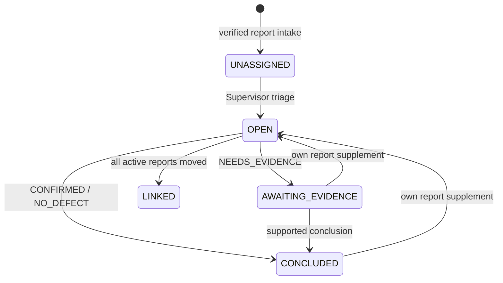

# Reporter, ReportSupplement, IncidentCase và liên kết Defect

> Baseline source: `cdeb1ca1037744d06995058af13d0582f6273c0a`, nhánh `huy-review`; BE-DOC-02, ngày 13/10/2026. `CURRENT_VERIFIED` ở đây nghĩa là đối chiếu source, không phải chứng nhận runtime. Build/tests trong phần việc này: **NOT_RUN**. Kết quả thực thi DOC-AUDIT-01/các checkpoint spec trước là **HISTORICAL**; quyết định owner có hiệu lực vẫn là **TARGET_CONFIRMED**.

Nghiệp vụ: [quyết định 32–44](../../../docs/product/confirmed-decisions.md) và [HUY-FINAL-INTEGRATION](../../../planning/development/HUY-FINAL-INTEGRATION.md), ưu tiên các mục owner clarification/activation mới nhất hơn checkpoint cũ. Audit dùng để định vị rủi ro, không thay authority: [DOC-AUDIT-01 gaps](../../../docs/audit/DOC-AUDIT-01-OPEN-GAPS.md). Mọi giao tiếp bên ngoài được mô tả là boundary; chưa xác minh FE/Android/FastAPI/deployment.

## EXPECTED_BUSINESS_BEHAVIOR — TARGET_CONFIRMED

Reporter gửi chứng cứ/miêu tả, không quyết định Defect và không tự chọn project authority. Backend giữ actor gốc, nguồn ảnh, thời điểm capture/receive và lịch sử. Case gom/tách các report mà không xóa nguồn; kết luận nội bộ và publication cho Reporter là hai quyết định khác nhau. PR33A matching trong cùng dự án, ưu tiên segment/lân cận, vị trí/sai số/lịch sử hoặc scope+ảnh khi thiếu GPS; PM có thể mở rộng trong dự án, không auto merge. PR34A PM duyệt/từ chối training label, AI không tự duyệt.

R10 phân biệt Defect đã được PM xác nhận với pre-Defect Report/Case: FIELD inspection trước Defect cần task type riêng, không tạo Defect/Survey giả. R18 case conclusion/publication tách Defect close. R19 correction/recurrence giữ lịch sử. R29 bảo vệ current rights/PII mỗi lần truy cập. Không trao quyền xem ảnh của Reporter khác từ link chung vào Case.

## CURRENT_IMPLEMENTATION và actor

`ReportsController` → `IReporterReportService`/`IReporterLifecycleService` → `ReporterReportRepository`/`ReporterLifecycleRepository`; private evidence qua `IAnhHuyProducerService` và `ReporterEvidenceService`. `CasesController` → `CaseWorkflowService` → `CaseWorkflowRepository`; `CandidatesController` → matcher/decision services → `CandidateDecisionRepository`; `DefectsController` → `DefectWorkflowService` → `DefectWorkflowRepository`. Có production HTTP anchors; module map RF nói absent là historical.

| Actor | Admission thực tế |
|---|---|
| Reporter | Create/list/read/supplement own report; own private evidence hoặc publication được chỉ định cho own report |
| Supervisor | Xem unassigned cases, triage vào project; project-scoped case read; không được dùng Supervisor để link/split/conclude/publish của PM |
| PM | Case trong current project, chọn verification method, link/split/conclude/publish, matching/decision/assessment/verification theo service |
| AI/Operator/Crew | Không tự kết luận case hoặc duyệt label; các nguồn FIELD/AI phải qua producer riêng |

[CaseWorkflowRepository.cs · GuardAsync L17](../../../RoadGuardSystem.Repositories/Implementations/Cases/CaseWorkflowRepository.cs#L17) khóa current user/role/project/membership/case và đọc lại project sau lock; PM không đọc unassigned case. `ListAsync` không có project chỉ Supervisor, query trả bucket `ProjectId == null`, không phải toàn bộ project cases. Reporter lifecycle luôn buộc role Reporter và repository owner guard. Token role tự thân không đủ.

## Preconditions và luồng chính / exact API sequence

1. Reporter dùng `POST /api/v1/reporter-evidence/uploads`, `/uploads/{uploadId}/part-urls`, upload bytes theo URL rồi `POST .../{uploadId}/complete` và `GET .../{uploadId}` đến VERIFIED. Không lấy project upload API để tạo private photo. Upload complete cần key + If-Match.
2. `POST /api/v1/reports` nhận `CreateReporterReportRequestDto(Description, Evidence)` cùng `Idempotency-Key`; mỗi evidence có FileId, FileVersion, LocationSource, CapturedAt/location optional. `ReporterIntakeRequestNormalizer` kiểm nội dung/metadata; service resolve file hai lần, trước và trong transaction, giữ nguồn owner/version/verified. Repository tạo Report, unassigned IncidentCase và active report link cùng audit trong một effect.
3. Reporter `GET /api/v1/reports?pageSize=20&cursor=...`, `GET /api/v1/reports/{reportId}` nhận own projection và ETag, không internal case notes. Supervisor `GET /api/v1/cases` đọc unassigned queue rồi `GET /api/v1/cases/{caseId}` lấy version.
4. Supervisor `POST /api/v1/cases/{caseId}/triage` với key + If-Match: chọn ProjectId, verification method, reason; geometry pins optional phải đủ route/set/version và được resolve. PM sau assignment có thể đổi verification method trong cùng project; không đổi project bằng triage PM.
5. PM `GET /api/v1/projects/{projectId}/candidates?sourceKind=...&sourceId=...` nhận versioned suggestions; `POST /api/v1/projects/{projectId}/candidate-decisions` đưa quyết định explicit, `GET .../{decisionId}` xem lại. Đây là quyết định nguồn với Defect, khác case link. PM đọc `GET /api/v1/projects/{projectId}/defects` và `/{defectId}`, ghi `POST /{defectId}/assessments` hoặc `/verification-decisions` theo điều kiện nguồn.
6. Case `POST /api/v1/cases/{caseId}/report-links` chuyển report giữa case cùng project, phải mang `SourceCaseVersions`; `POST .../report-splits` tạo case mới cho tập report selected, giữ history. Không merge bằng distance tự động.
7. PM `POST .../conclusions` chọn `CONFIRMED`, `NO_DEFECT` hoặc `NEEDS_EVIDENCE` và exact evidence/Defect IDs; confirmed cần Defect VERIFIED thực sự liên hệ report qua active candidate source head. PM `POST .../publications` chọn recipients, summary, defects và evidence; publication không phải full internal Case dump.
8. Reporter `POST /api/v1/reports/{reportId}/supplements` với key + own report If-Match; supplement là append, không rewrite original. `GET /api/v1/reports/{reportId}/evidence/{evidenceId}/download` hoặc publication-specific content endpoint kiểm own recipient/source pin.

Các command case cần key và If-Match; GET version trước khi quyết định. Controller/action đầy đủ ở appendix, không thêm route từ V2 draft.

## State machine và effects

Publication là collection append-only, không một trạng thái thay CONCLUDED. Split giữ project/method, geometry pins và lịch sử nguồn, tạo Case khác. Source Case chỉ LINKED khi không còn active reports. Domain [IncidentCase.cs · RegisterSupplement L101](../../../RoadGuardSystem.BusinessObjects/Cases/IncidentCase.cs#L101) mở lại khi supplement tới AwaitingEvidence/Concluded; không tự verify Defect.

`Report`, `ReportSupplement`, `ReportEvidence` giữ original owner/FileVersion/capture metadata; `IncidentCase`, `CaseConclusion`, `CasePublication`, `CaseReportLinkHistory` và các Huy join rows giữ active interval/history/recipient evidence. Repository kết thúc active link trước thêm replacement trong cùng transaction để thỏa uniqueness; revision/rowversion bump, audit actor/correlation/reason. Publication rows ghi từng recipient report/evidence/Defect; privacy không phụ thuộc client lọc. [CaseWorkflowRepository.cs · case "link": L122](../../../RoadGuardSystem.Repositories/Implementations/Cases/CaseWorkflowRepository.cs#L122).

## DTO, alternatives và concurrency

Request report dùng JSON unknown-member disallow; Reporter không gửi trusted project/status/uploader. Capture GPS có thể thiếu; nguồn location và accuracy được giữ, không dùng note làm verified location. `OwnReportDto` chỉ own report và published view; internal projection có active report IDs, latest conclusion, status/method/version, `UNKNOWN` progress.

Case reason bắt buộc tối đa 1000; IDs không rỗng/duplicate; routeVersion/set phải đi cặp, có GeometryVersion. If-Match decode 8 bytes rowversion; malformed request 400, missing header controller 428, stale 412, key-payload conflict 409 `idempotency_key_reused`, wrong scope/role 403, absent source 404, source-not-ready/invalid transition 409. `IdempotencyOperationService` giữ canonical stored outcome; receipt access guard đọc lại nguồn/quyền trước replay. Link kiểm cả target và source case version; không retry mù với ETag cũ. [CaseWorkflowService.cs · receiptAccessGuard L55](../../../RoadGuardSystem.Services/Implementations/Cases/CaseWorkflowService.cs#L55).

Conclusion `NEEDS_EVIDENCE` vẫn cho ghi; final FIELD/DRONE hiện trả 409 `source_not_ready`, dù enum verification method tồn tại. Existing-evidence conclusion resolve selected evidence đúng active reports; mỗi file vẫn private REPORT_PHOTO/verified/current pin. Defect confirmed phải VERIFIED + cùng project + actual source relation; ID gửi vào không tự tạo relation. Không dùng synthetic Defect để tránh gap.

## Evidence tests và gaps

Test source: `Huy01ReporterReportsApiTests`, `Huy01ReporterReceiptAccessSqlTests`, `Huy01CaseSqlTests`, `Huy01CaseDefectReadSqlTests`, `Huy01RoleAuthoritySqlTests`, `ReporterEvidenceApiTests`, `Huy01ReporterCaseDomainTests`, `ReporterIntakeRequestNormalizerTests`, `Huy01CandidateMatcherTests`, `Huy01CandidateDecisionDomainTests`, `MatchingSnapshotCanonicalTests`; appendix ghi toàn bộ trong thư mục liên quan. Phải xem assertions ownership/replay/revocation/split/conclusion/privacy/source rollback thay vì coi tên test là PASS. Tất cả **NOT_RUN** trong phần việc này.

| Gap | Bằng chứng, tác động, owner/hướng xử lý |
|---|---|
| G05 final FIELD/DRONE pre-Defect | CURRENT_VERIFIED `CaseWorkflowRepository.ApplyAsync` chặn khi outcome khác NeedsEvidence và method khác ExistingEvidence; Backend owner cần task/provenance producer riêng theo R10 |
| G03 protected-download race | Audit nêu metadata/owner check trước await storage open của `ReporterEvidenceService.DownloadAsync`; source-revalidated risk, exploit NOT_VERIFIED. Cần delayed-open revocation test rồi bounded authority recheck nếu tái hiện |
| Matching recommendation ≠ quyết định | CURRENT_VERIFIED PM command giữ source/candidate versions; không suy AI result là merge/verified/approved label |
| External privacy/UI adoption | UNKNOWN/NOT_VERIFIED; actual Reporter client phải kiểm publication recipient/download và không lộ internal DTO |

## Toàn bộ HTTP actions của controller trong workflow

`SOURCE_DERIVED_NOT_RUNTIME_VERIFIED`. Paths giữ source constraints; API version được thay1. Một action có nhiều route được ghi từng operation. Tham số/status/headers đầy đủ trong endpoint catalog chung.

| Method | Full route | Controller.Action / source |
|---|---|---|
| GET | `/api/v1/reports` | [ReportsController.List](../../../RoadGuardSystem.API/Controllers/ReportsController.cs#L23) |
| GET | `/api/v1/reports/{reportId:guid}` | [ReportsController.Read](../../../RoadGuardSystem.API/Controllers/ReportsController.cs#L33) |
| POST | `/api/v1/reports/{reportId:guid}/supplements` | [ReportsController.Supplement](../../../RoadGuardSystem.API/Controllers/ReportsController.cs#L43) |
| GET | `/api/v1/reports/{reportId:guid}/evidence/{evidenceId:guid}/download` | [ReportsController.Download](../../../RoadGuardSystem.API/Controllers/ReportsController.cs#L57) |
| POST | `/api/v1/reports` | [ReportsController.Create](../../../RoadGuardSystem.API/Controllers/ReportsController.cs#L92) |
| GET | `/api/v1/cases` | [CasesController.List](../../../RoadGuardSystem.API/Controllers/CasesController.cs#L21) |
| GET | `/api/v1/cases/{caseId:guid}` | [CasesController.Read](../../../RoadGuardSystem.API/Controllers/CasesController.cs#L42) |
| POST | `/api/v1/cases/{caseId:guid}/triage` | [CasesController.Triage](../../../RoadGuardSystem.API/Controllers/CasesController.cs#L51) |
| POST | `/api/v1/cases/{caseId:guid}/report-links` | [CasesController.Link](../../../RoadGuardSystem.API/Controllers/CasesController.cs#L63) |
| POST | `/api/v1/cases/{caseId:guid}/report-splits` | [CasesController.Split](../../../RoadGuardSystem.API/Controllers/CasesController.cs#L67) |
| POST | `/api/v1/cases/{caseId:guid}/conclusions` | [CasesController.Conclude](../../../RoadGuardSystem.API/Controllers/CasesController.cs#L71) |
| POST | `/api/v1/cases/{caseId:guid}/publications` | [CasesController.Publish](../../../RoadGuardSystem.API/Controllers/CasesController.cs#L77) |
| GET | `/api/v1/projects/{projectId:guid}/candidates` | [CandidatesController.Match](../../../RoadGuardSystem.API/Controllers/CandidatesController.cs#L22) |
| POST | `/api/v1/projects/{projectId:guid}/candidate-decisions` | [CandidatesController.Decide](../../../RoadGuardSystem.API/Controllers/CandidatesController.cs#L36) |
| GET | `/api/v1/projects/{projectId:guid}/candidate-decisions/{decisionId:guid}` | [CandidatesController.Read](../../../RoadGuardSystem.API/Controllers/CandidatesController.cs#L46) |
| GET | `/api/v1/projects/{projectId:guid}/defects` | [DefectsController.List](../../../RoadGuardSystem.API/Controllers/DefectsController.cs#L17) |
| GET | `/api/v1/projects/{projectId:guid}/defects/{defectId:guid}` | [DefectsController.Read](../../../RoadGuardSystem.API/Controllers/DefectsController.cs#L28) |
| POST | `/api/v1/projects/{projectId:guid}/defects/{defectId:guid}/assessments` | [DefectsController.Assess](../../../RoadGuardSystem.API/Controllers/DefectsController.cs#L35) |
| POST | `/api/v1/projects/{projectId:guid}/defects/{defectId:guid}/verification-decisions` | [DefectsController.Verify](../../../RoadGuardSystem.API/Controllers/DefectsController.cs#L46) |

## Inventory nguồn module — CURRENT_VERIFIED source discovery

File/symbol tại baseline; không phải execution evidence. Interface/implementation/helpers trong scope được liệt kê đầy đủ; catalog toàn Backend/schema nằm trong traceability của bộ docs.

| File / declaration line | Types và operation seams |
|---|---|
| [RoadGuardSystem.BusinessObjects/Candidates/ActiveCandidateDisposition.cs](../../../RoadGuardSystem.BusinessObjects/Candidates/ActiveCandidateDisposition.cs#L3) | `ActiveCandidateDisposition` |
| [RoadGuardSystem.BusinessObjects/Candidates/CandidateClassification.cs](../../../RoadGuardSystem.BusinessObjects/Candidates/CandidateClassification.cs#L5) | `CandidateClassification`; [Create](../../../RoadGuardSystem.BusinessObjects/Candidates/CandidateClassification.cs#L17) |
| [RoadGuardSystem.BusinessObjects/Candidates/CandidateCorrection.cs](../../../RoadGuardSystem.BusinessObjects/Candidates/CandidateCorrection.cs#L3) | `CandidateCorrection`; [Create](../../../RoadGuardSystem.BusinessObjects/Candidates/CandidateCorrection.cs#L14) |
| [RoadGuardSystem.BusinessObjects/Candidates/CandidateDecision.cs](../../../RoadGuardSystem.BusinessObjects/Candidates/CandidateDecision.cs#L3) | `CandidateDecision`; [Create](../../../RoadGuardSystem.BusinessObjects/Candidates/CandidateDecision.cs#L23) |
| [RoadGuardSystem.BusinessObjects/Candidates/CandidateDecisionKind.cs](../../../RoadGuardSystem.BusinessObjects/Candidates/CandidateDecisionKind.cs#L3) | `CandidateDecisionKind` |
| [RoadGuardSystem.BusinessObjects/Candidates/CandidateSourceFacts.cs](../../../RoadGuardSystem.BusinessObjects/Candidates/CandidateSourceFacts.cs#L3) | `CandidateSourceFacts`; [Create](../../../RoadGuardSystem.BusinessObjects/Candidates/CandidateSourceFacts.cs#L22) |
| [RoadGuardSystem.BusinessObjects/Candidates/CandidateSourceIdentity.cs](../../../RoadGuardSystem.BusinessObjects/Candidates/CandidateSourceIdentity.cs#L3) | `CandidateSourceIdentity`; [Create](../../../RoadGuardSystem.BusinessObjects/Candidates/CandidateSourceIdentity.cs#L16) |
| [RoadGuardSystem.BusinessObjects/Candidates/CandidateSourceKind.cs](../../../RoadGuardSystem.BusinessObjects/Candidates/CandidateSourceKind.cs#L3) | `CandidateSourceKind` |
| [RoadGuardSystem.BusinessObjects/Cases/CaseConclusion.cs](../../../RoadGuardSystem.BusinessObjects/Cases/CaseConclusion.cs#L3) | `CaseConclusion`; [Create](../../../RoadGuardSystem.BusinessObjects/Cases/CaseConclusion.cs#L19) |
| [RoadGuardSystem.BusinessObjects/Cases/CaseConclusionOutcome.cs](../../../RoadGuardSystem.BusinessObjects/Cases/CaseConclusionOutcome.cs#L3) | `CaseConclusionOutcome` |
| [RoadGuardSystem.BusinessObjects/Cases/CaseConclusionPrerequisites.cs](../../../RoadGuardSystem.BusinessObjects/Cases/CaseConclusionPrerequisites.cs#L3) | `CaseConclusionPrerequisites`; [Create](../../../RoadGuardSystem.BusinessObjects/Cases/CaseConclusionPrerequisites.cs#L14) |
| [RoadGuardSystem.BusinessObjects/Cases/CasePublication.cs](../../../RoadGuardSystem.BusinessObjects/Cases/CasePublication.cs#L3) | `CasePublication` |
| [RoadGuardSystem.BusinessObjects/Cases/CasePublicationPrerequisites.cs](../../../RoadGuardSystem.BusinessObjects/Cases/CasePublicationPrerequisites.cs#L3) | `CasePublicationPrerequisites`; [Create](../../../RoadGuardSystem.BusinessObjects/Cases/CasePublicationPrerequisites.cs#L20) |
| [RoadGuardSystem.BusinessObjects/Cases/CasePublicationRecipientFacts.cs](../../../RoadGuardSystem.BusinessObjects/Cases/CasePublicationRecipientFacts.cs#L3) | `CasePublicationRecipientFacts`; [Create](../../../RoadGuardSystem.BusinessObjects/Cases/CasePublicationRecipientFacts.cs#L20) |
| [RoadGuardSystem.BusinessObjects/Cases/CaseReportLinkHistory.cs](../../../RoadGuardSystem.BusinessObjects/Cases/CaseReportLinkHistory.cs#L3) | `CaseReportLinkHistory` |
| [RoadGuardSystem.BusinessObjects/Cases/CaseVerificationMethod.cs](../../../RoadGuardSystem.BusinessObjects/Cases/CaseVerificationMethod.cs#L3) | `CaseVerificationMethod` |
| [RoadGuardSystem.BusinessObjects/Cases/IncidentCase.cs](../../../RoadGuardSystem.BusinessObjects/Cases/IncidentCase.cs#L3) | `IncidentCase`, `a`; [CreateUnassigned](../../../RoadGuardSystem.BusinessObjects/Cases/IncidentCase.cs#L27); [Triage](../../../RoadGuardSystem.BusinessObjects/Cases/IncidentCase.cs#L43); [MarkAwaitingEvidence](../../../RoadGuardSystem.BusinessObjects/Cases/IncidentCase.cs#L69); [SelectVerificationMethod](../../../RoadGuardSystem.BusinessObjects/Cases/IncidentCase.cs#L81); [MaterializeLinkHistory](../../../RoadGuardSystem.BusinessObjects/Cases/IncidentCase.cs#L93); [RegisterSupplement](../../../RoadGuardSystem.BusinessObjects/Cases/IncidentCase.cs#L101); [Conclude](../../../RoadGuardSystem.BusinessObjects/Cases/IncidentCase.cs#L115); [Publish](../../../RoadGuardSystem.BusinessObjects/Cases/IncidentCase.cs#L148); [LinkReportsFrom](../../../RoadGuardSystem.BusinessObjects/Cases/IncidentCase.cs#L180); [SplitReports](../../../RoadGuardSystem.BusinessObjects/Cases/IncidentCase.cs#L212) |
| [RoadGuardSystem.BusinessObjects/Cases/IncidentCaseStatus.cs](../../../RoadGuardSystem.BusinessObjects/Cases/IncidentCaseStatus.cs#L3) | `IncidentCaseStatus` |
| [RoadGuardSystem.BusinessObjects/Reports/EvidenceCaptureMetadata.cs](../../../RoadGuardSystem.BusinessObjects/Reports/EvidenceCaptureMetadata.cs#L3) | `EvidenceCaptureMetadata`; [Create](../../../RoadGuardSystem.BusinessObjects/Reports/EvidenceCaptureMetadata.cs#L15) |
| [RoadGuardSystem.BusinessObjects/Reports/EvidenceLocationSource.cs](../../../RoadGuardSystem.BusinessObjects/Reports/EvidenceLocationSource.cs#L3) | `EvidenceLocationSource` |
| [RoadGuardSystem.BusinessObjects/Reports/EvidenceVerificationState.cs](../../../RoadGuardSystem.BusinessObjects/Reports/EvidenceVerificationState.cs#L3) | `EvidenceVerificationState` |
| [RoadGuardSystem.BusinessObjects/Reports/Report.cs](../../../RoadGuardSystem.BusinessObjects/Reports/Report.cs#L3) | `Report`; [Create](../../../RoadGuardSystem.BusinessObjects/Reports/Report.cs#L19); [AddSupplement](../../../RoadGuardSystem.BusinessObjects/Reports/Report.cs#L41) |
| [RoadGuardSystem.BusinessObjects/Reports/ReportEvidence.cs](../../../RoadGuardSystem.BusinessObjects/Reports/ReportEvidence.cs#L3) | `ReportEvidence` |
| [RoadGuardSystem.BusinessObjects/Reports/ReportSupplement.cs](../../../RoadGuardSystem.BusinessObjects/Reports/ReportSupplement.cs#L3) | `ReportSupplement` |
| [RoadGuardSystem.BusinessObjects/Reports/VerifiedEvidenceReference.cs](../../../RoadGuardSystem.BusinessObjects/Reports/VerifiedEvidenceReference.cs#L3) | `VerifiedEvidenceReference`; [Create](../../../RoadGuardSystem.BusinessObjects/Reports/VerifiedEvidenceReference.cs#L16) |
| [RoadGuardSystem.Repositories/Implementations/Cases/CaseWorkflowRepository.cs](../../../RoadGuardSystem.Repositories/Implementations/Cases/CaseWorkflowRepository.cs#L15) | `CaseWorkflowRepository`, `PageCursor`; [GuardAsync](../../../RoadGuardSystem.Repositories/Implementations/Cases/CaseWorkflowRepository.cs#L17); [ReadAsync](../../../RoadGuardSystem.Repositories/Implementations/Cases/CaseWorkflowRepository.cs#L47); [GuardCommandAsync](../../../RoadGuardSystem.Repositories/Implementations/Cases/CaseWorkflowRepository.cs#L50); [ListAsync](../../../RoadGuardSystem.Repositories/Implementations/Cases/CaseWorkflowRepository.cs#L61); [ApplyAsync](../../../RoadGuardSystem.Repositories/Implementations/Cases/CaseWorkflowRepository.cs#L85); [WireStatus](../../../RoadGuardSystem.Repositories/Implementations/Cases/CaseWorkflowRepository.cs#L268); [WireMethod](../../../RoadGuardSystem.Repositories/Implementations/Cases/CaseWorkflowRepository.cs#L269); [WireOutcome](../../../RoadGuardSystem.Repositories/Implementations/Cases/CaseWorkflowRepository.cs#L270) |
| [RoadGuardSystem.Repositories/Implementations/Defects/CandidateDecisionRepository.cs](../../../RoadGuardSystem.Repositories/Implementations/Defects/CandidateDecisionRepository.cs#L16) | `CandidateDecisionRepository`; [MatchTargetsAsync](../../../RoadGuardSystem.Repositories/Implementations/Defects/CandidateDecisionRepository.cs#L43); [LockSourceAsync](../../../RoadGuardSystem.Repositories/Implementations/Defects/CandidateDecisionRepository.cs#L73); [LockAiSourceAsync](../../../RoadGuardSystem.Repositories/Implementations/Defects/CandidateDecisionRepository.cs#L96); [SaveRejectAsync](../../../RoadGuardSystem.Repositories/Implementations/Defects/CandidateDecisionRepository.cs#L111); [SaveAcceptedAsync](../../../RoadGuardSystem.Repositories/Implementations/Defects/CandidateDecisionRepository.cs#L134); [ReadAsync](../../../RoadGuardSystem.Repositories/Implementations/Defects/CandidateDecisionRepository.cs#L221) |
| [RoadGuardSystem.Repositories/Implementations/Defects/DefectWorkflowRepository.cs](../../../RoadGuardSystem.Repositories/Implementations/Defects/DefectWorkflowRepository.cs#L14) | `DefectWorkflowRepository`; [ReadAsync](../../../RoadGuardSystem.Repositories/Implementations/Defects/DefectWorkflowRepository.cs#L16); [ListAsync](../../../RoadGuardSystem.Repositories/Implementations/Defects/DefectWorkflowRepository.cs#L29); [LinkedReportsAsync](../../../RoadGuardSystem.Repositories/Implementations/Defects/DefectWorkflowRepository.cs#L57); [LockTargetAsync](../../../RoadGuardSystem.Repositories/Implementations/Defects/DefectWorkflowRepository.cs#L65); [ApplyAssessmentAsync](../../../RoadGuardSystem.Repositories/Implementations/Defects/DefectWorkflowRepository.cs#L73); [ApplyVerificationAsync](../../../RoadGuardSystem.Repositories/Implementations/Defects/DefectWorkflowRepository.cs#L90); [ApplyFieldVerificationAsync](../../../RoadGuardSystem.Repositories/Implementations/Defects/DefectWorkflowRepository.cs#L105) |
| [RoadGuardSystem.Repositories/Implementations/Defects/DetectionReviewPersistenceRequest.cs](../../../RoadGuardSystem.Repositories/Implementations/Defects/DetectionReviewPersistenceRequest.cs#L7) | `DetectionReviewPersistenceRequest` |
| [RoadGuardSystem.Repositories/Implementations/Defects/DetectionReviewPersistenceResult.cs](../../../RoadGuardSystem.Repositories/Implementations/Defects/DetectionReviewPersistenceResult.cs#L3) | `DetectionReviewPersistenceResult` |
| [RoadGuardSystem.Repositories/Implementations/Defects/DetectionReviewPersistenceService.cs](../../../RoadGuardSystem.Repositories/Implementations/Defects/DetectionReviewPersistenceService.cs#L11) | `DetectionReviewPersistenceService`, `PersistenceOutcome`; [PersistAsync](../../../RoadGuardSystem.Repositories/Implementations/Defects/DetectionReviewPersistenceService.cs#L29) |
| [RoadGuardSystem.Repositories/Implementations/Defects/DetectionReviewPersistenceStatus.cs](../../../RoadGuardSystem.Repositories/Implementations/Defects/DetectionReviewPersistenceStatus.cs#L3) | `DetectionReviewPersistenceStatus` |
| [RoadGuardSystem.Repositories/Implementations/Reports/ReporterLifecycleRepository.cs](../../../RoadGuardSystem.Repositories/Implementations/Reports/ReporterLifecycleRepository.cs#L13) | `ReporterLifecycleException`, `ReporterLifecycleRepository`, `PageCursor`; [ReadAsync](../../../RoadGuardSystem.Repositories/Implementations/Reports/ReporterLifecycleRepository.cs#L21); [ListAsync](../../../RoadGuardSystem.Repositories/Implementations/Reports/ReporterLifecycleRepository.cs#L24); [GuardAsync](../../../RoadGuardSystem.Repositories/Implementations/Reports/ReporterLifecycleRepository.cs#L46); [SupplementAsync](../../../RoadGuardSystem.Repositories/Implementations/Reports/ReporterLifecycleRepository.cs#L55); [ResolveDownloadAsync](../../../RoadGuardSystem.Repositories/Implementations/Reports/ReporterLifecycleRepository.cs#L83) |
| [RoadGuardSystem.Repositories/Implementations/Reports/ReporterReportRepository.cs](../../../RoadGuardSystem.Repositories/Implementations/Reports/ReporterReportRepository.cs#L13) | `ReporterReportRepository`; [CreateAndSaveAsync](../../../RoadGuardSystem.Repositories/Implementations/Reports/ReporterReportRepository.cs#L15); [EnsureCurrentReceiptAccessAsync](../../../RoadGuardSystem.Repositories/Implementations/Reports/ReporterReportRepository.cs#L44) |
| [RoadGuardSystem.Repositories/Interfaces/Cases/ICaseWorkflowRepository.cs](../../../RoadGuardSystem.Repositories/Interfaces/Cases/ICaseWorkflowRepository.cs#L7) | `CaseWorkflowException`, `CaseCommand`, `CaseWriteResult`, `ICaseWorkflowRepository`; [GuardAsync](../../../RoadGuardSystem.Repositories/Interfaces/Cases/ICaseWorkflowRepository.cs#L20); [GuardCommandAsync](../../../RoadGuardSystem.Repositories/Interfaces/Cases/ICaseWorkflowRepository.cs#L22); [ReadAsync](../../../RoadGuardSystem.Repositories/Interfaces/Cases/ICaseWorkflowRepository.cs#L24); [ListAsync](../../../RoadGuardSystem.Repositories/Interfaces/Cases/ICaseWorkflowRepository.cs#L25); [ApplyAsync](../../../RoadGuardSystem.Repositories/Interfaces/Cases/ICaseWorkflowRepository.cs#L27) |
| [RoadGuardSystem.Repositories/Interfaces/Defects/ICandidateDecisionRepository.cs](../../../RoadGuardSystem.Repositories/Interfaces/Defects/ICandidateDecisionRepository.cs#L6) | `CandidateTargetMatchFact`, `ICandidateDecisionRepository`; [MatchTargetsAsync](../../../RoadGuardSystem.Repositories/Interfaces/Defects/ICandidateDecisionRepository.cs#L13); [LockSourceAsync](../../../RoadGuardSystem.Repositories/Interfaces/Defects/ICandidateDecisionRepository.cs#L14); [LockAiSourceAsync](../../../RoadGuardSystem.Repositories/Interfaces/Defects/ICandidateDecisionRepository.cs#L15); [SaveRejectAsync](../../../RoadGuardSystem.Repositories/Interfaces/Defects/ICandidateDecisionRepository.cs#L16); [SaveAcceptedAsync](../../../RoadGuardSystem.Repositories/Interfaces/Defects/ICandidateDecisionRepository.cs#L18); [ReadAsync](../../../RoadGuardSystem.Repositories/Interfaces/Defects/ICandidateDecisionRepository.cs#L21) |
| [RoadGuardSystem.Repositories/Interfaces/Defects/IDefectWorkflowRepository.cs](../../../RoadGuardSystem.Repositories/Interfaces/Defects/IDefectWorkflowRepository.cs#L7) | `IDefectWorkflowRepository`; [ApplyFieldVerificationAsync](../../../RoadGuardSystem.Repositories/Interfaces/Defects/IDefectWorkflowRepository.cs#L9); [ReadAsync](../../../RoadGuardSystem.Repositories/Interfaces/Defects/IDefectWorkflowRepository.cs#L13); [ListAsync](../../../RoadGuardSystem.Repositories/Interfaces/Defects/IDefectWorkflowRepository.cs#L15); [LinkedReportsAsync](../../../RoadGuardSystem.Repositories/Interfaces/Defects/IDefectWorkflowRepository.cs#L18); [LockTargetAsync](../../../RoadGuardSystem.Repositories/Interfaces/Defects/IDefectWorkflowRepository.cs#L19); [ApplyAssessmentAsync](../../../RoadGuardSystem.Repositories/Interfaces/Defects/IDefectWorkflowRepository.cs#L20); [ApplyVerificationAsync](../../../RoadGuardSystem.Repositories/Interfaces/Defects/IDefectWorkflowRepository.cs#L23) |
| [RoadGuardSystem.Repositories/Interfaces/Defects/IDetectionReviewRepository.cs](../../../RoadGuardSystem.Repositories/Interfaces/Defects/IDetectionReviewRepository.cs#L5) | `IDetectionReviewRepository`; [PersistAsync](../../../RoadGuardSystem.Repositories/Interfaces/Defects/IDetectionReviewRepository.cs#L7) |
| [RoadGuardSystem.Repositories/Interfaces/Reports/IReporterLifecycleRepository.cs](../../../RoadGuardSystem.Repositories/Interfaces/Reports/IReporterLifecycleRepository.cs#L6) | `IReporterLifecycleRepository`; [ReadAsync](../../../RoadGuardSystem.Repositories/Interfaces/Reports/IReporterLifecycleRepository.cs#L8); [ListAsync](../../../RoadGuardSystem.Repositories/Interfaces/Reports/IReporterLifecycleRepository.cs#L9); [GuardAsync](../../../RoadGuardSystem.Repositories/Interfaces/Reports/IReporterLifecycleRepository.cs#L10); [SupplementAsync](../../../RoadGuardSystem.Repositories/Interfaces/Reports/IReporterLifecycleRepository.cs#L11); [ResolveDownloadAsync](../../../RoadGuardSystem.Repositories/Interfaces/Reports/IReporterLifecycleRepository.cs#L13) |
| [RoadGuardSystem.Repositories/Interfaces/Reports/IReporterReportRepository.cs](../../../RoadGuardSystem.Repositories/Interfaces/Reports/IReporterReportRepository.cs#L5) | `ReporterReportWriteResult`, `ReporterIntakeFactsStatus`, `ReporterIntakeFactsException`, `IReporterReportRepository`; [EnsureCurrentReceiptAccessAsync](../../../RoadGuardSystem.Repositories/Interfaces/Reports/IReporterReportRepository.cs#L11); [CreateAndSaveAsync](../../../RoadGuardSystem.Repositories/Interfaces/Reports/IReporterReportRepository.cs#L13) |
| [RoadGuardSystem.Services/Implementations/Cases/CaseWorkflowService.cs](../../../RoadGuardSystem.Services/Implementations/Cases/CaseWorkflowService.cs#L14) | `CaseWorkflowService`; [ReadAsync](../../../RoadGuardSystem.Services/Implementations/Cases/CaseWorkflowService.cs#L17); [ListAsync](../../../RoadGuardSystem.Services/Implementations/Cases/CaseWorkflowService.cs#L19); [CommandAsync](../../../RoadGuardSystem.Services/Implementations/Cases/CaseWorkflowService.cs#L23); [ProjectAccess](../../../RoadGuardSystem.Services/Implementations/Cases/CaseWorkflowService.cs#L43); [AuthorizeAsync](../../../RoadGuardSystem.Services/Implementations/Cases/CaseWorkflowService.cs#L44) |
| [RoadGuardSystem.Services/Implementations/Defects/CandidateDecisionService.cs](../../../RoadGuardSystem.Services/Implementations/Defects/CandidateDecisionService.cs#L16) | `CandidateDecisionService`, `DecisionSource`; [ReadAsync](../../../RoadGuardSystem.Services/Implementations/Defects/CandidateDecisionService.cs#L21); [DecideAsync](../../../RoadGuardSystem.Services/Implementations/Defects/CandidateDecisionService.cs#L30); [Guard](../../../RoadGuardSystem.Services/Implementations/Defects/CandidateDecisionService.cs#L62) |
| [RoadGuardSystem.Services/Implementations/Defects/CandidateMatchingService.cs](../../../RoadGuardSystem.Services/Implementations/Defects/CandidateMatchingService.cs#L14) | `CandidateMatchingService`, `Cursor`; [MatchAsync](../../../RoadGuardSystem.Services/Implementations/Defects/CandidateMatchingService.cs#L22) |
| [RoadGuardSystem.Services/Implementations/Defects/DefectWorkflowService.cs](../../../RoadGuardSystem.Services/Implementations/Defects/DefectWorkflowService.cs#L16) | `DefectWorkflowService`; [ReadAsync](../../../RoadGuardSystem.Services/Implementations/Defects/DefectWorkflowService.cs#L21); [ListAsync](../../../RoadGuardSystem.Services/Implementations/Defects/DefectWorkflowService.cs#L30); [AssessAsync](../../../RoadGuardSystem.Services/Implementations/Defects/DefectWorkflowService.cs#L60); [Guard](../../../RoadGuardSystem.Services/Implementations/Defects/DefectWorkflowService.cs#L78); [VerifyAsync](../../../RoadGuardSystem.Services/Implementations/Defects/DefectWorkflowService.cs#L100); [Guard](../../../RoadGuardSystem.Services/Implementations/Defects/DefectWorkflowService.cs#L125) |
| [RoadGuardSystem.Services/Implementations/Defects/MatchingCandidateSnapshotReader.cs](../../../RoadGuardSystem.Services/Implementations/Defects/MatchingCandidateSnapshotReader.cs#L11) | `MatchingCandidateSnapshotReader`; [CaptureAsync](../../../RoadGuardSystem.Services/Implementations/Defects/MatchingCandidateSnapshotReader.cs#L16); [SerializeCanonical](../../../RoadGuardSystem.Services/Implementations/Defects/MatchingCandidateSnapshotReader.cs#L73) |
| [RoadGuardSystem.Services/Implementations/Reports/ReporterLifecycleService.cs](../../../RoadGuardSystem.Services/Implementations/Reports/ReporterLifecycleService.cs#L15) | `ReporterLifecycleService`; [ReadAsync](../../../RoadGuardSystem.Services/Implementations/Reports/ReporterLifecycleService.cs#L18); [ListAsync](../../../RoadGuardSystem.Services/Implementations/Reports/ReporterLifecycleService.cs#L21); [SupplementAsync](../../../RoadGuardSystem.Services/Implementations/Reports/ReporterLifecycleService.cs#L26); [DownloadAsync](../../../RoadGuardSystem.Services/Implementations/Reports/ReporterLifecycleService.cs#L47) |
| [RoadGuardSystem.Services/Implementations/Reports/ReporterReportService.cs](../../../RoadGuardSystem.Services/Implementations/Reports/ReporterReportService.cs#L12) | `ReporterReportService`, `ReporterReportSourceException`; [CreateAsync](../../../RoadGuardSystem.Services/Implementations/Reports/ReporterReportService.cs#L15) |
| [RoadGuardSystem.Services/Interfaces/Candidates/CandidateMatcher.cs](../../../RoadGuardSystem.Services/Interfaces/Candidates/CandidateMatcher.cs#L5) | `CandidateMatchFact`, `CandidateMatchItem`, `CandidateMatcher`; [Match](../../../RoadGuardSystem.Services/Interfaces/Candidates/CandidateMatcher.cs#L11) |
| [RoadGuardSystem.Services/Interfaces/Candidates/ICandidateMatchingService.cs](../../../RoadGuardSystem.Services/Interfaces/Candidates/ICandidateMatchingService.cs#L6) | `ICandidateMatchingService`; [MatchAsync](../../../RoadGuardSystem.Services/Interfaces/Candidates/ICandidateMatchingService.cs#L8) |
| [RoadGuardSystem.Services/Interfaces/Cases/ICaseWorkflowService.cs](../../../RoadGuardSystem.Services/Interfaces/Cases/ICaseWorkflowService.cs#L8) | `CaseWorkflowResult`, `ICaseWorkflowService`; [ReadAsync](../../../RoadGuardSystem.Services/Interfaces/Cases/ICaseWorkflowService.cs#L12); [ListAsync](../../../RoadGuardSystem.Services/Interfaces/Cases/ICaseWorkflowService.cs#L13); [CommandAsync](../../../RoadGuardSystem.Services/Interfaces/Cases/ICaseWorkflowService.cs#L14) |
| [RoadGuardSystem.Services/Interfaces/Defects/ICandidateDecisionService.cs](../../../RoadGuardSystem.Services/Interfaces/Defects/ICandidateDecisionService.cs#L6) | `CandidateDecisionResult`, `ICandidateDecisionService`; [DecideAsync](../../../RoadGuardSystem.Services/Interfaces/Defects/ICandidateDecisionService.cs#L10); [ReadAsync](../../../RoadGuardSystem.Services/Interfaces/Defects/ICandidateDecisionService.cs#L11) |
| [RoadGuardSystem.Services/Interfaces/Defects/IDefectWorkflowService.cs](../../../RoadGuardSystem.Services/Interfaces/Defects/IDefectWorkflowService.cs#L6) | `IDefectWorkflowService`; [ReadAsync](../../../RoadGuardSystem.Services/Interfaces/Defects/IDefectWorkflowService.cs#L8); [ListAsync](../../../RoadGuardSystem.Services/Interfaces/Defects/IDefectWorkflowService.cs#L10); [AssessAsync](../../../RoadGuardSystem.Services/Interfaces/Defects/IDefectWorkflowService.cs#L13); [VerifyAsync](../../../RoadGuardSystem.Services/Interfaces/Defects/IDefectWorkflowService.cs#L16) |
| [RoadGuardSystem.Services/Interfaces/Reports/Huy01CommandExecution.cs](../../../RoadGuardSystem.Services/Interfaces/Reports/Huy01CommandExecution.cs#L5) | `Huy01CommandExecution` |
| [RoadGuardSystem.Services/Interfaces/Reports/IReporterLifecycleService.cs](../../../RoadGuardSystem.Services/Interfaces/Reports/IReporterLifecycleService.cs#L7) | `ReporterLifecycleResult`, `IReporterLifecycleService`; [ReadAsync](../../../RoadGuardSystem.Services/Interfaces/Reports/IReporterLifecycleService.cs#L11); [ListAsync](../../../RoadGuardSystem.Services/Interfaces/Reports/IReporterLifecycleService.cs#L12); [SupplementAsync](../../../RoadGuardSystem.Services/Interfaces/Reports/IReporterLifecycleService.cs#L13); [DownloadAsync](../../../RoadGuardSystem.Services/Interfaces/Reports/IReporterLifecycleService.cs#L15) |
| [RoadGuardSystem.Services/Interfaces/Reports/IReporterReportService.cs](../../../RoadGuardSystem.Services/Interfaces/Reports/IReporterReportService.cs#L6) | `ReporterReportCommandStatus`, `ReporterReportCommandResult`, `IReporterReportService`; [CreateAsync](../../../RoadGuardSystem.Services/Interfaces/Reports/IReporterReportService.cs#L13) |
| [RoadGuardSystem.Services/Interfaces/Reports/ReporterIntakeRequestNormalizer.cs](../../../RoadGuardSystem.Services/Interfaces/Reports/ReporterIntakeRequestNormalizer.cs#L9) | `NormalizedReporterEvidence`, `NormalizedReporterIntake`, `ReporterIntakeRequestNormalizer`; [TryNormalize](../../../RoadGuardSystem.Services/Interfaces/Reports/ReporterIntakeRequestNormalizer.cs#L15); [Fingerprint](../../../RoadGuardSystem.Services/Interfaces/Reports/ReporterIntakeRequestNormalizer.cs#L59) |

## DTO source inventory

Nullable/default/validation phụ thuộc declarations và service guards; catalog chung giữ field-level schema. Persistence facts không tự là public wire.

| DTO file | Public declarations |
|---|---|
| [RoadGuardSystem.DTOs/Cases/CaseWorkflowDtos.cs](../../../RoadGuardSystem.DTOs/Cases/CaseWorkflowDtos.cs#L1) | [CaseTriageDto](../../../RoadGuardSystem.DTOs/Cases/CaseWorkflowDtos.cs#L6), [CaseLinkDto](../../../RoadGuardSystem.DTOs/Cases/CaseWorkflowDtos.cs#L9), [CaseSplitDto](../../../RoadGuardSystem.DTOs/Cases/CaseWorkflowDtos.cs#L11), [CaseConclusionDto](../../../RoadGuardSystem.DTOs/Cases/CaseWorkflowDtos.cs#L13), [CasePublicationDto](../../../RoadGuardSystem.DTOs/Cases/CaseWorkflowDtos.cs#L15), [InternalCaseDto](../../../RoadGuardSystem.DTOs/Cases/CaseWorkflowDtos.cs#L16), [CaseConclusionViewDto](../../../RoadGuardSystem.DTOs/Cases/CaseWorkflowDtos.cs#L27), [CasePublicationResponseDto](../../../RoadGuardSystem.DTOs/Cases/CaseWorkflowDtos.cs#L37), [CasePageDto](../../../RoadGuardSystem.DTOs/Cases/CaseWorkflowDtos.cs#L46) |
| [RoadGuardSystem.DTOs/Defects/CandidateDecisionDtos.cs](../../../RoadGuardSystem.DTOs/Defects/CandidateDecisionDtos.cs#L1) | [CandidateClassificationDto](../../../RoadGuardSystem.DTOs/Defects/CandidateDecisionDtos.cs#L6), [CandidateDecisionRequestDto](../../../RoadGuardSystem.DTOs/Defects/CandidateDecisionDtos.cs#L9), [CandidateRecurrenceDto](../../../RoadGuardSystem.DTOs/Defects/CandidateDecisionDtos.cs#L13), [CandidateDecisionResponseDto](../../../RoadGuardSystem.DTOs/Defects/CandidateDecisionDtos.cs#L14) |
| [RoadGuardSystem.DTOs/Defects/CandidateMatchDtos.cs](../../../RoadGuardSystem.DTOs/Defects/CandidateMatchDtos.cs#L1) | [CandidateMatchSourceDto](../../../RoadGuardSystem.DTOs/Defects/CandidateMatchDtos.cs#L3), [CandidateMatchHistoryDto](../../../RoadGuardSystem.DTOs/Defects/CandidateMatchDtos.cs#L4), [CandidateMatchItemDto](../../../RoadGuardSystem.DTOs/Defects/CandidateMatchDtos.cs#L5), [CandidateMatchPageDto](../../../RoadGuardSystem.DTOs/Defects/CandidateMatchDtos.cs#L9), [CandidateMatchResult](../../../RoadGuardSystem.DTOs/Defects/CandidateMatchDtos.cs#L11) |
| [RoadGuardSystem.DTOs/Defects/DefectWorkflowDtos.cs](../../../RoadGuardSystem.DTOs/Defects/DefectWorkflowDtos.cs#L1) | [DefectAssessmentRequestDto](../../../RoadGuardSystem.DTOs/Defects/DefectWorkflowDtos.cs#L6), [DefectVerificationRequestDto](../../../RoadGuardSystem.DTOs/Defects/DefectWorkflowDtos.cs#L10), [DefectGeometryDto](../../../RoadGuardSystem.DTOs/Defects/DefectWorkflowDtos.cs#L13), [DefectViewDto](../../../RoadGuardSystem.DTOs/Defects/DefectWorkflowDtos.cs#L22), [DefectPageDto](../../../RoadGuardSystem.DTOs/Defects/DefectWorkflowDtos.cs#L33), [DefectWorkflowResult](../../../RoadGuardSystem.DTOs/Defects/DefectWorkflowDtos.cs#L42) |
| [RoadGuardSystem.DTOs/Reports/OwnReportDtos.cs](../../../RoadGuardSystem.DTOs/Reports/OwnReportDtos.cs#L1) | [OwnReportEvidenceDto](../../../RoadGuardSystem.DTOs/Reports/OwnReportDtos.cs#L3), [OwnReportSupplementDto](../../../RoadGuardSystem.DTOs/Reports/OwnReportDtos.cs#L13), [OwnReportUpdateDto](../../../RoadGuardSystem.DTOs/Reports/OwnReportDtos.cs#L22), [OwnReportDto](../../../RoadGuardSystem.DTOs/Reports/OwnReportDtos.cs#L31), [OwnReportPageDto](../../../RoadGuardSystem.DTOs/Reports/OwnReportDtos.cs#L42) |
| [RoadGuardSystem.DTOs/Reports/ReporterReportDtos.cs](../../../RoadGuardSystem.DTOs/Reports/ReporterReportDtos.cs#L1) | [ReportEvidenceLocationDto](../../../RoadGuardSystem.DTOs/Reports/ReporterReportDtos.cs#L6), [ReportEvidenceInputDto](../../../RoadGuardSystem.DTOs/Reports/ReporterReportDtos.cs#L17), [CreateReporterReportRequestDto](../../../RoadGuardSystem.DTOs/Reports/ReporterReportDtos.cs#L21), [ReporterReportResponseDto](../../../RoadGuardSystem.DTOs/Reports/ReporterReportDtos.cs#L23) |

## Test-source inventory — NOT_RUN

Không gán PASS từ tên test. Theory có nhiều cases; fixtures/helpers không phải executed tests. Đọc assertions để phân biệt HTTP, mock, SQL và nguồn thực.

| Test source | Declared methods (Fact/Theory) |
|---|---|
| [tests/RoadGuardSystem.ApiTests/Cases/Huy01CaseSqlTests.cs](../../../tests/RoadGuardSystem.ApiTests/Cases/Huy01CaseSqlTests.cs#L1) | [ConclusionReplay_AuthorityChangedAfterRealPreflight_DeniesReceiptWithoutWrites](../../../tests/RoadGuardSystem.ApiTests/Cases/Huy01CaseSqlTests.cs#L32); [Conclusion_WithoutFieldDroneCompletionProvenance_IsNotReady](../../../tests/RoadGuardSystem.ApiTests/Cases/Huy01CaseSqlTests.cs#L68); [ConcurrentParentVersion_SameKeyReplays_DifferentKeysHaveOneWinner](../../../tests/RoadGuardSystem.ApiTests/Cases/Huy01CaseSqlTests.cs#L82); [CaseMutation_PrecommitRollsBack_PostcommitRecoversExactly](../../../tests/RoadGuardSystem.ApiTests/Cases/Huy01CaseSqlTests.cs#L104); [LinkSplit_KeepSnapshotRelationalHistoryAndOneActiveLink_InOneTransaction](../../../tests/RoadGuardSystem.ApiTests/Cases/Huy01CaseSqlTests.cs#L155); [Link_InvalidVersionOrFailureAfterClosingLinks_RollsBackAllCasesHistoryAndReceipt](../../../tests/RoadGuardSystem.ApiTests/Cases/Huy01CaseSqlTests.cs#L189); [Publication_TwoRecipientsCannotReceiveEachOthersPrivateEvidence_AndSupplementKeepsSnapshot](../../../tests/RoadGuardSystem.ApiTests/Cases/Huy01CaseSqlTests.cs#L215) |
| [tests/RoadGuardSystem.ApiTests/Defects/Rf1006ReporterDefectCharacterizationTests.cs](../../../tests/RoadGuardSystem.ApiTests/Defects/Rf1006ReporterDefectCharacterizationTests.cs#L1) | [ProcessingJobRead_CurrentRolesProjectionAndDurableEffects](../../../tests/RoadGuardSystem.ApiTests/Defects/Rf1006ReporterDefectCharacterizationTests.cs#L25) |
| [tests/RoadGuardSystem.ApiTests/Files/ReporterEvidenceApiTests.cs](../../../tests/RoadGuardSystem.ApiTests/Files/ReporterEvidenceApiTests.cs#L1) | [PrivateIntake_OwnerOnly_Replay_CurrentAuthority_AndVerification](../../../tests/RoadGuardSystem.ApiTests/Files/ReporterEvidenceApiTests.cs#L26); [AdmissionLimits_AndNoClientScope](../../../tests/RoadGuardSystem.ApiTests/Files/ReporterEvidenceApiTests.cs#L107); [ProjectRoles_CannotReachPrivateScopeThroughEitherRoute](../../../tests/RoadGuardSystem.ApiTests/Files/ReporterEvidenceApiTests.cs#L124); [PublicationDownload_IsRecipientScoped_AndTriageDoesNotPublicizeFile](../../../tests/RoadGuardSystem.ApiTests/Files/ReporterEvidenceApiTests.cs#L141) |
| [tests/RoadGuardSystem.ApiTests/Reports/Huy01CaseDefectReadSqlTests.cs](../../../tests/RoadGuardSystem.ApiTests/Reports/Huy01CaseDefectReadSqlTests.cs#L1) | [Capture_UsesPersistedVersionsAndConclusionsAndFailsClosedAfterRoleRevocation](../../../tests/RoadGuardSystem.ApiTests/Reports/Huy01CaseDefectReadSqlTests.cs#L20) |
| [tests/RoadGuardSystem.ApiTests/Reports/Huy01ReporterReceiptAccessSqlTests.cs](../../../tests/RoadGuardSystem.ApiTests/Reports/Huy01ReporterReceiptAccessSqlTests.cs#L1) | [OrdinaryReplay_AndChangedPayloadConflict_KeepOneScopedIntakeGraph](../../../tests/RoadGuardSystem.ApiTests/Reports/Huy01ReporterReceiptAccessSqlTests.cs#L29); [InactiveReporterRole_DeniesNewIntakeWithoutDurableEffects](../../../tests/RoadGuardSystem.ApiTests/Reports/Huy01ReporterReceiptAccessSqlTests.cs#L49); [InactiveReporterRoleAfterPreflight_DeniesReceiptAndConflict](../../../tests/RoadGuardSystem.ApiTests/Reports/Huy01ReporterReceiptAccessSqlTests.cs#L70); [Replay_ActorAuthorityChangedAfterRealPreflight_DeniesStoredReceiptWithoutNewEffects](../../../tests/RoadGuardSystem.ApiTests/Reports/Huy01ReporterReceiptAccessSqlTests.cs#L93); [Replay_EvidenceFactsChangedAfterRealPreflight_DeniesStoredReceiptWithoutNewEffects](../../../tests/RoadGuardSystem.ApiTests/Reports/Huy01ReporterReceiptAccessSqlTests.cs#L112); [Create_WithWrongOwnerOrNonPrivateScope_UsesRealProducerAndReturnsPrivacySafeNotFound](../../../tests/RoadGuardSystem.ApiTests/Reports/Huy01ReporterReceiptAccessSqlTests.cs#L132); [Replay_GuardCancellationAfterRealPreflight_DoesNotReturnProtectedReceipt](../../../tests/RoadGuardSystem.ApiTests/Reports/Huy01ReporterReceiptAccessSqlTests.cs#L153); [Replay_DelegateGuardFailureAfterCurrentValidation_DoesNotReturnReceiptOrRunCreate](../../../tests/RoadGuardSystem.ApiTests/Reports/Huy01ReporterReceiptAccessSqlTests.cs#L171); [ExecutionStrategyRetry_FindsReporterReceiptWithoutRunningCreateAgain](../../../tests/RoadGuardSystem.ApiTests/Reports/Huy01ReporterReceiptAccessSqlTests.cs#L189); [ExecutionStrategyRetry_AuthorityRevokedAfterRealPreflight_DeniesRetryReceiptPath](../../../tests/RoadGuardSystem.ApiTests/Reports/Huy01ReporterReceiptAccessSqlTests.cs#L210); [ExecutionStrategyRetry_AfterRolledBackCreateAttempt_GuardsCompetingDurableReceipt](../../../tests/RoadGuardSystem.ApiTests/Reports/Huy01ReporterReceiptAccessSqlTests.cs#L232); [DuplicateKeyRecovery_UsesTwoReporterHandlerAttemptsButPersistsOneIntakeGraph](../../../tests/RoadGuardSystem.ApiTests/Reports/Huy01ReporterReceiptAccessSqlTests.cs#L283); [DuplicateKeyRecovery_GuardsAndDeniesWhenAuthorityIsRevokedAfterLosingRollback](../../../tests/RoadGuardSystem.ApiTests/Reports/Huy01ReporterReceiptAccessSqlTests.cs#L311); [PostCommitAcknowledgementRecovery_ReplaysDurableReporterReceiptWithoutSecondHandler](../../../tests/RoadGuardSystem.ApiTests/Reports/Huy01ReporterReceiptAccessSqlTests.cs#L354); [PostCommitAcknowledgementRecovery_AuthorityRevokedBeforeDurableLookup_DeniesReceipt](../../../tests/RoadGuardSystem.ApiTests/Reports/Huy01ReporterReceiptAccessSqlTests.cs#L374); [PostCommitAcknowledgementRecovery_InactiveRoleBeforeDurableLookup_DeniesReceipt](../../../tests/RoadGuardSystem.ApiTests/Reports/Huy01ReporterReceiptAccessSqlTests.cs#L395); [PreCommitFailure_RollsBackEveryReporterGraphAttempt](../../../tests/RoadGuardSystem.ApiTests/Reports/Huy01ReporterReceiptAccessSqlTests.cs#L420) |
| [tests/RoadGuardSystem.ApiTests/Reports/Huy01ReporterReportsApiTests.cs](../../../tests/RoadGuardSystem.ApiTests/Reports/Huy01ReporterReportsApiTests.cs#L1) | [ActualOperationalClosureKeepsProductionReportIntakeAndSupervisorTriageAvailable](../../../tests/RoadGuardSystem.ApiTests/Reports/Huy01ReporterReportsApiTests.cs#L41); [ProductionRoot_BindsReporterCaseAndCandidateServicesOnce](../../../tests/RoadGuardSystem.ApiTests/Reports/Huy01ReporterReportsApiTests.cs#L92); [ProductionIntake_InactiveRoleAfterPreflight_DeniesReceiptBeforeReplayOrConflict](../../../tests/RoadGuardSystem.ApiTests/Reports/Huy01ReporterReportsApiTests.cs#L138); [ProductionCaseReporterAndCandidateRoutes_AreBound](../../../tests/RoadGuardSystem.ApiTests/Reports/Huy01ReporterReportsApiTests.cs#L208); [Candidate_ReportRejectCorrectionKeepNewAndLinkExisting_UseRealGeometrySourceAndHead](../../../tests/RoadGuardSystem.ApiTests/Reports/Huy01ReporterReportsApiTests.cs#L224); [ManualReportLabel_ApprovalAndRevision_KeepCurrentEligibilitySeparateFromHistory](../../../tests/RoadGuardSystem.ApiTests/Reports/Huy01ReporterReportsApiTests.cs#L646); [Case_TriageLinkSplitConclusionPublication_KeepVersionsHistoryAndRecipientPrivacy](../../../tests/RoadGuardSystem.ApiTests/Reports/Huy01ReporterReportsApiTests.cs#L1163); [Case_LinkSplitAndPublication_KeepRecipientEvidencePrivateAcrossReporters](../../../tests/RoadGuardSystem.ApiTests/Reports/Huy01ReporterReportsApiTests.cs#L1234); [OwnReport_ReadSupplementReplayPrivacyAndDownload_UseRealSqlGraph](../../../tests/RoadGuardSystem.ApiTests/Reports/Huy01ReporterReportsApiTests.cs#L1390); [CreateReport_LocationMissingCoordinates_ReturnsFieldValidationProblem](../../../tests/RoadGuardSystem.ApiTests/Reports/Huy01ReporterReportsApiTests.cs#L1513); [CreateReport_ExplicitZeroCoordinates_ReplaysWithNormalizedKeyAndExactOutcome](../../../tests/RoadGuardSystem.ApiTests/Reports/Huy01ReporterReportsApiTests.cs#L1549); [CreateReport_InvalidIdempotencyKey_ReturnsHeaderFieldValidationProblem](../../../tests/RoadGuardSystem.ApiTests/Reports/Huy01ReporterReportsApiTests.cs#L1583); [CreateReport_WithVerifiedOwnedEvidence_CreatesOneIntakeCase_AndReplaysExactly](../../../tests/RoadGuardSystem.ApiTests/Reports/Huy01ReporterReportsApiTests.cs#L1608) |
| [tests/RoadGuardSystem.ApiTests/Reports/Huy01RetentionInventorySqlTests.cs](../../../tests/RoadGuardSystem.ApiTests/Reports/Huy01RetentionInventorySqlTests.cs#L1) | [ConclusionEvidencePreservesProjectObligationButIncompleteSchemaNeverClaimsFullInventory](../../../tests/RoadGuardSystem.ApiTests/Reports/Huy01RetentionInventorySqlTests.cs#L17) |
| [tests/RoadGuardSystem.ApiTests/Reports/Huy01RoleAuthoritySqlTests.cs](../../../tests/RoadGuardSystem.ApiTests/Reports/Huy01RoleAuthoritySqlTests.cs#L1) | [InactiveProjectManagerRoleDeniesCaseGuardBeforeResourceRead](../../../tests/RoadGuardSystem.ApiTests/Reports/Huy01RoleAuthoritySqlTests.cs#L13) |
| [tests/RoadGuardSystem.UnitTests/Candidates/Huy01CandidateDecisionDomainTests.cs](../../../tests/RoadGuardSystem.UnitTests/Candidates/Huy01CandidateDecisionDomainTests.cs#L1) | [Create_KeepNew_RequiresClassificationAndDoesNotCreateTaskOrTarget](../../../tests/RoadGuardSystem.UnitTests/Candidates/Huy01CandidateDecisionDomainTests.cs#L11); [Create_LinkExisting_RequiresTargetVersionAndForbidsClassification](../../../tests/RoadGuardSystem.UnitTests/Candidates/Huy01CandidateDecisionDomainTests.cs#L22); [Create_Reject_ForbidsTargetAndClassificationWhilePreservingSourceFacts](../../../tests/RoadGuardSystem.UnitTests/Candidates/Huy01CandidateDecisionDomainTests.cs#L34); [Create_CorrectionRequiresMatchingActiveDispositionAndLeavesHistoryImmutable](../../../tests/RoadGuardSystem.UnitTests/Candidates/Huy01CandidateDecisionDomainTests.cs#L49) |
| [tests/RoadGuardSystem.UnitTests/Candidates/Huy01CandidateMatcherTests.cs](../../../tests/RoadGuardSystem.UnitTests/Candidates/Huy01CandidateMatcherTests.cs#L1) | [Matching_NoGps_KeepsAssignedAndNeighborScopeAndNeverExpandsAcrossProjects](../../../tests/RoadGuardSystem.UnitTests/Candidates/Huy01CandidateMatcherTests.cs#L9); [Matching_MetricDistanceAndTieBreak_AreDeterministicWithoutInventedScores](../../../tests/RoadGuardSystem.UnitTests/Candidates/Huy01CandidateMatcherTests.cs#L24) |
| [tests/RoadGuardSystem.UnitTests/Candidates/MatchingSnapshotCanonicalTests.cs](../../../tests/RoadGuardSystem.UnitTests/Candidates/MatchingSnapshotCanonicalTests.cs#L1) | Fixture/helper hoặc attribute ngoài pattern; xem source |
| [tests/RoadGuardSystem.UnitTests/Reports/Huy01ReporterCaseDomainTests.cs](../../../tests/RoadGuardSystem.UnitTests/Reports/Huy01ReporterCaseDomainTests.cs#L1) | [Case_AssignedMethodSelection_PreservesProjectAndRejectsInvalidInputBeforeMutation](../../../tests/RoadGuardSystem.UnitTests/Reports/Huy01ReporterCaseDomainTests.cs#L11); [Supplement_AppendsImmutableEvidenceWithoutChangingReportOrigin](../../../tests/RoadGuardSystem.UnitTests/Reports/Huy01ReporterCaseDomainTests.cs#L23); [Supplement_InvalidEvidenceOwner_DoesNotAppendPartialSupplement](../../../tests/RoadGuardSystem.UnitTests/Reports/Huy01ReporterCaseDomainTests.cs#L50); [Supplement_ReusedEvidence_DoesNotDuplicateReportEvidenceHistory](../../../tests/RoadGuardSystem.UnitTests/Reports/Huy01ReporterCaseDomainTests.cs#L69); [Case_SupplementAfterConclusion_ReopensWithoutChangingPublishedSnapshot](../../../tests/RoadGuardSystem.UnitTests/Reports/Huy01ReporterCaseDomainTests.cs#L86); [Case_ConclusionMissingVerifiedEvidence_DoesNotPartiallyMutate](../../../tests/RoadGuardSystem.UnitTests/Reports/Huy01ReporterCaseDomainTests.cs#L110); [Case_NoDefectConclusionWithoutVerifiedEvidence_DoesNotPartiallyMutate](../../../tests/RoadGuardSystem.UnitTests/Reports/Huy01ReporterCaseDomainTests.cs#L124); [Case_LinkAcrossProjects_IsRejectedWithoutMovingTheSourceReport](../../../tests/RoadGuardSystem.UnitTests/Reports/Huy01ReporterCaseDomainTests.cs#L138); [Case_SplitRequiresProperSubsetAndCreatesOpenSameProjectCase](../../../tests/RoadGuardSystem.UnitTests/Reports/Huy01ReporterCaseDomainTests.cs#L153); [Case_SplitUsingSourceIdentity_IsRejectedWithoutMutatingSourceOrHistory](../../../tests/RoadGuardSystem.UnitTests/Reports/Huy01ReporterCaseDomainTests.cs#L174); [Case_PublicationRequiresVerifiedDefectWhileCaseMayRemainOpen](../../../tests/RoadGuardSystem.UnitTests/Reports/Huy01ReporterCaseDomainTests.cs#L194); [Case_PublicationRejectsEvidenceNotPermittedForEverySelectedRecipient](../../../tests/RoadGuardSystem.UnitTests/Reports/Huy01ReporterCaseDomainTests.cs#L213); [Case_PublicationRejectsVerifiedDefectNotRelatedToRecipientReport](../../../tests/RoadGuardSystem.UnitTests/Reports/Huy01ReporterCaseDomainTests.cs#L239) |
| [tests/RoadGuardSystem.UnitTests/Reports/ReporterIntakeRequestNormalizerTests.cs](../../../tests/RoadGuardSystem.UnitTests/Reports/ReporterIntakeRequestNormalizerTests.cs#L1) | [Normalization_RejectsDelimiterInjectionThatCollidesWithLegacyEvidenceBoundaries](../../../tests/RoadGuardSystem.UnitTests/Reports/ReporterIntakeRequestNormalizerTests.cs#L13); [Validate_RequiresExplicitLocationSourceWireValue](../../../tests/RoadGuardSystem.UnitTests/Reports/ReporterIntakeRequestNormalizerTests.cs#L30); [Normalization_RejectsLocationWhenLatitudeOrLongitudeIsMissingFromJson](../../../tests/RoadGuardSystem.UnitTests/Reports/ReporterIntakeRequestNormalizerTests.cs#L44); [Normalization_AcceptsExplicitZeroCoordinatesAndUsesTrimmedIdempotencyKey](../../../tests/RoadGuardSystem.UnitTests/Reports/ReporterIntakeRequestNormalizerTests.cs#L69); [Normalization_AcceptsPrintableAsciiSpacesInsideIdempotencyKey](../../../tests/RoadGuardSystem.UnitTests/Reports/ReporterIntakeRequestNormalizerTests.cs#L81); [Normalization_RejectsInvalidIdempotencyKeyWithHeaderFieldError](../../../tests/RoadGuardSystem.UnitTests/Reports/ReporterIntakeRequestNormalizerTests.cs#L95) |

## Producer, EF và retention anchors

Source anchors đối chiếu persistence/producer và retention; EF configuration là logical model, không `LIVE_SQL_VERIFIED`.

| Source | Symbol / declaration |
|---|---|
| [RoadGuardSystem.BusinessObjects/Defects/Defect.cs](../../../RoadGuardSystem.BusinessObjects/Defects/Defect.cs#L8) | `Defect` |
| [RoadGuardSystem.BusinessObjects/Defects/DefectVerificationLog.cs](../../../RoadGuardSystem.BusinessObjects/Defects/DefectVerificationLog.cs#L6) | `DefectVerificationLog` |
| [RoadGuardSystem.Repositories/Configurations/DefectConfiguration.cs](../../../RoadGuardSystem.Repositories/Configurations/DefectConfiguration.cs#L11) | `DefectConfiguration` |
| [RoadGuardSystem.Repositories/Configurations/DefectVerificationLogConfiguration.cs](../../../RoadGuardSystem.Repositories/Configurations/DefectVerificationLogConfiguration.cs#L12) | `DefectVerificationLogConfiguration` |
| [RoadGuardSystem.Repositories/Configurations/Huy01IntegrationConfiguration.cs](../../../RoadGuardSystem.Repositories/Configurations/Huy01IntegrationConfiguration.cs#L18) | `Huy01Mapping`, `HuyReportConfiguration`, `HuySupplementConfiguration`, `HuyCaseConfiguration`, `HuyConclusionConfiguration`, `HuyPublicationConfiguration`, `HuyLinkHistoryConfiguration`, `HuyDecisionConfiguration`, `HuyLinkConfiguration`, `HuyRecipientConfiguration`, `HuyPublicationEvidenceConfiguration`, `HuySourceHeadConfiguration`, `HuyDefectSourceLinkConfiguration`, `HuyConclusionDefectConfiguration`, `HuyPublicationDefectConfiguration`, `HuyConclusionEvidenceConfiguration`, `HuyLinkHistoryReportConfiguration` |
| [RoadGuardSystem.Repositories/Implementations/Integration/AnhHuyFactsRepository.cs](../../../RoadGuardSystem.Repositories/Implementations/Integration/AnhHuyFactsRepository.cs#L10) | `AnhHuyFactsRepository` |
| [RoadGuardSystem.Repositories/Implementations/Retention/ReporterIntakeRetentionInventoryContributor.cs](../../../RoadGuardSystem.Repositories/Implementations/Retention/ReporterIntakeRetentionInventoryContributor.cs#L9) | `ReporterIntakeRetentionInventoryContributor` |
| [RoadGuardSystem.Repositories/Interfaces/Integration/IAnhHuyFactsRepository.cs](../../../RoadGuardSystem.Repositories/Interfaces/Integration/IAnhHuyFactsRepository.cs#L5) | `ReporterFileFacts`, `PublicationFileFacts`, `ReportSourceEvidence`, `ReportCandidateFacts`, `IAnhHuyFactsRepository` |
| [RoadGuardSystem.Services/Implementations/Integration/AnhHuyProducerService.cs](../../../RoadGuardSystem.Services/Implementations/Integration/AnhHuyProducerService.cs#L13) | `AnhHuyProducerService` |
| [RoadGuardSystem.Services/Implementations/Integration/CaseDefectReadReader.cs](../../../RoadGuardSystem.Services/Implementations/Integration/CaseDefectReadReader.cs#L13) | `CaseDefectReadReader` |
| [RoadGuardSystem.Services/Interfaces/Integration/Anh02Contracts.cs](../../../RoadGuardSystem.Services/Interfaces/Integration/Anh02Contracts.cs#L12) | `ICaseDefectReadReader`, `TrainingLabelFilterV1`, `NormalizedBoundingBoxV1`, `ApprovedTrainingLabelV1`, `ApprovedLabelSnapshotV1`, `IApprovedTrainingLabelReader`, `ITrainingSourceAccessReader`, `MatchingCandidateItemV1`, `MatchingCandidateSnapshotV1`, `IMatchingCandidateSnapshotReader`, `AiCandidateFactsV1`, `IAiCandidateFactsReader` |
| [RoadGuardSystem.Services/Interfaces/Integration/IAnhHuyProducerService.cs](../../../RoadGuardSystem.Services/Interfaces/Integration/IAnhHuyProducerService.cs#L8) | `AnhHuyProducerStatus`, `AnhHuyProducerResult`, `ResolvedEvidenceFacts`, `GeometrySegmentContext`, `ProjectGeometryContext`, `ResolvedCandidateSourceFacts`, `IAnhHuyProducerService` |
