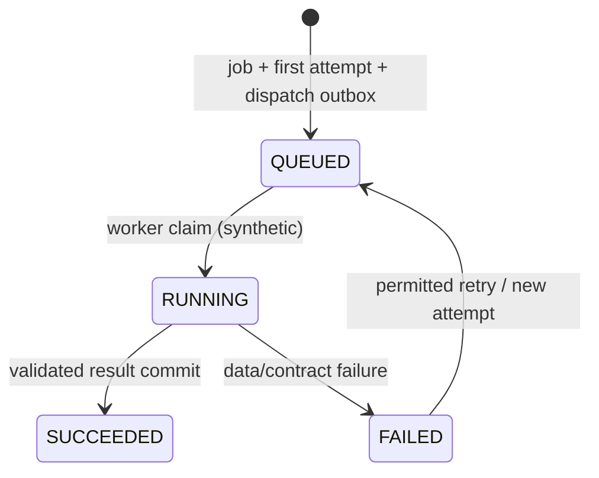

# Khảo sát drone, dataset và điều phối AI

> Baseline source: `cdeb1ca1037744d06995058af13d0582f6273c0a`, nhánh `huy-review`; BE-DOC-02, ngày 13/10/2026. `CURRENT_VERIFIED` ở đây nghĩa là đối chiếu source, không phải chứng nhận runtime. Build/tests trong phần việc này: **NOT_RUN**. Kết quả thực thi DOC-AUDIT-01/các checkpoint spec trước là **HISTORICAL**; quyết định owner có hiệu lực vẫn là **TARGET_CONFIRMED**.

Nghiệp vụ: [quyết định 32–44](../../../docs/product/confirmed-decisions.md) và [HUY-FINAL-INTEGRATION](../../../planning/development/HUY-FINAL-INTEGRATION.md), ưu tiên các mục owner clarification/activation mới nhất hơn checkpoint cũ. Audit dùng để định vị rủi ro, không thay authority: [DOC-AUDIT-01 gaps](../../../docs/audit/DOC-AUDIT-01-OPEN-GAPS.md). Mọi giao tiếp bên ngoài được mô tả là boundary; chưa xác minh FE/Android/FastAPI/deployment.

## EXPECTED_BUSINESS_BEHAVIOR — TARGET_CONFIRMED

PM lập kế hoạch, chọn scope và giao Operator; Operator nhận/thu video và telemetry SRT, upload chia phần/resume, nộp dataset. Backend giữ geometry/task/file pins và điều phối job; FastAPI phân tích video để trả ứng viên. Crew đo hiện trường; không dùng AI geometric depth để suy kích thước sửa thực tế. Orthomosaic, DSM, photogrammetry 3D nằm ngoài phạm vi. PM quyết định matching/nhãn, chỉ approved labels xuất training (PR33A/34A). PR38: ảnh20MiB/video8GiB/SRT10MiB/dataset32GiB. PR44 giao FE/AI bên ngoài; BE adapter/fixtures không chứng nhận live provider.

[ANH-02 cũ](../../../planning/V2/Execution/ANH-02-project-survey.md) chứa checkpoint Q11 chưa có coverage/baseline; source hiện có assessment/baseline producer, nên không chép blanket absence từ đó. Không tự chọn ngưỡng tự động khi owner chưa chốt: current method là PM evidence review có version.

## CURRENT_IMPLEMENTATION và actors

SurveyPlanningController giữ 3 legacy project/road-section operations. SurveyV2Controller có plan/task/list/work-package/dataset/coverage và lifecycle actions. SurveyAssessmentsController có assessment và baseline selection. ProcessingV2Controller giữ job/retry/service callback/validation; AiMockRunsController có synthetic two-stage orchestration riêng. Các pipeline dùng chung entities nhưng admission/provenance/fencing khác nhau.

PM current scope tạo plan/task, postpone/cancel/reassign/supplement, assessment/baseline; Operator current assignment accept/decline/upload/submit/read own task package. `ProcessingV2Service.IsManager` cho PM **hoặc Supervisor** create/retry legacy jobs, GET job cho PM/Supervisor/Operator với project guard; không tự gán assignment-only nếu service không kiểm. Synthetic `Anh02AiRepository.AuthorizeAsync` là boundary riêng: write PM current membership, read PM current membership hoặc current Supervisor global (project phải tồn tại). Service callback dùng policy `AiCallback`, không human PM token. Validation create chỉ PM, read PM/Supervisor.

## Preconditions và exact main sequence

1. PM `POST /api/v1/projects/{projectId}/survey-plans` (`CreateSurveyPlanV2RequestDto`, key). Nếu cần postpone: GET `/api/v1/survey-plans/{id}`, POST `.../{id}/postpone` với key+If-Match+reason/time. Legacy routes vẫn là `/api/v1/projects/{projectId}/road-sections/{roadSectionId}/survey-plans`, `/survey-requests`, và project `/survey-plans/{surveyPlanId}/postpone`.
2. PM `POST /api/v1/projects/{projectId}/survey-tasks` pin route/segment set/bands/operator. Operator `GET /api/v1/me/survey-tasks`, `GET /api/v1/survey-tasks/{taskId}` hoặc `/work-package`, rồi POST `/{taskId}/accept`; decline POST `/decline` với reason. Mutations cần key+If-Match trừ create.
3. Operator `POST /api/v1/uploads` purpose `SURVEY_VIDEO` hoặc `TELEMETRY`, ProjectId + TargetId=task; lấy part URLs, PUT bytes ngoài BE, complete key+If-Match, poll VERIFIED. Unassigned/inactive/wrong task/file purpose bị từ chối.
4. `POST /api/v1/survey-tasks/{taskId}/datasets` key+If-Match task; `SubmitDatasetRequestDto` gồm video/telemetry IDs, RecordedAt, DeviceId, band scopes, optional explicit video-SRT pairs/time offset. Repository buộc BAND_V1, accepted/in-progress, current assigned Operator, active drone device, subset task scopes, verified file purpose/target/project và total32GiB. Missing telemetry giữ MISSING, không tự fail hay coverage PASS.
5. `GET /api/v1/datasets/{id}` và `/coverage`; PM `POST /api/v1/datasets/{id}/assessments` với dataset ETag/key và `CreateAssessmentDto(MethodVersion="pm-evidence-review.v1", Items)`; mỗi segment/band đánh riêng position/quality/coverage PASS/FAIL/UNKNOWN, PASS cần evidence file/range. `GET .../assessments/{assessmentId}` đọc immutable source.
6. PM `POST /api/v1/projects/{projectId}/baseline-selections` với key, selected dataset+assessment+segment/band và expected previous selection; GET collection/history để xem. Dataset verified không tự thành baseline. Supplemental/cancel/reassign qua task routes giữ lịch sử và hiện quyền.
7. Legacy PM/Supervisor `POST /api/v1/processing-jobs` với dataset, band scope, model/preprocessing/config/mode, key; response202 + ETag + job Location. `GET /processing-jobs/{jobId}` poll; retry `POST .../{jobId}/retry` key+If-Match+reason; service callback `POST /api/v1/internal/processing-jobs/{jobId}/results` key + AI service bearer.
8. Synthetic Development/Testing/Test: PM `POST /api/v1/projects/{projectId}/ai-mock-runs` stage `VIDEO_ANALYSIS`, dataset/scope/model/config/fixture/expected geometry; GET run/result. Sau analysis có thể POST stage `DUPLICATE_MATCHING` với AnalysisRunId/CandidateSnapshotId; GET `/api/v1/projects/{projectId}/ai-candidates/{detectionId}` expose producer facts, không auto Defect.
9. PM `POST /api/v1/projects/{projectId}/validation-runs` với model/split/measurement type/unit/ground-truth+derived pairs/key; `GET /api/v1/validation-runs/{runId}` nhận used/excluded/bias/MAE/RMSE/unit/exclusion reasons. Đây là evaluation source, không kích thước hiện trường authoritative.

## State machine và persistence effects

Task transitions bind assigned actor and rowversion; accept/decline/cancel/reassign/supplement là command độc lập. `SurveyRequest.Accept`: NEW_ASSIGNED/REASSIGNED → ACCEPTED; reject ở hai state đó → REJECTED; reassignment từ state chưa submitted/completed/cancelled → REASSIGNED; supplement yêu cầu → SUPPLEMENT_REQUIRED; submit từ ACCEPTED/IN_PROGRESS/SUPPLEMENT_REQUIRED → SUBMITTED; cancel không cho từ SUBMITTED/COMPLETED/CANCELLED. [Domain transitions](../../../RoadGuardSystem.BusinessObjects/Surveys/SurveyRequest.cs#L96). Dataset submission repository hiện chỉ admitted ACCEPTED/IN_PROGRESS: domain primitive cho SUPPLEMENT_REQUIRED không chứng minh HTTP dataset branch ấy được hỗ trợ. Dataset submission tạo/giữ Survey, tạo SurveyDataVersion version tăng, SurveyFiles server-confirmed, source/scope/pairs manifests, audit và receipt; không rewrite uploaded source. Integrity status `PASSED` ở dataset response là file admission, không per-band position/quality/coverage. [SurveyV2PersistenceService.Dataset.cs · var sourceManifest = L127](../../../RoadGuardSystem.Repositories/Implementations/Surveys/SurveyV2PersistenceService.Dataset.cs#L127).

Sơ đồ trình bày trạng thái wire tổng quát; `ProcessingJobStatus.Completed` map `SUCCEEDED`, RetryableFailure/DataFailure map `FAILED`. Legacy callback có admission riêng, không được suy nó được worker mock fence bảo vệ. [ProcessingV2PersistenceService.cs · ToApiStatus L70](../../../RoadGuardSystem.Repositories/Implementations/Processing/ProcessingV2PersistenceService.cs#L70). Legacy create ghi ProcessingJob+Attempt và `processing_job.dispatch`; không có bằng chứng đây là outbound real FastAPI dispatcher. Validation worker tiêu thụ `validation_run.dispatch` để tính metrics, khác video inference.

Synthetic manifest canonical giữ schema/stage/run/job/attempt, dataset manifest hash, file ID/version/hash/bytes/MIME/purpose, video-SRT pairs, telemetry state, geometry pins, model/preprocessing/config/fixture, actor/time, candidate snapshot nếu matching. Worker đọc lại authority/source, thực sự đọc synthetic video bytes/hash, tạo frame object, detection provenance và canonical result/hash; complete fenced owner/current source transaction. IOException để lease recover cùng run; không tự kết luận không có lỗi đường từ mất storage. [Anh02AiService.cs · ProcessOneAsync L89](../../../RoadGuardSystem.Services/Implementations/Processing/Anh02/Anh02AiService.cs#L89).

## DTO, error, concurrency và alternatives

Scope `BandScopeDto`/AiMockScope pin routeVersion/set/segment IDs/target band SURFACE/LEFT_EDGE/RIGHT_EDGE. Dataset Pairs bảo toàn quan hệ video/telemetry/time offset; telemetry absent là thông tin không biết. Assessment method khác version đã chấp nhận trả `assessment_method_not_approved`; baseline conflict trả409, stale412, missing header428, invalid422. Task controls giữ If-Match; key reuse khác payload409. Cập nhật membership/task/source giữa preflight và replay phải được current receipt guard xét lại.

Legacy callback DTO bắt JobAttemptId/ManifestHash/ModelVersionId/Mode/RawResultFileId/ChecksumSha256/detections; detections GUID, frame ID, timestamp>=0, confidence0..1, bbox normalized x/y/w/h nằm trong ảnh. Các checks shape không là artifact provenance. Mock result có explicit schema `anh02.ai.v1`, source video/frame hashes, millisecond timestamp, model/stage/mode/run/job/attempt; position UNKNOWN và Geometry null, không đo depth. Callback và synthetic result **không tương đương contract**.

## Tests và gaps

Relevant sources: survey API `P2SurveyV2ApiTests`, `Anh01SurveyFlowTests`, `Anh01SurveyCorrectionTests`; SQL `P2V2SurveyScopeConcurrencyTests`; unit `Anh01AssessmentPolicyTests`; processing `Anh02AiHttpTests`, `A0801CallbackIdentityCharacterizationTests`, `Rf1005CallbackCharacterizationTests`, `P231ProcessingPersistenceTests`, `A0802ValidationReplayTests`, `P234ValidationAuthorizationTests`. Tất cả **NOT_RUN** trong BE-DOC-02; historical audit baseline không được chuyển thành fresh PASS. Appendix bao phủ cả legacy/schema test sources.

| Gap | Current evidence và hướng tối thiểu |
|---|---|
| G02 callback late-attempt/replay target | `ReceiveResultAsync` chỉ check attempt thuộc job, không active/latest fence; fingerprint chỉ detections+checksum trong project receipt, thiếu job/attempt/manifest/model/mode. Source limitation revalidated; exploit NOT_VERIFIED. Cần owner-approved compatibility design và negative late/out-of-order/key-target tests trước live provider |
| Artifact/source pin trên compatibility callback | Raw file check verified+project+checksum; không ngang provenance frame/video/dataset của synthetic. Không gán synthetic safety cho callback |
| Live FastAPI/model/network | PENDING_ENVIRONMENT_E2E; protocol/transport/auth/artifact exchange/adoption và real-video acceptance còn cần actual provider |
| GPS/coverage | MISSING/UNKNOWN giữ nguyên; PM evidence method không chứng minh autonomous coverage algorithm/accuracy |
| Huge real uploads | Metadata long/limit source có; actual8GiB/storage/resume experiment NOT_RUN |

## Toàn bộ HTTP actions của controller trong workflow

`SOURCE_DERIVED_NOT_RUNTIME_VERIFIED`. Paths giữ source constraints; API version được thay1. Một action có nhiều route được ghi từng operation. Tham số/status/headers đầy đủ trong endpoint catalog chung.

| Method | Full route | Controller.Action / source |
|---|---|---|
| POST | `/api/v1/projects/{projectId:guid}/road-sections/{roadSectionId:guid}/survey-plans` | [SurveyPlanningController.CreatePlan](../../../RoadGuardSystem.API/Controllers/SurveyPlanningController.cs#L27) |
| POST | `/api/v1/projects/{projectId:guid}/road-sections/{roadSectionId:guid}/survey-requests` | [SurveyPlanningController.CreateRequest](../../../RoadGuardSystem.API/Controllers/SurveyPlanningController.cs#L74) |
| POST | `/api/v1/projects/{projectId:guid}/survey-plans/{surveyPlanId:guid}/postpone` | [SurveyPlanningController.PostponePlan](../../../RoadGuardSystem.API/Controllers/SurveyPlanningController.cs#L121) |
| POST | `/api/v1/projects/{projectId:guid}/survey-plans` | [SurveyV2Controller.CreatePlan](../../../RoadGuardSystem.API/Controllers/SurveyV2Controller.cs#L24) |
| POST | `/api/v1/survey-plans/{planId:guid}/postpone` | [SurveyV2Controller.Postpone](../../../RoadGuardSystem.API/Controllers/SurveyV2Controller.cs#L42) |
| POST | `/api/v1/projects/{projectId:guid}/survey-tasks` | [SurveyV2Controller.CreateTask](../../../RoadGuardSystem.API/Controllers/SurveyV2Controller.cs#L62) |
| GET | `/api/v1/survey-tasks/{taskId:guid}` | [SurveyV2Controller.GetTask](../../../RoadGuardSystem.API/Controllers/SurveyV2Controller.cs#L81) |
| GET | `/api/v1/survey-plans/{id:guid}` | [SurveyV2Controller.ReadPlan](../../../RoadGuardSystem.API/Controllers/SurveyV2Controller.cs#L95) |
| GET | `/api/v1/datasets/{id:guid}` | [SurveyV2Controller.ReadDataset](../../../RoadGuardSystem.API/Controllers/SurveyV2Controller.cs#L97) |
| GET | `/api/v1/survey-tasks/{id:guid}/work-package` | [SurveyV2Controller.ReadWorkPackage](../../../RoadGuardSystem.API/Controllers/SurveyV2Controller.cs#L99) |
| GET | `/api/v1/me/survey-tasks` | [SurveyV2Controller.ListMyTasks](../../../RoadGuardSystem.API/Controllers/SurveyV2Controller.cs#L111) |
| POST | `/api/v1/survey-tasks/{taskId:guid}/datasets` | [SurveyV2Controller.SubmitDataset](../../../RoadGuardSystem.API/Controllers/SurveyV2Controller.cs#L122) |
| GET | `/api/v1/datasets/{datasetId:guid}/coverage` | [SurveyV2Controller.GetDatasetCoverage](../../../RoadGuardSystem.API/Controllers/SurveyV2Controller.cs#L148) |
| POST | `/api/v1/survey-tasks/{taskId:guid}/accept` | [SurveyV2Controller.AcceptTask](../../../RoadGuardSystem.API/Controllers/SurveyV2Controller.cs#L163) |
| POST | `/api/v1/survey-tasks/{taskId:guid}/decline` | [SurveyV2Controller.DeclineTask](../../../RoadGuardSystem.API/Controllers/SurveyV2Controller.cs#L172) |
| POST | `/api/v1/survey-tasks/{taskId:guid}/cancel` | [SurveyV2Controller.CancelTask](../../../RoadGuardSystem.API/Controllers/SurveyV2Controller.cs#L181) |
| POST | `/api/v1/survey-tasks/{taskId:guid}/reassign` | [SurveyV2Controller.ReassignTask](../../../RoadGuardSystem.API/Controllers/SurveyV2Controller.cs#L190) |
| POST | `/api/v1/survey-tasks/{taskId:guid}/supplements` | [SurveyV2Controller.RequestSupplement](../../../RoadGuardSystem.API/Controllers/SurveyV2Controller.cs#L199) |
| POST | `/api/v1/datasets/{id:guid}/assessments` | [SurveyAssessmentsController.Create](../../../RoadGuardSystem.API/Controllers/SurveyAssessmentsController.cs#L16) |
| GET | `/api/v1/datasets/{id:guid}/assessments/{assessmentId:guid}` | [SurveyAssessmentsController.Read](../../../RoadGuardSystem.API/Controllers/SurveyAssessmentsController.cs#L26) |
| POST | `/api/v1/projects/{projectId:guid}/baseline-selections` | [SurveyAssessmentsController.Select](../../../RoadGuardSystem.API/Controllers/SurveyAssessmentsController.cs#L34) |
| GET | `/api/v1/projects/{projectId:guid}/baseline-selections` | [SurveyAssessmentsController.Current](../../../RoadGuardSystem.API/Controllers/SurveyAssessmentsController.cs#L43) |
| GET | `/api/v1/projects/{projectId:guid}/baseline-selections/{id:guid}` | [SurveyAssessmentsController.History](../../../RoadGuardSystem.API/Controllers/SurveyAssessmentsController.cs#L45) |
| POST | `/api/v1/processing-jobs` | [ProcessingV2Controller.CreateProcessingJob](../../../RoadGuardSystem.API/Controllers/ProcessingV2Controller.cs#L27) |
| GET | `/api/v1/processing-jobs/{jobId:guid}` | [ProcessingV2Controller.GetProcessingJob](../../../RoadGuardSystem.API/Controllers/ProcessingV2Controller.cs#L36) |
| POST | `/api/v1/processing-jobs/{jobId:guid}/retry` | [ProcessingV2Controller.RetryProcessingJob](../../../RoadGuardSystem.API/Controllers/ProcessingV2Controller.cs#L44) |
| POST | `/api/v1/internal/processing-jobs/{jobId:guid}/results` | [ProcessingV2Controller.ReceiveAiResult](../../../RoadGuardSystem.API/Controllers/ProcessingV2Controller.cs#L53) |
| POST | `/api/v1/projects/{projectId:guid}/validation-runs` | [ProcessingV2Controller.CreateValidationRun](../../../RoadGuardSystem.API/Controllers/ProcessingV2Controller.cs#L61) |
| GET | `/api/v1/validation-runs/{runId:guid}` | [ProcessingV2Controller.GetValidationResult](../../../RoadGuardSystem.API/Controllers/ProcessingV2Controller.cs#L78) |
| POST | `/api/v1/projects/{projectId:guid}/ai-mock-runs` | [AiMockRunsController.Create](../../../RoadGuardSystem.API/Controllers/AiMockRunsController.cs#L18) |
| GET | `/api/v1/projects/{projectId:guid}/ai-mock-runs/{runId:guid}` | [AiMockRunsController.Get](../../../RoadGuardSystem.API/Controllers/AiMockRunsController.cs#L32) |
| GET | `/api/v1/projects/{projectId:guid}/ai-mock-runs/{runId:guid}/result` | [AiMockRunsController.Result](../../../RoadGuardSystem.API/Controllers/AiMockRunsController.cs#L39) |
| GET | `/api/v1/projects/{projectId:guid}/ai-candidates/{detectionId:guid}` | [AiMockRunsController.Candidate](../../../RoadGuardSystem.API/Controllers/AiMockRunsController.cs#L46) |

## Inventory nguồn module — CURRENT_VERIFIED source discovery

File/symbol tại baseline; không phải execution evidence. Interface/implementation/helpers trong scope được liệt kê đầy đủ; catalog toàn Backend/schema nằm trong traceability của bộ docs.

| File / declaration line | Types và operation seams |
|---|---|
| [RoadGuardSystem.BusinessObjects/Processing/AIDetection.cs](../../../RoadGuardSystem.BusinessObjects/Processing/AIDetection.cs#L6) | `AIDetection`; [Create](../../../RoadGuardSystem.BusinessObjects/Processing/AIDetection.cs#L32) |
| [RoadGuardSystem.BusinessObjects/Processing/AIModelVersion.cs](../../../RoadGuardSystem.BusinessObjects/Processing/AIModelVersion.cs#L6) | `AIModelVersion`; [Create](../../../RoadGuardSystem.BusinessObjects/Processing/AIModelVersion.cs#L22) |
| [RoadGuardSystem.BusinessObjects/Processing/Anh02AiProvenance.cs](../../../RoadGuardSystem.BusinessObjects/Processing/Anh02AiProvenance.cs#L5) | `AiMockRun`, `AiResultProvenance`, `AiDetectionProvenance`, `AiManifestFileReference` |
| [RoadGuardSystem.BusinessObjects/Processing/DerivedMeasurement.cs](../../../RoadGuardSystem.BusinessObjects/Processing/DerivedMeasurement.cs#L5) | `DerivedMeasurement`; [Create](../../../RoadGuardSystem.BusinessObjects/Processing/DerivedMeasurement.cs#L26) |
| [RoadGuardSystem.BusinessObjects/Processing/MeasurementValidationSample.cs](../../../RoadGuardSystem.BusinessObjects/Processing/MeasurementValidationSample.cs#L5) | `MeasurementValidationSample`; [Create](../../../RoadGuardSystem.BusinessObjects/Processing/MeasurementValidationSample.cs#L20) |
| [RoadGuardSystem.BusinessObjects/Processing/ProcessingAttempt.cs](../../../RoadGuardSystem.BusinessObjects/Processing/ProcessingAttempt.cs#L5) | `ProcessingAttempt`; [Create](../../../RoadGuardSystem.BusinessObjects/Processing/ProcessingAttempt.cs#L19) |
| [RoadGuardSystem.BusinessObjects/Processing/ProcessingBlock.cs](../../../RoadGuardSystem.BusinessObjects/Processing/ProcessingBlock.cs#L5) | `ProcessingBlock`; [Create](../../../RoadGuardSystem.BusinessObjects/Processing/ProcessingBlock.cs#L16) |
| [RoadGuardSystem.BusinessObjects/Processing/ProcessingJob.cs](../../../RoadGuardSystem.BusinessObjects/Processing/ProcessingJob.cs#L6) | `ProcessingJob`; [Create](../../../RoadGuardSystem.BusinessObjects/Processing/ProcessingJob.cs#L26); [CreateQueued](../../../RoadGuardSystem.BusinessObjects/Processing/ProcessingJob.cs#L66); [Retry](../../../RoadGuardSystem.BusinessObjects/Processing/ProcessingJob.cs#L89); [Complete](../../../RoadGuardSystem.BusinessObjects/Processing/ProcessingJob.cs#L103); [FailData](../../../RoadGuardSystem.BusinessObjects/Processing/ProcessingJob.cs#L119) |
| [RoadGuardSystem.BusinessObjects/Processing/ValidationRun.cs](../../../RoadGuardSystem.BusinessObjects/Processing/ValidationRun.cs#L6) | `ValidationRun`; [CreateQueued](../../../RoadGuardSystem.BusinessObjects/Processing/ValidationRun.cs#L28); [Complete](../../../RoadGuardSystem.BusinessObjects/Processing/ValidationRun.cs#L65) |
| [RoadGuardSystem.BusinessObjects/Surveys/DatasetAssessment.cs](../../../RoadGuardSystem.BusinessObjects/Surveys/DatasetAssessment.cs#L3) | `DatasetAssessment`, `DatasetAssessmentItem`, `BaselineSelection`, `BaselineSelectionItem`, `BaselineCurrentPointer`; [Create](../../../RoadGuardSystem.BusinessObjects/Surveys/DatasetAssessment.cs#L12); [Create](../../../RoadGuardSystem.BusinessObjects/Surveys/DatasetAssessment.cs#L30); [Create](../../../RoadGuardSystem.BusinessObjects/Surveys/DatasetAssessment.cs#L56); [Create](../../../RoadGuardSystem.BusinessObjects/Surveys/DatasetAssessment.cs#L71); [Select](../../../RoadGuardSystem.BusinessObjects/Surveys/DatasetAssessment.cs#L95); [Create](../../../RoadGuardSystem.BusinessObjects/Surveys/DatasetAssessment.cs#L96) |
| [RoadGuardSystem.BusinessObjects/Surveys/Flight.cs](../../../RoadGuardSystem.BusinessObjects/Surveys/Flight.cs#L3) | `Flight`; [Create](../../../RoadGuardSystem.BusinessObjects/Surveys/Flight.cs#L23) |
| [RoadGuardSystem.BusinessObjects/Surveys/QualityCheck.cs](../../../RoadGuardSystem.BusinessObjects/Surveys/QualityCheck.cs#L6) | `QualityCheck`; [Create](../../../RoadGuardSystem.BusinessObjects/Surveys/QualityCheck.cs#L26) |
| [RoadGuardSystem.BusinessObjects/Surveys/SupplementarySurveyRequest.cs](../../../RoadGuardSystem.BusinessObjects/Surveys/SupplementarySurveyRequest.cs#L6) | `SupplementarySurveyRequest`; [Create](../../../RoadGuardSystem.BusinessObjects/Surveys/SupplementarySurveyRequest.cs#L24) |
| [RoadGuardSystem.BusinessObjects/Surveys/Survey.cs](../../../RoadGuardSystem.BusinessObjects/Surveys/Survey.cs#L5) | `Survey`; [Create](../../../RoadGuardSystem.BusinessObjects/Surveys/Survey.cs#L29) |
| [RoadGuardSystem.BusinessObjects/Surveys/SurveyAssignment.cs](../../../RoadGuardSystem.BusinessObjects/Surveys/SurveyAssignment.cs#L3) | `SurveyAssignment`; [Create](../../../RoadGuardSystem.BusinessObjects/Surveys/SurveyAssignment.cs#L29); [EndForReassignment](../../../RoadGuardSystem.BusinessObjects/Surveys/SurveyAssignment.cs#L95); [Accept](../../../RoadGuardSystem.BusinessObjects/Surveys/SurveyAssignment.cs#L112); [Reject](../../../RoadGuardSystem.BusinessObjects/Surveys/SurveyAssignment.cs#L127) |
| [RoadGuardSystem.BusinessObjects/Surveys/SurveyDataVersion.cs](../../../RoadGuardSystem.BusinessObjects/Surveys/SurveyDataVersion.cs#L6) | `SurveyDataVersion`; [SetSubmissionProvenance](../../../RoadGuardSystem.BusinessObjects/Surveys/SurveyDataVersion.cs#L25); [Create](../../../RoadGuardSystem.BusinessObjects/Surveys/SurveyDataVersion.cs#L34); [CreateSubmitted](../../../RoadGuardSystem.BusinessObjects/Surveys/SurveyDataVersion.cs#L81) |
| [RoadGuardSystem.BusinessObjects/Surveys/SurveyFile.cs](../../../RoadGuardSystem.BusinessObjects/Surveys/SurveyFile.cs#L5) | `SurveyFile`; [Create](../../../RoadGuardSystem.BusinessObjects/Surveys/SurveyFile.cs#L29) |
| [RoadGuardSystem.BusinessObjects/Surveys/SurveyPlan.cs](../../../RoadGuardSystem.BusinessObjects/Surveys/SurveyPlan.cs#L6) | `SurveyPlan`; [SetBandScope](../../../RoadGuardSystem.BusinessObjects/Surveys/SurveyPlan.cs#L20); [MarkTaskCreated](../../../RoadGuardSystem.BusinessObjects/Surveys/SurveyPlan.cs#L21); [Create](../../../RoadGuardSystem.BusinessObjects/Surveys/SurveyPlan.cs#L39); [Postpone](../../../RoadGuardSystem.BusinessObjects/Surveys/SurveyPlan.cs#L86) |
| [RoadGuardSystem.BusinessObjects/Surveys/SurveyPlanPostponement.cs](../../../RoadGuardSystem.BusinessObjects/Surveys/SurveyPlanPostponement.cs#L3) | `SurveyPlanPostponement`; [Create](../../../RoadGuardSystem.BusinessObjects/Surveys/SurveyPlanPostponement.cs#L19) |
| [RoadGuardSystem.BusinessObjects/Surveys/SurveyPlanScope.cs](../../../RoadGuardSystem.BusinessObjects/Surveys/SurveyPlanScope.cs#L5) | `SurveyPlanScope`; [Create](../../../RoadGuardSystem.BusinessObjects/Surveys/SurveyPlanScope.cs#L23) |
| [RoadGuardSystem.BusinessObjects/Surveys/SurveyRequest.cs](../../../RoadGuardSystem.BusinessObjects/Surveys/SurveyRequest.cs#L6) | `SurveyRequest`; [SetBandScope](../../../RoadGuardSystem.BusinessObjects/Surveys/SurveyRequest.cs#L25); [Create](../../../RoadGuardSystem.BusinessObjects/Surveys/SurveyRequest.cs#L50); [Accept](../../../RoadGuardSystem.BusinessObjects/Surveys/SurveyRequest.cs#L96); [MarkRejected](../../../RoadGuardSystem.BusinessObjects/Surveys/SurveyRequest.cs#L107); [MarkReassigned](../../../RoadGuardSystem.BusinessObjects/Surveys/SurveyRequest.cs#L118); [MarkSupplementRequired](../../../RoadGuardSystem.BusinessObjects/Surveys/SurveyRequest.cs#L129); [MarkSubmitted](../../../RoadGuardSystem.BusinessObjects/Surveys/SurveyRequest.cs#L140); [Cancel](../../../RoadGuardSystem.BusinessObjects/Surveys/SurveyRequest.cs#L151); [ChangeDueAt](../../../RoadGuardSystem.BusinessObjects/Surveys/SurveyRequest.cs#L165) |
| [RoadGuardSystem.BusinessObjects/Surveys/SurveyRequestScope.cs](../../../RoadGuardSystem.BusinessObjects/Surveys/SurveyRequestScope.cs#L5) | `SurveyRequestScope`; [Create](../../../RoadGuardSystem.BusinessObjects/Surveys/SurveyRequestScope.cs#L23) |
| [RoadGuardSystem.Repositories/Implementations/Processing/Anh02AiRepository.cs](../../../RoadGuardSystem.Repositories/Implementations/Processing/Anh02AiRepository.cs#L18) | `Anh02AiRepository`; [AuthorizeAsync](../../../RoadGuardSystem.Repositories/Implementations/Processing/Anh02AiRepository.cs#L22); [ReadSourcesAsync](../../../RoadGuardSystem.Repositories/Implementations/Processing/Anh02AiRepository.cs#L37); [AdmitAsync](../../../RoadGuardSystem.Repositories/Implementations/Processing/Anh02AiRepository.cs#L98); [GetAsync](../../../RoadGuardSystem.Repositories/Implementations/Processing/Anh02AiRepository.cs#L167); [GetResultAsync](../../../RoadGuardSystem.Repositories/Implementations/Processing/Anh02AiRepository.cs#L169); [ClaimAsync](../../../RoadGuardSystem.Repositories/Implementations/Processing/Anh02AiRepository.cs#L172); [CompleteAsync](../../../RoadGuardSystem.Repositories/Implementations/Processing/Anh02AiRepository.cs#L186); [FailAsync](../../../RoadGuardSystem.Repositories/Implementations/Processing/Anh02AiRepository.cs#L211); [ReadCandidateAsync](../../../RoadGuardSystem.Repositories/Implementations/Processing/Anh02AiRepository.cs#L238); [DetectionProjectAsync](../../../RoadGuardSystem.Repositories/Implementations/Processing/Anh02AiRepository.cs#L265); [View](../../../RoadGuardSystem.Repositories/Implementations/Processing/Anh02AiRepository.cs#L280) |
| [RoadGuardSystem.Repositories/Implementations/Processing/ProcessingV2PersistenceService.cs](../../../RoadGuardSystem.Repositories/Implementations/Processing/ProcessingV2PersistenceService.cs#L17) | `ProcessingV2PersistenceService`, `StoredJobOutcome`, `StoredValidationOutcome`, `ValidationPairReference`, `ValidationPairFact`, `ScopeNotFoundException`; [GetDatasetProjectIdAsync](../../../RoadGuardSystem.Repositories/Implementations/Processing/ProcessingV2PersistenceService.cs#L29); [CreateAsync](../../../RoadGuardSystem.Repositories/Implementations/Processing/ProcessingV2PersistenceService.cs#L35); [GetAsync](../../../RoadGuardSystem.Repositories/Implementations/Processing/ProcessingV2PersistenceService.cs#L81); [RetryAsync](../../../RoadGuardSystem.Repositories/Implementations/Processing/ProcessingV2PersistenceService.cs#L92); [ReceiveResultAsync](../../../RoadGuardSystem.Repositories/Implementations/Processing/ProcessingV2PersistenceService.cs#L117); [CreateValidationAsync](../../../RoadGuardSystem.Repositories/Implementations/Processing/ProcessingV2PersistenceService.cs#L159); [GetValidationAsync](../../../RoadGuardSystem.Repositories/Implementations/Processing/ProcessingV2PersistenceService.cs#L201); [CompleteNextValidationRunAsync](../../../RoadGuardSystem.Repositories/Implementations/Processing/ProcessingV2PersistenceService.cs#L207) |
| [RoadGuardSystem.Repositories/Implementations/Surveys/SurveyAssessmentRepository.cs](../../../RoadGuardSystem.Repositories/Implementations/Surveys/SurveyAssessmentRepository.cs#L13) | `SurveyAssessmentRepository`, `AssessmentScope`, `SourceFile`, `AssessmentReject`; [ReadAsync](../../../RoadGuardSystem.Repositories/Implementations/Surveys/SurveyAssessmentRepository.cs#L16); [CreateAsync](../../../RoadGuardSystem.Repositories/Implementations/Surveys/SurveyAssessmentRepository.cs#L25); [SelectAsync](../../../RoadGuardSystem.Repositories/Implementations/Surveys/SurveyAssessmentRepository.cs#L58); [HistoryAsync](../../../RoadGuardSystem.Repositories/Implementations/Surveys/SurveyAssessmentRepository.cs#L100); [CurrentAsync](../../../RoadGuardSystem.Repositories/Implementations/Surveys/SurveyAssessmentRepository.cs#L107) |
| [RoadGuardSystem.Repositories/Implementations/Surveys/SurveyAssignmentPersistenceService.cs](../../../RoadGuardSystem.Repositories/Implementations/Surveys/SurveyAssignmentPersistenceService.cs#L11) | `SurveyAssignmentReassignmentResult`, `SurveyAssignmentPersistenceService`, `ReassignmentOutcome`; [GetReassignmentFactsAsync](../../../RoadGuardSystem.Repositories/Implementations/Surveys/SurveyAssignmentPersistenceService.cs#L37); [ReassignAsync](../../../RoadGuardSystem.Repositories/Implementations/Surveys/SurveyAssignmentPersistenceService.cs#L53) |
| [RoadGuardSystem.Repositories/Implementations/Surveys/SurveyAssignmentReassignmentFacts.cs](../../../RoadGuardSystem.Repositories/Implementations/Surveys/SurveyAssignmentReassignmentFacts.cs#L3) | `SurveyAssignmentReassignmentFacts` |
| [RoadGuardSystem.Repositories/Implementations/Surveys/SurveyDataValidationAdmissionPersistenceService.cs](../../../RoadGuardSystem.Repositories/Implementations/Surveys/SurveyDataValidationAdmissionPersistenceService.cs#L16) | `SurveyDataValidationAdmissionPersistenceService`, `AdmissionOutcome`; [AdmitAsync](../../../RoadGuardSystem.Repositories/Implementations/Surveys/SurveyDataValidationAdmissionPersistenceService.cs#L32) |
| [RoadGuardSystem.Repositories/Implementations/Surveys/SurveyDataValidationAdmissionRequest.cs](../../../RoadGuardSystem.Repositories/Implementations/Surveys/SurveyDataValidationAdmissionRequest.cs#L5) | `SurveyDataValidationAdmissionRequest` |
| [RoadGuardSystem.Repositories/Implementations/Surveys/SurveyDataValidationAdmissionResult.cs](../../../RoadGuardSystem.Repositories/Implementations/Surveys/SurveyDataValidationAdmissionResult.cs#L5) | `SurveyDataValidationAdmissionResult` |
| [RoadGuardSystem.Repositories/Implementations/Surveys/SurveyPlanCreationPersistenceRequest.cs](../../../RoadGuardSystem.Repositories/Implementations/Surveys/SurveyPlanCreationPersistenceRequest.cs#L3) | `SurveyPlanCreationPersistenceRequest` |
| [RoadGuardSystem.Repositories/Implementations/Surveys/SurveyPlanningPersistenceService.cs](../../../RoadGuardSystem.Repositories/Implementations/Surveys/SurveyPlanningPersistenceService.cs#L16) | `SurveyPlanningPersistenceService`, `ScopeNotFoundException`, `ScopeConflictException`; [CreatePlanAsync](../../../RoadGuardSystem.Repositories/Implementations/Surveys/SurveyPlanningPersistenceService.cs#L32); [CreateRequestAsync](../../../RoadGuardSystem.Repositories/Implementations/Surveys/SurveyPlanningPersistenceService.cs#L114); [PostponePlanAsync](../../../RoadGuardSystem.Repositories/Implementations/Surveys/SurveyPlanningPersistenceService.cs#L211) |
| [RoadGuardSystem.Repositories/Implementations/Surveys/SurveyPlanPersistenceResult.cs](../../../RoadGuardSystem.Repositories/Implementations/Surveys/SurveyPlanPersistenceResult.cs#L3) | `SurveyPlanPersistenceResult` |
| [RoadGuardSystem.Repositories/Implementations/Surveys/SurveyPlanPersistenceStatus.cs](../../../RoadGuardSystem.Repositories/Implementations/Surveys/SurveyPlanPersistenceStatus.cs#L3) | `SurveyPlanPersistenceStatus` |
| [RoadGuardSystem.Repositories/Implementations/Surveys/SurveyPlanPersistenceView.cs](../../../RoadGuardSystem.Repositories/Implementations/Surveys/SurveyPlanPersistenceView.cs#L5) | `SurveyPlanPersistenceView` |
| [RoadGuardSystem.Repositories/Implementations/Surveys/SurveyPlanPostponementPersistenceRequest.cs](../../../RoadGuardSystem.Repositories/Implementations/Surveys/SurveyPlanPostponementPersistenceRequest.cs#L3) | `SurveyPlanPostponementPersistenceRequest` |
| [RoadGuardSystem.Repositories/Implementations/Surveys/SurveyPlanPostponementPersistenceResult.cs](../../../RoadGuardSystem.Repositories/Implementations/Surveys/SurveyPlanPostponementPersistenceResult.cs#L3) | `SurveyPlanPostponementPersistenceResult` |
| [RoadGuardSystem.Repositories/Implementations/Surveys/SurveyPlanPostponementPersistenceStatus.cs](../../../RoadGuardSystem.Repositories/Implementations/Surveys/SurveyPlanPostponementPersistenceStatus.cs#L3) | `SurveyPlanPostponementPersistenceStatus` |
| [RoadGuardSystem.Repositories/Implementations/Surveys/SurveyPlanPostponementPersistenceView.cs](../../../RoadGuardSystem.Repositories/Implementations/Surveys/SurveyPlanPostponementPersistenceView.cs#L5) | `SurveyPlanPostponementPersistenceView` |
| [RoadGuardSystem.Repositories/Implementations/Surveys/SurveyRequestCreationPersistenceRequest.cs](../../../RoadGuardSystem.Repositories/Implementations/Surveys/SurveyRequestCreationPersistenceRequest.cs#L3) | `SurveyRequestCreationPersistenceRequest` |
| [RoadGuardSystem.Repositories/Implementations/Surveys/SurveyRequestPersistenceResult.cs](../../../RoadGuardSystem.Repositories/Implementations/Surveys/SurveyRequestPersistenceResult.cs#L3) | `SurveyRequestPersistenceResult` |
| [RoadGuardSystem.Repositories/Implementations/Surveys/SurveyRequestPersistenceStatus.cs](../../../RoadGuardSystem.Repositories/Implementations/Surveys/SurveyRequestPersistenceStatus.cs#L3) | `SurveyRequestPersistenceStatus` |
| [RoadGuardSystem.Repositories/Implementations/Surveys/SurveyRequestPersistenceView.cs](../../../RoadGuardSystem.Repositories/Implementations/Surveys/SurveyRequestPersistenceView.cs#L5) | `SurveyRequestPersistenceView` |
| [RoadGuardSystem.Repositories/Implementations/Surveys/SurveyV2PersistenceService.cs](../../../RoadGuardSystem.Repositories/Implementations/Surveys/SurveyV2PersistenceService.cs#L16) | `SurveyV2PersistenceService`, `StoredPlanOutcome`, `StoredTaskOutcome`, `TaskCursor`, `ResolvedScopeItem`, `ScopeResolution`, `ScopeNotFoundException`, `ScopeConflictException`, `OperatorNotFoundException`; [CreatePlanAsync](../../../RoadGuardSystem.Repositories/Implementations/Surveys/SurveyV2PersistenceService.cs#L27); [PostponePlanAsync](../../../RoadGuardSystem.Repositories/Implementations/Surveys/SurveyV2PersistenceService.cs#L57); [CreateTaskAsync](../../../RoadGuardSystem.Repositories/Implementations/Surveys/SurveyV2PersistenceService.cs#L110); [GetTaskAsync](../../../RoadGuardSystem.Repositories/Implementations/Surveys/SurveyV2PersistenceService.cs#L161); [ListMyTasksAsync](../../../RoadGuardSystem.Repositories/Implementations/Surveys/SurveyV2PersistenceService.cs#L207); [MutateTaskAsync](../../../RoadGuardSystem.Repositories/Implementations/Surveys/SurveyV2PersistenceService.cs#L245); [GetPlanProjectIdAsync](../../../RoadGuardSystem.Repositories/Implementations/Surveys/SurveyV2PersistenceService.cs#L353); [ReadPlanAsync](../../../RoadGuardSystem.Repositories/Implementations/Surveys/SurveyV2PersistenceService.cs#L356) |
| [RoadGuardSystem.Repositories/Implementations/Surveys/SurveyV2PersistenceService.Dataset.cs](../../../RoadGuardSystem.Repositories/Implementations/Surveys/SurveyV2PersistenceService.Dataset.cs#L12) | `SurveyV2PersistenceService`, `StoredDatasetOutcome`, `DatasetScopeItem`, `DatasetPair`; [SubmitDatasetAsync](../../../RoadGuardSystem.Repositories/Implementations/Surveys/SurveyV2PersistenceService.Dataset.cs#L16); [GetDatasetAccessAsync](../../../RoadGuardSystem.Repositories/Implementations/Surveys/SurveyV2PersistenceService.Dataset.cs#L158); [ReadDatasetAsync](../../../RoadGuardSystem.Repositories/Implementations/Surveys/SurveyV2PersistenceService.Dataset.cs#L174) |
| [RoadGuardSystem.Repositories/Interfaces/Processing/IAnh02AiRepository.cs](../../../RoadGuardSystem.Repositories/Interfaces/Processing/IAnh02AiRepository.cs#L8) | `AiSourceFileFact`, `AiSourcePair`, `AiDatasetSourceFacts`, `AiAdmissionManifest`, `AiCandidateReadFacts`, `AiCompletion`, `AiRequestException`, `IAnh02AiRepository`; [AuthorizeAsync](../../../RoadGuardSystem.Repositories/Interfaces/Processing/IAnh02AiRepository.cs#L26); [ReadSourcesAsync](../../../RoadGuardSystem.Repositories/Interfaces/Processing/IAnh02AiRepository.cs#L27); [AdmitAsync](../../../RoadGuardSystem.Repositories/Interfaces/Processing/IAnh02AiRepository.cs#L28); [GetAsync](../../../RoadGuardSystem.Repositories/Interfaces/Processing/IAnh02AiRepository.cs#L30); [GetResultAsync](../../../RoadGuardSystem.Repositories/Interfaces/Processing/IAnh02AiRepository.cs#L31); [ClaimAsync](../../../RoadGuardSystem.Repositories/Interfaces/Processing/IAnh02AiRepository.cs#L32); [CompleteAsync](../../../RoadGuardSystem.Repositories/Interfaces/Processing/IAnh02AiRepository.cs#L33); [FailAsync](../../../RoadGuardSystem.Repositories/Interfaces/Processing/IAnh02AiRepository.cs#L35); [ReadCandidateAsync](../../../RoadGuardSystem.Repositories/Interfaces/Processing/IAnh02AiRepository.cs#L36); [DetectionProjectAsync](../../../RoadGuardSystem.Repositories/Interfaces/Processing/IAnh02AiRepository.cs#L37) |
| [RoadGuardSystem.Repositories/Interfaces/Processing/IProcessingV2Repository.cs](../../../RoadGuardSystem.Repositories/Interfaces/Processing/IProcessingV2Repository.cs#L3) | `IProcessingV2Repository`; [GetDatasetProjectIdAsync](../../../RoadGuardSystem.Repositories/Interfaces/Processing/IProcessingV2Repository.cs#L5); [CreateAsync](../../../RoadGuardSystem.Repositories/Interfaces/Processing/IProcessingV2Repository.cs#L6); [GetAsync](../../../RoadGuardSystem.Repositories/Interfaces/Processing/IProcessingV2Repository.cs#L7); [RetryAsync](../../../RoadGuardSystem.Repositories/Interfaces/Processing/IProcessingV2Repository.cs#L8); [ReceiveResultAsync](../../../RoadGuardSystem.Repositories/Interfaces/Processing/IProcessingV2Repository.cs#L9); [CreateValidationAsync](../../../RoadGuardSystem.Repositories/Interfaces/Processing/IProcessingV2Repository.cs#L10); [GetValidationAsync](../../../RoadGuardSystem.Repositories/Interfaces/Processing/IProcessingV2Repository.cs#L11); [CompleteNextValidationRunAsync](../../../RoadGuardSystem.Repositories/Interfaces/Processing/IProcessingV2Repository.cs#L12) |
| [RoadGuardSystem.Repositories/Interfaces/Processing/ProcessingAiResultRequest.cs](../../../RoadGuardSystem.Repositories/Interfaces/Processing/ProcessingAiResultRequest.cs#L3) | `ProcessingAiResultRequest` |
| [RoadGuardSystem.Repositories/Interfaces/Processing/ProcessingJobCreateRequest.cs](../../../RoadGuardSystem.Repositories/Interfaces/Processing/ProcessingJobCreateRequest.cs#L3) | `ProcessingJobCreateRequest` |
| [RoadGuardSystem.Repositories/Interfaces/Processing/ProcessingJobPersistenceResult.cs](../../../RoadGuardSystem.Repositories/Interfaces/Processing/ProcessingJobPersistenceResult.cs#L3) | `ProcessingJobPersistenceResult` |
| [RoadGuardSystem.Repositories/Interfaces/Processing/ProcessingJobPersistenceStatus.cs](../../../RoadGuardSystem.Repositories/Interfaces/Processing/ProcessingJobPersistenceStatus.cs#L3) | `ProcessingJobPersistenceStatus` |
| [RoadGuardSystem.Repositories/Interfaces/Processing/ProcessingJobPersistenceView.cs](../../../RoadGuardSystem.Repositories/Interfaces/Processing/ProcessingJobPersistenceView.cs#L3) | `ProcessingJobPersistenceView` |
| [RoadGuardSystem.Repositories/Interfaces/Processing/ProcessingJobRetryRequest.cs](../../../RoadGuardSystem.Repositories/Interfaces/Processing/ProcessingJobRetryRequest.cs#L3) | `ProcessingJobRetryRequest` |
| [RoadGuardSystem.Repositories/Interfaces/Processing/ValidationRunCreateRequest.cs](../../../RoadGuardSystem.Repositories/Interfaces/Processing/ValidationRunCreateRequest.cs#L3) | `ValidationRunCreateRequest` |
| [RoadGuardSystem.Repositories/Interfaces/Processing/ValidationRunPersistenceResult.cs](../../../RoadGuardSystem.Repositories/Interfaces/Processing/ValidationRunPersistenceResult.cs#L3) | `ValidationRunPersistenceResult` |
| [RoadGuardSystem.Repositories/Interfaces/Processing/ValidationRunPersistenceView.cs](../../../RoadGuardSystem.Repositories/Interfaces/Processing/ValidationRunPersistenceView.cs#L3) | `ValidationRunPersistenceView` |
| [RoadGuardSystem.Repositories/Interfaces/Surveys/AssessmentContracts.cs](../../../RoadGuardSystem.Repositories/Interfaces/Surveys/AssessmentContracts.cs#L3) | `AssessmentEvidence`, `AssessmentItem`, `AssessmentRecord`, `BaselineItem`, `SelectedBaselineItem`, `BaselineRecord`, `AssessmentOutcome` |
| [RoadGuardSystem.Repositories/Interfaces/Surveys/DatasetDetailRecord.cs](../../../RoadGuardSystem.Repositories/Interfaces/Surveys/DatasetDetailRecord.cs#L3) | `DatasetDetailRecord` |
| [RoadGuardSystem.Repositories/Interfaces/Surveys/ISurveyAssessmentRepository.cs](../../../RoadGuardSystem.Repositories/Interfaces/Surveys/ISurveyAssessmentRepository.cs#L3) | `ISurveyAssessmentRepository`; [ReadAsync](../../../RoadGuardSystem.Repositories/Interfaces/Surveys/ISurveyAssessmentRepository.cs#L5); [CreateAsync](../../../RoadGuardSystem.Repositories/Interfaces/Surveys/ISurveyAssessmentRepository.cs#L6); [SelectAsync](../../../RoadGuardSystem.Repositories/Interfaces/Surveys/ISurveyAssessmentRepository.cs#L8); [HistoryAsync](../../../RoadGuardSystem.Repositories/Interfaces/Surveys/ISurveyAssessmentRepository.cs#L10); [CurrentAsync](../../../RoadGuardSystem.Repositories/Interfaces/Surveys/ISurveyAssessmentRepository.cs#L11) |
| [RoadGuardSystem.Repositories/Interfaces/Surveys/ISurveyAssignmentRepository.cs](../../../RoadGuardSystem.Repositories/Interfaces/Surveys/ISurveyAssignmentRepository.cs#L5) | `ISurveyAssignmentRepository`; [GetReassignmentFactsAsync](../../../RoadGuardSystem.Repositories/Interfaces/Surveys/ISurveyAssignmentRepository.cs#L7); [ReassignAsync](../../../RoadGuardSystem.Repositories/Interfaces/Surveys/ISurveyAssignmentRepository.cs#L11) |
| [RoadGuardSystem.Repositories/Interfaces/Surveys/ISurveyDataValidationAdmissionRepository.cs](../../../RoadGuardSystem.Repositories/Interfaces/Surveys/ISurveyDataValidationAdmissionRepository.cs#L5) | `ISurveyDataValidationAdmissionRepository`; [AdmitAsync](../../../RoadGuardSystem.Repositories/Interfaces/Surveys/ISurveyDataValidationAdmissionRepository.cs#L7) |
| [RoadGuardSystem.Repositories/Interfaces/Surveys/ISurveyPlanningRepository.cs](../../../RoadGuardSystem.Repositories/Interfaces/Surveys/ISurveyPlanningRepository.cs#L3) | `ISurveyPlanningRepository`; [CreatePlanAsync](../../../RoadGuardSystem.Repositories/Interfaces/Surveys/ISurveyPlanningRepository.cs#L5); [CreateRequestAsync](../../../RoadGuardSystem.Repositories/Interfaces/Surveys/ISurveyPlanningRepository.cs#L9); [PostponePlanAsync](../../../RoadGuardSystem.Repositories/Interfaces/Surveys/ISurveyPlanningRepository.cs#L13) |
| [RoadGuardSystem.Repositories/Interfaces/Surveys/ISurveyV2Repository.cs](../../../RoadGuardSystem.Repositories/Interfaces/Surveys/ISurveyV2Repository.cs#L5) | `ISurveyV2Repository`; [CreatePlanAsync](../../../RoadGuardSystem.Repositories/Interfaces/Surveys/ISurveyV2Repository.cs#L7); [PostponePlanAsync](../../../RoadGuardSystem.Repositories/Interfaces/Surveys/ISurveyV2Repository.cs#L8); [CreateTaskAsync](../../../RoadGuardSystem.Repositories/Interfaces/Surveys/ISurveyV2Repository.cs#L9); [GetTaskAsync](../../../RoadGuardSystem.Repositories/Interfaces/Surveys/ISurveyV2Repository.cs#L10); [ListMyTasksAsync](../../../RoadGuardSystem.Repositories/Interfaces/Surveys/ISurveyV2Repository.cs#L11); [MutateTaskAsync](../../../RoadGuardSystem.Repositories/Interfaces/Surveys/ISurveyV2Repository.cs#L12); [GetPlanProjectIdAsync](../../../RoadGuardSystem.Repositories/Interfaces/Surveys/ISurveyV2Repository.cs#L13); [SubmitDatasetAsync](../../../RoadGuardSystem.Repositories/Interfaces/Surveys/ISurveyV2Repository.cs#L14); [GetDatasetAccessAsync](../../../RoadGuardSystem.Repositories/Interfaces/Surveys/ISurveyV2Repository.cs#L15); [ReadPlanAsync](../../../RoadGuardSystem.Repositories/Interfaces/Surveys/ISurveyV2Repository.cs#L16); [ReadDatasetAsync](../../../RoadGuardSystem.Repositories/Interfaces/Surveys/ISurveyV2Repository.cs#L17) |
| [RoadGuardSystem.Repositories/Interfaces/Surveys/SurveyDatasetAccessView.cs](../../../RoadGuardSystem.Repositories/Interfaces/Surveys/SurveyDatasetAccessView.cs#L3) | `SurveyDatasetAccessView` |
| [RoadGuardSystem.Repositories/Interfaces/Surveys/SurveyDatasetPersistenceResult.cs](../../../RoadGuardSystem.Repositories/Interfaces/Surveys/SurveyDatasetPersistenceResult.cs#L3) | `SurveyDatasetPersistenceResult` |
| [RoadGuardSystem.Repositories/Interfaces/Surveys/SurveyDatasetPersistenceStatus.cs](../../../RoadGuardSystem.Repositories/Interfaces/Surveys/SurveyDatasetPersistenceStatus.cs#L3) | `SurveyDatasetPersistenceStatus` |
| [RoadGuardSystem.Repositories/Interfaces/Surveys/SurveyDatasetPersistenceView.cs](../../../RoadGuardSystem.Repositories/Interfaces/Surveys/SurveyDatasetPersistenceView.cs#L3) | `SurveyDatasetPersistenceView` |
| [RoadGuardSystem.Repositories/Interfaces/Surveys/SurveyDatasetSubmissionRequest.cs](../../../RoadGuardSystem.Repositories/Interfaces/Surveys/SurveyDatasetSubmissionRequest.cs#L3) | `SurveyDatasetSubmissionRequest` |
| [RoadGuardSystem.Repositories/Interfaces/Surveys/SurveyV2PersistenceStatus.cs](../../../RoadGuardSystem.Repositories/Interfaces/Surveys/SurveyV2PersistenceStatus.cs#L3) | `SurveyV2PersistenceStatus` |
| [RoadGuardSystem.Repositories/Interfaces/Surveys/SurveyV2PlanCreationRequest.cs](../../../RoadGuardSystem.Repositories/Interfaces/Surveys/SurveyV2PlanCreationRequest.cs#L4) | `SurveyV2PlanCreationRequest` |
| [RoadGuardSystem.Repositories/Interfaces/Surveys/SurveyV2PlanPersistenceResult.cs](../../../RoadGuardSystem.Repositories/Interfaces/Surveys/SurveyV2PlanPersistenceResult.cs#L3) | `SurveyV2PlanPersistenceResult` |
| [RoadGuardSystem.Repositories/Interfaces/Surveys/SurveyV2PlanPersistenceView.cs](../../../RoadGuardSystem.Repositories/Interfaces/Surveys/SurveyV2PlanPersistenceView.cs#L3) | `SurveyV2PlanPersistenceView` |
| [RoadGuardSystem.Repositories/Interfaces/Surveys/SurveyV2PlanPostponementRequest.cs](../../../RoadGuardSystem.Repositories/Interfaces/Surveys/SurveyV2PlanPostponementRequest.cs#L3) | `SurveyV2PlanPostponementRequest` |
| [RoadGuardSystem.Repositories/Interfaces/Surveys/SurveyV2ScopeRequest.cs](../../../RoadGuardSystem.Repositories/Interfaces/Surveys/SurveyV2ScopeRequest.cs#L3) | `SurveyV2ScopeRequest` |
| [RoadGuardSystem.Repositories/Interfaces/Surveys/SurveyV2TaskCreationRequest.cs](../../../RoadGuardSystem.Repositories/Interfaces/Surveys/SurveyV2TaskCreationRequest.cs#L4) | `SurveyV2TaskCreationRequest` |
| [RoadGuardSystem.Repositories/Interfaces/Surveys/SurveyV2TaskMutationRequest.cs](../../../RoadGuardSystem.Repositories/Interfaces/Surveys/SurveyV2TaskMutationRequest.cs#L3) | `SurveyV2TaskMutationRequest` |
| [RoadGuardSystem.Repositories/Interfaces/Surveys/SurveyV2TaskPagePersistenceResult.cs](../../../RoadGuardSystem.Repositories/Interfaces/Surveys/SurveyV2TaskPagePersistenceResult.cs#L3) | `SurveyV2TaskPagePersistenceResult` |
| [RoadGuardSystem.Repositories/Interfaces/Surveys/SurveyV2TaskPersistenceResult.cs](../../../RoadGuardSystem.Repositories/Interfaces/Surveys/SurveyV2TaskPersistenceResult.cs#L3) | `SurveyV2TaskPersistenceResult` |
| [RoadGuardSystem.Repositories/Interfaces/Surveys/SurveyV2TaskPersistenceView.cs](../../../RoadGuardSystem.Repositories/Interfaces/Surveys/SurveyV2TaskPersistenceView.cs#L3) | `SurveyV2TaskPersistenceView` |
| [RoadGuardSystem.Services/Implementations/Processing/Anh02/AiManifestCanonicalizer.cs](../../../RoadGuardSystem.Services/Implementations/Processing/Anh02/AiManifestCanonicalizer.cs#L8) | `AiManifestFileDraft`, `AiManifestPairDraft`, `AiMatchingItemDraft`, `AiManifestDraft`, `AiManifestCanonicalizer`; [Encode](../../../RoadGuardSystem.Services/Implementations/Processing/Anh02/AiManifestCanonicalizer.cs#L21); [Hash](../../../RoadGuardSystem.Services/Implementations/Processing/Anh02/AiManifestCanonicalizer.cs#L98) |
| [RoadGuardSystem.Services/Implementations/Processing/Anh02/AiResultCanonicalizer.cs](../../../RoadGuardSystem.Services/Implementations/Processing/Anh02/AiResultCanonicalizer.cs#L7) | `AiResultCanonicalizer`; [Encode](../../../RoadGuardSystem.Services/Implementations/Processing/Anh02/AiResultCanonicalizer.cs#L9) |
| [RoadGuardSystem.Services/Implementations/Processing/Anh02/Anh02AiService.cs](../../../RoadGuardSystem.Services/Implementations/Processing/Anh02/Anh02AiService.cs#L17) | `Anh02AiService`; [CreateAsync](../../../RoadGuardSystem.Services/Implementations/Processing/Anh02/Anh02AiService.cs#L29); [GetAsync](../../../RoadGuardSystem.Services/Implementations/Processing/Anh02/Anh02AiService.cs#L70); [GetResultAsync](../../../RoadGuardSystem.Services/Implementations/Processing/Anh02/Anh02AiService.cs#L75); [ProcessOneAsync](../../../RoadGuardSystem.Services/Implementations/Processing/Anh02/Anh02AiService.cs#L89); [ResolveAsync](../../../RoadGuardSystem.Services/Implementations/Processing/Anh02/Anh02AiService.cs#L219) |
| [RoadGuardSystem.Services/Implementations/Processing/Anh02/SyntheticAiFixture.cs](../../../RoadGuardSystem.Services/Implementations/Processing/Anh02/SyntheticAiFixture.cs#L8) | `SyntheticAiFixture`; [Supported](../../../RoadGuardSystem.Services/Implementations/Processing/Anh02/SyntheticAiFixture.cs#L16); [Frame](../../../RoadGuardSystem.Services/Implementations/Processing/Anh02/SyntheticAiFixture.cs#L17); [CheckSources](../../../RoadGuardSystem.Services/Implementations/Processing/Anh02/SyntheticAiFixture.cs#L25); [Identity](../../../RoadGuardSystem.Services/Implementations/Processing/Anh02/SyntheticAiFixture.cs#L32) |
| [RoadGuardSystem.Services/Implementations/Processing/ProcessingV2Service.cs](../../../RoadGuardSystem.Services/Implementations/Processing/ProcessingV2Service.cs#L12) | `ProcessingV2Service`; [CreateAsync](../../../RoadGuardSystem.Services/Implementations/Processing/ProcessingV2Service.cs#L24); [GetAsync](../../../RoadGuardSystem.Services/Implementations/Processing/ProcessingV2Service.cs#L35); [RetryAsync](../../../RoadGuardSystem.Services/Implementations/Processing/ProcessingV2Service.cs#L44); [ReceiveResultAsync](../../../RoadGuardSystem.Services/Implementations/Processing/ProcessingV2Service.cs#L53); [CreateValidationAsync](../../../RoadGuardSystem.Services/Implementations/Processing/ProcessingV2Service.cs#L71); [GetValidationAsync](../../../RoadGuardSystem.Services/Implementations/Processing/ProcessingV2Service.cs#L81) |
| [RoadGuardSystem.Services/Implementations/Processing/ProcessingV2ServiceResult.cs](../../../RoadGuardSystem.Services/Implementations/Processing/ProcessingV2ServiceResult.cs#L5) | `ProcessingV2ServiceResult` |
| [RoadGuardSystem.Services/Implementations/Processing/ProcessingV2ServiceStatus.cs](../../../RoadGuardSystem.Services/Implementations/Processing/ProcessingV2ServiceStatus.cs#L3) | `ProcessingV2ServiceStatus` |
| [RoadGuardSystem.Services/Implementations/Surveys/CreateSurveyPlanCommand.cs](../../../RoadGuardSystem.Services/Implementations/Surveys/CreateSurveyPlanCommand.cs#L5) | `CreateSurveyPlanCommand` |
| [RoadGuardSystem.Services/Implementations/Surveys/CreateSurveyRequestCommand.cs](../../../RoadGuardSystem.Services/Implementations/Surveys/CreateSurveyRequestCommand.cs#L5) | `CreateSurveyRequestCommand` |
| [RoadGuardSystem.Services/Implementations/Surveys/DatasetCoverageServiceResult.cs](../../../RoadGuardSystem.Services/Implementations/Surveys/DatasetCoverageServiceResult.cs#L5) | `DatasetCoverageServiceResult` |
| [RoadGuardSystem.Services/Implementations/Surveys/PostponeSurveyPlanCommand.cs](../../../RoadGuardSystem.Services/Implementations/Surveys/PostponeSurveyPlanCommand.cs#L3) | `PostponeSurveyPlanCommand` |
| [RoadGuardSystem.Services/Implementations/Surveys/SurveyAssessmentService.cs](../../../RoadGuardSystem.Services/Implementations/Surveys/SurveyAssessmentService.cs#L10) | `SurveyAssessmentService`; [CreateAsync](../../../RoadGuardSystem.Services/Implementations/Surveys/SurveyAssessmentService.cs#L12); [ValidItems](../../../RoadGuardSystem.Services/Implementations/Surveys/SurveyAssessmentService.cs#L24); [ReadAsync](../../../RoadGuardSystem.Services/Implementations/Surveys/SurveyAssessmentService.cs#L35); [SelectAsync](../../../RoadGuardSystem.Services/Implementations/Surveys/SurveyAssessmentService.cs#L43); [BaselineReadAsync](../../../RoadGuardSystem.Services/Implementations/Surveys/SurveyAssessmentService.cs#L53) |
| [RoadGuardSystem.Services/Implementations/Surveys/SurveyAssignmentService.cs](../../../RoadGuardSystem.Services/Implementations/Surveys/SurveyAssignmentService.cs#L7) | `SurveyAssignmentService`; [ReassignAsync](../../../RoadGuardSystem.Services/Implementations/Surveys/SurveyAssignmentService.cs#L16) |
| [RoadGuardSystem.Services/Implementations/Surveys/SurveyPlanningService.cs](../../../RoadGuardSystem.Services/Implementations/Surveys/SurveyPlanningService.cs#L10) | `SurveyPlanningService`; [CreatePlanAsync](../../../RoadGuardSystem.Services/Implementations/Surveys/SurveyPlanningService.cs#L26); [CreateRequestAsync](../../../RoadGuardSystem.Services/Implementations/Surveys/SurveyPlanningService.cs#L79); [PostponePlanAsync](../../../RoadGuardSystem.Services/Implementations/Surveys/SurveyPlanningService.cs#L133) |
| [RoadGuardSystem.Services/Implementations/Surveys/SurveyPlanningServiceStatus.cs](../../../RoadGuardSystem.Services/Implementations/Surveys/SurveyPlanningServiceStatus.cs#L3) | `SurveyPlanningServiceStatus` |
| [RoadGuardSystem.Services/Implementations/Surveys/SurveyPlanPostponementServiceResult.cs](../../../RoadGuardSystem.Services/Implementations/Surveys/SurveyPlanPostponementServiceResult.cs#L5) | `SurveyPlanPostponementServiceResult` |
| [RoadGuardSystem.Services/Implementations/Surveys/SurveyPlanServiceResult.cs](../../../RoadGuardSystem.Services/Implementations/Surveys/SurveyPlanServiceResult.cs#L5) | `SurveyPlanServiceResult` |
| [RoadGuardSystem.Services/Implementations/Surveys/SurveyRequestServiceResult.cs](../../../RoadGuardSystem.Services/Implementations/Surveys/SurveyRequestServiceResult.cs#L5) | `SurveyRequestServiceResult` |
| [RoadGuardSystem.Services/Implementations/Surveys/SurveyV2Service.cs](../../../RoadGuardSystem.Services/Implementations/Surveys/SurveyV2Service.cs#L11) | `SurveyV2Service`; [CreatePlanAsync](../../../RoadGuardSystem.Services/Implementations/Surveys/SurveyV2Service.cs#L23); [PostponePlanAsync](../../../RoadGuardSystem.Services/Implementations/Surveys/SurveyV2Service.cs#L37); [CreateTaskAsync](../../../RoadGuardSystem.Services/Implementations/Surveys/SurveyV2Service.cs#L48); [GetTaskAsync](../../../RoadGuardSystem.Services/Implementations/Surveys/SurveyV2Service.cs#L64); [ListMyTasksAsync](../../../RoadGuardSystem.Services/Implementations/Surveys/SurveyV2Service.cs#L74); [AcceptTaskAsync](../../../RoadGuardSystem.Services/Implementations/Surveys/SurveyV2Service.cs#L93); [DeclineTaskAsync](../../../RoadGuardSystem.Services/Implementations/Surveys/SurveyV2Service.cs#L96); [CancelTaskAsync](../../../RoadGuardSystem.Services/Implementations/Surveys/SurveyV2Service.cs#L99); [ReassignTaskAsync](../../../RoadGuardSystem.Services/Implementations/Surveys/SurveyV2Service.cs#L102); [RequestSupplementAsync](../../../RoadGuardSystem.Services/Implementations/Surveys/SurveyV2Service.cs#L105); [SubmitDatasetAsync](../../../RoadGuardSystem.Services/Implementations/Surveys/SurveyV2Service.cs#L111); [GetDatasetCoverageAsync](../../../RoadGuardSystem.Services/Implementations/Surveys/SurveyV2Service.cs#L147); [ReadResourceAsync](../../../RoadGuardSystem.Services/Implementations/Surveys/SurveyV2Service.cs#L234) |
| [RoadGuardSystem.Services/Implementations/Surveys/SurveyV2ServiceResult.cs](../../../RoadGuardSystem.Services/Implementations/Surveys/SurveyV2ServiceResult.cs#L5) | `SurveyV2ServiceResult` |
| [RoadGuardSystem.Services/Implementations/Surveys/SurveyV2ServiceStatus.cs](../../../RoadGuardSystem.Services/Implementations/Surveys/SurveyV2ServiceStatus.cs#L3) | `SurveyV2ServiceStatus` |
| [RoadGuardSystem.Services/Interfaces/Processing/IAnh02AiService.cs](../../../RoadGuardSystem.Services/Interfaces/Processing/IAnh02AiService.cs#L6) | `Anh02AiOptions`, `IAnh02AiService`; [CreateAsync](../../../RoadGuardSystem.Services/Interfaces/Processing/IAnh02AiService.cs#L13); [GetAsync](../../../RoadGuardSystem.Services/Interfaces/Processing/IAnh02AiService.cs#L14); [GetResultAsync](../../../RoadGuardSystem.Services/Interfaces/Processing/IAnh02AiService.cs#L15); [ProcessOneAsync](../../../RoadGuardSystem.Services/Interfaces/Processing/IAnh02AiService.cs#L16) |
| [RoadGuardSystem.Services/Interfaces/Processing/IProcessingV2Service.cs](../../../RoadGuardSystem.Services/Interfaces/Processing/IProcessingV2Service.cs#L6) | `IProcessingV2Service`; [CreateAsync](../../../RoadGuardSystem.Services/Interfaces/Processing/IProcessingV2Service.cs#L8); [GetAsync](../../../RoadGuardSystem.Services/Interfaces/Processing/IProcessingV2Service.cs#L9); [RetryAsync](../../../RoadGuardSystem.Services/Interfaces/Processing/IProcessingV2Service.cs#L10); [ReceiveResultAsync](../../../RoadGuardSystem.Services/Interfaces/Processing/IProcessingV2Service.cs#L11); [CreateValidationAsync](../../../RoadGuardSystem.Services/Interfaces/Processing/IProcessingV2Service.cs#L12); [GetValidationAsync](../../../RoadGuardSystem.Services/Interfaces/Processing/IProcessingV2Service.cs#L13) |
| [RoadGuardSystem.Services/Interfaces/Surveys/ISurveyAssessmentService.cs](../../../RoadGuardSystem.Services/Interfaces/Surveys/ISurveyAssessmentService.cs#L7) | `ISurveyAssessmentService`; [CreateAsync](../../../RoadGuardSystem.Services/Interfaces/Surveys/ISurveyAssessmentService.cs#L9); [ReadAsync](../../../RoadGuardSystem.Services/Interfaces/Surveys/ISurveyAssessmentService.cs#L10); [SelectAsync](../../../RoadGuardSystem.Services/Interfaces/Surveys/ISurveyAssessmentService.cs#L11); [BaselineReadAsync](../../../RoadGuardSystem.Services/Interfaces/Surveys/ISurveyAssessmentService.cs#L12) |
| [RoadGuardSystem.Services/Interfaces/Surveys/ISurveyAssignmentService.cs](../../../RoadGuardSystem.Services/Interfaces/Surveys/ISurveyAssignmentService.cs#L6) | `ISurveyAssignmentService`; [ReassignAsync](../../../RoadGuardSystem.Services/Interfaces/Surveys/ISurveyAssignmentService.cs#L8) |
| [RoadGuardSystem.Services/Interfaces/Surveys/ISurveyPlanningService.cs](../../../RoadGuardSystem.Services/Interfaces/Surveys/ISurveyPlanningService.cs#L5) | `ISurveyPlanningService`; [CreatePlanAsync](../../../RoadGuardSystem.Services/Interfaces/Surveys/ISurveyPlanningService.cs#L7); [CreateRequestAsync](../../../RoadGuardSystem.Services/Interfaces/Surveys/ISurveyPlanningService.cs#L13); [PostponePlanAsync](../../../RoadGuardSystem.Services/Interfaces/Surveys/ISurveyPlanningService.cs#L19) |
| [RoadGuardSystem.Services/Interfaces/Surveys/ISurveyV2Service.cs](../../../RoadGuardSystem.Services/Interfaces/Surveys/ISurveyV2Service.cs#L6) | `ISurveyV2Service`; [CreatePlanAsync](../../../RoadGuardSystem.Services/Interfaces/Surveys/ISurveyV2Service.cs#L8); [PostponePlanAsync](../../../RoadGuardSystem.Services/Interfaces/Surveys/ISurveyV2Service.cs#L9); [CreateTaskAsync](../../../RoadGuardSystem.Services/Interfaces/Surveys/ISurveyV2Service.cs#L10); [GetTaskAsync](../../../RoadGuardSystem.Services/Interfaces/Surveys/ISurveyV2Service.cs#L11); [ListMyTasksAsync](../../../RoadGuardSystem.Services/Interfaces/Surveys/ISurveyV2Service.cs#L12); [AcceptTaskAsync](../../../RoadGuardSystem.Services/Interfaces/Surveys/ISurveyV2Service.cs#L13); [DeclineTaskAsync](../../../RoadGuardSystem.Services/Interfaces/Surveys/ISurveyV2Service.cs#L14); [CancelTaskAsync](../../../RoadGuardSystem.Services/Interfaces/Surveys/ISurveyV2Service.cs#L15); [ReassignTaskAsync](../../../RoadGuardSystem.Services/Interfaces/Surveys/ISurveyV2Service.cs#L16); [RequestSupplementAsync](../../../RoadGuardSystem.Services/Interfaces/Surveys/ISurveyV2Service.cs#L17); [SubmitDatasetAsync](../../../RoadGuardSystem.Services/Interfaces/Surveys/ISurveyV2Service.cs#L18); [GetDatasetCoverageAsync](../../../RoadGuardSystem.Services/Interfaces/Surveys/ISurveyV2Service.cs#L19); [ReadResourceAsync](../../../RoadGuardSystem.Services/Interfaces/Surveys/ISurveyV2Service.cs#L20) |

## DTO source inventory

Nullable/default/validation phụ thuộc declarations và service guards; catalog chung giữ field-level schema. Persistence facts không tự là public wire.

| DTO file | Public declarations |
|---|---|
| [RoadGuardSystem.DTOs/Processing/AiDetectionDto.cs](../../../RoadGuardSystem.DTOs/Processing/AiDetectionDto.cs#L1) | [AiDetectionDto](../../../RoadGuardSystem.DTOs/Processing/AiDetectionDto.cs#L5) |
| [RoadGuardSystem.DTOs/Processing/Anh02AiDtos.cs](../../../RoadGuardSystem.DTOs/Processing/Anh02AiDtos.cs#L1) | [AiMockScopeRequest](../../../RoadGuardSystem.DTOs/Processing/Anh02AiDtos.cs#L6), [CreateAiMockRunRequest](../../../RoadGuardSystem.DTOs/Processing/Anh02AiDtos.cs#L16), [AiMockRunView](../../../RoadGuardSystem.DTOs/Processing/Anh02AiDtos.cs#L27), [AiDetectionResultV1](../../../RoadGuardSystem.DTOs/Processing/Anh02AiDtos.cs#L38), [AiMatchResultV1](../../../RoadGuardSystem.DTOs/Processing/Anh02AiDtos.cs#L44), [AiResultV1](../../../RoadGuardSystem.DTOs/Processing/Anh02AiDtos.cs#L46) |
| [RoadGuardSystem.DTOs/Processing/CreateProcessingJobRequestDto.cs](../../../RoadGuardSystem.DTOs/Processing/CreateProcessingJobRequestDto.cs#L1) | [CreateProcessingJobRequestDto](../../../RoadGuardSystem.DTOs/Processing/CreateProcessingJobRequestDto.cs#L6) |
| [RoadGuardSystem.DTOs/Processing/CreateValidationRunRequestDto.cs](../../../RoadGuardSystem.DTOs/Processing/CreateValidationRunRequestDto.cs#L1) | [CreateValidationRunRequestDto](../../../RoadGuardSystem.DTOs/Processing/CreateValidationRunRequestDto.cs#L5) |
| [RoadGuardSystem.DTOs/Processing/ProcessingJobResponseDto.cs](../../../RoadGuardSystem.DTOs/Processing/ProcessingJobResponseDto.cs#L1) | [ProcessingJobResponseDto](../../../RoadGuardSystem.DTOs/Processing/ProcessingJobResponseDto.cs#L3) |
| [RoadGuardSystem.DTOs/Processing/ReceiveAiResultRequestDto.cs](../../../RoadGuardSystem.DTOs/Processing/ReceiveAiResultRequestDto.cs#L1) | [ReceiveAiResultRequestDto](../../../RoadGuardSystem.DTOs/Processing/ReceiveAiResultRequestDto.cs#L5) |
| [RoadGuardSystem.DTOs/Processing/RetryProcessingJobRequestDto.cs](../../../RoadGuardSystem.DTOs/Processing/RetryProcessingJobRequestDto.cs#L1) | [RetryProcessingJobRequestDto](../../../RoadGuardSystem.DTOs/Processing/RetryProcessingJobRequestDto.cs#L5) |
| [RoadGuardSystem.DTOs/Processing/ValidationPairDto.cs](../../../RoadGuardSystem.DTOs/Processing/ValidationPairDto.cs#L1) | [ValidationPairDto](../../../RoadGuardSystem.DTOs/Processing/ValidationPairDto.cs#L3) |
| [RoadGuardSystem.DTOs/Processing/ValidationResultDto.cs](../../../RoadGuardSystem.DTOs/Processing/ValidationResultDto.cs#L1) | [ValidationResultDto](../../../RoadGuardSystem.DTOs/Processing/ValidationResultDto.cs#L3) |
| [RoadGuardSystem.DTOs/Surveys/AssessmentDtos.cs](../../../RoadGuardSystem.DTOs/Surveys/AssessmentDtos.cs#L1) | [AssessmentEvidenceDto](../../../RoadGuardSystem.DTOs/Surveys/AssessmentDtos.cs#L3), [AssessmentItemDto](../../../RoadGuardSystem.DTOs/Surveys/AssessmentDtos.cs#L4), [CreateAssessmentDto](../../../RoadGuardSystem.DTOs/Surveys/AssessmentDtos.cs#L6), [AssessmentView](../../../RoadGuardSystem.DTOs/Surveys/AssessmentDtos.cs#L7), [BaselineItemDto](../../../RoadGuardSystem.DTOs/Surveys/AssessmentDtos.cs#L9), [CreateBaselineDto](../../../RoadGuardSystem.DTOs/Surveys/AssessmentDtos.cs#L11), [BaselineSelectedItemDto](../../../RoadGuardSystem.DTOs/Surveys/AssessmentDtos.cs#L12), [BaselineView](../../../RoadGuardSystem.DTOs/Surveys/AssessmentDtos.cs#L14), [DatasetSourceFileDto](../../../RoadGuardSystem.DTOs/Surveys/AssessmentDtos.cs#L15), [DatasetDetailView](../../../RoadGuardSystem.DTOs/Surveys/AssessmentDtos.cs#L16), [SurveyTaskWorkPackage](../../../RoadGuardSystem.DTOs/Surveys/AssessmentDtos.cs#L19), [SurveyGeometryRefDto](../../../RoadGuardSystem.DTOs/Surveys/AssessmentDtos.cs#L21) |
| [RoadGuardSystem.DTOs/Surveys/BandScopeDto.cs](../../../RoadGuardSystem.DTOs/Surveys/BandScopeDto.cs#L1) | [BandScopeDto](../../../RoadGuardSystem.DTOs/Surveys/BandScopeDto.cs#L5) |
| [RoadGuardSystem.DTOs/Surveys/CreateSurveyPlanRequestDto.cs](../../../RoadGuardSystem.DTOs/Surveys/CreateSurveyPlanRequestDto.cs#L1) | [CreateSurveyPlanRequestDto](../../../RoadGuardSystem.DTOs/Surveys/CreateSurveyPlanRequestDto.cs#L6) |
| [RoadGuardSystem.DTOs/Surveys/CreateSurveyPlanResponseDto.cs](../../../RoadGuardSystem.DTOs/Surveys/CreateSurveyPlanResponseDto.cs#L1) | [CreateSurveyPlanResponseDto](../../../RoadGuardSystem.DTOs/Surveys/CreateSurveyPlanResponseDto.cs#L5) |
| [RoadGuardSystem.DTOs/Surveys/CreateSurveyPlanV2RequestDto.cs](../../../RoadGuardSystem.DTOs/Surveys/CreateSurveyPlanV2RequestDto.cs#L1) | [CreateSurveyPlanV2RequestDto](../../../RoadGuardSystem.DTOs/Surveys/CreateSurveyPlanV2RequestDto.cs#L5) |
| [RoadGuardSystem.DTOs/Surveys/CreateSurveyRequestRequestDto.cs](../../../RoadGuardSystem.DTOs/Surveys/CreateSurveyRequestRequestDto.cs#L1) | [CreateSurveyRequestRequestDto](../../../RoadGuardSystem.DTOs/Surveys/CreateSurveyRequestRequestDto.cs#L6) |
| [RoadGuardSystem.DTOs/Surveys/CreateSurveyRequestResponseDto.cs](../../../RoadGuardSystem.DTOs/Surveys/CreateSurveyRequestResponseDto.cs#L1) | [CreateSurveyRequestResponseDto](../../../RoadGuardSystem.DTOs/Surveys/CreateSurveyRequestResponseDto.cs#L5) |
| [RoadGuardSystem.DTOs/Surveys/CreateSurveyTaskV2RequestDto.cs](../../../RoadGuardSystem.DTOs/Surveys/CreateSurveyTaskV2RequestDto.cs#L1) | [CreateSurveyTaskV2RequestDto](../../../RoadGuardSystem.DTOs/Surveys/CreateSurveyTaskV2RequestDto.cs#L5) |
| [RoadGuardSystem.DTOs/Surveys/DatasetCoverageItemDto.cs](../../../RoadGuardSystem.DTOs/Surveys/DatasetCoverageItemDto.cs#L1) | [DatasetCoverageItemDto](../../../RoadGuardSystem.DTOs/Surveys/DatasetCoverageItemDto.cs#L3) |
| [RoadGuardSystem.DTOs/Surveys/DatasetCoverageResponseDto.cs](../../../RoadGuardSystem.DTOs/Surveys/DatasetCoverageResponseDto.cs#L1) | [DatasetCoverageResponseDto](../../../RoadGuardSystem.DTOs/Surveys/DatasetCoverageResponseDto.cs#L3) |
| [RoadGuardSystem.DTOs/Surveys/DatasetResponseDto.cs](../../../RoadGuardSystem.DTOs/Surveys/DatasetResponseDto.cs#L1) | [DatasetResponseDto](../../../RoadGuardSystem.DTOs/Surveys/DatasetResponseDto.cs#L3) |
| [RoadGuardSystem.DTOs/Surveys/PointDto.cs](../../../RoadGuardSystem.DTOs/Surveys/PointDto.cs#L1) | [PointDto](../../../RoadGuardSystem.DTOs/Surveys/PointDto.cs#L5) |
| [RoadGuardSystem.DTOs/Surveys/PositionDto.cs](../../../RoadGuardSystem.DTOs/Surveys/PositionDto.cs#L1) | [PositionDto](../../../RoadGuardSystem.DTOs/Surveys/PositionDto.cs#L5) |
| [RoadGuardSystem.DTOs/Surveys/PostponeSurveyPlanRequestDto.cs](../../../RoadGuardSystem.DTOs/Surveys/PostponeSurveyPlanRequestDto.cs#L1) | [PostponeSurveyPlanRequestDto](../../../RoadGuardSystem.DTOs/Surveys/PostponeSurveyPlanRequestDto.cs#L5) |
| [RoadGuardSystem.DTOs/Surveys/PostponeSurveyPlanResponseDto.cs](../../../RoadGuardSystem.DTOs/Surveys/PostponeSurveyPlanResponseDto.cs#L1) | [PostponeSurveyPlanResponseDto](../../../RoadGuardSystem.DTOs/Surveys/PostponeSurveyPlanResponseDto.cs#L5) |
| [RoadGuardSystem.DTOs/Surveys/PostponeSurveyPlanV2RequestDto.cs](../../../RoadGuardSystem.DTOs/Surveys/PostponeSurveyPlanV2RequestDto.cs#L1) | [PostponeSurveyPlanV2RequestDto](../../../RoadGuardSystem.DTOs/Surveys/PostponeSurveyPlanV2RequestDto.cs#L5) |
| [RoadGuardSystem.DTOs/Surveys/ReassignSurveyTaskV2RequestDto.cs](../../../RoadGuardSystem.DTOs/Surveys/ReassignSurveyTaskV2RequestDto.cs#L1) | [ReassignSurveyTaskV2RequestDto](../../../RoadGuardSystem.DTOs/Surveys/ReassignSurveyTaskV2RequestDto.cs#L5) |
| [RoadGuardSystem.DTOs/Surveys/SubmitDatasetRequestDto.cs](../../../RoadGuardSystem.DTOs/Surveys/SubmitDatasetRequestDto.cs#L1) | [SubmitDatasetRequestDto](../../../RoadGuardSystem.DTOs/Surveys/SubmitDatasetRequestDto.cs#L5), [DatasetPairDto](../../../RoadGuardSystem.DTOs/Surveys/SubmitDatasetRequestDto.cs#L13) |
| [RoadGuardSystem.DTOs/Surveys/SupplementSurveyTaskV2RequestDto.cs](../../../RoadGuardSystem.DTOs/Surveys/SupplementSurveyTaskV2RequestDto.cs#L1) | [SupplementSurveyTaskV2RequestDto](../../../RoadGuardSystem.DTOs/Surveys/SupplementSurveyTaskV2RequestDto.cs#L5) |
| [RoadGuardSystem.DTOs/Surveys/SurveyPlanV2ResponseDto.cs](../../../RoadGuardSystem.DTOs/Surveys/SurveyPlanV2ResponseDto.cs#L1) | [SurveyPlanV2ResponseDto](../../../RoadGuardSystem.DTOs/Surveys/SurveyPlanV2ResponseDto.cs#L3) |
| [RoadGuardSystem.DTOs/Surveys/SurveyTaskPageV2ResponseDto.cs](../../../RoadGuardSystem.DTOs/Surveys/SurveyTaskPageV2ResponseDto.cs#L1) | [SurveyTaskPageV2ResponseDto](../../../RoadGuardSystem.DTOs/Surveys/SurveyTaskPageV2ResponseDto.cs#L3) |
| [RoadGuardSystem.DTOs/Surveys/SurveyTaskReasonV2RequestDto.cs](../../../RoadGuardSystem.DTOs/Surveys/SurveyTaskReasonV2RequestDto.cs#L1) | [SurveyTaskReasonV2RequestDto](../../../RoadGuardSystem.DTOs/Surveys/SurveyTaskReasonV2RequestDto.cs#L5) |
| [RoadGuardSystem.DTOs/Surveys/SurveyTaskV2ResponseDto.cs](../../../RoadGuardSystem.DTOs/Surveys/SurveyTaskV2ResponseDto.cs#L1) | [SurveyTaskV2ResponseDto](../../../RoadGuardSystem.DTOs/Surveys/SurveyTaskV2ResponseDto.cs#L3) |

## Test-source inventory — NOT_RUN

Không gán PASS từ tên test. Theory có nhiều cases; fixtures/helpers không phải executed tests. Đọc assertions để phân biệt HTTP, mock, SQL và nguồn thực.

| Test source | Declared methods (Fact/Theory) |
|---|---|
| [tests/RoadGuardSystem.ApiTests/Processing/A0801CallbackIdentityCharacterizationTests.cs](../../../tests/RoadGuardSystem.ApiTests/Processing/A0801CallbackIdentityCharacterizationTests.cs#L1) | [ValidCallback_ThenSameKeyReplay_ReturnsStoredOutcomeAndOneEffect](../../../tests/RoadGuardSystem.ApiTests/Processing/A0801CallbackIdentityCharacterizationTests.cs#L42); [ChangedIdentity_SameKeyReplaysOriginal_NewKeyValidatesAndRejects](../../../tests/RoadGuardSystem.ApiTests/Processing/A0801CallbackIdentityCharacterizationTests.cs#L55); [ChangedFingerprint_WithValidStructure_ReturnsConflictWithoutSqlChange](../../../tests/RoadGuardSystem.ApiTests/Processing/A0801CallbackIdentityCharacterizationTests.cs#L99); [SameKeyAndFingerprint_DifferentProject_ExecutesIndependentReceipt](../../../tests/RoadGuardSystem.ApiTests/Processing/A0801CallbackIdentityCharacterizationTests.cs#L122); [InvalidUpstreamIdentity_IsRejectedBeforeReceiptEvenWithReplayKey](../../../tests/RoadGuardSystem.ApiTests/Processing/A0801CallbackIdentityCharacterizationTests.cs#L157); [MissingAiCredential_IsUnauthorizedAndHasNoSqlEffect](../../../tests/RoadGuardSystem.ApiTests/Processing/A0801CallbackIdentityCharacterizationTests.cs#L173) |
| [tests/RoadGuardSystem.ApiTests/Processing/Anh02AiHttpTests.cs](../../../tests/RoadGuardSystem.ApiTests/Processing/Anh02AiHttpTests.cs#L1) | [Real_synthetic_upload_manifest_worker_provenance_replay_and_revocation](../../../tests/RoadGuardSystem.ApiTests/Processing/Anh02AiHttpTests.cs#L33) |
| [tests/RoadGuardSystem.ApiTests/Surveys/Anh01SurveyCorrectionTests.cs](../../../tests/RoadGuardSystem.ApiTests/Surveys/Anh01SurveyCorrectionTests.cs#L1) | [DeclinedTaskRemainsManageableButEndedOperatorOnlyReplaysDeclineUntilReassignment](../../../tests/RoadGuardSystem.ApiTests/Surveys/Anh01SurveyCorrectionTests.cs#L17); [NewWorkRejectsSupersededRouteButAssignedTaskRetainsHistoricalScope](../../../tests/RoadGuardSystem.ApiTests/Surveys/Anh01SurveyCorrectionTests.cs#L72) |
| [tests/RoadGuardSystem.ApiTests/Surveys/Anh01SurveyFlowTests.cs](../../../tests/RoadGuardSystem.ApiTests/Surveys/Anh01SurveyFlowTests.cs#L1) | [ManualAssessmentPartialBaselineSupplementAndRevocationPersistThroughHttp](../../../tests/RoadGuardSystem.ApiTests/Surveys/Anh01SurveyFlowTests.cs#L24) |
| [tests/RoadGuardSystem.ApiTests/Surveys/P122SurveyPlanningTests.cs](../../../tests/RoadGuardSystem.ApiTests/Surveys/P122SurveyPlanningTests.cs#L1) | [CreateSurveyPlan_AnonymousCaller_IsUnauthorized](../../../tests/RoadGuardSystem.ApiTests/Surveys/P122SurveyPlanningTests.cs#L24); [PlanningCommands_CreateRequestAndPostpone_WithReplaySafeResponses](../../../tests/RoadGuardSystem.ApiTests/Surveys/P122SurveyPlanningTests.cs#L47) |
| [tests/RoadGuardSystem.ApiTests/Surveys/P2SurveyV2ApiTests.cs](../../../tests/RoadGuardSystem.ApiTests/Surveys/P2SurveyV2ApiTests.cs#L1) | [SurveyV2Endpoints_CreateReplayPostponeWithConcurrencyAndReadScope](../../../tests/RoadGuardSystem.ApiTests/Surveys/P2SurveyV2ApiTests.cs#L22) |
| [tests/RoadGuardSystem.ApiTests/Surveys/Rf1003RequestTaskAssignmentCharacterizationTests.cs](../../../tests/RoadGuardSystem.ApiTests/Surveys/Rf1003RequestTaskAssignmentCharacterizationTests.cs#L1) | [OldRequestAndV2TaskUseDistinctRoutesAndV2CreatesAssignment](../../../tests/RoadGuardSystem.ApiTests/Surveys/Rf1003RequestTaskAssignmentCharacterizationTests.cs#L22) |
| [tests/RoadGuardSystem.ApiTests/Surveys/Rf1003SameRowSurveyTests.cs](../../../tests/RoadGuardSystem.ApiTests/Surveys/Rf1003SameRowSurveyTests.cs#L1) | [OldPlan_V2PostponeAndReplay_RejectIncompatibleScopeBeforeWriting](../../../tests/RoadGuardSystem.ApiTests/Surveys/Rf1003SameRowSurveyTests.cs#L22); [V2Plan_OldPostponeAndReplay_ChangeTheSameRowAndInvalidateOldVersion](../../../tests/RoadGuardSystem.ApiTests/Surveys/Rf1003SameRowSurveyTests.cs#L88) |
| [tests/RoadGuardSystem.IntegrationTests/Processing/A0802ValidationReplayTests.cs](../../../tests/RoadGuardSystem.IntegrationTests/Processing/A0802ValidationReplayTests.cs#L1) | [StoredConflict_FirstAndReplayRemainConflict_AndReceiptIsStable](../../../tests/RoadGuardSystem.IntegrationTests/Processing/A0802ValidationReplayTests.cs#L27); [StoredInvalidInput_FirstAndReplayRemainInvalidInput_AndReceiptIsStable](../../../tests/RoadGuardSystem.IntegrationTests/Processing/A0802ValidationReplayTests.cs#L41); [StoredSuccess_ReplayReturnsReplayed_AndDoesNotDuplicateRunOrOutbox](../../../tests/RoadGuardSystem.IntegrationTests/Processing/A0802ValidationReplayTests.cs#L55) |
| [tests/RoadGuardSystem.IntegrationTests/Processing/P230ProcessingJobContractTests.cs](../../../tests/RoadGuardSystem.IntegrationTests/Processing/P230ProcessingJobContractTests.cs#L1) | [ProcessingJobs_BlockIndex_AllowsModelVariants](../../../tests/RoadGuardSystem.IntegrationTests/Processing/P230ProcessingJobContractTests.cs#L19) |
| [tests/RoadGuardSystem.IntegrationTests/Processing/P231ProcessingPersistenceTests.cs](../../../tests/RoadGuardSystem.IntegrationTests/Processing/P231ProcessingPersistenceTests.cs#L1) | [OutboxLease_OneWinnerAndCompletionIsReplaySafe](../../../tests/RoadGuardSystem.IntegrationTests/Processing/P231ProcessingPersistenceTests.cs#L25); [OutboxLease_ConcurrentWorkersHaveOneWinner](../../../tests/RoadGuardSystem.IntegrationTests/Processing/P231ProcessingPersistenceTests.cs#L52); [OutboxLease_RetryExhaustionIsDurable](../../../tests/RoadGuardSystem.IntegrationTests/Processing/P231ProcessingPersistenceTests.cs#L84) |
| [tests/RoadGuardSystem.IntegrationTests/Processing/P234ValidationRunContractTests.cs](../../../tests/RoadGuardSystem.IntegrationTests/Processing/P234ValidationRunContractTests.cs#L1) | [ProcessingFoundationMigration_CreatesValidationRunAndJobRowVersion](../../../tests/RoadGuardSystem.IntegrationTests/Processing/P234ValidationRunContractTests.cs#L20); [ValidationProvenanceMigration_CreatesResearchTablesAndConcurrencyToken](../../../tests/RoadGuardSystem.IntegrationTests/Processing/P234ValidationRunContractTests.cs#L33) |
| [tests/RoadGuardSystem.IntegrationTests/Processing/Rf1005CallbackCharacterizationTests.cs](../../../tests/RoadGuardSystem.IntegrationTests/Processing/Rf1005CallbackCharacterizationTests.cs#L1) | [CurrentAttempt_CallbackReplayAndRetryFromQueued_PreserveObservedSqlEffects](../../../tests/RoadGuardSystem.IntegrationTests/Processing/Rf1005CallbackCharacterizationTests.cs#L28) |
| [tests/RoadGuardSystem.IntegrationTests/Surveys/P122SurveyPlanningPersistenceTests.cs](../../../tests/RoadGuardSystem.IntegrationTests/Surveys/P122SurveyPlanningPersistenceTests.cs#L1) | [PlanningCommands_ReplayWithoutDuplicateEffects](../../../tests/RoadGuardSystem.IntegrationTests/Surveys/P122SurveyPlanningPersistenceTests.cs#L31); [PlanningCommands_WrongRoadSectionVersion_ReturnScopeConflict](../../../tests/RoadGuardSystem.IntegrationTests/Surveys/P122SurveyPlanningPersistenceTests.cs#L96) |
| [tests/RoadGuardSystem.IntegrationTests/Surveys/P222SurveyPlanningSchemaTests.cs](../../../tests/RoadGuardSystem.IntegrationTests/Surveys/P222SurveyPlanningSchemaTests.cs#L1) | [SurveyPlan_WithPostponement_RoundTrips](../../../tests/RoadGuardSystem.IntegrationTests/Surveys/P222SurveyPlanningSchemaTests.cs#L26); [SurveyPlan_InvalidValuesAndActiveDuplicate_AreRejectedBySqlServer](../../../tests/RoadGuardSystem.IntegrationTests/Surveys/P222SurveyPlanningSchemaTests.cs#L49); [SurveyRequest_MissingPlanAndActiveDuplicate_AreRejectedBySqlServer](../../../tests/RoadGuardSystem.IntegrationTests/Surveys/P222SurveyPlanningSchemaTests.cs#L83); [SurveyPlanAndRequest_CrossProjectScope_AreRejectedBySqlServer](../../../tests/RoadGuardSystem.IntegrationTests/Surveys/P222SurveyPlanningSchemaTests.cs#L105); [SurveyPlanPostponement_MutationAndDelete_AreRejectedBySqlServer](../../../tests/RoadGuardSystem.IntegrationTests/Surveys/P222SurveyPlanningSchemaTests.cs#L144) |
| [tests/RoadGuardSystem.IntegrationTests/Surveys/P223SurveyAssignmentSchemaTests.cs](../../../tests/RoadGuardSystem.IntegrationTests/Surveys/P223SurveyAssignmentSchemaTests.cs#L1) | [SurveyAndAssignment_ValidRecords_RoundTrip](../../../tests/RoadGuardSystem.IntegrationTests/Surveys/P223SurveyAssignmentSchemaTests.cs#L37); [SurveyStatusAndActiveAssignment_InvalidValues_AreRejectedBySqlServer](../../../tests/RoadGuardSystem.IntegrationTests/Surveys/P223SurveyAssignmentSchemaTests.cs#L76); [Survey_RequestAndVersionScopeMismatch_IsRejectedBySqlServer](../../../tests/RoadGuardSystem.IntegrationTests/Surveys/P223SurveyAssignmentSchemaTests.cs#L131); [Reassignment_PreservesHistoryAndEmitsOneNotificationEffect](../../../tests/RoadGuardSystem.IntegrationTests/Surveys/P223SurveyAssignmentSchemaTests.cs#L174); [Reassignment_PostCommitAcknowledgmentFailure_ReturnsDurableReplay](../../../tests/RoadGuardSystem.IntegrationTests/Surveys/P223SurveyAssignmentSchemaTests.cs#L261); [CancellationPersistence_FailedAudit_RollsBackAllWrites](../../../tests/RoadGuardSystem.IntegrationTests/Surveys/P223SurveyAssignmentSchemaTests.cs#L324) |
| [tests/RoadGuardSystem.IntegrationTests/Surveys/P230DataVersionQualityCheckSchemaTests.cs](../../../tests/RoadGuardSystem.IntegrationTests/Surveys/P230DataVersionQualityCheckSchemaTests.cs#L1) | [SurveyDataVersionAndQualityCheck_ValidTargets_RoundTrip](../../../tests/RoadGuardSystem.IntegrationTests/Surveys/P230DataVersionQualityCheckSchemaTests.cs#L33); [SurveyDataVersionAndQualityCheck_InvalidState_IsRejectedBySqlServer](../../../tests/RoadGuardSystem.IntegrationTests/Surveys/P230DataVersionQualityCheckSchemaTests.cs#L86); [SurveyDataVersion_ConfirmedManifestUpdate_IsRejectedBySqlServer](../../../tests/RoadGuardSystem.IntegrationTests/Surveys/P230DataVersionQualityCheckSchemaTests.cs#L152) |
| [tests/RoadGuardSystem.IntegrationTests/Surveys/P230FlightSurveyFileSchemaTests.cs](../../../tests/RoadGuardSystem.IntegrationTests/Surveys/P230FlightSurveyFileSchemaTests.cs#L1) | [FlightAndSurveyFile_ValidScope_RoundTrip](../../../tests/RoadGuardSystem.IntegrationTests/Surveys/P230FlightSurveyFileSchemaTests.cs#L33); [FlightAndSurveyFile_InvalidValues_AreRejectedBeforePersistence](../../../tests/RoadGuardSystem.IntegrationTests/Surveys/P230FlightSurveyFileSchemaTests.cs#L67); [FlightAndSurveyFile_DuplicateOrMismatchedScope_IsRejectedBySqlServer](../../../tests/RoadGuardSystem.IntegrationTests/Surveys/P230FlightSurveyFileSchemaTests.cs#L82); [Flight_SurveyIdentityUpdate_IsRejectedBySqlServer](../../../tests/RoadGuardSystem.IntegrationTests/Surveys/P230FlightSurveyFileSchemaTests.cs#L118) |
| [tests/RoadGuardSystem.IntegrationTests/Surveys/P230SupplementarySurveyRequestSchemaTests.cs](../../../tests/RoadGuardSystem.IntegrationTests/Surveys/P230SupplementarySurveyRequestSchemaTests.cs#L1) | [SupplementarySurveyRequest_ValidRound_RoundTrips](../../../tests/RoadGuardSystem.IntegrationTests/Surveys/P230SupplementarySurveyRequestSchemaTests.cs#L26); [SupplementarySurveyRequest_InvalidRoundOrScope_IsRejectedBySqlServer](../../../tests/RoadGuardSystem.IntegrationTests/Surveys/P230SupplementarySurveyRequestSchemaTests.cs#L43) |
| [tests/RoadGuardSystem.IntegrationTests/Surveys/P230SurveyDataValidationAdmissionTests.cs](../../../tests/RoadGuardSystem.IntegrationTests/Surveys/P230SurveyDataValidationAdmissionTests.cs#L1) | [AdmitAsync_ValidRequest_CommitsOneDurableOutcome](../../../tests/RoadGuardSystem.IntegrationTests/Surveys/P230SurveyDataValidationAdmissionTests.cs#L27); [AdmitAsync_FileOutsideSurvey_LeavesNoDatasetAuditOrOutbox](../../../tests/RoadGuardSystem.IntegrationTests/Surveys/P230SurveyDataValidationAdmissionTests.cs#L49); [AdmitAsync_ChangedFingerprint_ReturnsConflictWithoutDuplicateEffect](../../../tests/RoadGuardSystem.IntegrationTests/Surveys/P230SurveyDataValidationAdmissionTests.cs#L68); [AdmitAsync_CanonicalizesManifestFromSelectedFiles](../../../tests/RoadGuardSystem.IntegrationTests/Surveys/P230SurveyDataValidationAdmissionTests.cs#L89) |
| [tests/RoadGuardSystem.IntegrationTests/Surveys/P2V2SurveyScopeConcurrencyTests.cs](../../../tests/RoadGuardSystem.IntegrationTests/Surveys/P2V2SurveyScopeConcurrencyTests.cs#L1) | [SurveyPlan_MultiRouteScopeAndRowVersion_RoundTrips](../../../tests/RoadGuardSystem.IntegrationTests/Surveys/P2V2SurveyScopeConcurrencyTests.cs#L26); [SurveyPlan_StaleRowVersion_IsRejected](../../../tests/RoadGuardSystem.IntegrationTests/Surveys/P2V2SurveyScopeConcurrencyTests.cs#L62); [SurveyPlan_RootRouteVersionOutsideScope_ReturnsConflict](../../../tests/RoadGuardSystem.IntegrationTests/Surveys/P2V2SurveyScopeConcurrencyTests.cs#L99); [SubmitDataset_OutsideAssignedScope_LeavesNoDataset](../../../tests/RoadGuardSystem.IntegrationTests/Surveys/P2V2SurveyScopeConcurrencyTests.cs#L122); [SubmitDataset_WrongFilePurpose_LeavesNoDataset](../../../tests/RoadGuardSystem.IntegrationTests/Surveys/P2V2SurveyScopeConcurrencyTests.cs#L140); [SubmitDataset_AssignedScopeAndSurveyVideo_CommitsOnce](../../../tests/RoadGuardSystem.IntegrationTests/Surveys/P2V2SurveyScopeConcurrencyTests.cs#L158) |
| [tests/RoadGuardSystem.UnitTests/Processing/DerivedMeasurementTests.cs](../../../tests/RoadGuardSystem.UnitTests/Processing/DerivedMeasurementTests.cs#L1) | [Create_PublishedMeasurement_PreservesResearchProvenance](../../../tests/RoadGuardSystem.UnitTests/Processing/DerivedMeasurementTests.cs#L9) |
| [tests/RoadGuardSystem.UnitTests/Processing/P234ValidationAuthorizationTests.cs](../../../tests/RoadGuardSystem.UnitTests/Processing/P234ValidationAuthorizationTests.cs#L1) | [CreateValidationAsync_Supervisor_IsForbiddenBeforePersistence](../../../tests/RoadGuardSystem.UnitTests/Processing/P234ValidationAuthorizationTests.cs#L13) |
| [tests/RoadGuardSystem.UnitTests/Surveys/Anh01AssessmentPolicyTests.cs](../../../tests/RoadGuardSystem.UnitTests/Surveys/Anh01AssessmentPolicyTests.cs#L1) | [EveryDimensionIsExplicitAndPassNeedsEvidence](../../../tests/RoadGuardSystem.UnitTests/Surveys/Anh01AssessmentPolicyTests.cs#L10); [VideoIntervalsRequireAnOrderedNonnegativePair](../../../tests/RoadGuardSystem.UnitTests/Surveys/Anh01AssessmentPolicyTests.cs#L23); [DuplicateScopeAndMissingReasonAreRejected](../../../tests/RoadGuardSystem.UnitTests/Surveys/Anh01AssessmentPolicyTests.cs#L37) |
| [tests/RoadGuardSystem.UnitTests/Surveys/P122SurveyPlanningServiceTests.cs](../../../tests/RoadGuardSystem.UnitTests/Surveys/P122SurveyPlanningServiceTests.cs#L1) | [CreatePlanAsync_AuthorizedProjectManager_MapsPersistenceResult](../../../tests/RoadGuardSystem.UnitTests/Surveys/P122SurveyPlanningServiceTests.cs#L13); [CreateRequestAsync_WithoutDueAt_UsesStableFingerprintAcrossReplay](../../../tests/RoadGuardSystem.UnitTests/Surveys/P122SurveyPlanningServiceTests.cs#L54) |
| [tests/RoadGuardSystem.UnitTests/Surveys/P222SurveyPlanTests.cs](../../../tests/RoadGuardSystem.UnitTests/Surveys/P222SurveyPlanTests.cs#L1) | [Create_WithValidSchedule_PreservesSurveyScope](../../../tests/RoadGuardSystem.UnitTests/Surveys/P222SurveyPlanTests.cs#L10); [Create_WithInvalidScheduleOrStatus_IsRejected](../../../tests/RoadGuardSystem.UnitTests/Surveys/P222SurveyPlanTests.cs#L37); [CreatePostponement_WithReasonAndOptionalNewStart_PreservesAppendOnlyRecord](../../../tests/RoadGuardSystem.UnitTests/Surveys/P222SurveyPlanTests.cs#L63) |
| [tests/RoadGuardSystem.UnitTests/Surveys/P222SurveyRequestTests.cs](../../../tests/RoadGuardSystem.UnitTests/Surveys/P222SurveyRequestTests.cs#L1) | [Create_WithPlanSource_PreservesRequestScope](../../../tests/RoadGuardSystem.UnitTests/Surveys/P222SurveyRequestTests.cs#L10); [Create_WithEmptyScopeOrUnknownStatus_IsRejected](../../../tests/RoadGuardSystem.UnitTests/Surveys/P222SurveyRequestTests.cs#L41); [Status_UsesTheCanonicalSurveyRequestWorkflowValues](../../../tests/RoadGuardSystem.UnitTests/Surveys/P222SurveyRequestTests.cs#L68) |
| [tests/RoadGuardSystem.UnitTests/Surveys/P223SurveyModelTests.cs](../../../tests/RoadGuardSystem.UnitTests/Surveys/P223SurveyModelTests.cs#L1) | [CreateSurvey_PreservesVersionAnchorAndRequiresConsistentBaselineMetadata](../../../tests/RoadGuardSystem.UnitTests/Surveys/P223SurveyModelTests.cs#L10); [CreateAssignment_RequiresRejectionReasonWhenRejected](../../../tests/RoadGuardSystem.UnitTests/Surveys/P223SurveyModelTests.cs#L53); [Assignment_AcceptAndReject_EnforcePersistableHistoryTransitions](../../../tests/RoadGuardSystem.UnitTests/Surveys/P223SurveyModelTests.cs#L104) |
| [tests/RoadGuardSystem.UnitTests/Surveys/P2V2SurveyServiceTests.cs](../../../tests/RoadGuardSystem.UnitTests/Surveys/P2V2SurveyServiceTests.cs#L1) | [GetTaskAsync_AssignedOperatorWithRevokedMembership_IsForbidden](../../../tests/RoadGuardSystem.UnitTests/Surveys/P2V2SurveyServiceTests.cs#L15); [CreatePlanAsync_AuthorizedPm_PassesScopeAndIdempotencyToRepository](../../../tests/RoadGuardSystem.UnitTests/Surveys/P2V2SurveyServiceTests.cs#L27); [CreateTaskAsync_NonPm_ReturnsForbiddenWithoutPersisting](../../../tests/RoadGuardSystem.UnitTests/Surveys/P2V2SurveyServiceTests.cs#L53); [GetTaskAsync_UsesV2CanonicalStatusAndSchema](../../../tests/RoadGuardSystem.UnitTests/Surveys/P2V2SurveyServiceTests.cs#L71); [GetTaskAsync_BindsCamelCasePersistedScope](../../../tests/RoadGuardSystem.UnitTests/Surveys/P2V2SurveyServiceTests.cs#L91) |

## Producer và EF anchors

Source anchors đối chiếu persistence/producer và retention; EF configuration là logical model, không `LIVE_SQL_VERIFIED`.

| Source | Symbol / declaration |
|---|---|
| [RoadGuardSystem.Repositories/Configurations/AIDetectionConfiguration.cs](../../../RoadGuardSystem.Repositories/Configurations/AIDetectionConfiguration.cs#L10) | `AIDetectionConfiguration` |
| [RoadGuardSystem.Repositories/Configurations/AIModelVersionConfiguration.cs](../../../RoadGuardSystem.Repositories/Configurations/AIModelVersionConfiguration.cs#L8) | `AIModelVersionConfiguration` |
| [RoadGuardSystem.Repositories/Configurations/Anh02AiConfiguration.cs](../../../RoadGuardSystem.Repositories/Configurations/Anh02AiConfiguration.cs#L13) | `Anh02AiConfiguration` |
| [RoadGuardSystem.Repositories/Configurations/DatasetAssessmentConfiguration.cs](../../../RoadGuardSystem.Repositories/Configurations/DatasetAssessmentConfiguration.cs#L9) | `DatasetAssessmentConfiguration`, `DatasetAssessmentItemConfiguration`, `BaselineSelectionConfiguration`, `BaselineSelectionItemConfiguration`, `BaselineCurrentPointerConfiguration` |
| [RoadGuardSystem.Repositories/Configurations/DroneDeviceConfiguration.cs](../../../RoadGuardSystem.Repositories/Configurations/DroneDeviceConfiguration.cs#L7) | `DroneDeviceConfiguration` |
| [RoadGuardSystem.Repositories/Configurations/FlightConfiguration.cs](../../../RoadGuardSystem.Repositories/Configurations/FlightConfiguration.cs#L9) | `FlightConfiguration` |
| [RoadGuardSystem.Repositories/Configurations/ProcessingAttemptConfiguration.cs](../../../RoadGuardSystem.Repositories/Configurations/ProcessingAttemptConfiguration.cs#L8) | `ProcessingAttemptConfiguration` |
| [RoadGuardSystem.Repositories/Configurations/ProcessingBlockConfiguration.cs](../../../RoadGuardSystem.Repositories/Configurations/ProcessingBlockConfiguration.cs#L9) | `ProcessingBlockConfiguration` |
| [RoadGuardSystem.Repositories/Configurations/ProcessingJobConfiguration.cs](../../../RoadGuardSystem.Repositories/Configurations/ProcessingJobConfiguration.cs#L7) | `ProcessingJobConfiguration` |
| [RoadGuardSystem.Repositories/Configurations/QualityCheckConfiguration.cs](../../../RoadGuardSystem.Repositories/Configurations/QualityCheckConfiguration.cs#L8) | `QualityCheckConfiguration` |
| [RoadGuardSystem.Repositories/Configurations/SurveyAssignmentConfiguration.cs](../../../RoadGuardSystem.Repositories/Configurations/SurveyAssignmentConfiguration.cs#L8) | `SurveyAssignmentConfiguration` |
| [RoadGuardSystem.Repositories/Configurations/SurveyConfiguration.cs](../../../RoadGuardSystem.Repositories/Configurations/SurveyConfiguration.cs#L9) | `SurveyConfiguration` |
| [RoadGuardSystem.Repositories/Configurations/SurveyDataVersionConfiguration.cs](../../../RoadGuardSystem.Repositories/Configurations/SurveyDataVersionConfiguration.cs#L7) | `SurveyDataVersionConfiguration` |
| [RoadGuardSystem.Repositories/Configurations/SurveyFileConfiguration.cs](../../../RoadGuardSystem.Repositories/Configurations/SurveyFileConfiguration.cs#L8) | `SurveyFileConfiguration` |
| [RoadGuardSystem.Repositories/Configurations/SurveyPlanConfiguration.cs](../../../RoadGuardSystem.Repositories/Configurations/SurveyPlanConfiguration.cs#L8) | `SurveyPlanConfiguration` |
| [RoadGuardSystem.Repositories/Configurations/SurveyPlanPostponementConfiguration.cs](../../../RoadGuardSystem.Repositories/Configurations/SurveyPlanPostponementConfiguration.cs#L7) | `SurveyPlanPostponementConfiguration` |
| [RoadGuardSystem.Repositories/Configurations/SurveyPlanScopeConfiguration.cs](../../../RoadGuardSystem.Repositories/Configurations/SurveyPlanScopeConfiguration.cs#L8) | `SurveyPlanScopeConfiguration` |
| [RoadGuardSystem.Repositories/Configurations/SurveyRequestConfiguration.cs](../../../RoadGuardSystem.Repositories/Configurations/SurveyRequestConfiguration.cs#L9) | `SurveyRequestConfiguration` |
| [RoadGuardSystem.Repositories/Configurations/SurveyRequestScopeConfiguration.cs](../../../RoadGuardSystem.Repositories/Configurations/SurveyRequestScopeConfiguration.cs#L8) | `SurveyRequestScopeConfiguration` |
| [RoadGuardSystem.Repositories/Configurations/ValidationRunConfiguration.cs](../../../RoadGuardSystem.Repositories/Configurations/ValidationRunConfiguration.cs#L7) | `ValidationRunConfiguration` |
| [RoadGuardSystem.Repositories/Implementations/Integration/AnhHuyFactsRepository.cs](../../../RoadGuardSystem.Repositories/Implementations/Integration/AnhHuyFactsRepository.cs#L10) | `AnhHuyFactsRepository` |
| [RoadGuardSystem.Repositories/Interfaces/Integration/IAnhHuyFactsRepository.cs](../../../RoadGuardSystem.Repositories/Interfaces/Integration/IAnhHuyFactsRepository.cs#L5) | `ReporterFileFacts`, `PublicationFileFacts`, `ReportSourceEvidence`, `ReportCandidateFacts`, `IAnhHuyFactsRepository` |
| [RoadGuardSystem.Services/Implementations/Integration/AnhHuyProducerService.cs](../../../RoadGuardSystem.Services/Implementations/Integration/AnhHuyProducerService.cs#L13) | `AnhHuyProducerService` |
| [RoadGuardSystem.Services/Implementations/Integration/CaseDefectReadReader.cs](../../../RoadGuardSystem.Services/Implementations/Integration/CaseDefectReadReader.cs#L13) | `CaseDefectReadReader` |
| [RoadGuardSystem.Services/Interfaces/Integration/Anh02Contracts.cs](../../../RoadGuardSystem.Services/Interfaces/Integration/Anh02Contracts.cs#L12) | `ICaseDefectReadReader`, `TrainingLabelFilterV1`, `NormalizedBoundingBoxV1`, `ApprovedTrainingLabelV1`, `ApprovedLabelSnapshotV1`, `IApprovedTrainingLabelReader`, `ITrainingSourceAccessReader`, `MatchingCandidateItemV1`, `MatchingCandidateSnapshotV1`, `IMatchingCandidateSnapshotReader`, `AiCandidateFactsV1`, `IAiCandidateFactsReader` |
| [RoadGuardSystem.Services/Interfaces/Integration/IAnhHuyProducerService.cs](../../../RoadGuardSystem.Services/Interfaces/Integration/IAnhHuyProducerService.cs#L8) | `AnhHuyProducerStatus`, `AnhHuyProducerResult`, `ResolvedEvidenceFacts`, `GeometrySegmentContext`, `ProjectGeometryContext`, `ResolvedCandidateSourceFacts`, `IAnhHuyProducerService` |
