# Database ERD by bounded context

**EF_LOGICAL_MODEL / MIGRATION_DERIVED_PHYSICAL_MODEL** at cdeb1ca. Every191table appears in a primary CLR namespace context; cross-context targets are retained. Edges are657fresh EF-relational constraints plus5current migration SQL-only constraints; multiple FK columns between the same tables are collapsed visually, complete662definitions are in relationship catalog. No owner-navigation pseudo-FKs or invented cardinalities. LIVE_SQL_VERIFIED NOT_RUN.

## Auditing

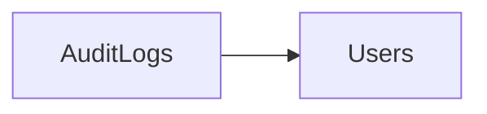

Primary tables: `dbo.AuditLogs`

## Candidates

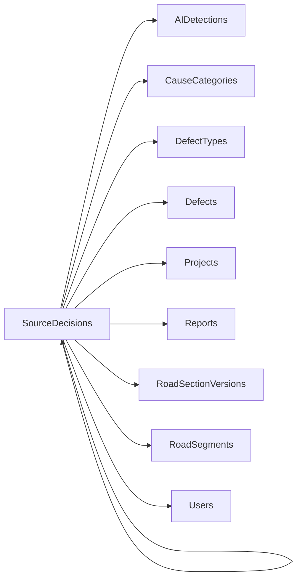

Primary tables: `dbo.SourceDecisions`

## Cases

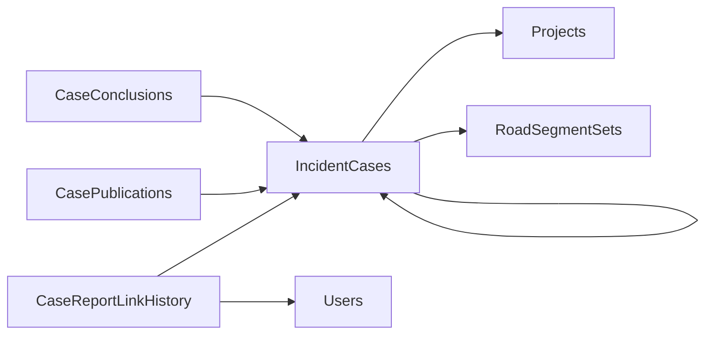

Primary tables: `dbo.CaseConclusions`, `dbo.CasePublications`, `dbo.CaseReportLinkHistory`, `dbo.IncidentCases`

## Catalogs

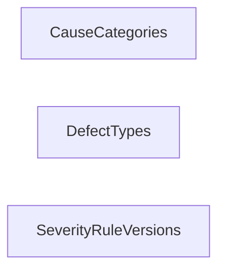

Primary tables: `dbo.CauseCategories`, `dbo.DefectTypes`, `dbo.SeverityRuleVersions`

## Clocks

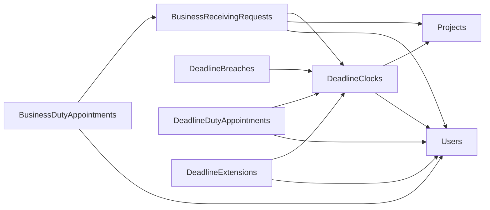

Primary tables: `dbo.BusinessDutyAppointments`, `dbo.BusinessReceivingRequests`, `dbo.DeadlineBreaches`, `dbo.DeadlineClocks`, `dbo.DeadlineDutyAppointments`, `dbo.DeadlineExtensions`

## Defects

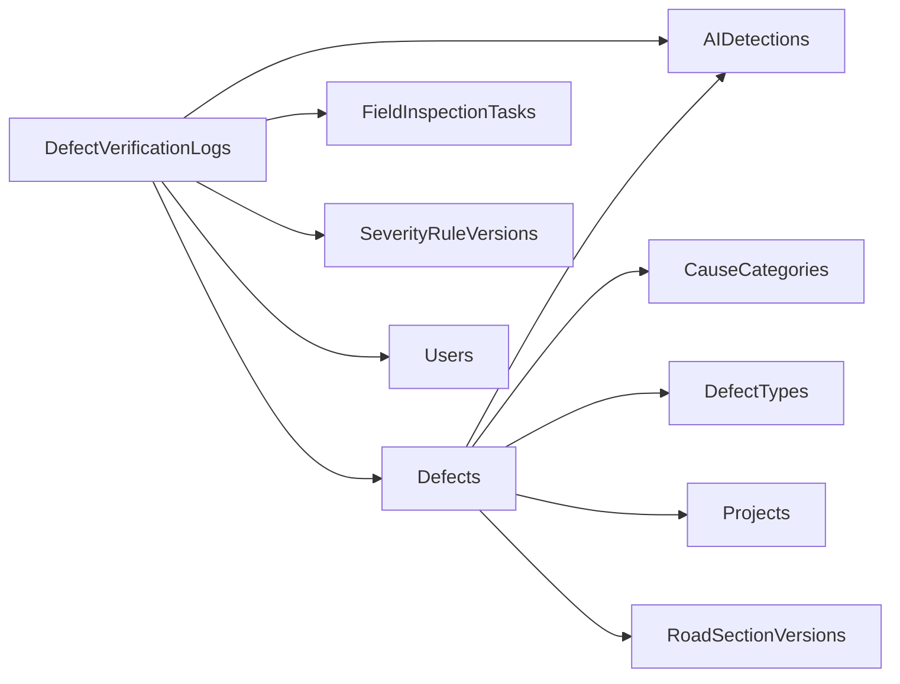

Primary tables: `dbo.DefectVerificationLogs`, `dbo.Defects`

## Devices

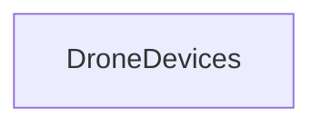

Primary tables: `dbo.DroneDevices`

## Exports

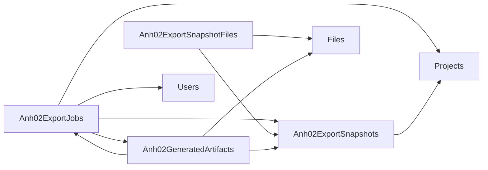

Primary tables: `dbo.Anh02ExportJobs`, `dbo.Anh02ExportSnapshotFiles`, `dbo.Anh02ExportSnapshots`, `dbo.Anh02GeneratedArtifacts`

## Files

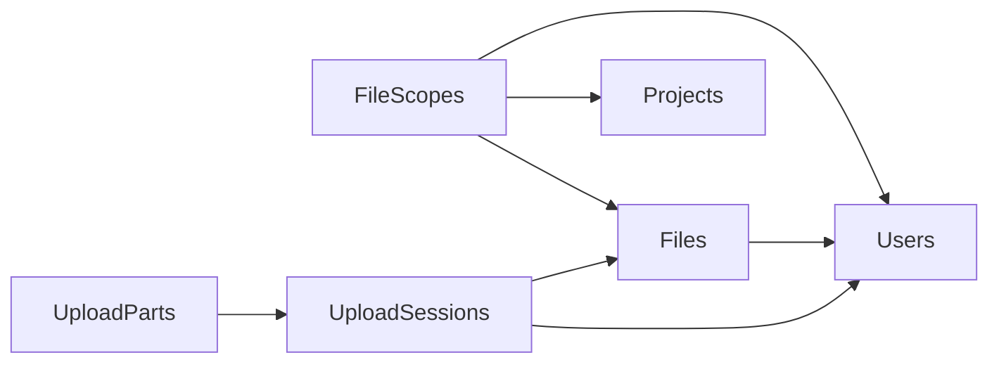

Primary tables: `dbo.FileScopes`, `dbo.Files`, `dbo.UploadParts`, `dbo.UploadSessions`

## Idempotency

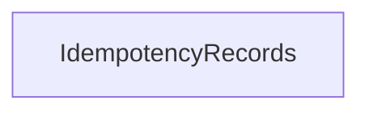

Primary tables: `dbo.IdempotencyRecords`

## Identity

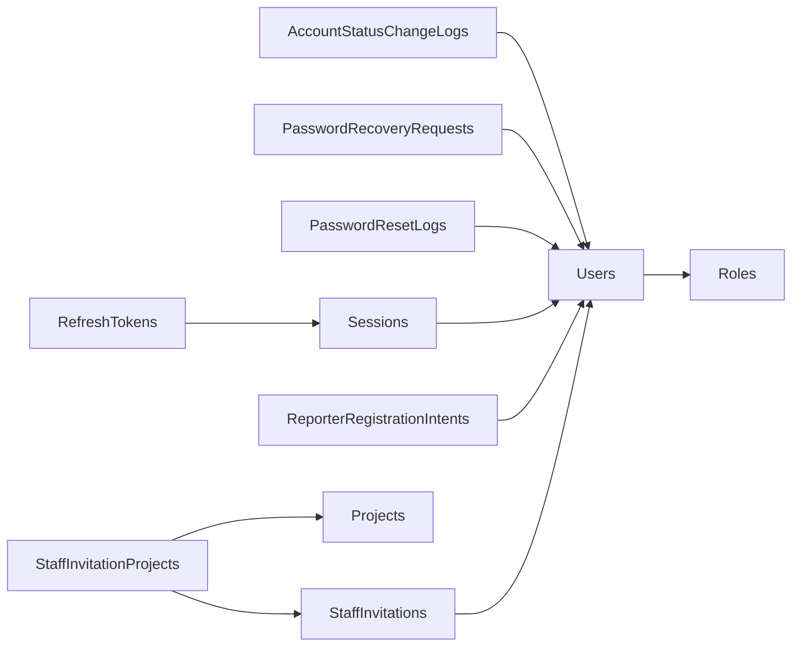

Primary tables: `dbo.AccountStatusChangeLogs`, `dbo.PasswordRecoveryRequests`, `dbo.PasswordResetLogs`, `dbo.RefreshTokens`, `dbo.ReporterRegistrationIntents`, `dbo.Roles`, `dbo.Sessions`, `dbo.StaffInvitationProjects`, `dbo.StaffInvitations`, `dbo.Users`

## Inspections

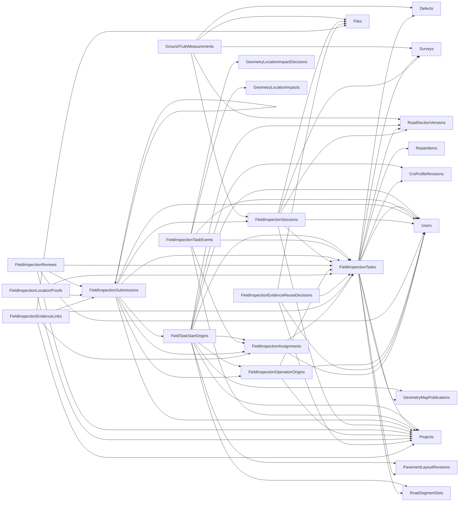

Primary tables: `dbo.FieldInspectionAssignments`, `dbo.FieldInspectionEvidenceLinks`, `dbo.FieldInspectionEvidenceReuseDecisions`, `dbo.FieldInspectionLocationProofs`, `dbo.FieldInspectionOperationOrigins`, `dbo.FieldInspectionReviews`, `dbo.FieldInspectionSessions`, `dbo.FieldInspectionSubmissions`, `dbo.FieldInspectionTaskEvents`, `dbo.FieldInspectionTasks`, `dbo.FieldTaskStartOrigins`, `dbo.GroundTruthMeasurements`

## Messaging

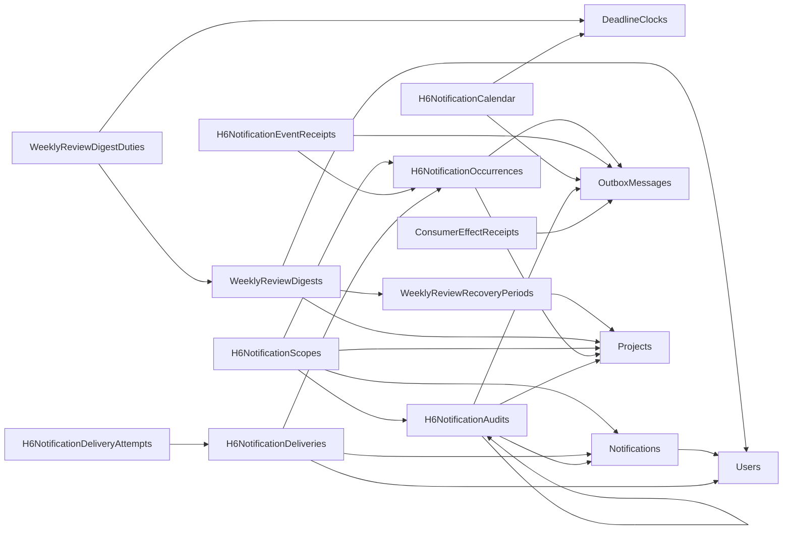

Primary tables: `dbo.ConsumerEffectReceipts`, `dbo.H6NotificationAudits`, `dbo.H6NotificationCalendar`, `dbo.H6NotificationDeliveries`, `dbo.H6NotificationDeliveryAttempts`, `dbo.H6NotificationEventReceipts`, `dbo.H6NotificationOccurrences`, `dbo.H6NotificationScopes`, `dbo.Notifications`, `dbo.OutboxMessages`, `dbo.WeeklyReviewDigestDuties`, `dbo.WeeklyReviewDigests`, `dbo.WeeklyReviewRecoveryPeriods`

## Models

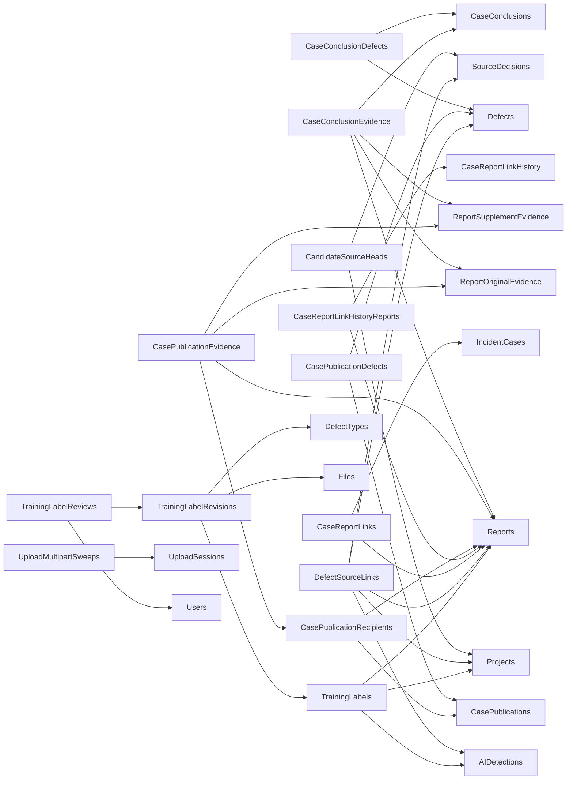

Primary tables: `dbo.CandidateSourceHeads`, `dbo.CaseConclusionDefects`, `dbo.CaseConclusionEvidence`, `dbo.CasePublicationDefects`, `dbo.CasePublicationEvidence`, `dbo.CasePublicationRecipients`, `dbo.CaseReportLinkHistoryReports`, `dbo.CaseReportLinks`, `dbo.DefectSourceLinks`, `dbo.TrainingLabelReviews`, `dbo.TrainingLabelRevisions`, `dbo.TrainingLabels`, `dbo.UploadMultipartSweeps`

## Offline

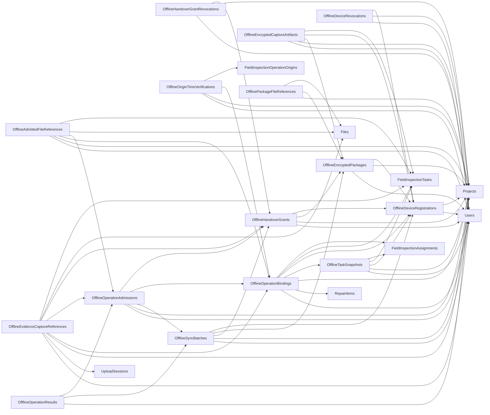

Primary tables: `dbo.OfflineAdmittedFileReferences`, `dbo.OfflineDeviceRegistrations`, `dbo.OfflineDeviceRevocations`, `dbo.OfflineEncryptedCaptureArtifacts`, `dbo.OfflineEncryptedPackages`, `dbo.OfflineEvidenceCaptureReferences`, `dbo.OfflineHandoverGrantRevocations`, `dbo.OfflineHandoverGrants`, `dbo.OfflineOperationAdmissions`, `dbo.OfflineOperationBindings`, `dbo.OfflineOperationResults`, `dbo.OfflineOriginTimeVerifications`, `dbo.OfflinePackageFileReferences`, `dbo.OfflineSyncBatches`, `dbo.OfflineTaskSnapshots`

## Processing

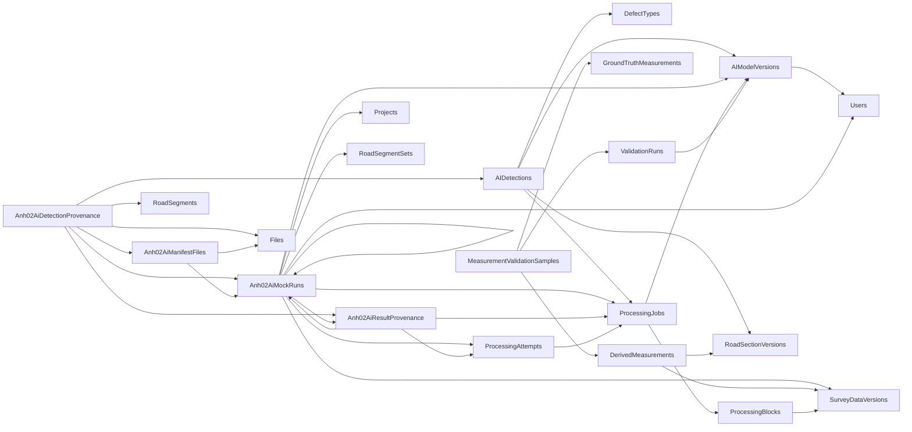

Primary tables: `dbo.AIDetections`, `dbo.AIModelVersions`, `dbo.Anh02AiDetectionProvenance`, `dbo.Anh02AiManifestFiles`, `dbo.Anh02AiMockRuns`, `dbo.Anh02AiResultProvenance`, `dbo.DerivedMeasurements`, `dbo.MeasurementValidationSamples`, `dbo.ProcessingAttempts`, `dbo.ProcessingBlocks`, `dbo.ProcessingJobs`, `dbo.ValidationRuns`

## Projects

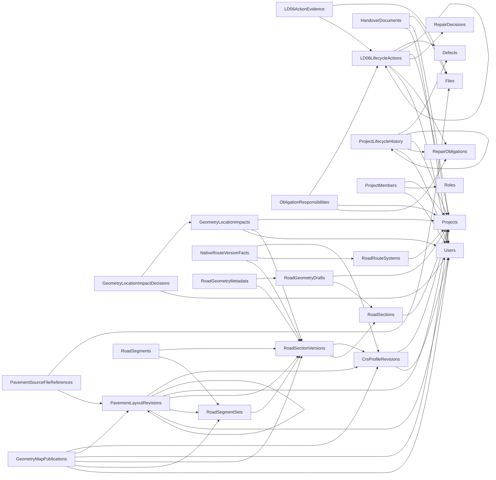

Primary tables: `dbo.CrsProfileRevisions`, `dbo.GeometryLocationImpactDecisions`, `dbo.GeometryLocationImpacts`, `dbo.GeometryMapPublications`, `dbo.HandoverDocuments`, `dbo.LD06ActionEvidence`, `dbo.LD06LifecycleActions`, `dbo.NativeRouteVersionFacts`, `dbo.ObligationResponsibilities`, `dbo.PavementLayoutRevisions`, `dbo.PavementSourceFileReferences`, `dbo.ProjectLifecycleHistory`, `dbo.ProjectMembers`, `dbo.Projects`, `dbo.RoadGeometryDrafts`, `dbo.RoadGeometryMetadata`, `dbo.RoadRouteSystems`, `dbo.RoadSectionVersions`, `dbo.RoadSections`, `dbo.RoadSegmentSets`, `dbo.RoadSegments`

## Repairs

```mermaid
flowchart LR
  CrsProfileRevisions["CrsProfileRevisions"]
  DeadlineClocks["DeadlineClocks"]
  Defects["Defects"]
  FieldInspectionAssignments["FieldInspectionAssignments"]
  FieldInspectionEvidenceReuseDecisions["FieldInspectionEvidenceReuseDecisions"]
  FieldInspectionOperationOrigins["FieldInspectionOperationOrigins"]
  FieldInspectionSessions["FieldInspectionSessions"]
  FieldInspectionSubmissions["FieldInspectionSubmissions"]
  FieldInspectionTaskEvents["FieldInspectionTaskEvents"]
  FieldInspectionTasks["FieldInspectionTasks"]
  FieldTaskStartOrigins["FieldTaskStartOrigins"]
  Files["Files"]
  GeometryMapPublications["GeometryMapPublications"]
  GroundTruthMeasurements["GroundTruthMeasurements"]
  HandoverDocuments["HandoverDocuments"]
  PavementLayoutRevisions["PavementLayoutRevisions"]
  Projects["Projects"]
  RepairActualScopes["RepairActualScopes"]
  RepairAssessmentEvidence["RepairAssessmentEvidence"]
  RepairAssessmentMeasurements["RepairAssessmentMeasurements"]
  RepairAttemptEvidence["RepairAttemptEvidence"]
  RepairAttemptReviews["RepairAttemptReviews"]
  RepairAttemptSubmissionLinks["RepairAttemptSubmissionLinks"]
  RepairAttempts["RepairAttempts"]
  RepairCorrectionEvidence["RepairCorrectionEvidence"]
  RepairDangerAcknowledgements["RepairDangerAcknowledgements"]
  RepairDangerWarnings["RepairDangerWarnings"]
  RepairDecisions["RepairDecisions"]
  RepairEligibilityAssessments["RepairEligibilityAssessments"]
  RepairEligibilityHandoverSources["RepairEligibilityHandoverSources"]
  RepairEligibilityWarrantySources["RepairEligibilityWarrantySources"]
  RepairExecutionAuthorizations["RepairExecutionAuthorizations"]
  RepairExecutionFinishes["RepairExecutionFinishes"]
  RepairExecutionStarts["RepairExecutionStarts"]
  RepairFieldTaskBindings["RepairFieldTaskBindings"]
  RepairItemLifecycleEvents["RepairItemLifecycleEvents"]
  RepairItems["RepairItems"]
  RepairMeasurementAssessments["RepairMeasurementAssessments"]
  RepairNormalSuccessors["RepairNormalSuccessors"]
  RepairObligationResolutionEvents["RepairObligationResolutionEvents"]
  RepairObligations["RepairObligations"]
  RepairPackages["RepairPackages"]
  RepairPolicyDraftChanges["RepairPolicyDraftChanges"]
  RepairPolicyDrafts["RepairPolicyDrafts"]
  RepairPolicyMeasurementRules["RepairPolicyMeasurementRules"]
  RepairPolicyRevisions["RepairPolicyRevisions"]
  RepairPolicyRevocations["RepairPolicyRevocations"]
  RepairReviewRequests["RepairReviewRequests"]
  RepairSafetyActionSources["RepairSafetyActionSources"]
  RepairSafetyCheckEvidence["RepairSafetyCheckEvidence"]
  RepairSafetyChecks["RepairSafetyChecks"]
  RepairSafetyMonitoring["RepairSafetyMonitoring"]
  RepairSafetyResponsibilityTransfers["RepairSafetyResponsibilityTransfers"]
  RepairTemporarySafetyMeasures["RepairTemporarySafetyMeasures"]
  RepairWorkHandovers["RepairWorkHandovers"]
  RoadCoverageMappings["RoadCoverageMappings"]
  RoadSectionVersions["RoadSectionVersions"]
  RoadSections["RoadSections"]
  RoadSegmentSets["RoadSegmentSets"]
  Users["Users"]
  Warranties["Warranties"]
  RepairActualScopes --> RepairObligations
  RepairActualScopes --> RoadSections
  RepairAssessmentEvidence --> FieldInspectionEvidenceReuseDecisions
  RepairAssessmentEvidence --> Files
  RepairAssessmentEvidence --> RepairMeasurementAssessments
  RepairAssessmentEvidence --> Users
  RepairAssessmentMeasurements --> GroundTruthMeasurements
  RepairAssessmentMeasurements --> RepairMeasurementAssessments
  RepairAttemptEvidence --> Files
  RepairAttemptEvidence --> RepairAttempts
  RepairAttemptReviews --> FieldInspectionSubmissions
  RepairAttemptReviews --> Projects
  RepairAttemptReviews --> RepairAttemptSubmissionLinks
  RepairAttemptReviews --> RepairAttempts
  RepairAttemptReviews --> RepairFieldTaskBindings
  RepairAttemptReviews --> RepairItems
  RepairAttemptReviews --> Users
  RepairAttemptSubmissionLinks --> DeadlineClocks
  RepairAttemptSubmissionLinks --> FieldInspectionSubmissions
  RepairAttemptSubmissionLinks --> Projects
  RepairAttemptSubmissionLinks --> RepairAttemptSubmissionLinks
  RepairAttemptSubmissionLinks --> RepairAttempts
  RepairAttemptSubmissionLinks --> RepairExecutionFinishes
  RepairAttemptSubmissionLinks --> RepairFieldTaskBindings
  RepairAttemptSubmissionLinks --> RepairItems
  RepairAttempts --> Defects
  RepairAttempts --> FieldInspectionAssignments
  RepairAttempts --> FieldInspectionTasks
  RepairAttempts --> Projects
  RepairAttempts --> RepairItems
  RepairAttempts --> RepairObligations
  RepairAttempts --> Users
  RepairCorrectionEvidence --> Files
  RepairCorrectionEvidence --> RepairDecisions
  RepairDangerAcknowledgements --> RepairDangerWarnings
  RepairDangerAcknowledgements --> RepairSafetyMonitoring
  RepairDangerAcknowledgements --> Users
  RepairDangerWarnings --> RepairSafetyMonitoring
  RepairDangerWarnings --> Users
  RepairDecisions --> Defects
  RepairDecisions --> RepairDecisions
  RepairDecisions --> RepairItems
  RepairDecisions --> RepairObligations
  RepairDecisions --> Users
  RepairEligibilityAssessments --> Projects
  RepairEligibilityAssessments --> RepairFieldTaskBindings
  RepairEligibilityAssessments --> RepairItems
  RepairEligibilityAssessments --> RepairMeasurementAssessments
  RepairEligibilityAssessments --> RepairPolicyRevisions
  RepairEligibilityAssessments --> RoadSections
  RepairEligibilityHandoverSources --> Files
  RepairEligibilityHandoverSources --> HandoverDocuments
  RepairEligibilityHandoverSources --> RepairEligibilityAssessments
  RepairEligibilityWarrantySources --> Files
  RepairEligibilityWarrantySources --> RepairEligibilityAssessments
  RepairEligibilityWarrantySources --> Warranties
  RepairExecutionAuthorizations --> Defects
  RepairExecutionAuthorizations --> FieldInspectionAssignments
  RepairExecutionAuthorizations --> FieldInspectionTasks
  RepairExecutionAuthorizations --> Projects
  RepairExecutionAuthorizations --> RepairPolicyRevisions
  RepairExecutionAuthorizations --> Users
  RepairExecutionFinishes --> FieldInspectionOperationOrigins
  RepairExecutionFinishes --> Projects
  RepairExecutionFinishes --> RepairExecutionStarts
  RepairExecutionFinishes --> RepairFieldTaskBindings
  RepairExecutionFinishes --> RepairItems
  RepairExecutionFinishes --> Users
  RepairExecutionStarts --> FieldInspectionOperationOrigins
  RepairExecutionStarts --> FieldTaskStartOrigins
  RepairExecutionStarts --> Projects
  RepairExecutionStarts --> RepairEligibilityAssessments
  RepairExecutionStarts --> RepairFieldTaskBindings
  RepairExecutionStarts --> RepairItems
  RepairExecutionStarts --> RepairMeasurementAssessments
  RepairExecutionStarts --> Users
  RepairFieldTaskBindings --> CrsProfileRevisions
  RepairFieldTaskBindings --> Defects
  RepairFieldTaskBindings --> FieldInspectionAssignments
  RepairFieldTaskBindings --> FieldInspectionTasks
  RepairFieldTaskBindings --> GeometryMapPublications
  RepairFieldTaskBindings --> PavementLayoutRevisions
  RepairFieldTaskBindings --> Projects
  RepairFieldTaskBindings --> RepairExecutionAuthorizations
  RepairFieldTaskBindings --> RepairItems
  RepairFieldTaskBindings --> RepairObligations
  RepairFieldTaskBindings --> RepairPolicyRevisions
  RepairFieldTaskBindings --> RoadSectionVersions
  RepairFieldTaskBindings --> RoadSegmentSets
  RepairFieldTaskBindings --> Users
  RepairItemLifecycleEvents --> Defects
  RepairItemLifecycleEvents --> FieldInspectionSubmissions
  RepairItemLifecycleEvents --> Projects
  RepairItemLifecycleEvents --> RepairAttemptReviews
  RepairItemLifecycleEvents --> RepairAttempts
  RepairItemLifecycleEvents --> RepairDecisions
  RepairItemLifecycleEvents --> RepairFieldTaskBindings
  RepairItemLifecycleEvents --> RepairItems
  RepairItemLifecycleEvents --> RepairObligations
  RepairItemLifecycleEvents --> Users
  RepairItems --> Defects
  RepairItems --> FieldInspectionSubmissions
  RepairItems --> Projects
  RepairItems --> RepairAttemptReviews
  RepairItems --> RepairAttemptSubmissionLinks
  RepairItems --> RepairAttempts
  RepairItems --> RepairDecisions
  RepairItems --> RepairExecutionFinishes
  RepairItems --> RepairExecutionStarts
  RepairItems --> RepairFieldTaskBindings
  RepairItems --> RepairItems
  RepairItems --> RepairMeasurementAssessments
  RepairItems --> RepairObligations
  RepairItems --> RepairPackages
  RepairItems --> Users
  RepairMeasurementAssessments --> FieldInspectionAssignments
  RepairMeasurementAssessments --> FieldInspectionOperationOrigins
  RepairMeasurementAssessments --> FieldInspectionSessions
  RepairMeasurementAssessments --> FieldInspectionSubmissions
  RepairMeasurementAssessments --> FieldInspectionTasks
  RepairMeasurementAssessments --> FieldTaskStartOrigins
  RepairMeasurementAssessments --> Projects
  RepairMeasurementAssessments --> RepairFieldTaskBindings
  RepairMeasurementAssessments --> RepairItems
  RepairMeasurementAssessments --> Users
  RepairNormalSuccessors --> FieldInspectionTaskEvents
  RepairNormalSuccessors --> Projects
  RepairNormalSuccessors --> RepairDecisions
  RepairNormalSuccessors --> RepairItemLifecycleEvents
  RepairNormalSuccessors --> RepairItems
  RepairNormalSuccessors --> RepairMeasurementAssessments
  RepairNormalSuccessors --> RepairObligations
  RepairNormalSuccessors --> Users
  RepairObligationResolutionEvents --> RepairDecisions
  RepairObligationResolutionEvents --> RepairObligations
  RepairObligations --> Defects
  RepairObligations --> FieldTaskStartOrigins
  RepairObligations --> Projects
  RepairObligations --> RepairDecisions
  RepairObligations --> RepairItems
  RepairObligations --> RepairPackages
  RepairPackages --> Defects
  RepairPackages --> Projects
  RepairPolicyDraftChanges --> RepairPolicyDrafts
  RepairPolicyDraftChanges --> Users
  RepairPolicyDrafts --> Projects
  RepairPolicyDrafts --> RepairPolicyDraftChanges
  RepairPolicyDrafts --> RepairPolicyRevisions
  RepairPolicyMeasurementRules --> RepairPolicyRevisions
  RepairPolicyRevisions --> Projects
  RepairPolicyRevisions --> Users
  RepairPolicyRevocations --> RepairPolicyRevisions
  RepairPolicyRevocations --> Users
  RepairReviewRequests --> Projects
  RepairReviewRequests --> RepairDecisions
  RepairReviewRequests --> RepairItems
  RepairReviewRequests --> Users
  RepairSafetyActionSources --> Projects
  RepairSafetyActionSources --> RepairFieldTaskBindings
  RepairSafetyActionSources --> RepairItems
  RepairSafetyActionSources --> RepairTemporarySafetyMeasures
  RepairSafetyActionSources --> Users
  RepairSafetyCheckEvidence --> Files
  RepairSafetyCheckEvidence --> RepairSafetyChecks
  RepairSafetyCheckEvidence --> Users
  RepairSafetyChecks --> RepairSafetyMonitoring
  RepairSafetyChecks --> RepairTemporarySafetyMeasures
  RepairSafetyChecks --> Users
  RepairSafetyMonitoring --> RepairObligations
  RepairSafetyMonitoring --> RepairSafetyChecks
  RepairSafetyMonitoring --> RepairTemporarySafetyMeasures
  RepairSafetyResponsibilityTransfers --> RepairTemporarySafetyMeasures
  RepairSafetyResponsibilityTransfers --> Users
  RepairTemporarySafetyMeasures --> Defects
  RepairTemporarySafetyMeasures --> Projects
  RepairTemporarySafetyMeasures --> RepairObligations
  RepairTemporarySafetyMeasures --> RepairSafetyResponsibilityTransfers
  RepairTemporarySafetyMeasures --> Users
  RepairWorkHandovers --> RepairItems
  RepairWorkHandovers --> Users
  RoadCoverageMappings --> Files
  RoadCoverageMappings --> HandoverDocuments
  RoadCoverageMappings --> Projects
  RoadCoverageMappings --> RepairObligations
  RoadCoverageMappings --> RoadCoverageMappings
  RoadCoverageMappings --> RoadSections
  RoadCoverageMappings --> Users
```

Primary tables: `dbo.RepairActualScopes`, `dbo.RepairAssessmentEvidence`, `dbo.RepairAssessmentMeasurements`, `dbo.RepairAttemptEvidence`, `dbo.RepairAttemptReviews`, `dbo.RepairAttemptSubmissionLinks`, `dbo.RepairAttempts`, `dbo.RepairCorrectionEvidence`, `dbo.RepairDangerAcknowledgements`, `dbo.RepairDangerWarnings`, `dbo.RepairDecisions`, `dbo.RepairEligibilityAssessments`, `dbo.RepairEligibilityHandoverSources`, `dbo.RepairEligibilityWarrantySources`, `dbo.RepairExecutionAuthorizations`, `dbo.RepairExecutionFinishes`, `dbo.RepairExecutionStarts`, `dbo.RepairFieldTaskBindings`, `dbo.RepairItemLifecycleEvents`, `dbo.RepairItems`, `dbo.RepairMeasurementAssessments`, `dbo.RepairNormalSuccessors`, `dbo.RepairObligationResolutionEvents`, `dbo.RepairObligations`, `dbo.RepairPackages`, `dbo.RepairPolicyDraftChanges`, `dbo.RepairPolicyDrafts`, `dbo.RepairPolicyMeasurementRules`, `dbo.RepairPolicyRevisions`, `dbo.RepairPolicyRevocations`, `dbo.RepairReviewRequests`, `dbo.RepairSafetyActionSources`, `dbo.RepairSafetyCheckEvidence`, `dbo.RepairSafetyChecks`, `dbo.RepairSafetyMonitoring`, `dbo.RepairSafetyResponsibilityTransfers`, `dbo.RepairTemporarySafetyMeasures`, `dbo.RepairWorkHandovers`, `dbo.RoadCoverageMappings`

## Reporting

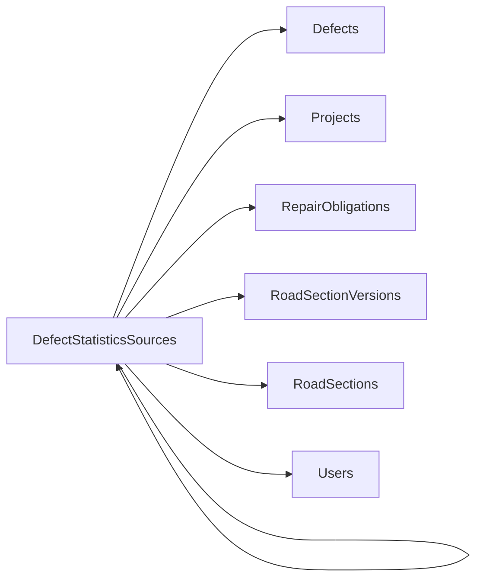

Primary tables: `dbo.DefectStatisticsSources`

## Reports

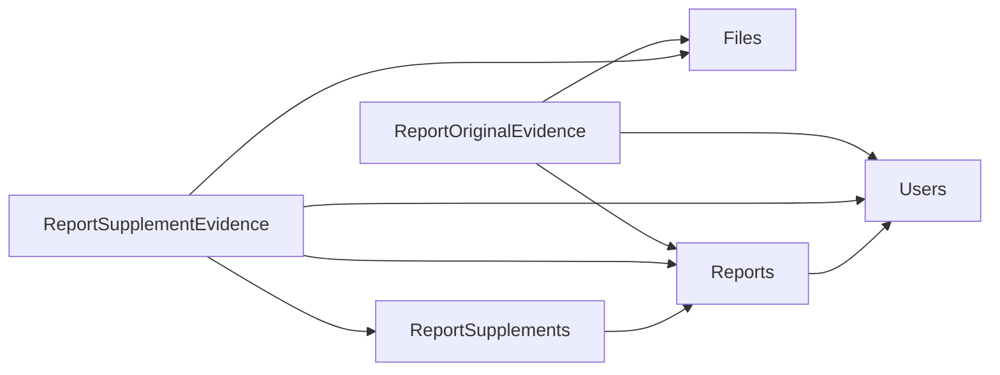

Primary tables: `dbo.ReportOriginalEvidence`, `dbo.ReportSupplementEvidence`, `dbo.ReportSupplements`, `dbo.Reports`

## Retention

```mermaid
flowchart LR
  Files["Files"]
  Projects["Projects"]
  RetentionBasisHeads["RetentionBasisHeads"]
  RetentionBasisRevisions["RetentionBasisRevisions"]
  RetentionEvaluationItems["RetentionEvaluationItems"]
  RetentionEvaluations["RetentionEvaluations"]
  RetentionHoldHistories["RetentionHoldHistories"]
  RetentionHolds["RetentionHolds"]
  Users["Users"]
  RetentionBasisHeads --> Files
  RetentionBasisHeads --> RetentionBasisRevisions
  RetentionBasisRevisions --> Files
  RetentionBasisRevisions --> RetentionBasisRevisions
  RetentionBasisRevisions --> Users
  RetentionEvaluationItems --> Files
  RetentionEvaluationItems --> RetentionEvaluations
  RetentionEvaluations --> Projects
  RetentionEvaluations --> Users
  RetentionHoldHistories --> RetentionHolds
  RetentionHoldHistories --> Users
  RetentionHolds --> Users
```

Primary tables: `dbo.RetentionBasisHeads`, `dbo.RetentionBasisRevisions`, `dbo.RetentionEvaluationItems`, `dbo.RetentionEvaluations`, `dbo.RetentionHoldHistories`, `dbo.RetentionHolds`

## Surveys

```mermaid
flowchart LR
  BaselineCurrentPointers["BaselineCurrentPointers"]
  BaselineSelectionItems["BaselineSelectionItems"]
  BaselineSelections["BaselineSelections"]
  DatasetAssessmentItems["DatasetAssessmentItems"]
  DatasetAssessments["DatasetAssessments"]
  DroneDevices["DroneDevices"]
  Files["Files"]
  Flights["Flights"]
  Projects["Projects"]
  QualityChecks["QualityChecks"]
  RoadSectionVersions["RoadSectionVersions"]
  RoadSections["RoadSections"]
  RoadSegments["RoadSegments"]
  SupplementarySurveyRequests["SupplementarySurveyRequests"]
  SurveyAssignments["SurveyAssignments"]
  SurveyDataVersions["SurveyDataVersions"]
  SurveyFiles["SurveyFiles"]
  SurveyPlanPostponements["SurveyPlanPostponements"]
  SurveyPlanScopes["SurveyPlanScopes"]
  SurveyPlans["SurveyPlans"]
  SurveyRequestScopes["SurveyRequestScopes"]
  SurveyRequests["SurveyRequests"]
  Surveys["Surveys"]
  Users["Users"]
  BaselineCurrentPointers --> BaselineSelectionItems
  BaselineCurrentPointers --> Projects
  BaselineSelectionItems --> BaselineSelections
  BaselineSelectionItems --> DatasetAssessments
  BaselineSelectionItems --> SurveyDataVersions
  BaselineSelections --> Projects
  BaselineSelections --> Users
  DatasetAssessmentItems --> DatasetAssessments
  DatasetAssessmentItems --> RoadSegments
  DatasetAssessments --> SurveyDataVersions
  DatasetAssessments --> Users
  Flights --> DroneDevices
  Flights --> Surveys
  Flights --> Users
  QualityChecks --> SurveyDataVersions
  QualityChecks --> SurveyFiles
  QualityChecks --> Users
  SupplementarySurveyRequests --> SurveyRequests
  SupplementarySurveyRequests --> Surveys
  SupplementarySurveyRequests --> Users
  SurveyAssignments --> SurveyRequests
  SurveyAssignments --> Users
  SurveyDataVersions --> Surveys
  SurveyFiles --> Files
  SurveyFiles --> Flights
  SurveyFiles --> Surveys
  SurveyPlanPostponements --> SurveyPlans
  SurveyPlanScopes --> RoadSectionVersions
  SurveyPlanScopes --> SurveyPlans
  SurveyPlans --> Projects
  SurveyPlans --> RoadSectionVersions
  SurveyPlans --> RoadSections
  SurveyRequestScopes --> RoadSectionVersions
  SurveyRequestScopes --> SurveyRequests
  SurveyRequests --> Projects
  SurveyRequests --> RoadSectionVersions
  SurveyRequests --> RoadSections
  SurveyRequests --> SupplementarySurveyRequests
  SurveyRequests --> SurveyPlans
  SurveyRequests --> SurveyRequests
  SurveyRequests --> Users
  Surveys --> Projects
  Surveys --> RoadSectionVersions
  Surveys --> SurveyRequests
  Surveys --> Users
```

Primary tables: `dbo.BaselineCurrentPointers`, `dbo.BaselineSelectionItems`, `dbo.BaselineSelections`, `dbo.DatasetAssessmentItems`, `dbo.DatasetAssessments`, `dbo.Flights`, `dbo.QualityChecks`, `dbo.SupplementarySurveyRequests`, `dbo.SurveyAssignments`, `dbo.SurveyDataVersions`, `dbo.SurveyFiles`, `dbo.SurveyPlanPostponements`, `dbo.SurveyPlanScopes`, `dbo.SurveyPlans`, `dbo.SurveyRequestScopes`, `dbo.SurveyRequests`, `dbo.Surveys`

## Warranties

```mermaid
flowchart LR
  Files["Files"]
  HandoverDocuments["HandoverDocuments"]
  Projects["Projects"]
  RoadSections["RoadSections"]
  Warranties["Warranties"]
  Warranties --> Files
  Warranties --> HandoverDocuments
  Warranties --> Projects
  Warranties --> RoadSections
```

Primary tables: `dbo.Warranties`
