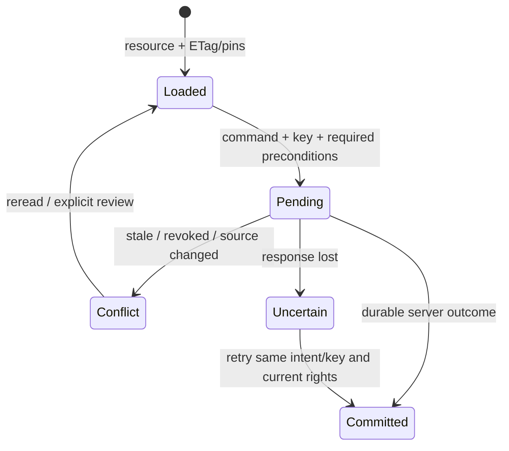

# Boundary Web/Android ↔ Backend

> Baseline source: `cdeb1ca1037744d06995058af13d0582f6273c0a`, nhánh `huy-review`; BE-DOC-02, ngày 13/10/2026. `CURRENT_VERIFIED` = source đối chiếu tại baseline; build/tests trong phần việc này **NOT_RUN**. Source không chứng minh external adoption/deployed behavior. Kết quả DOC-AUDIT-01 là **HISTORICAL**.

Nghiệp vụ từ [32–44](../../../docs/product/confirmed-decisions.md) và [HUY final, latest activation](../../../planning/development/HUY-FINAL-INTEGRATION.md); [audit gaps](../../../docs/audit/DOC-AUDIT-01-OPEN-GAPS.md) được đối chiếu lại với source.

## EXPECTED_BUSINESS_BEHAVIOR — TARGET_CONFIRMED

Web/Android là client nghiệp vụ; ASP.NET Core giữ current identity/project/resource authority, quyết định trạng thái và durable effects. PR44 giao FE/Android cho bên khác, không biến screen prototype hoặc FE-generated V2 draft thành runtime contract. PR36A tách Web secure cookie/server session và Android access/refresh. PR37 pilot idle/max cũ được **HUY H1 persistent-login authority mới supersede**: lifecycle persistent không tự logout sau thời gian nhàn rỗi, nhưng JWT/Web ticket vẫn hữu hạn và phải renew qua server; revoke/account/role/current membership luôn có hiệu lực.

Client phải giữ task/geometry/policy/source versions đã tải và original actor; offline không cấp quyền vô hạn. R08 original24h window và ND01 vẫn bảo toàn; stale/sync/reopen không reset clock. R29 current protected access và R30 không xóa dữ liệu chưa có durable acknowledgment. PR42A encrypted handover chỉ khi còn truy cập device, không hứa organizational recovery escrow. PR43A task/route/segment/destination đủ tác nghiệp; basemap provider/license chưa bắt buộc.

## CURRENT_IMPLEMENTATION và transport

Controllers dưới `/api/v1`, version `1.0` qua API versioning. Bearer auth và Web cookie là hai admission paths, không áp cookie tự động cho mọi `[Authorize]`. `WebCookieConfiguration.IsCookieEligibleRequest` nhận exact endpoint metadata `[WebCookieEligible]` và legacy allowlist; Authorization header có precedence. [WebCookieConfiguration.cs · IsCookieEligibleRequest L21](../../../RoadGuardSystem.API/Authentication/WebCookieConfiguration.cs#L21). Middleware từ chối mixed credential actors400, unsafe cookie requests phải CSRF, auth/web có controller-specific flow. [WebCookieRequestMiddleware.cs · InvokeAsync L13](../../../RoadGuardSystem.API/Middlewares/WebCookieRequestMiddleware.cs#L13).

Client nhận `application/problem+json` có status/title/detail/instance/code/correlationId ở các controller/middleware đã map. Không coi mọi error cùng envelope hoặc mọi action đều có cùng status: legacy/new workflows khác nhau, catalog operation là chuẩn implemented. `CorrelationIdMiddleware` dùng để nối log/error; không gửi secret/token trong correlation hay DTO.

## Actor/resource scope và preconditions

| Client/actor | Boundary phải giữ |
|---|---|
| Web Supervisor | Global authority ở operation có source cho phép; không suy membership-only hoặc quyền xem mọi private file |
| PM | Current project scope; project member/role/effective date; chỉ command được phép trên current resource/source |
| Android Crew | Assigned task/item/binding, loaded pins, signed admission và current rights reconnect; measure-only không quyền sửa |
| Operator | Assigned survey task + route/set/band; task-scoped video/SRT upload |
| Reporter | Own report/private photo/publication recipient; không internal case note hoặc ảnh Report khác |

Role claim thiếu/unknown có thể401; role đúng nhưng resource/current state không được phép403/404 theo action. Lấy một GUID không trao quyền. Session hết ticket được renew; bị revoke phải deny, receipt replay không khôi phục quyền cũ. Supervisor contact-account detail khác roster/primary-PM DTO không contact; không dùng một response rộng thay DTO dự định.

## API sequences và DTO producer/consumer

1. Web dùng implemented `/api/v1/auth/web/*` flow; Android `/api/v1/auth/*`; đọc profile/me và server session renewal đúng DTO. Client không tự chuyển body refresh thành cookie hay ngược lại. Full authentication sequence ở [workflow account](../02_Business_Workflows/01_Authentication_and_Accounts.md) và [security](../05_Security/04_Cookie_CSRF_and_Token_Security.md).
2. PM/Supervisor đọc `GET /api/v1/projects`, project members, primary-project-manager và work-package để xác định scope; không lọc toàn bộ user list phía FE để giả backend authorization. Roster/primary detail được thiết kế theo dữ liệu cần thiết.
3. Geometry: GET current resource/ETag → POST/PUT approved route với key và If-Match khi cần → giữ returned geometry/segment/publication hash → đọc task-bound package. Không tự áp newest geometry cho task cũ.
4. Reporter: private upload verified → POST reports → own read/supplement; nội bộ Case conclusion → explicit publication → Reporter view/download. Form Reporter không nhận private backend fields status/project/owner là trusted input.
5. Drone: create/accept task → verified multipart video/SRT → POST task dataset với task ETag → PM assessment/baseline → processing poll; 202 là admitted, không inference finished.
6. FIELD/repair: GET assigned task/item → accept/start/capture/assessment/submission/review đúng version; UI ba trạng thái “Chưa sửa / Đã báo sửa, chờ kiểm tra / Đã xác nhận sửa” dựa actual decision, không coi Crew repaired claim là accepted.
7. Offline: register device → download snapshot → signed `/api/v1/offline/sync` → xử lý từng outcome + durableAcknowledgment. Conflict giữ local evidence/PM review, không replay theo stale actor/quyền hoặc xóa local vì HTTP200 tổng batch. Handover export/grant/import giữ actor gốc.
8. Reporting/export: POST `/api/v1/projects/{projectId}/exports` + key →202 Location+ETag → GET export → GET `/manifest` và `/content` khi ready; content check current rights, frozen snapshot/hash. Không dùng cached permission để download.

DTO families do Backend producer giữ: Identity/Projects/Surveys/Files/Reports/Cases/Defects/Processing/Inspections/Repairs/Offline/Reporting/Exports. [Request/response catalog](../03_API_Contracts/03_Request_Response_DTOs.md) ghi toàn bộ schema; [Endpoint catalog](../03_API_Contracts/02_Endpoint_Catalog.md) ghi operation-specific parameters/status/headers. DTO không đồng nhất EF entity; `BoundaryFactMappings` tách public wire khỏi persistence facts. Không serialize database entity trực tiếp hoặc assume property casing từ tên C#.

## State machine của một mutation client

Đây là client contract behavior, không enum domain. Key được giữ cho cùng một ý định và cùng canonical request; không dùng key mới để nhân effect sau timeout. ETag/resource/source pins không thay thế identity. Với state chưa biết kết quả, GET hoặc exact replay; không “refresh ETag rồi resend same business command” tự động nếu ý nghĩa đã thay đổi.

## Errors, persistence và concurrency

Missing required header thường428, stale If-Match412, conflicting key409; legacy road version stale409. Payload validation400/422 tùy operation, not-found404, rights403, unavailable503, expired export410. Giữ error.code để UI định tuyến, không parse English title/detail. Dynamic rowversion/content hash là opaque; quote lại chính xác. `Idempotency-Key` có length/character khác nhau giữa modules; FE lấy operation contract, không một rule tự đặt cho tất cả.

Backend transaction ghi business state/audit/receipt/outbox khi operation có producer; client chỉ có durable commitment khi producer xác nhận. HTTP Accepted của upload/export/AI là queued/verification chờ worker. Notification read là inbox-read, khác business receipt ACK bắt đầu deadline LD02. Revoke có thể làm old receipt không đọc/replay được; đây là current-authority rule.

## Evidence và compatibility gaps

`CURRENT_VERIFIED` source: WebCookie selector/middleware, current authority service/repository guards, offline per-item receipt, export immutable snapshot. Tests ở Authentication/Authorization/Offline/Files/Surveys/Reports/Projects/Processing kiểm actual HTTP/fixture behavior khi chạy; **NOT_RUN** tại phần việc docs này. Historical DOC-AUDIT-01 chứng minh scope riêng, không browser/Android interoperability.

| Gap | Tác động/hướng tối thiểu |
|---|---|
| V2/FE lock G06 | Audit historical validators fail; old V2 YAML không active runtime truth. Consumer owner review source-derived OpenAPI/delta rồi approved adoption; không tự sửa lock trong docs task |
| Swagger excerpt G07 | Historical inventory test stale excerpts; source/runtime documentation evidence phải tách, không nói Swagger runtime certified |
| Real browser/proxy/cookie renewal | NOT_VERIFIED; actual browser HTTPS/CSRF/SameSite/proxy/keyring renewal/revocation cần acceptance |
| Android queue/keys/crash/kill/storage full | PENDING_ENVIRONMENT_E2E; signed BE fixture không chứng minh device durability/no-delete-before-ACK |
| Consumer contact/ETA | UNKNOWN nếu không có owner receipt; BE documentation không gán external implementation complete |

## Inventory nguồn module — CURRENT_VERIFIED source discovery

File/symbol tại baseline; không phải execution evidence. Interface/implementation/helpers trong scope được liệt kê đầy đủ; catalog toàn Backend/schema nằm trong traceability của bộ docs.

| File / declaration line | Types và operation seams |
|---|---|
| [RoadGuardSystem.API/Authentication/AiServiceJwtBearerConfiguration.cs](../../../RoadGuardSystem.API/Authentication/AiServiceJwtBearerConfiguration.cs#L8) | `AiServiceJwtBearerConfiguration`; [Configure](../../../RoadGuardSystem.API/Authentication/AiServiceJwtBearerConfiguration.cs#L13) |
| [RoadGuardSystem.API/Authentication/JwtBearerConfiguration.cs](../../../RoadGuardSystem.API/Authentication/JwtBearerConfiguration.cs#L15) | `JwtBearerConfiguration`; [Configure](../../../RoadGuardSystem.API/Authentication/JwtBearerConfiguration.cs#L19) |
| [RoadGuardSystem.API/Authentication/WebCookieActivityFilter.cs](../../../RoadGuardSystem.API/Authentication/WebCookieActivityFilter.cs#L11) | `WebCookieActivityFilter`; [OnResultExecutionAsync](../../../RoadGuardSystem.API/Authentication/WebCookieActivityFilter.cs#L13) |
| [RoadGuardSystem.API/Authentication/WebCookieConfiguration.cs](../../../RoadGuardSystem.API/Authentication/WebCookieConfiguration.cs#L10) | `WebCookieConfiguration` |
| [RoadGuardSystem.API/Authentication/WebCookieEligibleAttribute.cs](../../../RoadGuardSystem.API/Authentication/WebCookieEligibleAttribute.cs#L5) | `WebCookieEligibleAttribute` |
| [RoadGuardSystem.API/Authorization/ProjectAccessAuthorization.cs](../../../RoadGuardSystem.API/Authorization/ProjectAccessAuthorization.cs#L8) | `ProjectAccessRequirement`, `ProjectAuthorizationPolicies`, `ProjectAccessAuthorizationHandler`; [ProjectAccessAuthorizationHandler](../../../RoadGuardSystem.API/Authorization/ProjectAccessAuthorization.cs#L21) |
| [RoadGuardSystem.API/Authorization/ProjectAuthorizationMiddlewareResultHandler.cs](../../../RoadGuardSystem.API/Authorization/ProjectAuthorizationMiddlewareResultHandler.cs#L9) | `ProjectAuthorizationMiddlewareResultHandler`; [HandleAsync](../../../RoadGuardSystem.API/Authorization/ProjectAuthorizationMiddlewareResultHandler.cs#L13) |
| [RoadGuardSystem.API/Authorization/ProjectRoleClaimParser.cs](../../../RoadGuardSystem.API/Authorization/ProjectRoleClaimParser.cs#L5) | `ProjectRoleClaimParser` |
| [RoadGuardSystem.API/Middlewares/ApiVersioningValidationMiddleware.cs](../../../RoadGuardSystem.API/Middlewares/ApiVersioningValidationMiddleware.cs#L16) | `ApiVersioningValidationMiddleware`; [InvokeAsync](../../../RoadGuardSystem.API/Middlewares/ApiVersioningValidationMiddleware.cs#L28) |
| [RoadGuardSystem.API/Middlewares/CorrelationIdMiddleware.cs](../../../RoadGuardSystem.API/Middlewares/CorrelationIdMiddleware.cs#L11) | `CorrelationIdMiddleware`; [InvokeAsync](../../../RoadGuardSystem.API/Middlewares/CorrelationIdMiddleware.cs#L25) |
| [RoadGuardSystem.API/Middlewares/WebCookieRequestMiddleware.cs](../../../RoadGuardSystem.API/Middlewares/WebCookieRequestMiddleware.cs#L11) | `WebCookieRequestMiddleware`; [InvokeAsync](../../../RoadGuardSystem.API/Middlewares/WebCookieRequestMiddleware.cs#L13) |
| [RoadGuardSystem.DTOs/BoundaryFactMappings.cs](../../../RoadGuardSystem.DTOs/BoundaryFactMappings.cs#L4) | `BoundaryFactMappings`; [ToFacts](../../../RoadGuardSystem.DTOs/BoundaryFactMappings.cs#L6); [ToWire](../../../RoadGuardSystem.DTOs/BoundaryFactMappings.cs#L244) |
