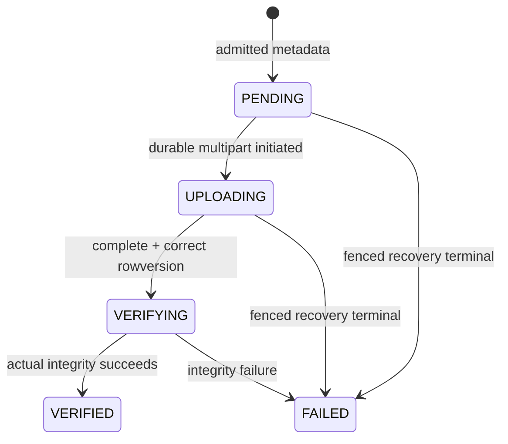

# Trao đổi file, video/SRT, artifacts và exports

> Baseline source: `cdeb1ca1037744d06995058af13d0582f6273c0a`, nhánh `huy-review`; BE-DOC-02, ngày 13/10/2026. `CURRENT_VERIFIED` = source đối chiếu tại baseline; build/tests trong phần việc này **NOT_RUN**. Source không chứng minh external adoption/deployed behavior. Kết quả DOC-AUDIT-01 là **HISTORICAL**.

Nghiệp vụ từ [32–44](../../../docs/product/confirmed-decisions.md) và [HUY final, latest activation](../../../planning/development/HUY-FINAL-INTEGRATION.md); [audit gaps](../../../docs/audit/DOC-AUDIT-01-OPEN-GAPS.md) được đối chiếu lại với source.

## EXPECTED_BUSINESS_BEHAVIOR — TARGET_CONFIRMED

File bytes và metadata là hai phần của cùng nguồn chứng cứ; upload xong từng part chưa là file đã verified. PR38 yêu cầu multipart/resume và limits ảnh20MiB/video8GiB/SRT10MiB/dataset32GiB. PR41A lưu evidence/video nguồn theo mọi nghĩa vụ hết bảo hành+5 năm, hold chặn xóa; không có retention basis thì WAITING_RETENTION_BASIS. Export tạm30ngày không biến hồ sơ nghiệp vụ thành dữ liệu được xóa sau30ngày. PR42A encrypted handover và original actor phải giữ, không hứa cứu khóa/mất thiết bị chưa sync.

BE quyết định owner/project/task/purpose/source pins; object storage không tự hiểu role nghiệp vụ. AI-generated frame/result là derived artifact có provenance; không lấy URL/path từ client làm trusted file identity. FIELD AFTER phải mới theo checklist; Reporter/Drone BEFORE reuse cần PM source decision theo R12. File đã verified chưa đồng nghĩa ảnh còn phù hợp hoặc repair accepted.

## CURRENT_IMPLEMENTATION và actors

`UploadsController` → `UploadService` → `IUploadRepository`/`UploadPersistenceService` + `IUploadObjectStorage`/`MinioUploadObjectStorage`; `ReporterEvidenceController` → `ReporterEvidenceService`: `ReporterEvidencePersistenceService` cung cấp active-Reporter/publication guards; session mutation và bytes dùng shared `UploadPersistenceService`/`IUploadRepository` với private upload lineage. `FileRepository` + `LocalFileContentStore` là file-store seam khác, không được mô tả như mọi request đều lưu local disk. Worker `UploadVerificationWorker`, `MultipartRecoveryWorker` có durability/reconciliation responsibilities khác nhau.

Operator video/SRT chỉ current accepted/active assigned survey; PM/Crew FIELD purposes cần current task/resource; Reporter photo project/target null trong private path; ROUTE_SOURCE/DOCUMENT đi project policy. Offline upload dùng admission/capture origin riêng, không arbitrary device claim. Download kiểm scope/current producer rights. Export content qua `ExportService`/repository snapshot và current rights, khác generic file content. AI-generated artifact qua `IAnh02ArtifactStore` và immutable namespace.

## Preconditions, limits và DTO

| Purpose / MIME | Source maximum | Ý nghĩa |
|---|---|---|
| REPORT_PHOTO/BEFORE/AFTER/MEASUREMENT + JPEG/PNG | 20 ×1024² bytes | Photo limit; nghiệp vụ capture/reuse kiểm riêng |
| SURVEY_VIDEO + video/mp4 | 8 ×1024³ bytes | Metadata `long`; không hứa actual transfer E2E |
| TELEMETRY + application/x-subrip | 10 ×1024² bytes | Missing SRT giữ MISSING/UNKNOWN |
| Dataset aggregate | 32 ×1024³ bytes | Tổng admitted files, không per-file video limit |
| DOCUMENT/ROUTE_SOURCE | int.MaxValue | Current implementation ceiling; PR38 không chốt limit mới cho hai purpose này |

[UploadAdmissionPolicy.cs · MaximumBytes L10](../../../RoadGuardSystem.BusinessObjects/Files/UploadAdmissionPolicy.cs#L10). `UploadCreateRequestDto` chứa project/target/purpose/fileName/mediaType/size/checksum; expected SHA256 lowercase. `ReporterEvidenceCreateRequestDto` không mang project authority. `UploadSessionResponseDto` chứa session/file/state/part size/expiry/version; `UploadPartUrlsResponseDto` trả number/url/expiry; complete gửi `CompletedUploadPartDto` number/ETag; metadata `FileMetadataResponseDto` giữ integrity/version. Part ETag không tự là SHA256 file.

## Exact main sequence

1. Project flow `POST /api/v1/uploads` hoặc private `POST /api/v1/reporter-evidence/uploads` với key; response201 Location+ETag. Offline task-bound `POST /api/v1/offline/uploads` cần exactly one key và `OfflineUploadCreateRequestDto` admission/capture origin/Upload body.
2. `GET /api/v1/uploads/{uploadId}` (private `/reporter-evidence/uploads/{uploadId}`) để resume với session status/expiry. `POST .../{uploadId}/part-urls` body PartNumbers + key để lấy signed PUT URLs; expiry bị chặn ở session expiry.
3. Client PUT đúng bytes từng part trực tiếp object-storage URL; BE không nhận bytes qua controller action này. Giữ part number/storage ETag và local bytes để retry/resume. Không ghi signed URL hay credential vào audit/publication.
4. `POST .../{uploadId}/complete` key + If-Match + Parts; response202 chỉ vào VERIFYING. Worker đọc/check object theo repository policy; poll GET tới VERIFIED/FAILED. FILE reference không admitted cho evidence/dataset trước VERIFIED.
5. `GET /api/v1/files/{fileId}` + `/content` cho project metadata/download; private `/api/v1/reporter-evidence/files/{fileId}` + `/content`. Reporter publication download `/api/v1/reporter-evidence/publications/{publicationId}/reports/{reportId}/evidence/{evidenceId}/content` hoặc Reports controller own report evidence download.
6. Dataset submission dùng verified video/SRT IDs và explicit pair/time offsets, source manifest hashes; AI mock worker đọc video source thật, tạo deterministic frame key, verify durable artifact, rồi attach SQL provenance.
7. Export `POST /api/v1/projects/{projectId}/exports` key; poll `GET /{exportId}`, `GET /{exportId}/manifest`, `GET /{exportId}/content`. Response content ETag hash + `private, no-store`, range processing disabled tại controller. Manifest và content giữ issued snapshot; new correction không rewrite issued export.

## State machine và recovery

`UploadSession` có MultipartFence/Phase/Deadline/NextCheckAt và RowVersion; phase CLAIMED/CALLING/RECONCILING/DURABLE/TERMINAL là trạng thái coordination riêng, không upload wire enum. Recovery terminal đổi fence và `multipart_restart_required`, không tự tạo another remote multipart từ timeout không rõ. [UploadSession.cs · StopMultipart L113](../../../RoadGuardSystem.BusinessObjects/Files/UploadSession.cs#L113). `UploadPersistenceService.Recovery`/private retry reconciles external durable initiation; active claim/replay không được nhân object initialization.

SQL transaction giữ metadata/session/parts/receipt/file scope/audit. Object operation có crash window ngoài SQL; fence/reconcile/immutable keys là bridge, không distributed atomic SQL+S3. `UploadVerificationWorker` scoped polling 30s; lỗi log và tiếp vòng; không gọi failed network thành VERIFIED. Verify processing từng round không là retention deletion.

## Artifact durability và provenance

[MinioAnh02ArtifactStore.cs · WriteAsync L23](../../../RoadGuardSystem.Repositories/Implementations/Storage/MinioAnh02ArtifactStore.cs#L23) validates namespace `anh02/`, spool bytes/hash/size, PutObject `IfNoneMatch="*"`, lưu `anh02-sha256`/`anh02-size` atomically with object, rồi OpenRead kiểm actual bytes/hash/metadata/MIME. Competing immutable key không overwrite; khác content/size fails verification. OpenRead spool DeleteOnClose và kiểm metadata với bytes. Không dùng object ETag làm content proof, không tin SQL attach đã có nghĩa object tồn tại. Cùng artifact store dùng BE generated export/frame paths qua interface; đây là source algorithm, real S3 semantics vẫn cần external integration tests.

AIDetection provenance phải đi run/result/job/attempt/manifest/source video/version/frame/hash/timestamp; Reporter source giữ original uploader/owner, publication recipient chỉ đọc selected reference; handover file giữ originalActor/current submitter riêng. Retention contributors phải nhìn tất cả source pins và issued export/history/holds, không xóa source còn nghĩa vụ chỉ vì job thành công hoặc temporary artifact expired.

## Error, replay, concurrency và negative flows

Missing key/If-Match428; malformed/unsupported/too-large upload422 `upload_validation_failed` và maxBytes/actualBytes khi available; stale complete412; conflicting receipt409; inaccessible file403/404; unavailable storage503. Source references chưa verified409 ở protected workflow. Response download không tự cấp presigned public GET; controller trả stream khi authorized.

Một key = một canonical intent; GET session rồi resume same upload, không POST new upload vô điều kiện sau timeout. Part-url receipt và complete receipt là operation khác nhau. Revoke task/member/source phải invalidate write/replay/current read theo guard; uploaded bytes vẫn giữ để xử lý retention/an toàn, không đổi quyền bằng ownership cũ. `UploadPersistenceService.FieldAdmission`/`.Offline` đóng task/capture origin; không assume every owner can access all purpose.

Reporter download check trước async storage.OpenFileAsync còn audit G03 risk: current source không thấy post-open authority recheck tương đương FIELD; delayed-open race **NOT_VERIFIED**, không gọi exploit reproduced. Compatibility AI callback chỉ metadata-check raw result và thiếu full active attempt/frame lineage (G02); generic verified file không bù được lỗ hổng đó.

## Tests và gaps

API source `UploadApiTests`, `ReporterEvidenceApiTests`, `Anh01UploadContractTests`, `MultipartRecoveryHttpTests`; SQL `UploadPersistenceSqlTests`, `PrivateMultipartRetrySqlTests`, `MultipartRecoveryStateSqlTests`, `MultipartRecoveryAdapterTests`, `FileRepositorySqlTests`; artifact `Anh01StorageRecoveryTests`, `Anh02AiHttpTests`, export storage authority tests; schema/migration sources ở appendix. **NOT_RUN** phần việc này. Historical MinIO skip không được tính real storage PASS.

| Gap | Owner / minimal next evidence |
|---|---|
| Live8GiB multipart/resume/checksum | Storage/Android owners: actual isolated object storage and device transfer under disconnect/retry; metadata tests chưa đủ |
| Object consistency/conditional write/crash | BE/storage: real S3/MinIO lease/IfNoneMatch/object-before-SQL recovery acceptance |
| Reporter delayed-open revocation G03 | BE: deterministic delayed-open negative test before deciding narrow recheck/dispose fix |
| Retention basis/holds | Owner/source: actual warranty/obligation evidence; missing basis waits, no guessed upload-date deletion |
| Deployed export/key custody/handover | Operations/client: restore actual SQL/object/key material and original actor preservation; no organization recovery escrow claim |

## Toàn bộ HTTP actions của controller trong workflow

`SOURCE_DERIVED_NOT_RUNTIME_VERIFIED`. Paths giữ source constraints; API version được thay1. Một action có nhiều route được ghi từng operation. Tham số/status/headers đầy đủ trong endpoint catalog chung.

| Method | Full route | Controller.Action / source |
|---|---|---|
| POST | `/api/v1/uploads` | [UploadsController.Create](../../../RoadGuardSystem.API/Controllers/UploadsController.cs#L27) |
| GET | `/api/v1/uploads/{uploadId:guid}` | [UploadsController.GetSession](../../../RoadGuardSystem.API/Controllers/UploadsController.cs#L50) |
| POST | `/api/v1/offline/uploads` | [UploadsController.CreateOffline](../../../RoadGuardSystem.API/Controllers/UploadsController.cs#L59) |
| POST | `/api/v1/uploads/{uploadId:guid}/part-urls` | [UploadsController.GetPartUrls](../../../RoadGuardSystem.API/Controllers/UploadsController.cs#L71) |
| POST | `/api/v1/uploads/{uploadId:guid}/complete` | [UploadsController.Complete](../../../RoadGuardSystem.API/Controllers/UploadsController.cs#L85) |
| GET | `/api/v1/files/{fileId:guid}` | [UploadsController.GetFileMetadata](../../../RoadGuardSystem.API/Controllers/UploadsController.cs#L103) |
| GET | `/api/v1/files/{fileId:guid}/content` | [UploadsController.Download](../../../RoadGuardSystem.API/Controllers/UploadsController.cs#L119) |
| POST | `/api/v1/reporter-evidence/uploads` | [ReporterEvidenceController.Create](../../../RoadGuardSystem.API/Controllers/ReporterEvidenceController.cs#L27) |
| GET | `/api/v1/reporter-evidence/uploads/{uploadId:guid}` | [ReporterEvidenceController.GetSession](../../../RoadGuardSystem.API/Controllers/ReporterEvidenceController.cs#L50) |
| POST | `/api/v1/reporter-evidence/uploads/{uploadId:guid}/part-urls` | [ReporterEvidenceController.GetPartUrls](../../../RoadGuardSystem.API/Controllers/ReporterEvidenceController.cs#L59) |
| POST | `/api/v1/reporter-evidence/uploads/{uploadId:guid}/complete` | [ReporterEvidenceController.Complete](../../../RoadGuardSystem.API/Controllers/ReporterEvidenceController.cs#L73) |
| GET | `/api/v1/reporter-evidence/files/{fileId:guid}` | [ReporterEvidenceController.GetFileMetadata](../../../RoadGuardSystem.API/Controllers/ReporterEvidenceController.cs#L91) |
| GET | `/api/v1/reporter-evidence/files/{fileId:guid}/content` | [ReporterEvidenceController.Download](../../../RoadGuardSystem.API/Controllers/ReporterEvidenceController.cs#L107) |
| GET | `/api/v1/reporter-evidence/publications/{publicationId:guid}/reports/{reportId:guid}/evidence/{evidenceId:guid}/content` | [ReporterEvidenceController.DownloadPublication](../../../RoadGuardSystem.API/Controllers/ReporterEvidenceController.cs#L123) |
| POST | `/api/v1/projects/{projectId:guid}/exports` | [ExportsController.Create](../../../RoadGuardSystem.API/Controllers/ExportsController.cs#L18) |
| GET | `/api/v1/projects/{projectId:guid}/exports/{exportId:guid}` | [ExportsController.Get](../../../RoadGuardSystem.API/Controllers/ExportsController.cs#L28) |
| GET | `/api/v1/projects/{projectId:guid}/exports/{exportId:guid}/manifest` | [ExportsController.Manifest](../../../RoadGuardSystem.API/Controllers/ExportsController.cs#L35) |
| GET | `/api/v1/projects/{projectId:guid}/exports/{exportId:guid}/content` | [ExportsController.Content](../../../RoadGuardSystem.API/Controllers/ExportsController.cs#L42) |

## Inventory nguồn module — CURRENT_VERIFIED source discovery

File/symbol tại baseline; không phải execution evidence. Interface/implementation/helpers trong scope được liệt kê đầy đủ; catalog toàn Backend/schema nằm trong traceability của bộ docs.

| File / declaration line | Types và operation seams |
|---|---|
| [RoadGuardSystem.API/Workers/MultipartRecoveryWorker.cs](../../../RoadGuardSystem.API/Workers/MultipartRecoveryWorker.cs#L5) | `MultipartRecoveryWorker` |
| [RoadGuardSystem.API/Workers/UploadVerificationWorker.cs](../../../RoadGuardSystem.API/Workers/UploadVerificationWorker.cs#L5) | `UploadVerificationWorker` |
| [RoadGuardSystem.BusinessObjects/Files/FileScope.cs](../../../RoadGuardSystem.BusinessObjects/Files/FileScope.cs#L3) | `FileScope`; [CreatePrivate](../../../RoadGuardSystem.BusinessObjects/Files/FileScope.cs#L17); [Create](../../../RoadGuardSystem.BusinessObjects/Files/FileScope.cs#L33) |
| [RoadGuardSystem.BusinessObjects/Files/StoredFile.cs](../../../RoadGuardSystem.BusinessObjects/Files/StoredFile.cs#L3) | `StoredFile`; [Create](../../../RoadGuardSystem.BusinessObjects/Files/StoredFile.cs#L27) |
| [RoadGuardSystem.BusinessObjects/Files/UploadAdmissionPolicy.cs](../../../RoadGuardSystem.BusinessObjects/Files/UploadAdmissionPolicy.cs#L3) | `UploadAdmissionPolicy`; [MaximumBytes](../../../RoadGuardSystem.BusinessObjects/Files/UploadAdmissionPolicy.cs#L10) |
| [RoadGuardSystem.BusinessObjects/Files/UploadPart.cs](../../../RoadGuardSystem.BusinessObjects/Files/UploadPart.cs#L3) | `UploadPart`; [Create](../../../RoadGuardSystem.BusinessObjects/Files/UploadPart.cs#L16); [RecordUrl](../../../RoadGuardSystem.BusinessObjects/Files/UploadPart.cs#L26); [RecordCompletion](../../../RoadGuardSystem.BusinessObjects/Files/UploadPart.cs#L37) |
| [RoadGuardSystem.BusinessObjects/Files/UploadSession.cs](../../../RoadGuardSystem.BusinessObjects/Files/UploadSession.cs#L5) | `UploadSession`; [Create](../../../RoadGuardSystem.BusinessObjects/Files/UploadSession.cs#L30); [StartUploading](../../../RoadGuardSystem.BusinessObjects/Files/UploadSession.cs#L71); [ClaimMultipartInitiation](../../../RoadGuardSystem.BusinessObjects/Files/UploadSession.cs#L84); [BeginMultipart](../../../RoadGuardSystem.BusinessObjects/Files/UploadSession.cs#L93); [SetMultipartPhase](../../../RoadGuardSystem.BusinessObjects/Files/UploadSession.cs#L104); [StopMultipart](../../../RoadGuardSystem.BusinessObjects/Files/UploadSession.cs#L113); [StartVerification](../../../RoadGuardSystem.BusinessObjects/Files/UploadSession.cs#L125); [MarkVerified](../../../RoadGuardSystem.BusinessObjects/Files/UploadSession.cs#L137); [MarkFailed](../../../RoadGuardSystem.BusinessObjects/Files/UploadSession.cs#L148) |
| [RoadGuardSystem.Repositories/Implementations/Files/FileRepository.cs](../../../RoadGuardSystem.Repositories/Implementations/Files/FileRepository.cs#L13) | `FileRepository`; [StoreAsync](../../../RoadGuardSystem.Repositories/Implementations/Files/FileRepository.cs#L34) |
| [RoadGuardSystem.Repositories/Implementations/Files/FileStoreResult.cs](../../../RoadGuardSystem.Repositories/Implementations/Files/FileStoreResult.cs#L3) | `FileStoreStatus`, `FileStoreResult` |
| [RoadGuardSystem.Repositories/Implementations/Files/ReporterEvidencePersistenceService.cs](../../../RoadGuardSystem.Repositories/Implementations/Files/ReporterEvidencePersistenceService.cs#L6) | `ReporterEvidencePersistenceService`; [IsActiveReporterAsync](../../../RoadGuardSystem.Repositories/Implementations/Files/ReporterEvidencePersistenceService.cs#L8) |
| [RoadGuardSystem.Repositories/Implementations/Files/StoreFileRequest.cs](../../../RoadGuardSystem.Repositories/Implementations/Files/StoreFileRequest.cs#L3) | `StoreFileRequest` |
| [RoadGuardSystem.Repositories/Implementations/Files/UploadPersistenceService.cs](../../../RoadGuardSystem.Repositories/Implementations/Files/UploadPersistenceService.cs#L13) | `UploadPersistenceService`, `UploadNotFoundException`, `UploadConcurrencyException`, `UploadPartConflictException`, `UploadPartUrlReceipt`; [IsCurrentSurveyOperatorAsync](../../../RoadGuardSystem.Repositories/Implementations/Files/UploadPersistenceService.cs#L31); [CreateAsync](../../../RoadGuardSystem.Repositories/Implementations/Files/UploadPersistenceService.cs#L39); [CreateOfflineAsync](../../../RoadGuardSystem.Repositories/Implementations/Files/UploadPersistenceService.cs#L44); [GetSessionAsync](../../../RoadGuardSystem.Repositories/Implementations/Files/UploadPersistenceService.cs#L148); [GetPartUrlsAsync](../../../RoadGuardSystem.Repositories/Implementations/Files/UploadPersistenceService.cs#L159); [CompleteAsync](../../../RoadGuardSystem.Repositories/Implementations/Files/UploadPersistenceService.cs#L302); [GetFileMetadataAsync](../../../RoadGuardSystem.Repositories/Implementations/Files/UploadPersistenceService.cs#L404); [OpenFileAsync](../../../RoadGuardSystem.Repositories/Implementations/Files/UploadPersistenceService.cs#L443); [GetVerifyingIdsAsync](../../../RoadGuardSystem.Repositories/Implementations/Files/UploadPersistenceService.cs#L446); [VerifyNextAsync](../../../RoadGuardSystem.Repositories/Implementations/Files/UploadPersistenceService.cs#L456); [VerifyAsync](../../../RoadGuardSystem.Repositories/Implementations/Files/UploadPersistenceService.cs#L467) |
| [RoadGuardSystem.Repositories/Implementations/Files/UploadPersistenceService.FieldAdmission.cs](../../../RoadGuardSystem.Repositories/Implementations/Files/UploadPersistenceService.FieldAdmission.cs#L9) | `UploadPersistenceService`; [UploadPersistenceService](../../../RoadGuardSystem.Repositories/Implementations/Files/UploadPersistenceService.FieldAdmission.cs#L12); [IsCurrentFieldActorAsync](../../../RoadGuardSystem.Repositories/Implementations/Files/UploadPersistenceService.FieldAdmission.cs#L23); [Read](../../../RoadGuardSystem.Repositories/Implementations/Files/UploadPersistenceService.FieldAdmission.cs#L25); [IsCurrentLegacyFieldFileReaderAsync](../../../RoadGuardSystem.Repositories/Implementations/Files/UploadPersistenceService.FieldAdmission.cs#L38); [Read](../../../RoadGuardSystem.Repositories/Implementations/Files/UploadPersistenceService.FieldAdmission.cs#L41) |
| [RoadGuardSystem.Repositories/Implementations/Files/UploadPersistenceService.Offline.cs](../../../RoadGuardSystem.Repositories/Implementations/Files/UploadPersistenceService.Offline.cs#L12) | `UploadPersistenceService`; [IsCurrentOfflineFileActorAsync](../../../RoadGuardSystem.Repositories/Implementations/Files/UploadPersistenceService.Offline.cs#L14); [Read](../../../RoadGuardSystem.Repositories/Implementations/Files/UploadPersistenceService.Offline.cs#L17); [UploadPersistenceService](../../../RoadGuardSystem.Repositories/Implementations/Files/UploadPersistenceService.Offline.cs#L38) |
| [RoadGuardSystem.Repositories/Implementations/Files/UploadPersistenceService.Recovery.cs](../../../RoadGuardSystem.Repositories/Implementations/Files/UploadPersistenceService.Recovery.cs#L11) | `UploadPersistenceService`; [UploadPersistenceService](../../../RoadGuardSystem.Repositories/Implementations/Files/UploadPersistenceService.Recovery.cs#L16); [RecoverMultipartsAsync](../../../RoadGuardSystem.Repositories/Implementations/Files/UploadPersistenceService.Recovery.cs#L135) |
| [RoadGuardSystem.Repositories/Implementations/Storage/FileStorageErrorCodes.cs](../../../RoadGuardSystem.Repositories/Implementations/Storage/FileStorageErrorCodes.cs#L3) | `FileStorageErrorCodes` |
| [RoadGuardSystem.Repositories/Implementations/Storage/FileStorageException.cs](../../../RoadGuardSystem.Repositories/Implementations/Storage/FileStorageException.cs#L3) | `FileStorageException` |
| [RoadGuardSystem.Repositories/Implementations/Storage/LocalFileContentStore.cs](../../../RoadGuardSystem.Repositories/Implementations/Storage/LocalFileContentStore.cs#L8) | `LocalFileContentStore`; [StoreAsync](../../../RoadGuardSystem.Repositories/Implementations/Storage/LocalFileContentStore.cs#L63); [OpenReadAsync](../../../RoadGuardSystem.Repositories/Implementations/Storage/LocalFileContentStore.cs#L173) |
| [RoadGuardSystem.Repositories/Implementations/Storage/MinioAnh02ArtifactStore.cs](../../../RoadGuardSystem.Repositories/Implementations/Storage/MinioAnh02ArtifactStore.cs#L10) | `MinioAnh02ArtifactStore`; [WriteAsync](../../../RoadGuardSystem.Repositories/Implementations/Storage/MinioAnh02ArtifactStore.cs#L23); [OpenReadAsync](../../../RoadGuardSystem.Repositories/Implementations/Storage/MinioAnh02ArtifactStore.cs#L51); [Temporary](../../../RoadGuardSystem.Repositories/Implementations/Storage/MinioAnh02ArtifactStore.cs#L74); [CopyHashAsync](../../../RoadGuardSystem.Repositories/Implementations/Storage/MinioAnh02ArtifactStore.cs#L75) |
| [RoadGuardSystem.Repositories/Implementations/Storage/MinioUploadObjectStorage.cs](../../../RoadGuardSystem.Repositories/Implementations/Storage/MinioUploadObjectStorage.cs#L12) | `MinioUploadObjectStorage`; [InitiateAsync](../../../RoadGuardSystem.Repositories/Implementations/Storage/MinioUploadObjectStorage.cs#L42); [ListMultipartIdsAsync](../../../RoadGuardSystem.Repositories/Implementations/Storage/MinioUploadObjectStorage.cs#L61); [HasPartsAsync](../../../RoadGuardSystem.Repositories/Implementations/Storage/MinioUploadObjectStorage.cs#L91); [AbortMultipartAsync](../../../RoadGuardSystem.Repositories/Implementations/Storage/MinioUploadObjectStorage.cs#L112); [PresignPartsAsync](../../../RoadGuardSystem.Repositories/Implementations/Storage/MinioUploadObjectStorage.cs#L125); [CompleteAndVerifyAsync](../../../RoadGuardSystem.Repositories/Implementations/Storage/MinioUploadObjectStorage.cs#L160); [OpenReadAsync](../../../RoadGuardSystem.Repositories/Implementations/Storage/MinioUploadObjectStorage.cs#L235) |
| [RoadGuardSystem.Repositories/Implementations/Storage/S3ResponseStream.cs](../../../RoadGuardSystem.Repositories/Implementations/Storage/S3ResponseStream.cs#L6) | `S3ResponseStream`; [Flush](../../../RoadGuardSystem.Repositories/Implementations/Storage/S3ResponseStream.cs#L24); [FlushAsync](../../../RoadGuardSystem.Repositories/Implementations/Storage/S3ResponseStream.cs#L25); [Read](../../../RoadGuardSystem.Repositories/Implementations/Storage/S3ResponseStream.cs#L26); [Read](../../../RoadGuardSystem.Repositories/Implementations/Storage/S3ResponseStream.cs#L27); [ReadAsync](../../../RoadGuardSystem.Repositories/Implementations/Storage/S3ResponseStream.cs#L28); [ReadAsync](../../../RoadGuardSystem.Repositories/Implementations/Storage/S3ResponseStream.cs#L29); [Seek](../../../RoadGuardSystem.Repositories/Implementations/Storage/S3ResponseStream.cs#L30); [SetLength](../../../RoadGuardSystem.Repositories/Implementations/Storage/S3ResponseStream.cs#L31); [Write](../../../RoadGuardSystem.Repositories/Implementations/Storage/S3ResponseStream.cs#L32); [DisposeAsync](../../../RoadGuardSystem.Repositories/Implementations/Storage/S3ResponseStream.cs#L46) |
| [RoadGuardSystem.Repositories/Implementations/Storage/StoredContent.cs](../../../RoadGuardSystem.Repositories/Implementations/Storage/StoredContent.cs#L3) | `StoredContent` |
| [RoadGuardSystem.Repositories/Interfaces/Files/FileMetadataPersistenceView.cs](../../../RoadGuardSystem.Repositories/Interfaces/Files/FileMetadataPersistenceView.cs#L3) | `FileMetadataPersistenceView` |
| [RoadGuardSystem.Repositories/Interfaces/Files/IFileRepository.cs](../../../RoadGuardSystem.Repositories/Interfaces/Files/IFileRepository.cs#L3) | `IFileRepository`; [StoreAsync](../../../RoadGuardSystem.Repositories/Interfaces/Files/IFileRepository.cs#L5) |
| [RoadGuardSystem.Repositories/Interfaces/Files/IReporterEvidenceRepository.cs](../../../RoadGuardSystem.Repositories/Interfaces/Files/IReporterEvidenceRepository.cs#L3) | `IReporterEvidenceRepository`; [IsActiveReporterAsync](../../../RoadGuardSystem.Repositories/Interfaces/Files/IReporterEvidenceRepository.cs#L5) |
| [RoadGuardSystem.Repositories/Interfaces/Files/IUploadRepository.cs](../../../RoadGuardSystem.Repositories/Interfaces/Files/IUploadRepository.cs#L3) | `IUploadRepository`; [IsCurrentOfflineFileActorAsync](../../../RoadGuardSystem.Repositories/Interfaces/Files/IUploadRepository.cs#L5); [IsCurrentLegacyFieldFileReaderAsync](../../../RoadGuardSystem.Repositories/Interfaces/Files/IUploadRepository.cs#L6); [IsCurrentFieldActorAsync](../../../RoadGuardSystem.Repositories/Interfaces/Files/IUploadRepository.cs#L7); [RecoverMultipartsAsync](../../../RoadGuardSystem.Repositories/Interfaces/Files/IUploadRepository.cs#L8); [IsCurrentSurveyOperatorAsync](../../../RoadGuardSystem.Repositories/Interfaces/Files/IUploadRepository.cs#L9); [CreateAsync](../../../RoadGuardSystem.Repositories/Interfaces/Files/IUploadRepository.cs#L10); [CreateOfflineAsync](../../../RoadGuardSystem.Repositories/Interfaces/Files/IUploadRepository.cs#L11); [GetSessionAsync](../../../RoadGuardSystem.Repositories/Interfaces/Files/IUploadRepository.cs#L13); [GetPartUrlsAsync](../../../RoadGuardSystem.Repositories/Interfaces/Files/IUploadRepository.cs#L14); [CompleteAsync](../../../RoadGuardSystem.Repositories/Interfaces/Files/IUploadRepository.cs#L15); [GetFileMetadataAsync](../../../RoadGuardSystem.Repositories/Interfaces/Files/IUploadRepository.cs#L16); [OpenFileAsync](../../../RoadGuardSystem.Repositories/Interfaces/Files/IUploadRepository.cs#L17); [VerifyNextAsync](../../../RoadGuardSystem.Repositories/Interfaces/Files/IUploadRepository.cs#L18); [GetVerifyingIdsAsync](../../../RoadGuardSystem.Repositories/Interfaces/Files/IUploadRepository.cs#L19); [VerifyAsync](../../../RoadGuardSystem.Repositories/Interfaces/Files/IUploadRepository.cs#L20) |
| [RoadGuardSystem.Repositories/Interfaces/Files/UploadCompletePersistenceRequest.cs](../../../RoadGuardSystem.Repositories/Interfaces/Files/UploadCompletePersistenceRequest.cs#L5) | `UploadCompletePersistenceRequest` |
| [RoadGuardSystem.Repositories/Interfaces/Files/UploadCreatePersistenceRequest.cs](../../../RoadGuardSystem.Repositories/Interfaces/Files/UploadCreatePersistenceRequest.cs#L3) | `UploadCreatePersistenceRequest` |
| [RoadGuardSystem.Repositories/Interfaces/Files/UploadMutationPersistenceResult.cs](../../../RoadGuardSystem.Repositories/Interfaces/Files/UploadMutationPersistenceResult.cs#L3) | `UploadMutationPersistenceResult` |
| [RoadGuardSystem.Repositories/Interfaces/Files/UploadPartUrlsPersistenceResult.cs](../../../RoadGuardSystem.Repositories/Interfaces/Files/UploadPartUrlsPersistenceResult.cs#L5) | `UploadPartUrlsPersistenceResult` |
| [RoadGuardSystem.Repositories/Interfaces/Files/UploadPersistenceStatus.cs](../../../RoadGuardSystem.Repositories/Interfaces/Files/UploadPersistenceStatus.cs#L3) | `UploadPersistenceStatus` |
| [RoadGuardSystem.Repositories/Interfaces/Files/UploadSessionPersistenceView.cs](../../../RoadGuardSystem.Repositories/Interfaces/Files/UploadSessionPersistenceView.cs#L3) | `UploadSessionPersistenceView` |
| [RoadGuardSystem.Repositories/Interfaces/Storage/CompletedStoragePart.cs](../../../RoadGuardSystem.Repositories/Interfaces/Storage/CompletedStoragePart.cs#L3) | `CompletedStoragePart` |
| [RoadGuardSystem.Repositories/Interfaces/Storage/IAnh02ArtifactStore.cs](../../../RoadGuardSystem.Repositories/Interfaces/Storage/IAnh02ArtifactStore.cs#L3) | `Anh02ArtifactMetadata`, `Anh02ArtifactRead`, `IAnh02ArtifactStore`; [DisposeAsync](../../../RoadGuardSystem.Repositories/Interfaces/Storage/IAnh02ArtifactStore.cs#L6); [WriteAsync](../../../RoadGuardSystem.Repositories/Interfaces/Storage/IAnh02ArtifactStore.cs#L11); [OpenReadAsync](../../../RoadGuardSystem.Repositories/Interfaces/Storage/IAnh02ArtifactStore.cs#L12) |
| [RoadGuardSystem.Repositories/Interfaces/Storage/IFileContentStore.cs](../../../RoadGuardSystem.Repositories/Interfaces/Storage/IFileContentStore.cs#L3) | `IFileContentStore`, `IFileContentCleanup`; [StoreAsync](../../../RoadGuardSystem.Repositories/Interfaces/Storage/IFileContentStore.cs#L5); [OpenReadAsync](../../../RoadGuardSystem.Repositories/Interfaces/Storage/IFileContentStore.cs#L13); [DeleteAsync](../../../RoadGuardSystem.Repositories/Interfaces/Storage/IFileContentStore.cs#L18) |
| [RoadGuardSystem.Repositories/Interfaces/Storage/IMultipartRecoveryStorage.cs](../../../RoadGuardSystem.Repositories/Interfaces/Storage/IMultipartRecoveryStorage.cs#L3) | `IMultipartRecoveryStorage`; [ListMultipartIdsAsync](../../../RoadGuardSystem.Repositories/Interfaces/Storage/IMultipartRecoveryStorage.cs#L5); [HasPartsAsync](../../../RoadGuardSystem.Repositories/Interfaces/Storage/IMultipartRecoveryStorage.cs#L6); [AbortMultipartAsync](../../../RoadGuardSystem.Repositories/Interfaces/Storage/IMultipartRecoveryStorage.cs#L7) |
| [RoadGuardSystem.Repositories/Interfaces/Storage/IUploadObjectStorage.cs](../../../RoadGuardSystem.Repositories/Interfaces/Storage/IUploadObjectStorage.cs#L3) | `IUploadObjectStorage`; [InitiateAsync](../../../RoadGuardSystem.Repositories/Interfaces/Storage/IUploadObjectStorage.cs#L5); [PresignPartsAsync](../../../RoadGuardSystem.Repositories/Interfaces/Storage/IUploadObjectStorage.cs#L6); [CompleteAndVerifyAsync](../../../RoadGuardSystem.Repositories/Interfaces/Storage/IUploadObjectStorage.cs#L7); [OpenReadAsync](../../../RoadGuardSystem.Repositories/Interfaces/Storage/IUploadObjectStorage.cs#L8) |
| [RoadGuardSystem.Repositories/Interfaces/Storage/PresignedUploadPart.cs](../../../RoadGuardSystem.Repositories/Interfaces/Storage/PresignedUploadPart.cs#L3) | `PresignedUploadPart` |
| [RoadGuardSystem.Repositories/Interfaces/Storage/UploadObjectVerification.cs](../../../RoadGuardSystem.Repositories/Interfaces/Storage/UploadObjectVerification.cs#L3) | `UploadObjectVerification` |
| [RoadGuardSystem.Services/Implementations/Files/ReporterEvidenceService.cs](../../../RoadGuardSystem.Services/Implementations/Files/ReporterEvidenceService.cs#L15) | `ReporterEvidenceService`; [CreateAsync](../../../RoadGuardSystem.Services/Implementations/Files/ReporterEvidenceService.cs#L37); [GetSessionAsync](../../../RoadGuardSystem.Services/Implementations/Files/ReporterEvidenceService.cs#L76); [GetPartUrlsAsync](../../../RoadGuardSystem.Services/Implementations/Files/ReporterEvidenceService.cs#L84); [CompleteAsync](../../../RoadGuardSystem.Services/Implementations/Files/ReporterEvidenceService.cs#L125); [GetFileMetadataAsync](../../../RoadGuardSystem.Services/Implementations/Files/ReporterEvidenceService.cs#L152); [DownloadPublicationAsync](../../../RoadGuardSystem.Services/Implementations/Files/ReporterEvidenceService.cs#L160); [DownloadAsync](../../../RoadGuardSystem.Services/Implementations/Files/ReporterEvidenceService.cs#L174) |
| [RoadGuardSystem.Services/Implementations/Files/UploadService.cs](../../../RoadGuardSystem.Services/Implementations/Files/UploadService.cs#L15) | `UploadService`; [CreateAsync](../../../RoadGuardSystem.Services/Implementations/Files/UploadService.cs#L39); [CreateOfflineAsync](../../../RoadGuardSystem.Services/Implementations/Files/UploadService.cs#L48); [GetSessionAsync](../../../RoadGuardSystem.Services/Implementations/Files/UploadService.cs#L106); [GetPartUrlsAsync](../../../RoadGuardSystem.Services/Implementations/Files/UploadService.cs#L115); [CompleteAsync](../../../RoadGuardSystem.Services/Implementations/Files/UploadService.cs#L157); [GetFileMetadataAsync](../../../RoadGuardSystem.Services/Implementations/Files/UploadService.cs#L186); [DownloadAsync](../../../RoadGuardSystem.Services/Implementations/Files/UploadService.cs#L194); [ProcessOneVerificationAsync](../../../RoadGuardSystem.Services/Implementations/Files/UploadService.cs#L221); [ProcessOneVerificationInRoundAsync](../../../RoadGuardSystem.Services/Implementations/Files/UploadService.cs#L226) |
| [RoadGuardSystem.Services/Interfaces/Files/IReporterEvidenceService.cs](../../../RoadGuardSystem.Services/Interfaces/Files/IReporterEvidenceService.cs#L6) | `IReporterEvidenceService`; [CreateAsync](../../../RoadGuardSystem.Services/Interfaces/Files/IReporterEvidenceService.cs#L8); [GetSessionAsync](../../../RoadGuardSystem.Services/Interfaces/Files/IReporterEvidenceService.cs#L9); [GetPartUrlsAsync](../../../RoadGuardSystem.Services/Interfaces/Files/IReporterEvidenceService.cs#L10); [CompleteAsync](../../../RoadGuardSystem.Services/Interfaces/Files/IReporterEvidenceService.cs#L11); [GetFileMetadataAsync](../../../RoadGuardSystem.Services/Interfaces/Files/IReporterEvidenceService.cs#L12); [DownloadPublicationAsync](../../../RoadGuardSystem.Services/Interfaces/Files/IReporterEvidenceService.cs#L13); [DownloadAsync](../../../RoadGuardSystem.Services/Interfaces/Files/IReporterEvidenceService.cs#L14) |
| [RoadGuardSystem.Services/Interfaces/Files/IUploadService.cs](../../../RoadGuardSystem.Services/Interfaces/Files/IUploadService.cs#L6) | `IUploadService`; [CreateAsync](../../../RoadGuardSystem.Services/Interfaces/Files/IUploadService.cs#L8); [CreateOfflineAsync](../../../RoadGuardSystem.Services/Interfaces/Files/IUploadService.cs#L9); [GetSessionAsync](../../../RoadGuardSystem.Services/Interfaces/Files/IUploadService.cs#L11); [GetPartUrlsAsync](../../../RoadGuardSystem.Services/Interfaces/Files/IUploadService.cs#L12); [CompleteAsync](../../../RoadGuardSystem.Services/Interfaces/Files/IUploadService.cs#L13); [GetFileMetadataAsync](../../../RoadGuardSystem.Services/Interfaces/Files/IUploadService.cs#L14); [DownloadAsync](../../../RoadGuardSystem.Services/Interfaces/Files/IUploadService.cs#L15); [ProcessOneVerificationAsync](../../../RoadGuardSystem.Services/Interfaces/Files/IUploadService.cs#L16); [ProcessOneVerificationInRoundAsync](../../../RoadGuardSystem.Services/Interfaces/Files/IUploadService.cs#L17) |
| [RoadGuardSystem.Services/Interfaces/Files/UploadServiceResult.cs](../../../RoadGuardSystem.Services/Interfaces/Files/UploadServiceResult.cs#L5) | `UploadServiceResult` |
| [RoadGuardSystem.Services/Interfaces/Files/UploadServiceStatus.cs](../../../RoadGuardSystem.Services/Interfaces/Files/UploadServiceStatus.cs#L3) | `UploadServiceStatus` |

## DTO source inventory

Nullable/default/validation phụ thuộc declarations và service guards; catalog chung giữ field-level schema. Persistence facts không tự là public wire.

| DTO file | Public declarations |
|---|---|
| [RoadGuardSystem.DTOs/Exports/ExportDtos.cs](../../../RoadGuardSystem.DTOs/Exports/ExportDtos.cs#L1) | [CreateExportRequestDto](../../../RoadGuardSystem.DTOs/Exports/ExportDtos.cs#L7), [ExportJobViewDto](../../../RoadGuardSystem.DTOs/Exports/ExportDtos.cs#L16), [ExportSourceRevisionDto](../../../RoadGuardSystem.DTOs/Exports/ExportDtos.cs#L17), [ExportFileDto](../../../RoadGuardSystem.DTOs/Exports/ExportDtos.cs#L26), [ExportSectionDto](../../../RoadGuardSystem.DTOs/Exports/ExportDtos.cs#L35), [ExportLabelDto](../../../RoadGuardSystem.DTOs/Exports/ExportDtos.cs#L44), [ExportManifestV1Dto](../../../RoadGuardSystem.DTOs/Exports/ExportDtos.cs#L53), [ExportSnapshotPayloadDto](../../../RoadGuardSystem.DTOs/Exports/ExportDtos.cs#L62) |
| [RoadGuardSystem.DTOs/Files/CompletedUploadPartDto.cs](../../../RoadGuardSystem.DTOs/Files/CompletedUploadPartDto.cs#L1) | [CompletedUploadPartDto](../../../RoadGuardSystem.DTOs/Files/CompletedUploadPartDto.cs#L5) |
| [RoadGuardSystem.DTOs/Files/FileMetadataResponseDto.cs](../../../RoadGuardSystem.DTOs/Files/FileMetadataResponseDto.cs#L1) | [FileMetadataResponseDto](../../../RoadGuardSystem.DTOs/Files/FileMetadataResponseDto.cs#L3) |
| [RoadGuardSystem.DTOs/Files/OfflineUploadCreateRequestDto.cs](../../../RoadGuardSystem.DTOs/Files/OfflineUploadCreateRequestDto.cs#L1) | [OfflineUploadCreateRequestDto](../../../RoadGuardSystem.DTOs/Files/OfflineUploadCreateRequestDto.cs#L5) |
| [RoadGuardSystem.DTOs/Files/ReporterEvidenceCreateRequestDto.cs](../../../RoadGuardSystem.DTOs/Files/ReporterEvidenceCreateRequestDto.cs#L1) | [ReporterEvidenceCreateRequestDto](../../../RoadGuardSystem.DTOs/Files/ReporterEvidenceCreateRequestDto.cs#L5) |
| [RoadGuardSystem.DTOs/Files/UploadCompleteRequestDto.cs](../../../RoadGuardSystem.DTOs/Files/UploadCompleteRequestDto.cs#L1) | [UploadCompleteRequestDto](../../../RoadGuardSystem.DTOs/Files/UploadCompleteRequestDto.cs#L5) |
| [RoadGuardSystem.DTOs/Files/UploadCreateRequestDto.cs](../../../RoadGuardSystem.DTOs/Files/UploadCreateRequestDto.cs#L1) | [UploadCreateRequestDto](../../../RoadGuardSystem.DTOs/Files/UploadCreateRequestDto.cs#L5) |
| [RoadGuardSystem.DTOs/Files/UploadPartUrlResponseDto.cs](../../../RoadGuardSystem.DTOs/Files/UploadPartUrlResponseDto.cs#L1) | [UploadPartUrlResponseDto](../../../RoadGuardSystem.DTOs/Files/UploadPartUrlResponseDto.cs#L3) |
| [RoadGuardSystem.DTOs/Files/UploadPartUrlsRequestDto.cs](../../../RoadGuardSystem.DTOs/Files/UploadPartUrlsRequestDto.cs#L1) | [UploadPartUrlsRequestDto](../../../RoadGuardSystem.DTOs/Files/UploadPartUrlsRequestDto.cs#L5) |
| [RoadGuardSystem.DTOs/Files/UploadPartUrlsResponseDto.cs](../../../RoadGuardSystem.DTOs/Files/UploadPartUrlsResponseDto.cs#L1) | [UploadPartUrlsResponseDto](../../../RoadGuardSystem.DTOs/Files/UploadPartUrlsResponseDto.cs#L3) |
| [RoadGuardSystem.DTOs/Files/UploadSessionResponseDto.cs](../../../RoadGuardSystem.DTOs/Files/UploadSessionResponseDto.cs#L1) | [UploadSessionResponseDto](../../../RoadGuardSystem.DTOs/Files/UploadSessionResponseDto.cs#L3) |

## Test-source inventory — NOT_RUN

Không gán PASS từ tên test. Theory có nhiều cases; fixtures/helpers không phải executed tests. Đọc assertions để phân biệt HTTP, mock, SQL và nguồn thực.

| Test source | Declared methods (Fact/Theory) |
|---|---|
| [tests/RoadGuardSystem.ApiTests/Files/Anh01UploadContractTests.cs](../../../tests/RoadGuardSystem.ApiTests/Files/Anh01UploadContractTests.cs#L1) | [PartUrlReplay_Returns200WithOriginalParts](../../../tests/RoadGuardSystem.ApiTests/Files/Anh01UploadContractTests.cs#L17); [Int64Size_ValidJson_ReachesSemanticValidation](../../../tests/RoadGuardSystem.ApiTests/Files/Anh01UploadContractTests.cs#L33) |
| [tests/RoadGuardSystem.ApiTests/Files/MultipartRecoveryHttpTests.cs](../../../tests/RoadGuardSystem.ApiTests/Files/MultipartRecoveryHttpTests.cs#L1) | [LostAcknowledgement_NewHostRecoversSameKey_ConflictsAndAuthority_CompleteDownload](../../../tests/RoadGuardSystem.ApiTests/Files/MultipartRecoveryHttpTests.cs#L25); [LegacyTerminalViaRealWorker_ReturnsConflictAndPermitsNewCreate](../../../tests/RoadGuardSystem.ApiTests/Files/MultipartRecoveryHttpTests.cs#L70) |
| [tests/RoadGuardSystem.ApiTests/Files/ReporterEvidenceApiTests.cs](../../../tests/RoadGuardSystem.ApiTests/Files/ReporterEvidenceApiTests.cs#L1) | [PrivateIntake_OwnerOnly_Replay_CurrentAuthority_AndVerification](../../../tests/RoadGuardSystem.ApiTests/Files/ReporterEvidenceApiTests.cs#L26); [AdmissionLimits_AndNoClientScope](../../../tests/RoadGuardSystem.ApiTests/Files/ReporterEvidenceApiTests.cs#L107); [ProjectRoles_CannotReachPrivateScopeThroughEitherRoute](../../../tests/RoadGuardSystem.ApiTests/Files/ReporterEvidenceApiTests.cs#L124); [PublicationDownload_IsRecipientScoped_AndTriageDoesNotPublicizeFile](../../../tests/RoadGuardSystem.ApiTests/Files/ReporterEvidenceApiTests.cs#L141) |
| [tests/RoadGuardSystem.ApiTests/Files/UploadApiTests.cs](../../../tests/RoadGuardSystem.ApiTests/Files/UploadApiTests.cs#L1) | [UploadCreate_DocumentRetainsIntLimitWithoutWriting](../../../tests/RoadGuardSystem.ApiTests/Files/UploadApiTests.cs#L29); [UploadEndpoints_EnforceScopeIdempotencyAndIfMatchBeforeVerifiedDownload](../../../tests/RoadGuardSystem.ApiTests/Files/UploadApiTests.cs#L78) |
| [tests/RoadGuardSystem.IntegrationTests/Files/Anh01StorageRecoveryTests.cs](../../../tests/RoadGuardSystem.IntegrationTests/Files/Anh01StorageRecoveryTests.cs#L1) | [CompletedObject_TransientReadFailuresRemainStorageUnavailable](../../../tests/RoadGuardSystem.IntegrationTests/Files/Anh01StorageRecoveryTests.cs#L14) |
| [tests/RoadGuardSystem.IntegrationTests/Files/FileRepositorySqlTests.cs](../../../tests/RoadGuardSystem.IntegrationTests/Files/FileRepositorySqlTests.cs#L1) | [StoreAsync_UnknownOwner_LeavesNoDatabaseOrStorageEffects](../../../tests/RoadGuardSystem.IntegrationTests/Files/FileRepositorySqlTests.cs#L32); [StoreAsync_UserWriteReplayAndConflict_PersistExactlyOneSanitizedEffect](../../../tests/RoadGuardSystem.IntegrationTests/Files/FileRepositorySqlTests.cs#L52); [StoreAsync_SystemWrite_AllowsNullOwnerAndRecordsSystemSource](../../../tests/RoadGuardSystem.IntegrationTests/Files/FileRepositorySqlTests.cs#L94); [StoreAsync_DatabaseFailure_RemovesStoredObjectAndRollsBackEffects](../../../tests/RoadGuardSystem.IntegrationTests/Files/FileRepositorySqlTests.cs#L112); [DatabaseTrigger_BlocksDirectFileUpdateAndDelete](../../../tests/RoadGuardSystem.IntegrationTests/Files/FileRepositorySqlTests.cs#L133); [DatabaseConstraints_RejectInvalidSizeChecksumOwnerAndDuplicateUri](../../../tests/RoadGuardSystem.IntegrationTests/Files/FileRepositorySqlTests.cs#L159); [StoreAsync_ConcurrentIdenticalRetry_ConvergesToOneEffect](../../../tests/RoadGuardSystem.IntegrationTests/Files/FileRepositorySqlTests.cs#L182) |
| [tests/RoadGuardSystem.IntegrationTests/Files/Huy01MultipartRecoverySchemaTests.cs](../../../tests/RoadGuardSystem.IntegrationTests/Files/Huy01MultipartRecoverySchemaTests.cs#L1) | [MultipartRecoverySchema_PersistsFenceStateAndSweepTable](../../../tests/RoadGuardSystem.IntegrationTests/Files/Huy01MultipartRecoverySchemaTests.cs#L11) |
| [tests/RoadGuardSystem.IntegrationTests/Files/LocalFileContentStoreTests.cs](../../../tests/RoadGuardSystem.IntegrationTests/Files/LocalFileContentStoreTests.cs#L1) | [StoreAsync_TraversalName_IsRejectedWithoutWritingContent](../../../tests/RoadGuardSystem.IntegrationTests/Files/LocalFileContentStoreTests.cs#L15); [OpenReadAsync_SymbolicLinkToOutsideRoot_IsRejected](../../../tests/RoadGuardSystem.IntegrationTests/Files/LocalFileContentStoreTests.cs#L35); [Constructor_ConfiguredRootSymbolicLink_IsRejected](../../../tests/RoadGuardSystem.IntegrationTests/Files/LocalFileContentStoreTests.cs#L72); [StoreAsync_TemporaryDirectorySymbolicLink_IsRejectedBeforeOutsideWrite](../../../tests/RoadGuardSystem.IntegrationTests/Files/LocalFileContentStoreTests.cs#L92); [StoreAsync_ObjectDirectorySymbolicLink_IsRejectedBeforeOutsideWrite](../../../tests/RoadGuardSystem.IntegrationTests/Files/LocalFileContentStoreTests.cs#L116); [ReadAndCleanup_ObjectDirectorySymbolicLink_CannotTouchOutsideFile](../../../tests/RoadGuardSystem.IntegrationTests/Files/LocalFileContentStoreTests.cs#L140); [StoreAsync_InvalidIntegrityInput_CleansTemporaryContent](../../../tests/RoadGuardSystem.IntegrationTests/Files/LocalFileContentStoreTests.cs#L172); [StoreAsync_Cancellation_CleansTemporaryContent](../../../tests/RoadGuardSystem.IntegrationTests/Files/LocalFileContentStoreTests.cs#L200); [StoreAsync_MidStreamCancellation_CleansPartialTemporaryContent](../../../tests/RoadGuardSystem.IntegrationTests/Files/LocalFileContentStoreTests.cs#L220); [StoreAsync_EmptyAndDeclaredSizeMismatch_AreRejectedWithoutContent](../../../tests/RoadGuardSystem.IntegrationTests/Files/LocalFileContentStoreTests.cs#L240); [Constructor_RootOccupiedByFile_ReturnsStorageUnavailable](../../../tests/RoadGuardSystem.IntegrationTests/Files/LocalFileContentStoreTests.cs#L258); [StoreAsync_NullOrUnreadableStream_ReturnsStableContentError](../../../tests/RoadGuardSystem.IntegrationTests/Files/LocalFileContentStoreTests.cs#L280); [StoreAsync_Collision_DoesNotOverwriteCommittedBytes](../../../tests/RoadGuardSystem.IntegrationTests/Files/LocalFileContentStoreTests.cs#L298); [StoreAsync_ValidPdf_RoundTripsVerifiedMetadataWithBoundedReads](../../../tests/RoadGuardSystem.IntegrationTests/Files/LocalFileContentStoreTests.cs#L322); [StoreAsync_ValidMp4_UsesServerObservedVideoMime](../../../tests/RoadGuardSystem.IntegrationTests/Files/LocalFileContentStoreTests.cs#L350); [StoreAsync_ValidSrt_UsesServerObservedTextMime](../../../tests/RoadGuardSystem.IntegrationTests/Files/LocalFileContentStoreTests.cs#L373) |
| [tests/RoadGuardSystem.IntegrationTests/Files/MultipartRecoveryAdapterTests.cs](../../../tests/RoadGuardSystem.IntegrationTests/Files/MultipartRecoveryAdapterTests.cs#L1) | [ExactKeyListing_ExhaustsBothMarkers_ExcludesPrefixNeighbors_AndChecksPartPagination](../../../tests/RoadGuardSystem.IntegrationTests/Files/MultipartRecoveryAdapterTests.cs#L15); [StorageFailures_AreUnavailable_WithoutPretendingCleanupSucceeded](../../../tests/RoadGuardSystem.IntegrationTests/Files/MultipartRecoveryAdapterTests.cs#L26) |
| [tests/RoadGuardSystem.IntegrationTests/Files/MultipartRecoveryStateSqlTests.cs](../../../tests/RoadGuardSystem.IntegrationTests/Files/MultipartRecoveryStateSqlTests.cs#L1) | [RestartFromDurableCalling_TwoReconcilersAndTwoKeys_AuthorizeOneUpload](../../../tests/RoadGuardSystem.IntegrationTests/Files/MultipartRecoveryStateSqlTests.cs#L21); [AmbiguousOrTerminal_RequiresNewSession_CleansOnlyExactOwnedKey_AndLateOrphans](../../../tests/RoadGuardSystem.IntegrationTests/Files/MultipartRecoveryStateSqlTests.cs#L45); [LateWorkerAfterFenceTransfer_CannotIssueStaleUrl_RecoveryContinues](../../../tests/RoadGuardSystem.IntegrationTests/Files/MultipartRecoveryStateSqlTests.cs#L81); [InterruptedRecovery_RemainsDurableAndRetryableWithoutProtectedEffects](../../../tests/RoadGuardSystem.IntegrationTests/Files/MultipartRecoveryStateSqlTests.cs#L99); [CancellationAfterClaimCommit_BeforeRemoteCall_HasBoundedTerminalRestart](../../../tests/RoadGuardSystem.IntegrationTests/Files/MultipartRecoveryStateSqlTests.cs#L145); [ProjectRecovery_UsesCurrentMembershipBeforeAdoptionReplayAndConflict](../../../tests/RoadGuardSystem.IntegrationTests/Files/MultipartRecoveryStateSqlTests.cs#L162); [ExpiredAcceptedUpload_IsFencedAndAborted_WithoutResurrectingReceipts](../../../tests/RoadGuardSystem.IntegrationTests/Files/MultipartRecoveryStateSqlTests.cs#L195); [CallerCancellationAfterRemoteCreate_FreshContextRecoversIndependently](../../../tests/RoadGuardSystem.IntegrationTests/Files/MultipartRecoveryStateSqlTests.cs#L210); [RevokeDuringPresign_WithholdsCommittedProtectedReceipt](../../../tests/RoadGuardSystem.IntegrationTests/Files/MultipartRecoveryStateSqlTests.cs#L224); [AcknowledgedIdWithTransportDuplicate_SweepAbortsExtrasWithoutDriftingVerifiedVersion](../../../tests/RoadGuardSystem.IntegrationTests/Files/MultipartRecoveryStateSqlTests.cs#L236); [VerifiedAndVerifyingSessions_AreNotResurrectedOrVersionDriftedByWorker](../../../tests/RoadGuardSystem.IntegrationTests/Files/MultipartRecoveryStateSqlTests.cs#L258) |
| [tests/RoadGuardSystem.IntegrationTests/Files/PrivateMultipartRetrySqlTests.cs](../../../tests/RoadGuardSystem.IntegrationTests/Files/PrivateMultipartRetrySqlTests.cs#L1) | [SuccessThenSqlRollback_RetryConcurrentSameKeyAndFreshContext_ReusesOneMultipart](../../../tests/RoadGuardSystem.IntegrationTests/Files/PrivateMultipartRetrySqlTests.cs#L20); [LostStorageAcknowledgement_FreshContextRecoversWithoutAnotherInitiation_AndRechecksAuthority](../../../tests/RoadGuardSystem.IntegrationTests/Files/PrivateMultipartRetrySqlTests.cs#L51); [ExhaustedSqlRetries_AcknowledgedStorageDoesNotPermitFreshRequestToInitiateAgain](../../../tests/RoadGuardSystem.IntegrationTests/Files/PrivateMultipartRetrySqlTests.cs#L71); [ClaimCommitAcknowledgementLoss_IsRecoveredBeforeOneStorageCall](../../../tests/RoadGuardSystem.IntegrationTests/Files/PrivateMultipartRetrySqlTests.cs#L89); [ReceiptRollbackOrLostAck_AfterDurableId_ReplaysWithoutAnotherHandlerSideEffect](../../../tests/RoadGuardSystem.IntegrationTests/Files/PrivateMultipartRetrySqlTests.cs#L101) |
| [tests/RoadGuardSystem.IntegrationTests/Files/UploadPersistenceSqlTests.cs](../../../tests/RoadGuardSystem.IntegrationTests/Files/UploadPersistenceSqlTests.cs#L1) | [UploadMigration_CreatesScopedTablesAndConcurrencyToken](../../../tests/RoadGuardSystem.IntegrationTests/Files/UploadPersistenceSqlTests.cs#L29); [UploadFlow_ReplaysCreateRejectsStaleVersionAndVerifiesCompletedObject](../../../tests/RoadGuardSystem.IntegrationTests/Files/UploadPersistenceSqlTests.cs#L45); [VerificationRound_SkipsMoreThanOneBatchOfRetryableFailures_ThenRetriesAfterRecovery](../../../tests/RoadGuardSystem.IntegrationTests/Files/UploadPersistenceSqlTests.cs#L128); [VerificationRound_DrainingSuccessesAndNewArrivalsDoesNotSkipOlderSessions](../../../tests/RoadGuardSystem.IntegrationTests/Files/UploadPersistenceSqlTests.cs#L173); [Anh01_LargeMetadata_ResumeAndExpiredReceipt_DoNotCreateAnotherMultipart](../../../tests/RoadGuardSystem.IntegrationTests/Files/UploadPersistenceSqlTests.cs#L227) |
| [tests/RoadGuardSystem.IntegrationTests/Migrations/Files/Anh01FileMigrationTests.cs](../../../tests/RoadGuardSystem.IntegrationTests/Migrations/Files/Anh01FileMigrationTests.cs#L1) | [WidenPreservesExistingMetadataAndTrigger_UnsafeDownRollsBack](../../../tests/RoadGuardSystem.IntegrationTests/Migrations/Files/Anh01FileMigrationTests.cs#L14) |
| [tests/RoadGuardSystem.IntegrationTests/Migrations/Files/MultipartRecoveryMigrationTests.cs](../../../tests/RoadGuardSystem.IntegrationTests/Migrations/Files/MultipartRecoveryMigrationTests.cs#L1) | [FreshAndBaselineUpgrade_PreserveLegacyClaimAndFileIdentity_NoPendingModelChanges](../../../tests/RoadGuardSystem.IntegrationTests/Migrations/Files/MultipartRecoveryMigrationTests.cs#L20) |
| [tests/RoadGuardSystem.UnitTests/Files/Anh01UploadAdmissionTests.cs](../../../tests/RoadGuardSystem.UnitTests/Files/Anh01UploadAdmissionTests.cs#L1) | [Admission_EnforcesPurposeAndSizeBeforePersistence](../../../tests/RoadGuardSystem.UnitTests/Files/Anh01UploadAdmissionTests.cs#L17) |
| [tests/RoadGuardSystem.UnitTests/Reporting/H7ExportStorageAuthorityTests.cs](../../../tests/RoadGuardSystem.UnitTests/Reporting/H7ExportStorageAuthorityTests.cs#L1) | [SnapshotAuthorityQueryPreservesAbsentEmptyAndPrivateSourceScope](../../../tests/RoadGuardSystem.UnitTests/Reporting/H7ExportStorageAuthorityTests.cs#L24); [RevocationDuringStorageWaitDoesNotReturnSourceBytesToRenderer](../../../tests/RoadGuardSystem.UnitTests/Reporting/H7ExportStorageAuthorityTests.cs#L91) |

## File, receipt và export persistence anchors

Source anchors đối chiếu persistence/producer và retention; EF configuration là logical model, không `LIVE_SQL_VERIFIED`.

| Source | Symbol / declaration |
|---|---|
| [RoadGuardSystem.Repositories/Configurations/Anh02ExportConfiguration.cs](../../../RoadGuardSystem.Repositories/Configurations/Anh02ExportConfiguration.cs#L10) | `Anh02ExportConfiguration` |
| [RoadGuardSystem.Repositories/Configurations/FileScopeConfiguration.cs](../../../RoadGuardSystem.Repositories/Configurations/FileScopeConfiguration.cs#L9) | `FileScopeConfiguration` |
| [RoadGuardSystem.Repositories/Configurations/UploadPartConfiguration.cs](../../../RoadGuardSystem.Repositories/Configurations/UploadPartConfiguration.cs#L7) | `UploadPartConfiguration` |
| [RoadGuardSystem.Repositories/Configurations/UploadSessionConfiguration.cs](../../../RoadGuardSystem.Repositories/Configurations/UploadSessionConfiguration.cs#L8) | `UploadSessionConfiguration` |
| [RoadGuardSystem.Repositories/Idempotency/Anh02ReceiptAuthority.cs](../../../RoadGuardSystem.Repositories/Idempotency/Anh02ReceiptAuthority.cs#L7) | `Anh02ReceiptAuthority` |
| [RoadGuardSystem.Repositories/Idempotency/MultipartReceiptAuthority.cs](../../../RoadGuardSystem.Repositories/Idempotency/MultipartReceiptAuthority.cs#L7) | `MultipartReceiptAuthority` |
