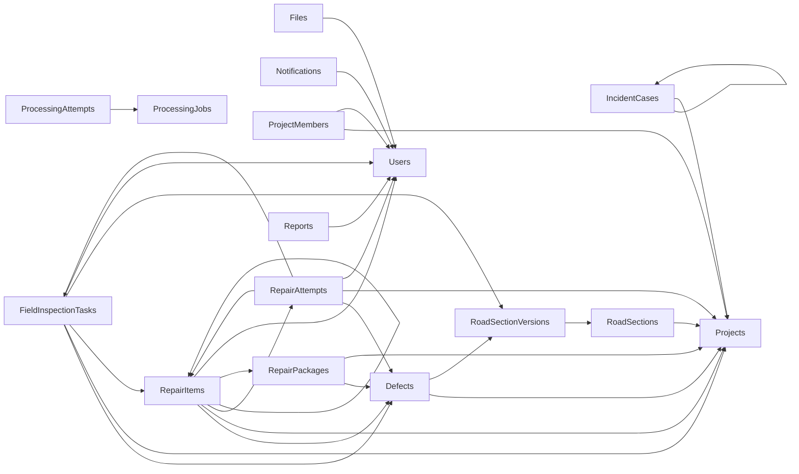

# Audited physical data dictionary và ERD mapping

**ACTIVE · TEST_VERIFIED (owned SQL catalog) · DOC-AUDIT-01**, `f0c8762509310b2779068891062267c5f520aff2`. Fresh `Rf06aSchemaInventoryTests` đã apply migrations trên fixture-owned SQL, so sánh model/snapshot/catalog và xuất inventory ngoài repo. Không seed/shared/team/production DB. **191 tables, 1,940 columns, 662 FK constraints, 693 indexes, 219 key constraints, 229 checks, 189 triggers**. Counts FK/index/key là distinct constraints, không đếm composite-column rows. Không application views/spatial indexes/sequences quan sát trong catalog.

Migrations: `20261008171739_BaselineCurrentSchema` → `20261009043010_AllowVerifiedDefectPostRepairTasks`. Replacement baseline chỉ cho NEW isolated DB theo RG-CI-01; không tự áp lên existing history. `__EFMigrationsHistory` là EF infrastructure, ngoài application totals.

Full fresh inventory/model/snapshot/raw SQL trigger definitions, source hashes và TRX nằm trong gói evidence; digest ở [manifest](../../audit/DOC-AUDIT-01-EVIDENCE.json). Tài liệu này trích toàn191 table/1940 column và exact SQL FK/key/index/check/trigger-name mapping. Cột thể hiện physical observation, không tự chốt business meaning. SQL/EF/source comparison có phạm vi của extractor; không chứng minh mọi trigger runtime effect hay production row policy.

## Enforced FK overview

Các cạnh sau chỉ vẽ FK được catalog quan sát; dictionary phía dưới ghi child/principal columns cho toàn bộ662 constraints. Multiplicity/optional business workflow không được suy chỉ từ hình.

## Entity/source module map

| Module | Entity/config/source families | Runtime interpretation |
|---|---|---|
| Identity/staff | `Identity/ApplicationUser`, `UserSession`, `ProjectMember`; ApplicationUser/Session/ProjectMember configurations; StaffReadRepository | Contacts restricted projection, memberships/effective dates; SQL FK alone does not authorize. |
| Report/case/defect | `Reports`, `Cases`, `Candidates`, `Defects`; Huy01Integration/TrainingLabel configurations | Original source/recipient publications, append-only links/revisions, human decisions. |
| Repair/FIELD | `Inspections`, `Repairs`; FieldInspection*/RepairWorkflow/RepairProducerSource/RepairPolicySafety configurations | Actual measurements/evidence, pinned policy/binding, attempt/review/correction/obligation and clocks. |
| Offline | Offline entities; OfflinePersistenceConfigurations; admission + transfer/sync repositories | Device/source/signature/snapshot/current recipient/original actor and durable receipts. |
| AI/upload | Processing/Files entities; ProcessingJob/Attempt/Anh02Ai/StoredFile configurations | Immutable manifests/provenance; MOCK distinct live provider; sizes bigint. |
| Operations | Messaging/Clocks/Retention/Reporting entities/configurations | Notification recipient/current source, audit/outbox, retention basis/hold and immutable exports. |

Tên entity/enum/source path là implementation evidence; accepted rules theo [product authority](../../product/README.md). Historical V2 names không bắt tạo bảng tương ứng. Không curing/traffic-release schema requirement trong current R01.

## Complete table dictionary

### dbo.AccountStatusChangeLogs

CLR mapping: `RoadGuardSystem.BusinessObjects.Identity.AccountStatusChangeLog`. EF physical definitions in `RoadGuardDbContext`, `Configurations/` and current model snapshot; baseline/additive migrations above.

| Column | SQL type/facets | Nullable | EF property/concurrency |
|---|---|---|---|
| `Id` | uniqueidentifier | false | Id |
| `TargetUserId` | uniqueidentifier | false | TargetUserId |
| `ChangedByUserId` | uniqueidentifier | true | ChangedByUserId |
| `OccurredAt` | datetimeoffset | false | OccurredAt |
| `FromStatus` | tinyint | false | FromStatus |
| `ToStatus` | tinyint | false | ToStatus |
| `Reason` | nvarchar(max) | false | Reason |
| `Source` | varchar(80) | false | Source |
| `CorrelationId` | uniqueidentifier | true | CorrelationId |
| `HandoverReference` | uniqueidentifier | true | HandoverReference |

Keys:
- `PK_AccountStatusChangeLogs`: PRIMARY_KEY_CONSTRAINT(Id)

Foreign keys:
- `FK_AccountStatusChangeLogs_Users_ChangedByUserId`: ChangedByUserId → dbo.Users(Id); delete=NO_ACTION; disabled=False; notTrusted=False
- `FK_AccountStatusChangeLogs_Users_TargetUserId`: TargetUserId → dbo.Users(Id); delete=NO_ACTION; disabled=False; notTrusted=False

Indexes:
- `IX_AccountStatusChangeLogs_ChangedByUserId`: ChangedByUserId; unique=False; NONCLUSTERED
- `IX_AccountStatusChangeLogs_OccurredAt`: OccurredAt; unique=False; NONCLUSTERED
- `IX_AccountStatusChangeLogs_TargetUserId`: TargetUserId; unique=False; NONCLUSTERED

Checks:
- `CK_AccountStatusChangeLogs_FromStatus`: `([FromStatus]=(3) OR [FromStatus]=(2) OR [FromStatus]=(1))`; disabled=False; notTrusted=False
- `CK_AccountStatusChangeLogs_FromToStatus_Diff`: `([FromStatus]<>[ToStatus])`; disabled=False; notTrusted=False
- `CK_AccountStatusChangeLogs_Reason_SafeCode`: `([Reason]='ACCOUNT_REACTIVATED' OR [Reason]='SECURITY_INCIDENT' OR [Reason]='ADMINISTRATIVE_LOCK' OR [Reason]='NO_STATUS_CHANGE' OR [Reason]='SAFETY_POLICY_VIOLATION' OR [Reason]='REGISTRATION_APPROVED' OR [Reason]='SELF_SERVICE_ACCOUNT_RECOVERY' OR [Reason]='ADMINISTRATOR_INITIATED')`; disabled=False; notTrusted=False
- `CK_AccountStatusChangeLogs_Source_SafeCode`: `([Source]='SYSTEM' OR [Source]='COMPLIANCE_REVIEW' OR [Source]='IDENTITY_SERVICE' OR [Source]='SELF_SERVICE' OR [Source]='ADMIN_API')`; disabled=False; notTrusted=False
- `CK_AccountStatusChangeLogs_ToStatus`: `([ToStatus]=(3) OR [ToStatus]=(2) OR [ToStatus]=(1))`; disabled=False; notTrusted=False

Triggers:
- `TR_AccountStatusChangeLogs_AppendOnly` → `RoadGuardSystem.Repositories/Migrations/20261008171739_BaselineCurrentSchema.cs:11875`; definition comparison OUTER_WHITESPACE_ONLY; digest `5a7da5c98aad9f2e14224303b4e8a4bf6c79b7676b6f0e1ccfdac98c43df1185`.

### dbo.AIDetections

CLR mapping: `RoadGuardSystem.BusinessObjects.Processing.AIDetection`. EF physical definitions in `RoadGuardDbContext`, `Configurations/` and current model snapshot; baseline/additive migrations above.

| Column | SQL type/facets | Nullable | EF property/concurrency |
|---|---|---|---|
| `Id` | uniqueidentifier | false | Id |
| `ProcessingJobId` | uniqueidentifier | false | ProcessingJobId |
| `ModelVersionId` | uniqueidentifier | false | ModelVersionId |
| `RoadSectionVersionId` | uniqueidentifier | true | RoadSectionVersionId |
| `Geometry` | geometry | true | Geometry |
| `DefectTypeCode` | varchar(80) | true | DefectTypeCode |
| `Confidence` | decimal(6,5) | false | Confidence |
| `EstimatedWidth` | decimal(12,3) | true | EstimatedWidth |
| `EstimatedLength` | decimal(12,3) | true | EstimatedLength |
| `RawPayload` | nvarchar(max) | false | RawPayload |

Keys:
- `PK_AIDetections`: PRIMARY_KEY_CONSTRAINT(Id)

Foreign keys:
- `FK_AIDetections_AIModelVersions_ModelVersionId`: ModelVersionId → dbo.AIModelVersions(Id); delete=NO_ACTION; disabled=False; notTrusted=False
- `FK_AIDetections_DefectTypes_DefectTypeCode`: DefectTypeCode → dbo.DefectTypes(Code); delete=NO_ACTION; disabled=False; notTrusted=False
- `FK_AIDetections_ProcessingJobs_ProcessingJobId`: ProcessingJobId → dbo.ProcessingJobs(Id); delete=NO_ACTION; disabled=False; notTrusted=False
- `FK_AIDetections_RoadSectionVersions_RoadSectionVersionId`: RoadSectionVersionId → dbo.RoadSectionVersions(Id); delete=NO_ACTION; disabled=False; notTrusted=False

Indexes:
- `IX_AIDetections_DefectTypeCode`: DefectTypeCode; unique=False; NONCLUSTERED
- `IX_AIDetections_ModelVersionId`: ModelVersionId; unique=False; NONCLUSTERED
- `IX_AIDetections_ProcessingJobId`: ProcessingJobId; unique=False; NONCLUSTERED
- `IX_AIDetections_RoadSectionVersionId`: RoadSectionVersionId; unique=False; NONCLUSTERED

Checks:
- `CK_AIDetections_Confidence`: `([Confidence]>=(0) AND [Confidence]<=(1))`; disabled=False; notTrusted=False
- `CK_AIDetections_EstimatedDimensions`: `(([EstimatedWidth] IS NULL OR [EstimatedWidth]>=(0)) AND ([EstimatedLength] IS NULL OR [EstimatedLength]>=(0)))`; disabled=False; notTrusted=False
- `CK_AIDetections_RawPayload_Json`: `(isjson([RawPayload])=(1))`; disabled=False; notTrusted=False

Triggers:
- `TR_AIDetections_Immutable` → `RoadGuardSystem.Repositories/Migrations/20261008171739_BaselineCurrentSchema.cs:11885`; definition comparison OUTER_WHITESPACE_ONLY; digest `7b750929df2e6143f21c1ff192da667ccd8a9e0041a81bcc3e1e00c043153a6f`.

### dbo.AIModelVersions

CLR mapping: `RoadGuardSystem.BusinessObjects.Processing.AIModelVersion`. EF physical definitions in `RoadGuardDbContext`, `Configurations/` and current model snapshot; baseline/additive migrations above.

| Column | SQL type/facets | Nullable | EF property/concurrency |
|---|---|---|---|
| `Id` | uniqueidentifier | false | Id |
| `ModelName` | varchar(120) | false | ModelName |
| `VersionLabel` | varchar(80) | false | VersionLabel |
| `ArtifactUri` | nvarchar(2048) | false | ArtifactUri |
| `Metrics` | nvarchar(max) | true | Metrics |
| `OperatingThresholds` | nvarchar(max) | true | OperatingThresholds |
| `Status` | tinyint | false | Status |
| `ReleasedAt` | datetimeoffset | true | ReleasedAt |
| `ReleasedByUserId` | uniqueidentifier | true | ReleasedByUserId |

Keys:
- `PK_AIModelVersions`: PRIMARY_KEY_CONSTRAINT(Id)

Foreign keys:
- `FK_AIModelVersions_Users_ReleasedByUserId`: ReleasedByUserId → dbo.Users(Id); delete=NO_ACTION; disabled=False; notTrusted=False

Indexes:
- `IX_AIModelVersions_ModelName`: ModelName; unique=False; NONCLUSTERED
- `IX_AIModelVersions_ReleasedByUserId`: ReleasedByUserId; unique=False; NONCLUSTERED
- `UX_AIModelVersions_VersionLabel`: VersionLabel; unique=True; NONCLUSTERED

Checks:
- `CK_AIModelVersions_Metrics_Json`: `([Metrics] IS NULL OR isjson([Metrics])=(1))`; disabled=False; notTrusted=False
- `CK_AIModelVersions_OperatingThresholds_Json`: `([OperatingThresholds] IS NULL OR isjson([OperatingThresholds])=(1))`; disabled=False; notTrusted=False
- `CK_AIModelVersions_ReleaseMetadata`: `([ReleasedAt] IS NULL AND [ReleasedByUserId] IS NULL OR [ReleasedAt] IS NOT NULL AND [ReleasedByUserId] IS NOT NULL)`; disabled=False; notTrusted=False
- `CK_AIModelVersions_Status`: `([Status]=(3) OR [Status]=(2) OR [Status]=(1))`; disabled=False; notTrusted=False

Triggers:
- None observed.

### dbo.Anh02AiDetectionProvenance

CLR mapping: `RoadGuardSystem.BusinessObjects.Processing.AiDetectionProvenance`. EF physical definitions in `RoadGuardDbContext`, `Configurations/` and current model snapshot; baseline/additive migrations above.

| Column | SQL type/facets | Nullable | EF property/concurrency |
|---|---|---|---|
| `DetectionId` | uniqueidentifier | false | DetectionId |
| `RunId` | uniqueidentifier | false | RunId |
| `ResultId` | uniqueidentifier | false | ResultId |
| `SourceVideoFileId` | uniqueidentifier | false | SourceVideoFileId |
| `SourceVideoFileVersion` | varchar(128) | false | SourceVideoFileVersion |
| `FrameFileId` | uniqueidentifier | false | FrameFileId |
| `FrameFileVersion` | varchar(128) | false | FrameFileVersion |
| `DerivationHash` | varchar(128) | false | DerivationHash |
| `TimestampMilliseconds` | bigint | false | TimestampMilliseconds |
| `SourceDurationMilliseconds` | bigint | false | SourceDurationMilliseconds |
| `SegmentId` | uniqueidentifier | true | SegmentId |
| `BoxX` | decimal(12,9) | false | BoxX |
| `BoxY` | decimal(12,9) | false | BoxY |
| `BoxWidth` | decimal(12,9) | false | BoxWidth |
| `BoxHeight` | decimal(12,9) | false | BoxHeight |

Keys:
- `PK_Anh02AiDetectionProvenance`: PRIMARY_KEY_CONSTRAINT(DetectionId)

Foreign keys:
- `FK_Anh02AiDetectionProvenance_AIDetections_DetectionId`: DetectionId → dbo.AIDetections(Id); delete=NO_ACTION; disabled=False; notTrusted=False
- `FK_Anh02AiDetectionProvenance_Anh02AiManifestFiles_RunId_SourceVideoFileId_SourceVideoFileVersion`: RunId, SourceVideoFileId, SourceVideoFileVersion → dbo.Anh02AiManifestFiles(RunId, FileId, FileVersion); delete=NO_ACTION; disabled=False; notTrusted=False
- `FK_Anh02AiDetectionProvenance_Anh02AiMockRuns_RunId`: RunId → dbo.Anh02AiMockRuns(Id); delete=NO_ACTION; disabled=False; notTrusted=False
- `FK_Anh02AiDetectionProvenance_Anh02AiResultProvenance_ResultId_RunId`: ResultId, RunId → dbo.Anh02AiResultProvenance(Id, RunId); delete=NO_ACTION; disabled=False; notTrusted=False
- `FK_Anh02AiDetectionProvenance_Files_FrameFileId`: FrameFileId → dbo.Files(Id); delete=NO_ACTION; disabled=False; notTrusted=False
- `FK_Anh02AiDetectionProvenance_Files_SourceVideoFileId`: SourceVideoFileId → dbo.Files(Id); delete=NO_ACTION; disabled=False; notTrusted=False
- `FK_Anh02AiDetectionProvenance_RoadSegments_SegmentId`: SegmentId → dbo.RoadSegments(Id); delete=NO_ACTION; disabled=False; notTrusted=False

Indexes:
- `IX_Anh02AiDetectionProvenance_FrameFileId`: FrameFileId; unique=False; NONCLUSTERED
- `IX_Anh02AiDetectionProvenance_ResultId_RunId`: ResultId, RunId; unique=False; NONCLUSTERED
- `IX_Anh02AiDetectionProvenance_RunId_SourceVideoFileId_SourceVideoFileVersion`: RunId, SourceVideoFileId, SourceVideoFileVersion; unique=False; NONCLUSTERED
- `IX_Anh02AiDetectionProvenance_SegmentId`: SegmentId; unique=False; NONCLUSTERED
- `IX_Anh02AiDetectionProvenance_SourceVideoFileId`: SourceVideoFileId; unique=False; NONCLUSTERED

Checks:
- `CK_Anh02AiDetection_Box`: `([BoxX]>=(0) AND [BoxY]>=(0) AND [BoxWidth]>(0) AND [BoxHeight]>(0) AND ([BoxX]+[BoxWidth])<=(1) AND ([BoxY]+[BoxHeight])<=(1))`; disabled=False; notTrusted=False
- `CK_Anh02AiDetection_Time`: `([TimestampMilliseconds]>=(0) AND [SourceDurationMilliseconds]>(0) AND [TimestampMilliseconds]<[SourceDurationMilliseconds])`; disabled=False; notTrusted=False

Triggers:
- `TR_Anh02AiDetectionProvenance_Immutable` → `RoadGuardSystem.Repositories/Migrations/20261008171739_BaselineCurrentSchema.cs:11895`; definition comparison OUTER_WHITESPACE_ONLY; digest `f70e44b1e456907cc92ab19a4cc3a9fac16ef22bd803df8ec2238910e37b8200`.

### dbo.Anh02AiManifestFiles

CLR mapping: `RoadGuardSystem.BusinessObjects.Processing.AiManifestFileReference`. EF physical definitions in `RoadGuardDbContext`, `Configurations/` and current model snapshot; baseline/additive migrations above.

| Column | SQL type/facets | Nullable | EF property/concurrency |
|---|---|---|---|
| `RunId` | uniqueidentifier | false | RunId |
| `FileId` | uniqueidentifier | false | FileId |
| `FileVersion` | varchar(128) | false | FileVersion |

Keys:
- `AK_Anh02AiManifestFiles_RunId_FileId_FileVersion`: UNIQUE_CONSTRAINT(RunId, FileId, FileVersion)
- `PK_Anh02AiManifestFiles`: PRIMARY_KEY_CONSTRAINT(RunId, FileId)

Foreign keys:
- `FK_Anh02AiManifestFiles_Anh02AiMockRuns_RunId`: RunId → dbo.Anh02AiMockRuns(Id); delete=NO_ACTION; disabled=False; notTrusted=False
- `FK_Anh02AiManifestFiles_Files_FileId`: FileId → dbo.Files(Id); delete=NO_ACTION; disabled=False; notTrusted=False

Indexes:
- `IX_Anh02AiManifestFiles_FileId`: FileId; unique=False; NONCLUSTERED

Checks:
- None observed.

Triggers:
- `TR_Anh02AiManifestFiles_Immutable` → `RoadGuardSystem.Repositories/Migrations/20261008171739_BaselineCurrentSchema.cs:11898`; definition comparison OUTER_WHITESPACE_ONLY; digest `66cf8ee67dd892c86013380107da1e84f232b0e9ba48b9161815f2708a7cff47`.

### dbo.Anh02AiMockRuns

CLR mapping: `RoadGuardSystem.BusinessObjects.Processing.AiMockRun`. EF physical definitions in `RoadGuardDbContext`, `Configurations/` and current model snapshot; baseline/additive migrations above.

| Column | SQL type/facets | Nullable | EF property/concurrency |
|---|---|---|---|
| `Id` | uniqueidentifier | false | Id |
| `ProjectId` | uniqueidentifier | false | ProjectId |
| `DatasetVersionId` | uniqueidentifier | false | DatasetVersionId |
| `ProcessingJobId` | uniqueidentifier | false | ProcessingJobId |
| `AttemptId` | uniqueidentifier | false | AttemptId |
| `ModelVersionId` | uniqueidentifier | false | ModelVersionId |
| `RouteVersionId` | uniqueidentifier | false | RouteVersionId |
| `SegmentSetId` | uniqueidentifier | false | SegmentSetId |
| `CreatedBy` | uniqueidentifier | false | CreatedBy |
| `CreatedAt` | datetimeoffset | false | CreatedAt |
| `Stage` | varchar(24) | false | Stage |
| `Status` | varchar(24) | false | Status |
| `FixtureVersion` | varchar(128) | false | FixtureVersion |
| `GeometryVersion` | varchar(128) | false | GeometryVersion |
| `ManifestHash` | varchar(64) | false | ManifestHash |
| `CanonicalManifest` | nvarchar(max) | false | CanonicalManifest |
| `AnalysisRunId` | uniqueidentifier | true | AnalysisRunId |
| `ResultId` | uniqueidentifier | true | ResultId |
| `ErrorCode` | varchar(80) | true | ErrorCode |
| `LeaseOwner` | uniqueidentifier | true | LeaseOwner |
| `LeaseUntil` | datetimeoffset | true | LeaseUntil |
| `ResultTimestamp` | datetimeoffset | true | ResultTimestamp |
| `CompletedAt` | datetimeoffset | true | CompletedAt |
| `RowVersion` | timestamp | false | RowVersion / concurrency |

Keys:
- `PK_Anh02AiMockRuns`: PRIMARY_KEY_CONSTRAINT(Id)

Foreign keys:
- `FK_Anh02AiMockRuns_AIModelVersions_ModelVersionId`: ModelVersionId → dbo.AIModelVersions(Id); delete=NO_ACTION; disabled=False; notTrusted=False
- `FK_Anh02AiMockRuns_Anh02AiMockRuns_AnalysisRunId`: AnalysisRunId → dbo.Anh02AiMockRuns(Id); delete=NO_ACTION; disabled=False; notTrusted=False
- `FK_Anh02AiMockRuns_Anh02AiResultProvenance_ResultId_Id`: ResultId, Id → dbo.Anh02AiResultProvenance(Id, RunId); delete=NO_ACTION; disabled=False; notTrusted=False
- `FK_Anh02AiMockRuns_ProcessingAttempts_AttemptId`: AttemptId → dbo.ProcessingAttempts(Id); delete=NO_ACTION; disabled=False; notTrusted=False
- `FK_Anh02AiMockRuns_ProcessingJobs_ProcessingJobId`: ProcessingJobId → dbo.ProcessingJobs(Id); delete=NO_ACTION; disabled=False; notTrusted=False
- `FK_Anh02AiMockRuns_Projects_ProjectId`: ProjectId → dbo.Projects(Id); delete=NO_ACTION; disabled=False; notTrusted=False
- `FK_Anh02AiMockRuns_RoadSegmentSets_SegmentSetId_RouteVersionId`: SegmentSetId, RouteVersionId → dbo.RoadSegmentSets(Id, RoadSectionVersionId); delete=NO_ACTION; disabled=False; notTrusted=False
- `FK_Anh02AiMockRuns_SurveyDataVersions_DatasetVersionId`: DatasetVersionId → dbo.SurveyDataVersions(Id); delete=NO_ACTION; disabled=False; notTrusted=False
- `FK_Anh02AiMockRuns_Users_CreatedBy`: CreatedBy → dbo.Users(Id); delete=NO_ACTION; disabled=False; notTrusted=False

Indexes:
- `IX_Anh02AiMockRuns_AnalysisRunId`: AnalysisRunId; unique=False; NONCLUSTERED
- `IX_Anh02AiMockRuns_AttemptId`: AttemptId; unique=False; NONCLUSTERED
- `IX_Anh02AiMockRuns_CreatedBy`: CreatedBy; unique=False; NONCLUSTERED
- `IX_Anh02AiMockRuns_DatasetVersionId`: DatasetVersionId; unique=False; NONCLUSTERED
- `IX_Anh02AiMockRuns_ModelVersionId`: ModelVersionId; unique=False; NONCLUSTERED
- `IX_Anh02AiMockRuns_ProcessingJobId`: ProcessingJobId; unique=True; NONCLUSTERED; filter=(catalog filtered)
- `IX_Anh02AiMockRuns_ProjectId`: ProjectId; unique=False; NONCLUSTERED
- `IX_Anh02AiMockRuns_ResultId_Id`: ResultId, Id; unique=False; NONCLUSTERED
- `IX_Anh02AiMockRuns_SegmentSetId_RouteVersionId`: SegmentSetId, RouteVersionId; unique=False; NONCLUSTERED
- `IX_Anh02AiMockRuns_Status_LeaseUntil`: Status, LeaseUntil; unique=False; NONCLUSTERED

Checks:
- `CK_Anh02AiMockRuns_Completion`: `([Status]='SUCCEEDED' AND [ResultId] IS NOT NULL AND [CompletedAt] IS NOT NULL OR [Status]<>'SUCCEEDED' AND [ResultId] IS NULL)`; disabled=False; notTrusted=False
- `CK_Anh02AiMockRuns_Manifest`: `(isjson([CanonicalManifest])=(1))`; disabled=False; notTrusted=False
- `CK_Anh02AiMockRuns_Stage`: `([Stage]='DUPLICATE_MATCHING' OR [Stage]='VIDEO_ANALYSIS')`; disabled=False; notTrusted=False
- `CK_Anh02AiMockRuns_Status`: `([Status]='FAILED' OR [Status]='SUCCEEDED' OR [Status]='RUNNING' OR [Status]='QUEUED')`; disabled=False; notTrusted=False

Triggers:
- `TR_Anh02AiMockRuns_Identity` → `RoadGuardSystem.Repositories/Migrations/20261008171739_BaselineCurrentSchema.cs:11901`; definition comparison OUTER_WHITESPACE_ONLY; digest `e106e73a6ed7db261716eebb8f99b0fde8b10b85abfd8289c22fa6398467d332`.

### dbo.Anh02AiResultProvenance

CLR mapping: `RoadGuardSystem.BusinessObjects.Processing.AiResultProvenance`. EF physical definitions in `RoadGuardDbContext`, `Configurations/` and current model snapshot; baseline/additive migrations above.

| Column | SQL type/facets | Nullable | EF property/concurrency |
|---|---|---|---|
| `Id` | uniqueidentifier | false | Id |
| `RunId` | uniqueidentifier | false | RunId |
| `ProcessingJobId` | uniqueidentifier | false | ProcessingJobId |
| `AttemptId` | uniqueidentifier | false | AttemptId |
| `ManifestHash` | varchar(64) | false | ManifestHash |
| `ResultHash` | varchar(64) | false | ResultHash |
| `CanonicalResult` | nvarchar(max) | false | CanonicalResult |
| `CompletedAt` | datetimeoffset | false | CompletedAt |

Keys:
- `AK_Anh02AiResultProvenance_Id_RunId`: UNIQUE_CONSTRAINT(Id, RunId)
- `PK_Anh02AiResultProvenance`: PRIMARY_KEY_CONSTRAINT(Id)

Foreign keys:
- `FK_Anh02AiResultProvenance_Anh02AiMockRuns_RunId`: RunId → dbo.Anh02AiMockRuns(Id); delete=NO_ACTION; disabled=False; notTrusted=False
- `FK_Anh02AiResultProvenance_ProcessingAttempts_AttemptId`: AttemptId → dbo.ProcessingAttempts(Id); delete=NO_ACTION; disabled=False; notTrusted=False
- `FK_Anh02AiResultProvenance_ProcessingJobs_ProcessingJobId`: ProcessingJobId → dbo.ProcessingJobs(Id); delete=NO_ACTION; disabled=False; notTrusted=False

Indexes:
- `IX_Anh02AiResultProvenance_AttemptId`: AttemptId; unique=False; NONCLUSTERED
- `IX_Anh02AiResultProvenance_ProcessingJobId`: ProcessingJobId; unique=False; NONCLUSTERED
- `IX_Anh02AiResultProvenance_RunId`: RunId; unique=True; NONCLUSTERED

Checks:
- `CK_Anh02AiResult_Json`: `(isjson([CanonicalResult])=(1))`; disabled=False; notTrusted=False

Triggers:
- `TR_Anh02AiResultProvenance_Immutable` → `RoadGuardSystem.Repositories/Migrations/20261008171739_BaselineCurrentSchema.cs:11918`; definition comparison OUTER_WHITESPACE_ONLY; digest `04208cf9e610c6cebec997ab484093b6b2ec10c57976f63ff9c26d23378433b2`.

### dbo.Anh02ExportJobs

CLR mapping: `RoadGuardSystem.BusinessObjects.Exports.ExportJob`. EF physical definitions in `RoadGuardDbContext`, `Configurations/` and current model snapshot; baseline/additive migrations above.

| Column | SQL type/facets | Nullable | EF property/concurrency |
|---|---|---|---|
| `Id` | uniqueidentifier | false | Id |
| `ProjectId` | uniqueidentifier | false | ProjectId |
| `RequestedBy` | uniqueidentifier | false | RequestedBy |
| `SnapshotId` | uniqueidentifier | false | SnapshotId |
| `Kind` | varchar(16) | false | Kind |
| `Format` | varchar(8) | false | Format |
| `Status` | varchar(16) | false | Status |
| `CreatedAt` | datetimeoffset | false | CreatedAt |
| `CompletedAt` | datetimeoffset | true | CompletedAt |
| `ExpiresAt` | datetimeoffset | true | ExpiresAt |
| `ArtifactId` | uniqueidentifier | true | ArtifactId |
| `ErrorCode` | varchar(80) | true | ErrorCode |
| `LeaseToken` | uniqueidentifier | true | LeaseToken |
| `LeaseUntil` | datetimeoffset | true | LeaseUntil |
| `NextAttemptAt` | datetimeoffset | true | NextAttemptAt |
| `RowVersion` | timestamp | false | RowVersion / concurrency |

Keys:
- `PK_Anh02ExportJobs`: PRIMARY_KEY_CONSTRAINT(Id)

Foreign keys:
- `FK_Anh02ExportJobs_Anh02ExportSnapshots_SnapshotId`: SnapshotId → dbo.Anh02ExportSnapshots(Id); delete=NO_ACTION; disabled=False; notTrusted=False
- `FK_Anh02ExportJobs_Anh02GeneratedArtifacts_ArtifactId`: ArtifactId → dbo.Anh02GeneratedArtifacts(Id); delete=NO_ACTION; disabled=False; notTrusted=False
- `FK_Anh02ExportJobs_Projects_ProjectId`: ProjectId → dbo.Projects(Id); delete=NO_ACTION; disabled=False; notTrusted=False
- `FK_Anh02ExportJobs_Users_RequestedBy`: RequestedBy → dbo.Users(Id); delete=NO_ACTION; disabled=False; notTrusted=False

Indexes:
- `IX_Anh02ExportJobs_ArtifactId`: ArtifactId; unique=False; NONCLUSTERED
- `IX_Anh02ExportJobs_ProjectId`: ProjectId; unique=False; NONCLUSTERED
- `IX_Anh02ExportJobs_RequestedBy`: RequestedBy; unique=False; NONCLUSTERED
- `IX_Anh02ExportJobs_SnapshotId`: SnapshotId; unique=True; NONCLUSTERED
- `IX_Anh02ExportJobs_Status_NextAttemptAt_LeaseUntil`: Status, NextAttemptAt, LeaseUntil; unique=False; NONCLUSTERED

Checks:
- `CK_Anh02ExportJob_Expiry`: `([Status]<>'SUCCEEDED' AND [ExpiresAt] IS NULL OR [Status]='SUCCEEDED' AND [ArtifactId] IS NOT NULL AND [CompletedAt] IS NOT NULL AND [ExpiresAt]=dateadd(day,(30),[CompletedAt]))`; disabled=False; notTrusted=False
- `CK_Anh02ExportJob_Format`: `(([Format]='ZIP' OR [Format]='PDF') AND ([Kind]<>'TRAINING' OR [Format]='ZIP'))`; disabled=False; notTrusted=False
- `CK_Anh02ExportJob_Kind`: `([Kind]='TRAINING' OR [Kind]='DOSSIER')`; disabled=False; notTrusted=False
- `CK_Anh02ExportJob_State`: `([Status]='FAILED' OR [Status]='SUCCEEDED' OR [Status]='RUNNING' OR [Status]='QUEUED')`; disabled=False; notTrusted=False

Triggers:
- None observed.

### dbo.Anh02ExportSnapshotFiles

CLR mapping: `RoadGuardSystem.BusinessObjects.Exports.ExportSnapshotFile`. EF physical definitions in `RoadGuardDbContext`, `Configurations/` and current model snapshot; baseline/additive migrations above.

| Column | SQL type/facets | Nullable | EF property/concurrency |
|---|---|---|---|
| `Id` | uniqueidentifier | false | Id |
| `SnapshotId` | uniqueidentifier | false | SnapshotId |
| `FileId` | uniqueidentifier | false | FileId |
| `FileVersion` | nvarchar(128) | false | FileVersion |
| `Sha256` | char(64) | false | Sha256 |
| `SizeBytes` | bigint | false | SizeBytes |
| `MediaType` | nvarchar(120) | false | MediaType |
| `Included` | bit | false | Included |
| `ArchivePath` | nvarchar(255) | true | ArchivePath |

Keys:
- `PK_Anh02ExportSnapshotFiles`: PRIMARY_KEY_CONSTRAINT(Id)

Foreign keys:
- `FK_Anh02ExportSnapshotFiles_Anh02ExportSnapshots_SnapshotId`: SnapshotId → dbo.Anh02ExportSnapshots(Id); delete=NO_ACTION; disabled=False; notTrusted=False
- `FK_Anh02ExportSnapshotFiles_Files_FileId`: FileId → dbo.Files(Id); delete=NO_ACTION; disabled=False; notTrusted=False

Indexes:
- `IX_Anh02ExportSnapshotFiles_FileId`: FileId; unique=False; NONCLUSTERED
- `IX_Anh02ExportSnapshotFiles_SnapshotId_FileId`: SnapshotId, FileId; unique=True; NONCLUSTERED

Checks:
- `CK_Anh02ExportSnapshotFile_Size`: `([SizeBytes]>(0))`; disabled=False; notTrusted=False

Triggers:
- `TR_Anh02ExportSnapshotFiles_Immutable` → `RoadGuardSystem.Repositories/Migrations/20261008171739_BaselineCurrentSchema.cs:11921`; definition comparison OUTER_WHITESPACE_ONLY; digest `f95b7f0b57770a5ef9931378539a1a1493d01862917eef138f26870dd2dd8a85`.

### dbo.Anh02ExportSnapshots

CLR mapping: `RoadGuardSystem.BusinessObjects.Exports.ExportSnapshot`. EF physical definitions in `RoadGuardDbContext`, `Configurations/` and current model snapshot; baseline/additive migrations above.

| Column | SQL type/facets | Nullable | EF property/concurrency |
|---|---|---|---|
| `Id` | uniqueidentifier | false | Id |
| `ProjectId` | uniqueidentifier | false | ProjectId |
| `PayloadJson` | nvarchar(max) | false | PayloadJson |
| `Hash` | char(64) | false | Hash |
| `CapturedAt` | datetimeoffset | false | CapturedAt |

Keys:
- `PK_Anh02ExportSnapshots`: PRIMARY_KEY_CONSTRAINT(Id)

Foreign keys:
- `FK_Anh02ExportSnapshots_Projects_ProjectId`: ProjectId → dbo.Projects(Id); delete=NO_ACTION; disabled=False; notTrusted=False

Indexes:
- `IX_Anh02ExportSnapshots_ProjectId`: ProjectId; unique=False; NONCLUSTERED

Checks:
- None observed.

Triggers:
- `TR_Anh02ExportSnapshots_Immutable` → `RoadGuardSystem.Repositories/Migrations/20261008171739_BaselineCurrentSchema.cs:11924`; definition comparison OUTER_WHITESPACE_ONLY; digest `35ea834a5bd341c47863be72b6faf98f0d0123c5407536ad86b5139a0332a2ab`.

### dbo.Anh02GeneratedArtifacts

CLR mapping: `RoadGuardSystem.BusinessObjects.Exports.GeneratedArtifact`. EF physical definitions in `RoadGuardDbContext`, `Configurations/` and current model snapshot; baseline/additive migrations above.

| Column | SQL type/facets | Nullable | EF property/concurrency |
|---|---|---|---|
| `Id` | uniqueidentifier | false | Id |
| `ExportJobId` | uniqueidentifier | false | ExportJobId |
| `SnapshotId` | uniqueidentifier | false | SnapshotId |
| `FileId` | uniqueidentifier | false | FileId |
| `CreatedAt` | datetimeoffset | false | CreatedAt |

Keys:
- `PK_Anh02GeneratedArtifacts`: PRIMARY_KEY_CONSTRAINT(Id)

Foreign keys:
- `FK_Anh02GeneratedArtifacts_Anh02ExportJobs_ExportJobId`: ExportJobId → dbo.Anh02ExportJobs(Id); delete=NO_ACTION; disabled=False; notTrusted=False
- `FK_Anh02GeneratedArtifacts_Anh02ExportSnapshots_SnapshotId`: SnapshotId → dbo.Anh02ExportSnapshots(Id); delete=NO_ACTION; disabled=False; notTrusted=False
- `FK_Anh02GeneratedArtifacts_Files_FileId`: FileId → dbo.Files(Id); delete=NO_ACTION; disabled=False; notTrusted=False

Indexes:
- `IX_Anh02GeneratedArtifacts_ExportJobId`: ExportJobId; unique=True; NONCLUSTERED
- `IX_Anh02GeneratedArtifacts_FileId`: FileId; unique=True; NONCLUSTERED
- `IX_Anh02GeneratedArtifacts_SnapshotId`: SnapshotId; unique=False; NONCLUSTERED

Checks:
- None observed.

Triggers:
- `TR_Anh02GeneratedArtifacts_Immutable` → `RoadGuardSystem.Repositories/Migrations/20261008171739_BaselineCurrentSchema.cs:11927`; definition comparison OUTER_WHITESPACE_ONLY; digest `4417679574129c5271dec19eb33c9eb7760e7181e73ceab881928c51ab7136c3`.

### dbo.AuditLogs

CLR mapping: `RoadGuardSystem.BusinessObjects.Auditing.AuditLog`. EF physical definitions in `RoadGuardDbContext`, `Configurations/` and current model snapshot; baseline/additive migrations above.

| Column | SQL type/facets | Nullable | EF property/concurrency |
|---|---|---|---|
| `Id` | uniqueidentifier | false | Id |
| `ActorUserId` | uniqueidentifier | true | ActorUserId |
| `OccurredAtUtc` | datetimeoffset | false | OccurredAtUtc |
| `EventType` | varchar(100) | false | EventType |
| `EntityType` | varchar(100) | false | EntityType |
| `EntityId` | uniqueidentifier | false | EntityId |
| `BeforeSnapshot` | nvarchar(max) | true | BeforeSnapshot |
| `AfterSnapshot` | nvarchar(max) | true | AfterSnapshot |
| `Reason` | nvarchar(max) | true | Reason |
| `Source` | varchar(80) | false | Source |
| `CorrelationId` | uniqueidentifier | true | CorrelationId |

Keys:
- `PK_AuditLogs`: PRIMARY_KEY_CONSTRAINT(Id)

Foreign keys:
- `FK_AuditLogs_Users_ActorUserId`: ActorUserId → dbo.Users(Id); delete=NO_ACTION; disabled=False; notTrusted=False

Indexes:
- `IX_AuditLogs_ActorUserId`: ActorUserId; unique=False; NONCLUSTERED
- `IX_AuditLogs_CorrelationId`: CorrelationId; unique=False; NONCLUSTERED
- `IX_AuditLogs_Entity`: EntityType, EntityId; unique=False; NONCLUSTERED
- `IX_AuditLogs_OccurredAtUtc`: OccurredAtUtc; unique=False; NONCLUSTERED

Checks:
- `CK_AuditLogs_AfterSnapshot_Json`: `([AfterSnapshot] IS NULL OR isjson([AfterSnapshot])=(1))`; disabled=False; notTrusted=False
- `CK_AuditLogs_BeforeSnapshot_Json`: `([BeforeSnapshot] IS NULL OR isjson([BeforeSnapshot])=(1))`; disabled=False; notTrusted=False

Triggers:
- `TR_AuditLogs_AppendOnly` → `RoadGuardSystem.Repositories/Migrations/20261008171739_BaselineCurrentSchema.cs:11930`; definition comparison OUTER_WHITESPACE_ONLY; digest `4fc0ae0b4e8ed77eababdbd9edf99beb8dbb07afe91ba8913be77750317c005a`.

### dbo.BaselineCurrentPointers

CLR mapping: `RoadGuardSystem.BusinessObjects.Surveys.BaselineCurrentPointer`. EF physical definitions in `RoadGuardDbContext`, `Configurations/` and current model snapshot; baseline/additive migrations above.

| Column | SQL type/facets | Nullable | EF property/concurrency |
|---|---|---|---|
| `Id` | uniqueidentifier | false | Id |
| `ProjectId` | uniqueidentifier | false | ProjectId |
| `RouteVersionId` | uniqueidentifier | false | RouteVersionId |
| `SegmentSetId` | uniqueidentifier | false | SegmentSetId |
| `SegmentId` | uniqueidentifier | false | SegmentId |
| `TargetBand` | nvarchar(20) | false | TargetBand |
| `SelectionId` | uniqueidentifier | false | SelectionId |
| `RowVersion` | timestamp | false | RowVersion / concurrency |

Keys:
- `PK_BaselineCurrentPointers`: PRIMARY_KEY_CONSTRAINT(Id)

Foreign keys:
- `FK_BaselineCurrentPointers_BaselineSelectionItems_SelectionId`: SelectionId → dbo.BaselineSelectionItems(Id); delete=NO_ACTION; disabled=False; notTrusted=False
- `FK_BaselineCurrentPointers_Projects_ProjectId`: ProjectId → dbo.Projects(Id); delete=NO_ACTION; disabled=False; notTrusted=False

Indexes:
- `IX_BaselineCurrentPointers_ProjectId_RouteVersionId_SegmentSetId_SegmentId_TargetBand`: ProjectId, RouteVersionId, SegmentSetId, SegmentId, TargetBand; unique=True; NONCLUSTERED
- `IX_BaselineCurrentPointers_SelectionId`: SelectionId; unique=False; NONCLUSTERED

Checks:
- None observed.

Triggers:
- None observed.

### dbo.BaselineSelectionItems

CLR mapping: `RoadGuardSystem.BusinessObjects.Surveys.BaselineSelectionItem`. EF physical definitions in `RoadGuardDbContext`, `Configurations/` and current model snapshot; baseline/additive migrations above.

| Column | SQL type/facets | Nullable | EF property/concurrency |
|---|---|---|---|
| `Id` | uniqueidentifier | false | Id |
| `BaselineSelectionId` | uniqueidentifier | false | BaselineSelectionId |
| `DatasetId` | uniqueidentifier | false | DatasetId |
| `AssessmentId` | uniqueidentifier | false | AssessmentId |
| `RouteVersionId` | uniqueidentifier | false | RouteVersionId |
| `SegmentSetId` | uniqueidentifier | false | SegmentSetId |
| `SegmentId` | uniqueidentifier | false | SegmentId |
| `TargetBand` | nvarchar(20) | false | TargetBand |

Keys:
- `PK_BaselineSelectionItems`: PRIMARY_KEY_CONSTRAINT(Id)

Foreign keys:
- `FK_BaselineSelectionItems_BaselineSelections_BaselineSelectionId`: BaselineSelectionId → dbo.BaselineSelections(Id); delete=NO_ACTION; disabled=False; notTrusted=False
- `FK_BaselineSelectionItems_DatasetAssessments_AssessmentId`: AssessmentId → dbo.DatasetAssessments(Id); delete=NO_ACTION; disabled=False; notTrusted=False
- `FK_BaselineSelectionItems_SurveyDataVersions_DatasetId`: DatasetId → dbo.SurveyDataVersions(Id); delete=NO_ACTION; disabled=False; notTrusted=False

Indexes:
- `IX_BaselineSelectionItems_AssessmentId`: AssessmentId; unique=False; NONCLUSTERED
- `IX_BaselineSelectionItems_BaselineSelectionId_RouteVersionId_SegmentSetId_SegmentId_TargetBand`: BaselineSelectionId, RouteVersionId, SegmentSetId, SegmentId, TargetBand; unique=True; NONCLUSTERED
- `IX_BaselineSelectionItems_DatasetId`: DatasetId; unique=False; NONCLUSTERED

Checks:
- None observed.

Triggers:
- `TR_BaselineSelectionItems_Immutable` → `RoadGuardSystem.Repositories/Migrations/20261008171739_BaselineCurrentSchema.cs:11940`; definition comparison OUTER_WHITESPACE_ONLY; digest `239ee9861417d39a275045a97b17f960a5e3171ffbd987800fcbd7b237677b2e`.

### dbo.BaselineSelections

CLR mapping: `RoadGuardSystem.BusinessObjects.Surveys.BaselineSelection`. EF physical definitions in `RoadGuardDbContext`, `Configurations/` and current model snapshot; baseline/additive migrations above.

| Column | SQL type/facets | Nullable | EF property/concurrency |
|---|---|---|---|
| `Id` | uniqueidentifier | false | Id |
| `ProjectId` | uniqueidentifier | false | ProjectId |
| `SelectedBy` | uniqueidentifier | false | SelectedBy |
| `SelectedAt` | datetimeoffset | false | SelectedAt |
| `Reason` | nvarchar(max) | false | Reason |
| `RowVersion` | timestamp | false | RowVersion / concurrency |

Keys:
- `PK_BaselineSelections`: PRIMARY_KEY_CONSTRAINT(Id)

Foreign keys:
- `FK_BaselineSelections_Projects_ProjectId`: ProjectId → dbo.Projects(Id); delete=NO_ACTION; disabled=False; notTrusted=False
- `FK_BaselineSelections_Users_SelectedBy`: SelectedBy → dbo.Users(Id); delete=NO_ACTION; disabled=False; notTrusted=False

Indexes:
- `IX_BaselineSelections_ProjectId`: ProjectId; unique=False; NONCLUSTERED
- `IX_BaselineSelections_SelectedBy`: SelectedBy; unique=False; NONCLUSTERED

Checks:
- None observed.

Triggers:
- `TR_BaselineSelections_Immutable` → `RoadGuardSystem.Repositories/Migrations/20261008171739_BaselineCurrentSchema.cs:11943`; definition comparison OUTER_WHITESPACE_ONLY; digest `cbae15ff6640031cbe800c8b846e942a42cc7c2b741a6edf6a504ec97c04c846`.

### dbo.BusinessDutyAppointments

CLR mapping: `RoadGuardSystem.BusinessObjects.Clocks.BusinessDutyAppointment`. EF physical definitions in `RoadGuardDbContext`, `Configurations/` and current model snapshot; baseline/additive migrations above.

| Column | SQL type/facets | Nullable | EF property/concurrency |
|---|---|---|---|
| `Id` | uniqueidentifier | false | Id |
| `RequestId` | uniqueidentifier | false | RequestId |
| `PreviousActorId` | uniqueidentifier | true | PreviousActorId |
| `CurrentActorId` | uniqueidentifier | false | CurrentActorId |
| `DecisionActorId` | uniqueidentifier | false | DecisionActorId |
| `Reason` | nvarchar(2000) | false | Reason |
| `EffectiveAt` | datetimeoffset | false | EffectiveAt |

Keys:
- `PK_BusinessDutyAppointments`: PRIMARY_KEY_CONSTRAINT(Id)

Foreign keys:
- `FK_BusinessDutyAppointments_BusinessReceivingRequests_RequestId`: RequestId → dbo.BusinessReceivingRequests(Id); delete=NO_ACTION; disabled=False; notTrusted=False
- `FK_BusinessDutyAppointments_Users_CurrentActorId`: CurrentActorId → dbo.Users(Id); delete=NO_ACTION; disabled=False; notTrusted=False
- `FK_BusinessDutyAppointments_Users_DecisionActorId`: DecisionActorId → dbo.Users(Id); delete=NO_ACTION; disabled=False; notTrusted=False

Indexes:
- `IX_BusinessDutyAppointments_CurrentActorId`: CurrentActorId; unique=False; NONCLUSTERED
- `IX_BusinessDutyAppointments_DecisionActorId`: DecisionActorId; unique=False; NONCLUSTERED
- `IX_BusinessDutyAppointments_RequestId`: RequestId; unique=False; NONCLUSTERED

Checks:
- None observed.

Triggers:
- `TR_BusinessDutyAppointments_Immutable` → `RoadGuardSystem.Repositories/Migrations/20261008171739_BaselineCurrentSchema.cs:11946`; definition comparison OUTER_WHITESPACE_ONLY; digest `b119ffc2246e4b17a1e408d380c58acef9fc30502c900c93ce3cd4de4f921c00`.

### dbo.BusinessReceivingRequests

CLR mapping: `RoadGuardSystem.BusinessObjects.Clocks.BusinessReceivingRequest`. EF physical definitions in `RoadGuardDbContext`, `Configurations/` and current model snapshot; baseline/additive migrations above.

| Column | SQL type/facets | Nullable | EF property/concurrency |
|---|---|---|---|
| `Id` | uniqueidentifier | false | Id |
| `ProjectId` | uniqueidentifier | false | ProjectId |
| `Kind` | tinyint | false | Kind |
| `SourceKind` | nvarchar(64) | false | SourceKind |
| `SourceId` | uniqueidentifier | false | SourceId |
| `SourceVersion` | nvarchar(256) | false | SourceVersion |
| `ScopeId` | uniqueidentifier | false | ScopeId |
| `ResponsibleActorId` | uniqueidentifier | true | ResponsibleActorId |
| `ResponsibleRole` | tinyint | false | ResponsibleRole |
| `RequestedAt` | datetimeoffset | false | RequestedAt |
| `AcknowledgmentId` | uniqueidentifier | true | AcknowledgmentId |
| `AcknowledgedBy` | uniqueidentifier | true | AcknowledgedBy |
| `AcknowledgedAt` | datetimeoffset | true | AcknowledgedAt |
| `ClaimedDeviceAt` | datetimeoffset | true | ClaimedDeviceAt |
| `ClockId` | uniqueidentifier | true | ClockId |
| `CompletedAt` | datetimeoffset | true | CompletedAt |
| `RowVersion` | timestamp | false | RowVersion / concurrency |

Keys:
- `PK_BusinessReceivingRequests`: PRIMARY_KEY_CONSTRAINT(Id)

Foreign keys:
- `FK_BusinessReceivingRequests_DeadlineClocks_ClockId`: ClockId → dbo.DeadlineClocks(Id); delete=NO_ACTION; disabled=False; notTrusted=False
- `FK_BusinessReceivingRequests_Projects_ProjectId`: ProjectId → dbo.Projects(Id); delete=NO_ACTION; disabled=False; notTrusted=False
- `FK_BusinessReceivingRequests_Users_ResponsibleActorId`: ResponsibleActorId → dbo.Users(Id); delete=NO_ACTION; disabled=False; notTrusted=False

Indexes:
- `IX_BusinessReceivingRequests_ClockId`: ClockId; unique=False; NONCLUSTERED
- `IX_BusinessReceivingRequests_ProjectId_ScopeId_CompletedAt`: ProjectId, ScopeId, CompletedAt; unique=False; NONCLUSTERED
- `IX_BusinessReceivingRequests_ResponsibleActorId`: ResponsibleActorId; unique=False; NONCLUSTERED
- `IX_BusinessReceivingRequests_SourceKind_SourceId_Kind`: SourceKind, SourceId, Kind; unique=True; NONCLUSTERED

Checks:
- `CK_BusinessReceivingRequests_Ack`: `([AcknowledgedAt] IS NULL AND [AcknowledgmentId] IS NULL AND [AcknowledgedBy] IS NULL AND [ClockId] IS NULL AND [ClaimedDeviceAt] IS NULL OR [AcknowledgedAt] IS NOT NULL AND [AcknowledgmentId] IS NOT NULL AND [AcknowledgedBy] IS NOT NULL AND [ClockId] IS NOT NULL AND [AcknowledgedAt]>=[RequestedAt])`; disabled=False; notTrusted=False

Triggers:
- `TR_BusinessReceivingRequests_SourceAck` → `RoadGuardSystem.Repositories/Migrations/20261008171739_BaselineCurrentSchema.cs:11950`; definition comparison OUTER_WHITESPACE_ONLY; digest `00ff230928837a7ecbf925adecc6e9c6915093234ee5a1f913172c1025701de2`.

### dbo.CandidateSourceHeads

CLR mapping: `RoadGuardSystem.Repositories.Models.Huy01.HuyCandidateSourceHead`. EF physical definitions in `RoadGuardDbContext`, `Configurations/` and current model snapshot; baseline/additive migrations above.

| Column | SQL type/facets | Nullable | EF property/concurrency |
|---|---|---|---|
| `SourceKind` | int | false | SourceKind |
| `SourceId` | uniqueidentifier | false | SourceId |
| `ProjectId` | uniqueidentifier | false | ProjectId |
| `DecisionId` | uniqueidentifier | false | DecisionId |
| `RowVersion` | timestamp | false | RowVersion / concurrency |

Keys:
- `PK_CandidateSourceHeads`: PRIMARY_KEY_CONSTRAINT(SourceKind, SourceId)

Foreign keys:
- `FK_CandidateSourceHeads_Projects_ProjectId`: ProjectId → dbo.Projects(Id); delete=NO_ACTION; disabled=False; notTrusted=False
- `FK_CandidateSourceHeads_SourceDecisions_DecisionId_SourceKind_SourceId_ProjectId`: DecisionId, SourceKind, SourceId, ProjectId → dbo.SourceDecisions(Id, SourceKind, SourceId, ProjectId); delete=NO_ACTION; disabled=False; notTrusted=False

Indexes:
- `IX_CandidateSourceHeads_DecisionId_SourceKind_SourceId_ProjectId`: DecisionId, SourceKind, SourceId, ProjectId; unique=False; NONCLUSTERED
- `IX_CandidateSourceHeads_ProjectId`: ProjectId; unique=False; NONCLUSTERED

Checks:
- None observed.

Triggers:
- None observed.

### dbo.CaseConclusionDefects

CLR mapping: `RoadGuardSystem.Repositories.Models.Huy01.HuyConclusionDefect`. EF physical definitions in `RoadGuardDbContext`, `Configurations/` and current model snapshot; baseline/additive migrations above.

| Column | SQL type/facets | Nullable | EF property/concurrency |
|---|---|---|---|
| `ConclusionId` | uniqueidentifier | false | ConclusionId |
| `DefectId` | uniqueidentifier | false | DefectId |

Keys:
- `PK_CaseConclusionDefects`: PRIMARY_KEY_CONSTRAINT(ConclusionId, DefectId)

Foreign keys:
- `FK_CaseConclusionDefects_CaseConclusions_ConclusionId`: ConclusionId → dbo.CaseConclusions(Id); delete=NO_ACTION; disabled=False; notTrusted=False
- `FK_CaseConclusionDefects_Defects_DefectId`: DefectId → dbo.Defects(Id); delete=NO_ACTION; disabled=False; notTrusted=False

Indexes:
- `IX_CaseConclusionDefects_DefectId`: DefectId; unique=False; NONCLUSTERED

Checks:
- None observed.

Triggers:
- `TR_CaseConclusionDefects_Immutable` → `RoadGuardSystem.Repositories/Migrations/20261008171739_BaselineCurrentSchema.cs:11966`; definition comparison OUTER_WHITESPACE_ONLY; digest `96bdf2f02634d60af02ecadc44e793fc912fb72e51591bd8c6593fb73823e649`.

### dbo.CaseConclusionEvidence

CLR mapping: `RoadGuardSystem.Repositories.Models.Huy01.HuyConclusionEvidence`. EF physical definitions in `RoadGuardDbContext`, `Configurations/` and current model snapshot; baseline/additive migrations above.

| Column | SQL type/facets | Nullable | EF property/concurrency |
|---|---|---|---|
| `ConclusionId` | uniqueidentifier | false | ConclusionId |
| `EvidenceId` | uniqueidentifier | false | EvidenceId |
| `SourceReportId` | uniqueidentifier | false | SourceReportId |
| `OriginalEvidenceId` | uniqueidentifier | true | OriginalEvidenceId |
| `SupplementEvidenceId` | uniqueidentifier | true | SupplementEvidenceId |

Keys:
- `PK_CaseConclusionEvidence`: PRIMARY_KEY_CONSTRAINT(ConclusionId, EvidenceId)

Foreign keys:
- `FK_CaseConclusionEvidence_CaseConclusions_ConclusionId`: ConclusionId → dbo.CaseConclusions(Id); delete=NO_ACTION; disabled=False; notTrusted=False
- `FK_CaseConclusionEvidence_OriginalEvidence`: OriginalEvidenceId, SourceReportId → dbo.ReportOriginalEvidence(Id, ReportId); delete=NO_ACTION; disabled=False; notTrusted=False
- `FK_CaseConclusionEvidence_Reports_SourceReportId`: SourceReportId → dbo.Reports(Id); delete=NO_ACTION; disabled=False; notTrusted=False
- `FK_CaseConclusionEvidence_SupplementEvidence`: SupplementEvidenceId, SourceReportId → dbo.ReportSupplementEvidence(Id, ReportId); delete=NO_ACTION; disabled=False; notTrusted=False

Indexes:
- `IX_CaseConclusionEvidence_SourceReportId`: SourceReportId; unique=False; NONCLUSTERED

Checks:
- `CK_CaseConclusionEvidence_TypedEvidence`: `([OriginalEvidenceId] IS NOT NULL AND [OriginalEvidenceId]=[EvidenceId] AND [SupplementEvidenceId] IS NULL OR [SupplementEvidenceId] IS NOT NULL AND [SupplementEvidenceId]=[EvidenceId] AND [OriginalEvidenceId] IS NULL)`; disabled=False; notTrusted=False

Triggers:
- `TR_CaseConclusionEvidence_Immutable` → `RoadGuardSystem.Repositories/Migrations/20261008171739_BaselineCurrentSchema.cs:11969`; definition comparison OUTER_WHITESPACE_ONLY; digest `f690b05b5ca2a0a23adb309e7d5493fcd024ba43d8bcf8887f9911189b6f42e3`.

### dbo.CaseConclusions

CLR mapping: `RoadGuardSystem.BusinessObjects.Cases.CaseConclusion`. EF physical definitions in `RoadGuardDbContext`, `Configurations/` and current model snapshot; baseline/additive migrations above.

| Column | SQL type/facets | Nullable | EF property/concurrency |
|---|---|---|---|
| `Id` | uniqueidentifier | false | Id |
| `Outcome` | int | false | Outcome |
| `Reason` | nvarchar(1000) | false | Reason |
| `ConcludedAt` | datetimeoffset | false | ConcludedAt |
| `CaseId` | uniqueidentifier | false | CaseId |
| `DefectIdsJson` | nvarchar(max) | false | _defectIds |
| `EvidenceIdsJson` | nvarchar(max) | false | _evidenceIds |

Keys:
- `PK_CaseConclusions`: PRIMARY_KEY_CONSTRAINT(Id)

Foreign keys:
- `FK_CaseConclusions_IncidentCases_CaseId`: CaseId → dbo.IncidentCases(Id); delete=NO_ACTION; disabled=False; notTrusted=False

Indexes:
- `IX_CaseConclusions_CaseId`: CaseId; unique=False; NONCLUSTERED

Checks:
- None observed.

Triggers:
- `TR_CaseConclusions_Immutable` → `RoadGuardSystem.Repositories/Migrations/20261008171739_BaselineCurrentSchema.cs:11972`; definition comparison OUTER_WHITESPACE_ONLY; digest `1af9783944b0a4fa97222ca42e3a0fb100350e0eafb4f22971bb32218697c722`.

### dbo.CasePublicationDefects

CLR mapping: `RoadGuardSystem.Repositories.Models.Huy01.HuyPublicationDefect`. EF physical definitions in `RoadGuardDbContext`, `Configurations/` and current model snapshot; baseline/additive migrations above.

| Column | SQL type/facets | Nullable | EF property/concurrency |
|---|---|---|---|
| `PublicationId` | uniqueidentifier | false | PublicationId |
| `DefectId` | uniqueidentifier | false | DefectId |

Keys:
- `PK_CasePublicationDefects`: PRIMARY_KEY_CONSTRAINT(PublicationId, DefectId)

Foreign keys:
- `FK_CasePublicationDefects_CasePublications_PublicationId`: PublicationId → dbo.CasePublications(Id); delete=NO_ACTION; disabled=False; notTrusted=False
- `FK_CasePublicationDefects_Defects_DefectId`: DefectId → dbo.Defects(Id); delete=NO_ACTION; disabled=False; notTrusted=False

Indexes:
- `IX_CasePublicationDefects_DefectId`: DefectId; unique=False; NONCLUSTERED

Checks:
- None observed.

Triggers:
- `TR_CasePublicationDefects_Immutable` → `RoadGuardSystem.Repositories/Migrations/20261008171739_BaselineCurrentSchema.cs:11975`; definition comparison OUTER_WHITESPACE_ONLY; digest `976f353843096688f3c4b3acb6b81d3a9cc4b657d81dea3fcba54f2ee7c0f0a8`.

### dbo.CasePublicationEvidence

CLR mapping: `RoadGuardSystem.Repositories.Models.Huy01.HuyPublicationEvidence`. EF physical definitions in `RoadGuardDbContext`, `Configurations/` and current model snapshot; baseline/additive migrations above.

| Column | SQL type/facets | Nullable | EF property/concurrency |
|---|---|---|---|
| `PublicationId` | uniqueidentifier | false | PublicationId |
| `RecipientReportId` | uniqueidentifier | false | RecipientReportId |
| `EvidenceId` | uniqueidentifier | false | EvidenceId |
| `SourceReportId` | uniqueidentifier | false | SourceReportId |
| `OriginalEvidenceId` | uniqueidentifier | true | OriginalEvidenceId |
| `SupplementEvidenceId` | uniqueidentifier | true | SupplementEvidenceId |

Keys:
- `PK_CasePublicationEvidence`: PRIMARY_KEY_CONSTRAINT(PublicationId, RecipientReportId, EvidenceId)

Foreign keys:
- `FK_CasePublicationEvidence_CasePublicationRecipients_PublicationId_RecipientReportId`: PublicationId, RecipientReportId → dbo.CasePublicationRecipients(PublicationId, ReportId); delete=NO_ACTION; disabled=False; notTrusted=False
- `FK_CasePublicationEvidence_OriginalEvidence`: OriginalEvidenceId, SourceReportId → dbo.ReportOriginalEvidence(Id, ReportId); delete=NO_ACTION; disabled=False; notTrusted=False
- `FK_CasePublicationEvidence_Reports_SourceReportId`: SourceReportId → dbo.Reports(Id); delete=NO_ACTION; disabled=False; notTrusted=False
- `FK_CasePublicationEvidence_SupplementEvidence`: SupplementEvidenceId, SourceReportId → dbo.ReportSupplementEvidence(Id, ReportId); delete=NO_ACTION; disabled=False; notTrusted=False

Indexes:
- `IX_CasePublicationEvidence_SourceReportId`: SourceReportId; unique=False; NONCLUSTERED

Checks:
- `CK_CasePublicationEvidence_TypedEvidence`: `([OriginalEvidenceId] IS NOT NULL AND [OriginalEvidenceId]=[EvidenceId] AND [SupplementEvidenceId] IS NULL OR [SupplementEvidenceId] IS NOT NULL AND [SupplementEvidenceId]=[EvidenceId] AND [OriginalEvidenceId] IS NULL)`; disabled=False; notTrusted=False

Triggers:
- `TR_CasePublicationEvidence_Immutable` → `RoadGuardSystem.Repositories/Migrations/20261008171739_BaselineCurrentSchema.cs:11978`; definition comparison OUTER_WHITESPACE_ONLY; digest `5beb41f45a5da34f8f11dc997059aadd4173da33383d04c18adaefe88179bd4b`.

### dbo.CasePublicationRecipients

CLR mapping: `RoadGuardSystem.Repositories.Models.Huy01.HuyPublicationRecipient`. EF physical definitions in `RoadGuardDbContext`, `Configurations/` and current model snapshot; baseline/additive migrations above.

| Column | SQL type/facets | Nullable | EF property/concurrency |
|---|---|---|---|
| `PublicationId` | uniqueidentifier | false | PublicationId |
| `ReportId` | uniqueidentifier | false | ReportId |

Keys:
- `PK_CasePublicationRecipients`: PRIMARY_KEY_CONSTRAINT(PublicationId, ReportId)

Foreign keys:
- `FK_CasePublicationRecipients_CasePublications_PublicationId`: PublicationId → dbo.CasePublications(Id); delete=NO_ACTION; disabled=False; notTrusted=False
- `FK_CasePublicationRecipients_Reports_ReportId`: ReportId → dbo.Reports(Id); delete=NO_ACTION; disabled=False; notTrusted=False

Indexes:
- `IX_CasePublicationRecipients_ReportId`: ReportId; unique=False; NONCLUSTERED

Checks:
- None observed.

Triggers:
- `TR_CasePublicationRecipients_Immutable` → `RoadGuardSystem.Repositories/Migrations/20261008171739_BaselineCurrentSchema.cs:11981`; definition comparison OUTER_WHITESPACE_ONLY; digest `25c562896d57abd8cce6cef598f148f6bd8036f668a7f57ebe08b997948fb8dd`.

### dbo.CasePublications

CLR mapping: `RoadGuardSystem.BusinessObjects.Cases.CasePublication`. EF physical definitions in `RoadGuardDbContext`, `Configurations/` and current model snapshot; baseline/additive migrations above.

| Column | SQL type/facets | Nullable | EF property/concurrency |
|---|---|---|---|
| `Id` | uniqueidentifier | false | Id |
| `CaseId` | uniqueidentifier | false | CaseId |
| `Summary` | nvarchar(1000) | false | Summary |
| `PublishedAt` | datetimeoffset | false | PublishedAt |
| `DefectIdsJson` | nvarchar(max) | false | _defectIds |
| `EvidenceIdsJson` | nvarchar(max) | false | _evidenceIds |
| `RecipientReportIdsJson` | nvarchar(max) | false | _recipientReportIds |

Keys:
- `PK_CasePublications`: PRIMARY_KEY_CONSTRAINT(Id)

Foreign keys:
- `FK_CasePublications_IncidentCases_CaseId`: CaseId → dbo.IncidentCases(Id); delete=NO_ACTION; disabled=False; notTrusted=False

Indexes:
- `IX_CasePublications_CaseId`: CaseId; unique=False; NONCLUSTERED

Checks:
- None observed.

Triggers:
- `TR_CasePublications_Immutable` → `RoadGuardSystem.Repositories/Migrations/20261008171739_BaselineCurrentSchema.cs:11984`; definition comparison OUTER_WHITESPACE_ONLY; digest `da93c14d30c44fe7f9de55b67b016a98e62e2e94394c8e851750a02f5552c7f7`.

### dbo.CaseReportLinkHistory

CLR mapping: `RoadGuardSystem.BusinessObjects.Cases.CaseReportLinkHistory`. EF physical definitions in `RoadGuardDbContext`, `Configurations/` and current model snapshot; baseline/additive migrations above.

| Column | SQL type/facets | Nullable | EF property/concurrency |
|---|---|---|---|
| `Id` | uniqueidentifier | false | Id |
| `FromCaseId` | uniqueidentifier | false | FromCaseId |
| `ToCaseId` | uniqueidentifier | false | ToCaseId |
| `Reason` | nvarchar(1000) | false | Reason |
| `ActorUserId` | uniqueidentifier | false | ActorUserId |
| `OccurredAt` | datetimeoffset | false | OccurredAt |
| `ReportIdsJson` | nvarchar(max) | false | _reportIds |

Keys:
- `PK_CaseReportLinkHistory`: PRIMARY_KEY_CONSTRAINT(Id)

Foreign keys:
- `FK_CaseReportLinkHistory_IncidentCases_FromCaseId`: FromCaseId → dbo.IncidentCases(Id); delete=NO_ACTION; disabled=False; notTrusted=False
- `FK_CaseReportLinkHistory_IncidentCases_ToCaseId`: ToCaseId → dbo.IncidentCases(Id); delete=NO_ACTION; disabled=False; notTrusted=False
- `FK_CaseReportLinkHistory_Users_ActorUserId`: ActorUserId → dbo.Users(Id); delete=NO_ACTION; disabled=False; notTrusted=False

Indexes:
- `IX_CaseReportLinkHistory_ActorUserId`: ActorUserId; unique=False; NONCLUSTERED
- `IX_CaseReportLinkHistory_FromCaseId`: FromCaseId; unique=False; NONCLUSTERED
- `IX_CaseReportLinkHistory_ToCaseId`: ToCaseId; unique=False; NONCLUSTERED

Checks:
- None observed.

Triggers:
- `TR_CaseReportLinkHistory_Immutable` → `RoadGuardSystem.Repositories/Migrations/20261008171739_BaselineCurrentSchema.cs:11987`; definition comparison OUTER_WHITESPACE_ONLY; digest `08c86f5af6e88be5ac403b28215350454c03fde03702314b83fde2367f33466d`.

### dbo.CaseReportLinkHistoryReports

CLR mapping: `RoadGuardSystem.Repositories.Models.Huy01.HuyLinkHistoryReport`. EF physical definitions in `RoadGuardDbContext`, `Configurations/` and current model snapshot; baseline/additive migrations above.

| Column | SQL type/facets | Nullable | EF property/concurrency |
|---|---|---|---|
| `HistoryId` | uniqueidentifier | false | HistoryId |
| `ReportId` | uniqueidentifier | false | ReportId |

Keys:
- `PK_CaseReportLinkHistoryReports`: PRIMARY_KEY_CONSTRAINT(HistoryId, ReportId)

Foreign keys:
- `FK_CaseReportLinkHistoryReports_CaseReportLinkHistory_HistoryId`: HistoryId → dbo.CaseReportLinkHistory(Id); delete=NO_ACTION; disabled=False; notTrusted=False
- `FK_CaseReportLinkHistoryReports_Reports_ReportId`: ReportId → dbo.Reports(Id); delete=NO_ACTION; disabled=False; notTrusted=False

Indexes:
- `IX_CaseReportLinkHistoryReports_ReportId`: ReportId; unique=False; NONCLUSTERED

Checks:
- None observed.

Triggers:
- `TR_CaseReportLinkHistoryReports_Immutable` → `RoadGuardSystem.Repositories/Migrations/20261008171739_BaselineCurrentSchema.cs:11990`; definition comparison OUTER_WHITESPACE_ONLY; digest `d4964dbe34b56de7150faf65391f79797d589976f2c9ec766adcf0262c7a4f20`.

### dbo.CaseReportLinks

CLR mapping: `RoadGuardSystem.Repositories.Models.Huy01.HuyCaseReportLink`. EF physical definitions in `RoadGuardDbContext`, `Configurations/` and current model snapshot; baseline/additive migrations above.

| Column | SQL type/facets | Nullable | EF property/concurrency |
|---|---|---|---|
| `Id` | uniqueidentifier | false | Id |
| `CaseId` | uniqueidentifier | false | CaseId |
| `ReportId` | uniqueidentifier | false | ReportId |
| `StartedAt` | datetimeoffset | false | StartedAt |
| `EndedAt` | datetimeoffset | true | EndedAt |
| `RowVersion` | timestamp | false | RowVersion / concurrency |

Keys:
- `PK_CaseReportLinks`: PRIMARY_KEY_CONSTRAINT(Id)

Foreign keys:
- `FK_CaseReportLinks_IncidentCases_CaseId`: CaseId → dbo.IncidentCases(Id); delete=NO_ACTION; disabled=False; notTrusted=False
- `FK_CaseReportLinks_Reports_ReportId`: ReportId → dbo.Reports(Id); delete=NO_ACTION; disabled=False; notTrusted=False

Indexes:
- `IX_CaseReportLinks_CaseId_ReportId`: CaseId, ReportId; unique=False; NONCLUSTERED
- `IX_CaseReportLinks_ReportId`: ReportId; unique=True; NONCLUSTERED; filter=(catalog filtered)

Checks:
- `CK_CaseReportLinks_Times`: `([EndedAt] IS NULL OR [EndedAt]>=[StartedAt])`; disabled=False; notTrusted=False

Triggers:
- `TR_CaseReportLinks_AppendOnly` → `RoadGuardSystem.Repositories/Migrations/20261008171739_BaselineCurrentSchema.cs:11993`; definition comparison OUTER_WHITESPACE_ONLY; digest `6c99dae8d40d2fced994c9da5e54858cfd866e807cc22d418e8ad0be7289e397`.

### dbo.CauseCategories

CLR mapping: `RoadGuardSystem.BusinessObjects.Catalogs.CauseCategory`. EF physical definitions in `RoadGuardDbContext`, `Configurations/` and current model snapshot; baseline/additive migrations above.

| Column | SQL type/facets | Nullable | EF property/concurrency |
|---|---|---|---|
| `Code` | varchar(80) | false | Code |
| `Name` | nvarchar(150) | false | Name |
| `IsActive` | bit | false | IsActive |

Keys:
- `PK_CauseCategories`: PRIMARY_KEY_CONSTRAINT(Code)

Foreign keys:
- None observed.

Indexes:
- None observed.

Checks:
- None observed.

Triggers:
- None observed.

### dbo.ConsumerEffectReceipts

CLR mapping: `RoadGuardSystem.BusinessObjects.Messaging.ConsumerEffectReceipt`. EF physical definitions in `RoadGuardDbContext`, `Configurations/` and current model snapshot; baseline/additive migrations above.

| Column | SQL type/facets | Nullable | EF property/concurrency |
|---|---|---|---|
| `Id` | uniqueidentifier | false | Id |
| `MessageId` | uniqueidentifier | false | MessageId |
| `ConsumerName` | varchar(100) | false | ConsumerName |
| `EffectId` | uniqueidentifier | false | EffectId |
| `ProcessedAtUtc` | datetimeoffset | false | ProcessedAtUtc |

Keys:
- `PK_ConsumerEffectReceipts`: PRIMARY_KEY_CONSTRAINT(Id)

Foreign keys:
- `FK_ConsumerEffectReceipts_OutboxMessages_MessageId`: MessageId → dbo.OutboxMessages(Id); delete=NO_ACTION; disabled=False; notTrusted=False

Indexes:
- `UX_ConsumerEffectReceipts_MessageConsumer`: MessageId, ConsumerName; unique=True; NONCLUSTERED

Checks:
- None observed.

Triggers:
- None observed.

### dbo.CrsProfileRevisions

CLR mapping: `RoadGuardSystem.BusinessObjects.Projects.CrsProfileRevision`. EF physical definitions in `RoadGuardDbContext`, `Configurations/` and current model snapshot; baseline/additive migrations above.

| Column | SQL type/facets | Nullable | EF property/concurrency |
|---|---|---|---|
| `Id` | uniqueidentifier | false | Id |
| `ProjectId` | uniqueidentifier | false | ProjectId |
| `Code` | nvarchar(80) | false | Code |
| `Revision` | int | false | Revision |
| `SourceSrid` | int | false | SourceSrid |
| `Status` | nvarchar(16) | false | Status |
| `SampleOnly` | bit | false | SampleOnly |
| `PayloadJson` | nvarchar(max) | false | PayloadJson |
| `CreatedBy` | uniqueidentifier | false | CreatedBy |
| `CreatedAt` | datetimeoffset | false | CreatedAt |

Keys:
- `AK_CrsProfileRevisions_Id_ProjectId`: UNIQUE_CONSTRAINT(Id, ProjectId)
- `PK_CrsProfileRevisions`: PRIMARY_KEY_CONSTRAINT(Id)

Foreign keys:
- `FK_CrsProfileRevisions_Projects_ProjectId`: ProjectId → dbo.Projects(Id); delete=NO_ACTION; disabled=False; notTrusted=False
- `FK_CrsProfileRevisions_Users_CreatedBy`: CreatedBy → dbo.Users(Id); delete=NO_ACTION; disabled=False; notTrusted=False

Indexes:
- `IX_CrsProfileRevisions_CreatedBy`: CreatedBy; unique=False; NONCLUSTERED
- `IX_CrsProfileRevisions_ProjectId_Code_Revision`: ProjectId, Code, Revision; unique=True; NONCLUSTERED

Checks:
- `CK_CrsProfileRevision`: `([Revision]>(0) AND [SourceSrid]>=(0) AND ([Status]='VERIFIED' OR [Status]='CANDIDATE') AND isjson([PayloadJson])=(1))`; disabled=False; notTrusted=False

Triggers:
- `TR_CrsProfileRevisions_Immutable` → `RoadGuardSystem.Repositories/Migrations/20261008171739_BaselineCurrentSchema.cs:11996`; definition comparison OUTER_WHITESPACE_ONLY; digest `ea212a6c64bbc8342058e7615dbeba6327e644d6290ede40e26f05e15ef2e177`.

### dbo.DatasetAssessmentItems

CLR mapping: `RoadGuardSystem.BusinessObjects.Surveys.DatasetAssessmentItem`. EF physical definitions in `RoadGuardDbContext`, `Configurations/` and current model snapshot; baseline/additive migrations above.

| Column | SQL type/facets | Nullable | EF property/concurrency |
|---|---|---|---|
| `Id` | uniqueidentifier | false | Id |
| `AssessmentId` | uniqueidentifier | false | AssessmentId |
| `RouteVersionId` | uniqueidentifier | false | RouteVersionId |
| `SegmentSetId` | uniqueidentifier | false | SegmentSetId |
| `SegmentId` | uniqueidentifier | false | SegmentId |
| `TargetBand` | nvarchar(20) | false | TargetBand |
| `PositionStatus` | nvarchar(10) | false | PositionStatus |
| `QualityStatus` | nvarchar(10) | false | QualityStatus |
| `CoverageStatus` | nvarchar(10) | false | CoverageStatus |
| `Reason` | nvarchar(max) | false | Reason |
| `EvidenceJson` | nvarchar(max) | false | EvidenceJson |

Keys:
- `PK_DatasetAssessmentItems`: PRIMARY_KEY_CONSTRAINT(Id)

Foreign keys:
- `FK_DatasetAssessmentItems_DatasetAssessments_AssessmentId`: AssessmentId → dbo.DatasetAssessments(Id); delete=NO_ACTION; disabled=False; notTrusted=False
- `FK_DatasetAssessmentItems_RoadSegments_SegmentId`: SegmentId → dbo.RoadSegments(Id); delete=NO_ACTION; disabled=False; notTrusted=False

Indexes:
- `IX_DatasetAssessmentItems_AssessmentId_RouteVersionId_SegmentSetId_SegmentId_TargetBand`: AssessmentId, RouteVersionId, SegmentSetId, SegmentId, TargetBand; unique=True; NONCLUSTERED
- `IX_DatasetAssessmentItems_SegmentId`: SegmentId; unique=False; NONCLUSTERED

Checks:
- `CK_Assessment_Status`: `(([PositionStatus]='UNKNOWN' OR [PositionStatus]='FAIL' OR [PositionStatus]='PASS') AND ([QualityStatus]='UNKNOWN' OR [QualityStatus]='FAIL' OR [QualityStatus]='PASS') AND ([CoverageStatus]='UNKNOWN' OR [CoverageStatus]='FAIL' OR [CoverageStatus]='PASS'))`; disabled=False; notTrusted=False

Triggers:
- `TR_DatasetAssessmentItems_Immutable` → `RoadGuardSystem.Repositories/Migrations/20261008171739_BaselineCurrentSchema.cs:11999`; definition comparison OUTER_WHITESPACE_ONLY; digest `1ddfc7ebd13e59cf65f8d5ce9fc04367e530cb6e464ac7df50dd2479a690adfd`.

### dbo.DatasetAssessments

CLR mapping: `RoadGuardSystem.BusinessObjects.Surveys.DatasetAssessment`. EF physical definitions in `RoadGuardDbContext`, `Configurations/` and current model snapshot; baseline/additive migrations above.

| Column | SQL type/facets | Nullable | EF property/concurrency |
|---|---|---|---|
| `Id` | uniqueidentifier | false | Id |
| `DatasetId` | uniqueidentifier | false | DatasetId |
| `MethodVersion` | nvarchar(80) | false | MethodVersion |
| `ReviewedBy` | uniqueidentifier | false | ReviewedBy |
| `ReviewedAt` | datetimeoffset | false | ReviewedAt |
| `RowVersion` | timestamp | false | RowVersion / concurrency |

Keys:
- `PK_DatasetAssessments`: PRIMARY_KEY_CONSTRAINT(Id)

Foreign keys:
- `FK_DatasetAssessments_SurveyDataVersions_DatasetId`: DatasetId → dbo.SurveyDataVersions(Id); delete=NO_ACTION; disabled=False; notTrusted=False
- `FK_DatasetAssessments_Users_ReviewedBy`: ReviewedBy → dbo.Users(Id); delete=NO_ACTION; disabled=False; notTrusted=False

Indexes:
- `IX_DatasetAssessments_DatasetId_ReviewedAt`: DatasetId, ReviewedAt; unique=False; NONCLUSTERED
- `IX_DatasetAssessments_ReviewedBy`: ReviewedBy; unique=False; NONCLUSTERED

Checks:
- None observed.

Triggers:
- `TR_DatasetAssessments_Immutable` → `RoadGuardSystem.Repositories/Migrations/20261008171739_BaselineCurrentSchema.cs:12002`; definition comparison OUTER_WHITESPACE_ONLY; digest `e4123afba0d28ac0d683a83dd901c02d58e7d1095742b1d710297769514a10f6`.

### dbo.DeadlineBreaches

CLR mapping: `RoadGuardSystem.BusinessObjects.Clocks.DeadlineBreach`. EF physical definitions in `RoadGuardDbContext`, `Configurations/` and current model snapshot; baseline/additive migrations above.

| Column | SQL type/facets | Nullable | EF property/concurrency |
|---|---|---|---|
| `Id` | uniqueidentifier | false | Id |
| `ClockId` | uniqueidentifier | false | ClockId |
| `DueAt` | datetimeoffset | false | DueAt |
| `ObservedAt` | datetimeoffset | false | ObservedAt |

Keys:
- `PK_DeadlineBreaches`: PRIMARY_KEY_CONSTRAINT(Id)

Foreign keys:
- `FK_DeadlineBreaches_DeadlineClocks_ClockId`: ClockId → dbo.DeadlineClocks(Id); delete=NO_ACTION; disabled=False; notTrusted=False

Indexes:
- `IX_DeadlineBreaches_ClockId_DueAt`: ClockId, DueAt; unique=True; NONCLUSTERED

Checks:
- `CK_DeadlineBreaches_Times`: `([ObservedAt]>=[DueAt])`; disabled=False; notTrusted=False

Triggers:
- `TR_DeadlineBreaches_Immutable` → `RoadGuardSystem.Repositories/Migrations/20261008171739_BaselineCurrentSchema.cs:12005`; definition comparison OUTER_WHITESPACE_ONLY; digest `a864dcbe35e0d756c45e7f998e6f75c2e3c6cce2416e19270e88bdf69729bcf3`.

### dbo.DeadlineClocks

CLR mapping: `RoadGuardSystem.BusinessObjects.Clocks.DeadlineClock`. EF physical definitions in `RoadGuardDbContext`, `Configurations/` and current model snapshot; baseline/additive migrations above.

| Column | SQL type/facets | Nullable | EF property/concurrency |
|---|---|---|---|
| `Id` | uniqueidentifier | false | Id |
| `ProjectId` | uniqueidentifier | false | ProjectId |
| `Kind` | tinyint | false | Kind |
| `TargetId` | uniqueidentifier | false | TargetId |
| `OriginEventId` | uniqueidentifier | false | OriginEventId |
| `OriginAt` | datetimeoffset | false | OriginAt |
| `OriginalDueAt` | datetimeoffset | false | OriginalDueAt |
| `CurrentDueAt` | datetimeoffset | false | CurrentDueAt |
| `CompletedAt` | datetimeoffset | true | CompletedAt |
| `AcknowledgedAt` | datetimeoffset | true | AcknowledgedAt |
| `AcknowledgedByUserId` | uniqueidentifier | true | AcknowledgedByUserId |
| `AcknowledgmentEventId` | uniqueidentifier | true | AcknowledgmentEventId |
| `RowVersion` | timestamp | false | RowVersion / concurrency |
| `AppointedActorId` | uniqueidentifier | true | AppointedActorId |
| `AppointedRole` | tinyint | true | AppointedRole |

Keys:
- `PK_DeadlineClocks`: PRIMARY_KEY_CONSTRAINT(Id)

Foreign keys:
- `FK_DeadlineClocks_Projects_ProjectId`: ProjectId → dbo.Projects(Id); delete=NO_ACTION; disabled=False; notTrusted=False
- `FK_DeadlineClocks_Users_AcknowledgedByUserId`: AcknowledgedByUserId → dbo.Users(Id); delete=NO_ACTION; disabled=False; notTrusted=False
- `FK_DeadlineClocks_Users_AppointedActorId`: AppointedActorId → dbo.Users(Id); delete=NO_ACTION; disabled=False; notTrusted=False

Indexes:
- `IX_DeadlineClocks_AcknowledgedByUserId`: AcknowledgedByUserId; unique=False; NONCLUSTERED
- `IX_DeadlineClocks_AppointedActorId`: AppointedActorId; unique=False; NONCLUSTERED
- `IX_DeadlineClocks_Kind_TargetId`: Kind, TargetId; unique=True; NONCLUSTERED
- `IX_DeadlineClocks_OriginEventId`: OriginEventId; unique=False; NONCLUSTERED
- `IX_DeadlineClocks_ProjectId_CompletedAt_CurrentDueAt`: ProjectId, CompletedAt, CurrentDueAt; unique=False; NONCLUSTERED

Checks:
- `CK_DeadlineClocks_Acknowledgment`: `([AcknowledgedAt] IS NULL AND [AcknowledgedByUserId] IS NULL AND [AcknowledgmentEventId] IS NULL OR [Kind]=(9) AND [AcknowledgedAt] IS NOT NULL AND [AcknowledgedAt]>=[OriginAt] AND [AcknowledgedByUserId] IS NOT NULL AND [AcknowledgmentEventId] IS NOT NULL AND [CompletedAt] IS NOT NULL AND [CompletedAt]=[AcknowledgedAt])`; disabled=False; notTrusted=False
- `CK_DeadlineClocks_Kind`: `([Kind]>=(1) AND [Kind]<=(10))`; disabled=False; notTrusted=False
- `CK_DeadlineClocks_Times`: `(([OriginalDueAt]>[OriginAt] OR [Kind]=(10) AND [OriginalDueAt]=[OriginAt]) AND [CurrentDueAt]>=[OriginalDueAt] AND ([CompletedAt] IS NULL OR [CompletedAt]>=[OriginAt]))`; disabled=False; notTrusted=False

Triggers:
- `TR_DeadlineClocks_ImmutableOrigin` → `RoadGuardSystem.Repositories/Migrations/20261008171739_BaselineCurrentSchema.cs:12009`; definition comparison OUTER_WHITESPACE_ONLY; digest `18efbb55acc3df40576abd8b8e8ab79d6def3c7cff46006704442159c030939f`.

### dbo.DeadlineDutyAppointments

CLR mapping: `RoadGuardSystem.BusinessObjects.Clocks.DeadlineDutyAppointment`. EF physical definitions in `RoadGuardDbContext`, `Configurations/` and current model snapshot; baseline/additive migrations above.

| Column | SQL type/facets | Nullable | EF property/concurrency |
|---|---|---|---|
| `Id` | uniqueidentifier | false | Id |
| `ClockId` | uniqueidentifier | false | ClockId |
| `PreviousActorId` | uniqueidentifier | true | PreviousActorId |
| `CurrentActorId` | uniqueidentifier | false | CurrentActorId |
| `Role` | tinyint | false | Role |
| `DecisionActorId` | uniqueidentifier | false | DecisionActorId |
| `Reason` | nvarchar(2000) | false | Reason |
| `EffectiveAt` | datetimeoffset | false | EffectiveAt |

Keys:
- `PK_DeadlineDutyAppointments`: PRIMARY_KEY_CONSTRAINT(Id)

Foreign keys:
- `FK_DeadlineDutyAppointments_DeadlineClocks_ClockId`: ClockId → dbo.DeadlineClocks(Id); delete=NO_ACTION; disabled=False; notTrusted=False
- `FK_DeadlineDutyAppointments_Users_CurrentActorId`: CurrentActorId → dbo.Users(Id); delete=NO_ACTION; disabled=False; notTrusted=False
- `FK_DeadlineDutyAppointments_Users_DecisionActorId`: DecisionActorId → dbo.Users(Id); delete=NO_ACTION; disabled=False; notTrusted=False

Indexes:
- `IX_DeadlineDutyAppointments_ClockId`: ClockId; unique=False; NONCLUSTERED
- `IX_DeadlineDutyAppointments_CurrentActorId`: CurrentActorId; unique=False; NONCLUSTERED
- `IX_DeadlineDutyAppointments_DecisionActorId`: DecisionActorId; unique=False; NONCLUSTERED

Checks:
- None observed.

Triggers:
- `TR_DeadlineDutyAppointments_Immutable` → `RoadGuardSystem.Repositories/Migrations/20261008171739_BaselineCurrentSchema.cs:12025`; definition comparison OUTER_WHITESPACE_ONLY; digest `d848c41aabb8af23e89e2a677997a2ac7d5ca7877f2c4114bdf9a3b29e7db7e5`.

### dbo.DeadlineExtensions

CLR mapping: `RoadGuardSystem.BusinessObjects.Clocks.DeadlineExtension`. EF physical definitions in `RoadGuardDbContext`, `Configurations/` and current model snapshot; baseline/additive migrations above.

| Column | SQL type/facets | Nullable | EF property/concurrency |
|---|---|---|---|
| `Id` | uniqueidentifier | false | Id |
| `ClockId` | uniqueidentifier | false | ClockId |
| `ActorUserId` | uniqueidentifier | false | ActorUserId |
| `OccurredAt` | datetimeoffset | false | OccurredAt |
| `PreviousDueAt` | datetimeoffset | false | PreviousDueAt |
| `NewDueAt` | datetimeoffset | false | NewDueAt |
| `Reason` | nvarchar(2000) | false | Reason |
| `PreviousDeadlineBreached` | bit | false | PreviousDeadlineBreached |

Keys:
- `PK_DeadlineExtensions`: PRIMARY_KEY_CONSTRAINT(Id)

Foreign keys:
- `FK_DeadlineExtensions_DeadlineClocks_ClockId`: ClockId → dbo.DeadlineClocks(Id); delete=NO_ACTION; disabled=False; notTrusted=False
- `FK_DeadlineExtensions_Users_ActorUserId`: ActorUserId → dbo.Users(Id); delete=NO_ACTION; disabled=False; notTrusted=False

Indexes:
- `IX_DeadlineExtensions_ActorUserId`: ActorUserId; unique=False; NONCLUSTERED
- `IX_DeadlineExtensions_ClockId_NewDueAt`: ClockId, NewDueAt; unique=True; NONCLUSTERED

Checks:
- `CK_DeadlineExtensions_Times`: `([NewDueAt]>[PreviousDueAt] AND [NewDueAt]>[OccurredAt])`; disabled=False; notTrusted=False

Triggers:
- `TR_DeadlineExtensions_Immutable` → `RoadGuardSystem.Repositories/Migrations/20261008171739_BaselineCurrentSchema.cs:12029`; definition comparison OUTER_WHITESPACE_ONLY; digest `34ff8da7fb63652a02d7d8b6f3154c5456a88e7e25b0d78fbe97893a43fee344`.

### dbo.Defects

CLR mapping: `RoadGuardSystem.BusinessObjects.Defects.Defect`. EF physical definitions in `RoadGuardDbContext`, `Configurations/` and current model snapshot; baseline/additive migrations above.

| Column | SQL type/facets | Nullable | EF property/concurrency |
|---|---|---|---|
| `Id` | uniqueidentifier | false | Id |
| `ProjectId` | uniqueidentifier | true | ProjectId |
| `RoadSectionVersionId` | uniqueidentifier | true | RoadSectionVersionId |
| `SourceAIDetectionId` | uniqueidentifier | true | SourceAIDetectionId |
| `DefectTypeCode` | varchar(80) | false | DefectTypeCode |
| `CauseCategoryCode` | varchar(80) | true | CauseCategoryCode |
| `Severity` | tinyint default (CONVERT([tinyint],(0))) | false | Severity |
| `Status` | tinyint default (CONVERT([tinyint],(0))) | false | Status |
| `Geometry` | geometry | true | Geometry |
| `ReportedAt` | datetimeoffset | true | ReportedAt |
| `RowVersion` | timestamp | true | RowVersion / concurrency |

Keys:
- `PK_Defects`: PRIMARY_KEY_CONSTRAINT(Id)

Foreign keys:
- `FK_Defects_AIDetections_SourceAIDetectionId`: SourceAIDetectionId → dbo.AIDetections(Id); delete=NO_ACTION; disabled=False; notTrusted=False
- `FK_Defects_CauseCategories_CauseCategoryCode`: CauseCategoryCode → dbo.CauseCategories(Code); delete=NO_ACTION; disabled=False; notTrusted=False
- `FK_Defects_DefectTypes_DefectTypeCode`: DefectTypeCode → dbo.DefectTypes(Code); delete=NO_ACTION; disabled=False; notTrusted=False
- `FK_Defects_Projects_ProjectId`: ProjectId → dbo.Projects(Id); delete=NO_ACTION; disabled=False; notTrusted=False
- `FK_Defects_RoadSectionVersions_RoadSectionVersionId`: RoadSectionVersionId → dbo.RoadSectionVersions(Id); delete=NO_ACTION; disabled=False; notTrusted=False

Indexes:
- `IX_Defects_CauseCategoryCode`: CauseCategoryCode; unique=False; NONCLUSTERED
- `IX_Defects_DefectTypeCode`: DefectTypeCode; unique=False; NONCLUSTERED
- `IX_Defects_ProjectId`: ProjectId; unique=False; NONCLUSTERED
- `IX_Defects_RoadSectionVersionId`: RoadSectionVersionId; unique=False; NONCLUSTERED
- `UX_Defects_SourceAIDetectionId`: SourceAIDetectionId; unique=True; NONCLUSTERED; filter=(catalog filtered)

Checks:
- `CK_Defects_Severity`: `([Severity] IS NULL OR ([Severity]=(4) OR [Severity]=(3) OR [Severity]=(2) OR [Severity]=(1) OR [Severity]=(0)))`; disabled=False; notTrusted=False
- `CK_Defects_Status`: `([Status] IS NULL OR ([Status]=(5) OR [Status]=(4) OR [Status]=(3) OR [Status]=(2) OR [Status]=(1) OR [Status]=(0)))`; disabled=False; notTrusted=False

Triggers:
- None observed.

### dbo.DefectSourceLinks

CLR mapping: `RoadGuardSystem.Repositories.Models.Huy01.HuyDefectSourceLink`. EF physical definitions in `RoadGuardDbContext`, `Configurations/` and current model snapshot; baseline/additive migrations above.

| Column | SQL type/facets | Nullable | EF property/concurrency |
|---|---|---|---|
| `Id` | uniqueidentifier | false | Id |
| `SourceKind` | int | false | SourceKind |
| `SourceId` | uniqueidentifier | false | SourceId |
| `ReportSourceId` | uniqueidentifier | true | ReportSourceId |
| `AIDetectionSourceId` | uniqueidentifier | true | AIDetectionSourceId |
| `ProjectId` | uniqueidentifier | false | ProjectId |
| `DefectId` | uniqueidentifier | false | DefectId |
| `DecisionId` | uniqueidentifier | false | DecisionId |
| `CreatedAt` | datetimeoffset | false | CreatedAt |
| `EndedAt` | datetimeoffset | true | EndedAt |
| `RowVersion` | timestamp | false | RowVersion / concurrency |

Keys:
- `PK_DefectSourceLinks`: PRIMARY_KEY_CONSTRAINT(Id)

Foreign keys:
- `FK_DefectSourceLinks_AIDetections_AIDetectionSourceId`: AIDetectionSourceId → dbo.AIDetections(Id); delete=NO_ACTION; disabled=False; notTrusted=False
- `FK_DefectSourceLinks_Defects_DefectId`: DefectId → dbo.Defects(Id); delete=NO_ACTION; disabled=False; notTrusted=False
- `FK_DefectSourceLinks_Projects_ProjectId`: ProjectId → dbo.Projects(Id); delete=NO_ACTION; disabled=False; notTrusted=False
- `FK_DefectSourceLinks_Reports_ReportSourceId`: ReportSourceId → dbo.Reports(Id); delete=NO_ACTION; disabled=False; notTrusted=False
- `FK_DefectSourceLinks_SourceDecisions_DecisionId_SourceKind_SourceId_ProjectId`: DecisionId, SourceKind, SourceId, ProjectId → dbo.SourceDecisions(Id, SourceKind, SourceId, ProjectId); delete=NO_ACTION; disabled=False; notTrusted=False

Indexes:
- `IX_DefectSourceLinks_AIDetectionSourceId`: AIDetectionSourceId; unique=False; NONCLUSTERED
- `IX_DefectSourceLinks_DecisionId`: DecisionId; unique=True; NONCLUSTERED
- `IX_DefectSourceLinks_DecisionId_SourceKind_SourceId_ProjectId`: DecisionId, SourceKind, SourceId, ProjectId; unique=False; NONCLUSTERED
- `IX_DefectSourceLinks_DefectId`: DefectId; unique=False; NONCLUSTERED
- `IX_DefectSourceLinks_ProjectId`: ProjectId; unique=False; NONCLUSTERED
- `IX_DefectSourceLinks_ReportSourceId`: ReportSourceId; unique=False; NONCLUSTERED
- `IX_DefectSourceLinks_SourceKind_SourceId`: SourceKind, SourceId; unique=True; NONCLUSTERED; filter=(catalog filtered)

Checks:
- `CK_DefectSourceLinks_TypedSource`: `([SourceKind]=(1) AND [ReportSourceId]=[SourceId] AND [AIDetectionSourceId] IS NULL OR [SourceKind]=(2) AND [AIDetectionSourceId]=[SourceId] AND [ReportSourceId] IS NULL)`; disabled=False; notTrusted=False

Triggers:
- None observed.

### dbo.DefectStatisticsSources

CLR mapping: `RoadGuardSystem.BusinessObjects.Reporting.DefectStatisticsSource`. EF physical definitions in `RoadGuardDbContext`, `Configurations/` and current model snapshot; baseline/additive migrations above.

| Column | SQL type/facets | Nullable | EF property/concurrency |
|---|---|---|---|
| `Id` | uniqueidentifier | false | Id |
| `ProjectId` | uniqueidentifier | false | ProjectId |
| `DefectId` | uniqueidentifier | false | DefectId |
| `DefectVersion` | varchar(100) | false | DefectVersion |
| `ObligationId` | uniqueidentifier | false | ObligationId |
| `ScopeHash` | varchar(64) | false | ScopeHash |
| `RoadSectionId` | uniqueidentifier | false | RoadSectionId |
| `RouteVersionId` | uniqueidentifier | false | RouteVersionId |
| `LocationVersion` | nvarchar(200) | false | LocationVersion |
| `From` | decimal(18,3) | false | From |
| `To` | decimal(18,3) | false | To |
| `OffsetFrom` | decimal(18,3) | false | OffsetFrom |
| `OffsetTo` | decimal(18,3) | false | OffsetTo |
| `SharedPartId` | uniqueidentifier | false | SharedPartId |
| `SegmentIdsJson` | nvarchar(max) | false | SegmentIdsJson |
| `QuantitiesJson` | nvarchar(max) | false | QuantitiesJson |
| `SourceFactsJson` | nvarchar(max) | false | SourceFactsJson |
| `Provenance` | varchar(20) | false | Provenance |
| `ActorId` | uniqueidentifier | false | ActorId |
| `ConfirmedAtUtc` | datetimeoffset | false | ConfirmedAtUtc |
| `Reason` | nvarchar(2000) | false | Reason |
| `SupersedesId` | uniqueidentifier | true | SupersedesId |

Keys:
- `PK_DefectStatisticsSources`: PRIMARY_KEY_CONSTRAINT(Id)

Foreign keys:
- `FK_DefectStatisticsSources_DefectStatisticsSources_SupersedesId`: SupersedesId → dbo.DefectStatisticsSources(Id); delete=NO_ACTION; disabled=False; notTrusted=False
- `FK_DefectStatisticsSources_Defects_DefectId`: DefectId → dbo.Defects(Id); delete=NO_ACTION; disabled=False; notTrusted=False
- `FK_DefectStatisticsSources_Projects_ProjectId`: ProjectId → dbo.Projects(Id); delete=NO_ACTION; disabled=False; notTrusted=False
- `FK_DefectStatisticsSources_RepairObligations_ObligationId`: ObligationId → dbo.RepairObligations(Id); delete=NO_ACTION; disabled=False; notTrusted=False
- `FK_DefectStatisticsSources_RoadSectionVersions_RouteVersionId`: RouteVersionId → dbo.RoadSectionVersions(Id); delete=NO_ACTION; disabled=False; notTrusted=False
- `FK_DefectStatisticsSources_RoadSections_RoadSectionId`: RoadSectionId → dbo.RoadSections(Id); delete=NO_ACTION; disabled=False; notTrusted=False
- `FK_DefectStatisticsSources_Users_ActorId`: ActorId → dbo.Users(Id); delete=NO_ACTION; disabled=False; notTrusted=False

Indexes:
- `IX_DefectStatisticsSources_ActorId`: ActorId; unique=False; NONCLUSTERED
- `IX_DefectStatisticsSources_DefectId`: DefectId; unique=False; NONCLUSTERED
- `IX_DefectStatisticsSources_ObligationId`: ObligationId; unique=False; NONCLUSTERED
- `IX_DefectStatisticsSources_ProjectId_SharedPartId`: ProjectId, SharedPartId; unique=False; NONCLUSTERED
- `IX_DefectStatisticsSources_RoadSectionId`: RoadSectionId; unique=False; NONCLUSTERED
- `IX_DefectStatisticsSources_RouteVersionId`: RouteVersionId; unique=False; NONCLUSTERED
- `IX_DefectStatisticsSources_SupersedesId`: SupersedesId; unique=True; NONCLUSTERED; filter=(catalog filtered)

Checks:
- `CK_DefectStatisticsSources_Bounds`: `([From]>=(0) AND [To]>[From] AND [OffsetTo]>[OffsetFrom])`; disabled=False; notTrusted=False
- `CK_DefectStatisticsSources_Facts`: `(isjson([SegmentIdsJson])=(1) AND isjson([QuantitiesJson])=(1) AND isjson([SourceFactsJson])=(1) AND (([Provenance]) collate Latin1_General_100_BIN2='TEST_ONLY' OR ([Provenance]) collate Latin1_General_100_BIN2='REAL_SOURCE'))`; disabled=False; notTrusted=False

Triggers:
- `TR_DefectStatisticsSources_Immutable` → `RoadGuardSystem.Repositories/Migrations/20261008171739_BaselineCurrentSchema.cs:12033`; definition comparison OUTER_WHITESPACE_ONLY; digest `9e52fc22c20f744b0521691c46d5eef63d07f10930e87b6156ecfa4ae897c4a0`.
- `TR_DefectStatisticsSources_Scope` → `RoadGuardSystem.Repositories/Migrations/20261008171739_BaselineCurrentSchema.cs:12039`; definition comparison OUTER_WHITESPACE_ONLY; digest `b99f5e0e060dab022cff3e9a00a84f291fd597016c22f2c0d69e99eac02c5824`.

### dbo.DefectTypes

CLR mapping: `RoadGuardSystem.BusinessObjects.Catalogs.DefectType`. EF physical definitions in `RoadGuardDbContext`, `Configurations/` and current model snapshot; baseline/additive migrations above.

| Column | SQL type/facets | Nullable | EF property/concurrency |
|---|---|---|---|
| `Code` | varchar(80) | false | Code |
| `Name` | nvarchar(150) | false | Name |
| `Description` | nvarchar(max) | true | Description |
| `IsActive` | bit | false | IsActive |

Keys:
- `PK_DefectTypes`: PRIMARY_KEY_CONSTRAINT(Code)

Foreign keys:
- None observed.

Indexes:
- None observed.

Checks:
- None observed.

Triggers:
- None observed.

### dbo.DefectVerificationLogs

CLR mapping: `RoadGuardSystem.BusinessObjects.Defects.DefectVerificationLog`. EF physical definitions in `RoadGuardDbContext`, `Configurations/` and current model snapshot; baseline/additive migrations above.

| Column | SQL type/facets | Nullable | EF property/concurrency |
|---|---|---|---|
| `Id` | uniqueidentifier | false | Id |
| `DefectId` | uniqueidentifier | true | DefectId |
| `AIDetectionId` | uniqueidentifier | true | AIDetectionId |
| `Action` | tinyint | false | Action |
| `BeforeSnapshot` | nvarchar(max) | true | BeforeSnapshot |
| `AfterSnapshot` | nvarchar(max) | true | AfterSnapshot |
| `SeverityRuleVersionId` | uniqueidentifier | true | SeverityRuleVersionId |
| `FieldInspectionTaskId` | uniqueidentifier | true | FieldInspectionTaskId |
| `VerifiedByUserId` | uniqueidentifier | false | VerifiedByUserId |
| `Reason` | nvarchar(1000) | false | Reason |

Keys:
- `PK_DefectVerificationLogs`: PRIMARY_KEY_CONSTRAINT(Id)

Foreign keys:
- `FK_DefectVerificationLogs_AIDetections_AIDetectionId`: AIDetectionId → dbo.AIDetections(Id); delete=NO_ACTION; disabled=False; notTrusted=False
- `FK_DefectVerificationLogs_Defects_DefectId`: DefectId → dbo.Defects(Id); delete=NO_ACTION; disabled=False; notTrusted=False
- `FK_DefectVerificationLogs_FieldInspectionTasks_FieldInspectionTaskId`: FieldInspectionTaskId → dbo.FieldInspectionTasks(Id); delete=NO_ACTION; disabled=False; notTrusted=False
- `FK_DefectVerificationLogs_SeverityRuleVersions_SeverityRuleVersionId`: SeverityRuleVersionId → dbo.SeverityRuleVersions(Id); delete=NO_ACTION; disabled=False; notTrusted=False
- `FK_DefectVerificationLogs_Users_VerifiedByUserId`: VerifiedByUserId → dbo.Users(Id); delete=NO_ACTION; disabled=False; notTrusted=False

Indexes:
- `IX_DefectVerificationLogs_AIDetectionId`: AIDetectionId; unique=False; NONCLUSTERED
- `IX_DefectVerificationLogs_DefectId`: DefectId; unique=False; NONCLUSTERED
- `IX_DefectVerificationLogs_FieldInspectionTaskId`: FieldInspectionTaskId; unique=False; NONCLUSTERED
- `IX_DefectVerificationLogs_SeverityRuleVersionId`: SeverityRuleVersionId; unique=False; NONCLUSTERED
- `IX_DefectVerificationLogs_VerifiedByUserId`: VerifiedByUserId; unique=False; NONCLUSTERED

Checks:
- `CK_DefectVerificationLogs_Action`: `([Action]=(5) OR [Action]=(4) OR [Action]=(3) OR [Action]=(2) OR [Action]=(1))`; disabled=False; notTrusted=False
- `CK_DefectVerificationLogs_AfterSnapshot_Json`: `([AfterSnapshot] IS NULL OR isjson([AfterSnapshot])=(1))`; disabled=False; notTrusted=False
- `CK_DefectVerificationLogs_BeforeSnapshot_Json`: `([BeforeSnapshot] IS NULL OR isjson([BeforeSnapshot])=(1))`; disabled=False; notTrusted=False
- `CK_DefectVerificationLogs_ExactlyOneTarget`: `([DefectId] IS NOT NULL AND [AIDetectionId] IS NULL OR [DefectId] IS NULL AND [AIDetectionId] IS NOT NULL)`; disabled=False; notTrusted=False

Triggers:
- `TR_DefectVerificationLogs_AppendOnly` → `RoadGuardSystem.Repositories/Migrations/20261008171739_BaselineCurrentSchema.cs:12068`; definition comparison OUTER_WHITESPACE_ONLY; digest `5ec1f57e4d4a758b049fa0871c92b533d4f6578f45e41c9d094ae87ad72b8569`.

### dbo.DerivedMeasurements

CLR mapping: `RoadGuardSystem.BusinessObjects.Processing.DerivedMeasurement`. EF physical definitions in `RoadGuardDbContext`, `Configurations/` and current model snapshot; baseline/additive migrations above.

| Column | SQL type/facets | Nullable | EF property/concurrency |
|---|---|---|---|
| `Id` | uniqueidentifier | false | Id |
| `SurveyDataVersionId` | uniqueidentifier | false | SurveyDataVersionId |
| `RoadSectionVersionId` | uniqueidentifier | false | RoadSectionVersionId |
| `SampleId` | nvarchar(100) | false | SampleId |
| `MeasurementType` | tinyint | false | MeasurementType |
| `Value` | decimal(19,6) | false | Value |
| `Unit` | nvarchar(20) | false | Unit |
| `UncertaintyEstimate` | decimal(19,6) | true | UncertaintyEstimate |
| `SourceType` | tinyint | false | SourceType |
| `AlgorithmVersion` | nvarchar(100) | true | AlgorithmVersion |
| `ComputedAt` | datetimeoffset | false | ComputedAt |
| `Status` | tinyint | false | Status |

Keys:
- `PK_DerivedMeasurements`: PRIMARY_KEY_CONSTRAINT(Id)

Foreign keys:
- `FK_DerivedMeasurements_RoadSectionVersions_RoadSectionVersionId`: RoadSectionVersionId → dbo.RoadSectionVersions(Id); delete=NO_ACTION; disabled=False; notTrusted=False
- `FK_DerivedMeasurements_SurveyDataVersions_SurveyDataVersionId`: SurveyDataVersionId → dbo.SurveyDataVersions(Id); delete=NO_ACTION; disabled=False; notTrusted=False

Indexes:
- `IX_DerivedMeasurements_DataSampleTypeStatus`: SurveyDataVersionId, SampleId, MeasurementType, Status; unique=False; NONCLUSTERED
- `IX_DerivedMeasurements_RoadSectionVersionId`: RoadSectionVersionId; unique=False; NONCLUSTERED

Checks:
- `CK_DerivedMeasurements_MeasurementType`: `([MeasurementType]=(3) OR [MeasurementType]=(2) OR [MeasurementType]=(1))`; disabled=False; notTrusted=False
- `CK_DerivedMeasurements_SourceType`: `([SourceType]=(4) OR [SourceType]=(3) OR [SourceType]=(2) OR [SourceType]=(1))`; disabled=False; notTrusted=False
- `CK_DerivedMeasurements_Status`: `([Status]=(3) OR [Status]=(2) OR [Status]=(1))`; disabled=False; notTrusted=False
- `CK_DerivedMeasurements_UncertaintyEstimate`: `([UncertaintyEstimate] IS NULL OR [UncertaintyEstimate]>=(0))`; disabled=False; notTrusted=False
- `CK_DerivedMeasurements_Unit`: `(lower([Unit])='m' OR lower([Unit])='cm' OR lower([Unit])='mm')`; disabled=False; notTrusted=False
- `CK_DerivedMeasurements_Value`: `([Value]>=(0))`; disabled=False; notTrusted=False

Triggers:
- None observed.

### dbo.DroneDevices

CLR mapping: `RoadGuardSystem.BusinessObjects.Devices.DroneDevice`. EF physical definitions in `RoadGuardDbContext`, `Configurations/` and current model snapshot; baseline/additive migrations above.

| Column | SQL type/facets | Nullable | EF property/concurrency |
|---|---|---|---|
| `Id` | uniqueidentifier | false | Id |
| `SerialNo` | varchar(120) | false | SerialNo |
| `Model` | nvarchar(120) | true | Model |
| `Status` | tinyint | false | Status |
| `ChecklistVersion` | varchar(50) | true | ChecklistVersion |

Keys:
- `PK_DroneDevices`: PRIMARY_KEY_CONSTRAINT(Id)

Foreign keys:
- None observed.

Indexes:
- `UX_DroneDevices_SerialNo`: SerialNo; unique=True; NONCLUSTERED

Checks:
- `CK_DroneDevices_Status`: `([Status]=(3) OR [Status]=(2) OR [Status]=(1))`; disabled=False; notTrusted=False

Triggers:
- None observed.

### dbo.FieldInspectionAssignments

CLR mapping: `RoadGuardSystem.BusinessObjects.Inspections.FieldInspectionAssignment`. EF physical definitions in `RoadGuardDbContext`, `Configurations/` and current model snapshot; baseline/additive migrations above.

| Column | SQL type/facets | Nullable | EF property/concurrency |
|---|---|---|---|
| `Id` | uniqueidentifier | false | Id |
| `FieldInspectionTaskId` | uniqueidentifier | false | FieldInspectionTaskId |
| `AssignedToUserId` | uniqueidentifier | false | AssignedToUserId |
| `AssignedByUserId` | uniqueidentifier | false | AssignedByUserId |
| `AssignedAt` | datetimeoffset | false | AssignedAt |
| `EndedAt` | datetimeoffset | true | EndedAt |
| `Status` | tinyint | false | Status |
| `Reason` | nvarchar(1000) | true | Reason |

Keys:
- `PK_FieldInspectionAssignments`: PRIMARY_KEY_CONSTRAINT(Id)

Foreign keys:
- `FK_FieldInspectionAssignments_FieldInspectionTasks_FieldInspectionTaskId`: FieldInspectionTaskId → dbo.FieldInspectionTasks(Id); delete=NO_ACTION; disabled=False; notTrusted=False
- `FK_FieldInspectionAssignments_Users_AssignedByUserId`: AssignedByUserId → dbo.Users(Id); delete=NO_ACTION; disabled=False; notTrusted=False
- `FK_FieldInspectionAssignments_Users_AssignedToUserId`: AssignedToUserId → dbo.Users(Id); delete=NO_ACTION; disabled=False; notTrusted=False

Indexes:
- `IX_FieldInspectionAssignments_AssignedByUserId`: AssignedByUserId; unique=False; NONCLUSTERED
- `IX_FieldInspectionAssignments_AssignedToUserId`: AssignedToUserId; unique=False; NONCLUSTERED
- `UX_FieldInspectionAssignments_ActiveTask`: FieldInspectionTaskId; unique=True; NONCLUSTERED; filter=(catalog filtered)

Checks:
- `CK_FieldInspectionAssignments_State`: `([Status]=(1) AND [EndedAt] IS NULL AND [Reason] IS NULL OR ([Status]=(3) OR [Status]=(2)) AND [EndedAt] IS NOT NULL AND len(ltrim(rtrim([Reason])))>(0))`; disabled=False; notTrusted=False
- `CK_FieldInspectionAssignments_Status`: `([Status]=(3) OR [Status]=(2) OR [Status]=(1))`; disabled=False; notTrusted=False
- `CK_FieldInspectionAssignments_TimestampOrder`: `([EndedAt] IS NULL OR [EndedAt]>=[AssignedAt])`; disabled=False; notTrusted=False

Triggers:
- None observed.

### dbo.FieldInspectionEvidenceLinks

CLR mapping: `RoadGuardSystem.BusinessObjects.Inspections.FieldInspectionEvidenceLink`. EF physical definitions in `RoadGuardDbContext`, `Configurations/` and current model snapshot; baseline/additive migrations above.

| Column | SQL type/facets | Nullable | EF property/concurrency |
|---|---|---|---|
| `Id` | uniqueidentifier | false | Id |
| `ProjectId` | uniqueidentifier | false | ProjectId |
| `TaskId` | uniqueidentifier | false | TaskId |
| `AssignmentId` | uniqueidentifier | false | AssignmentId |
| `SubmissionId` | uniqueidentifier | false | SubmissionId |
| `FileId` | uniqueidentifier | true | FileId |
| `CaptureOriginId` | uniqueidentifier | false | CaptureOriginId |
| `Purpose` | nvarchar(20) | false | Purpose |
| `DeclaredChecksum` | nvarchar(64) | false | DeclaredChecksum |
| `MediaType` | nvarchar(120) | false | MediaType |
| `CaptureFactsJson` | nvarchar(max) | false | CaptureFactsJson |

Keys:
- `PK_FieldInspectionEvidenceLinks`: PRIMARY_KEY_CONSTRAINT(Id)

Foreign keys:
- `FK_FieldInspectionEvidenceLinks_FieldInspectionAssignments_AssignmentId`: AssignmentId → dbo.FieldInspectionAssignments(Id); delete=NO_ACTION; disabled=False; notTrusted=False
- `FK_FieldInspectionEvidenceLinks_FieldInspectionSubmissions_SubmissionId`: SubmissionId → dbo.FieldInspectionSubmissions(Id); delete=NO_ACTION; disabled=False; notTrusted=False
- `FK_FieldInspectionEvidenceLinks_FieldInspectionTasks_TaskId`: TaskId → dbo.FieldInspectionTasks(Id); delete=NO_ACTION; disabled=False; notTrusted=False
- `FK_FieldInspectionEvidenceLinks_Files_FileId`: FileId → dbo.Files(Id); delete=NO_ACTION; disabled=False; notTrusted=False
- `FK_FieldInspectionEvidenceLinks_Projects_ProjectId`: ProjectId → dbo.Projects(Id); delete=NO_ACTION; disabled=False; notTrusted=False

Indexes:
- `IX_FieldInspectionEvidenceLinks_AssignmentId`: AssignmentId; unique=False; NONCLUSTERED
- `IX_FieldInspectionEvidenceLinks_FileId`: FileId; unique=False; NONCLUSTERED
- `IX_FieldInspectionEvidenceLinks_ProjectId`: ProjectId; unique=False; NONCLUSTERED
- `IX_FieldInspectionEvidenceLinks_SubmissionId_CaptureOriginId`: SubmissionId, CaptureOriginId; unique=True; NONCLUSTERED
- `IX_FieldInspectionEvidenceLinks_TaskId`: TaskId; unique=False; NONCLUSTERED

Checks:
- None observed.

Triggers:
- `TR_FieldInspectionEvidenceLinks_Immutable` → `RoadGuardSystem.Repositories/Migrations/20261008171739_BaselineCurrentSchema.cs:12078`; definition comparison OUTER_WHITESPACE_ONLY; digest `bee76ef4e7d1c1302acfae2d3d80b7954bc71e4185887fc8f4b74c718d9a6c3a`.
- `TR_FieldInspectionEvidenceLinks_Scope` → `RoadGuardSystem.Repositories/Migrations/20261008171739_BaselineCurrentSchema.cs:12087`; definition comparison OUTER_WHITESPACE_ONLY; digest `427b0965875736641f6b72c3bc80fd2ef95b13b101efd6e34dceeec6c4a6de53`.

### dbo.FieldInspectionEvidenceReuseDecisions

CLR mapping: `RoadGuardSystem.BusinessObjects.Inspections.FieldInspectionEvidenceReuseDecision`. EF physical definitions in `RoadGuardDbContext`, `Configurations/` and current model snapshot; baseline/additive migrations above.

| Column | SQL type/facets | Nullable | EF property/concurrency |
|---|---|---|---|
| `Id` | uniqueidentifier | false | Id |
| `ProjectId` | uniqueidentifier | false | ProjectId |
| `TaskId` | uniqueidentifier | false | TaskId |
| `FileId` | uniqueidentifier | false | FileId |
| `SourceEvidenceId` | uniqueidentifier | false | SourceEvidenceId |
| `ActorId` | uniqueidentifier | false | ActorId |
| `SourceKind` | nvarchar(20) | false | SourceKind |
| `FileChecksum` | nvarchar(64) | false | FileChecksum |
| `ProvenanceJson` | nvarchar(max) | false | ProvenanceJson |
| `Reason` | nvarchar(2000) | false | Reason |
| `OccurredAt` | datetimeoffset | false | OccurredAt |

Keys:
- `PK_FieldInspectionEvidenceReuseDecisions`: PRIMARY_KEY_CONSTRAINT(Id)

Foreign keys:
- `FK_FieldInspectionEvidenceReuseDecisions_FieldInspectionTasks_TaskId`: TaskId → dbo.FieldInspectionTasks(Id); delete=NO_ACTION; disabled=False; notTrusted=False
- `FK_FieldInspectionEvidenceReuseDecisions_Files_FileId`: FileId → dbo.Files(Id); delete=NO_ACTION; disabled=False; notTrusted=False
- `FK_FieldInspectionEvidenceReuseDecisions_Projects_ProjectId`: ProjectId → dbo.Projects(Id); delete=NO_ACTION; disabled=False; notTrusted=False
- `FK_FieldInspectionEvidenceReuseDecisions_Users_ActorId`: ActorId → dbo.Users(Id); delete=NO_ACTION; disabled=False; notTrusted=False

Indexes:
- `IX_FieldInspectionEvidenceReuseDecisions_ActorId`: ActorId; unique=False; NONCLUSTERED
- `IX_FieldInspectionEvidenceReuseDecisions_FileId`: FileId; unique=False; NONCLUSTERED
- `IX_FieldInspectionEvidenceReuseDecisions_ProjectId`: ProjectId; unique=False; NONCLUSTERED
- `IX_FieldInspectionEvidenceReuseDecisions_TaskId`: TaskId; unique=False; NONCLUSTERED

Checks:
- None observed.

Triggers:
- `TR_FieldInspectionEvidenceReuseDecisions_Immutable` → `RoadGuardSystem.Repositories/Migrations/20261008171739_BaselineCurrentSchema.cs:12107`; definition comparison OUTER_WHITESPACE_ONLY; digest `e4cb32ae8c82e6ca56e29d0f6ce84a21f4eb9719e1ab4b2628077bc586cf25fd`.
- `TR_FieldInspectionEvidenceReuseDecisions_Scope` → `RoadGuardSystem.Repositories/Migrations/20261008171739_BaselineCurrentSchema.cs:12116`; definition comparison OUTER_WHITESPACE_ONLY; digest `f7685beb767480b68226698eb6c7b093ab5e201a005fea1f86eab495eeac6a47`.

### dbo.FieldInspectionLocationProofs

CLR mapping: `RoadGuardSystem.BusinessObjects.Inspections.FieldInspectionLocationProof`. EF physical definitions in `RoadGuardDbContext`, `Configurations/` and current model snapshot; baseline/additive migrations above.

| Column | SQL type/facets | Nullable | EF property/concurrency |
|---|---|---|---|
| `Id` | uniqueidentifier | false | Id |
| `ProjectId` | uniqueidentifier | false | ProjectId |
| `TaskId` | uniqueidentifier | false | TaskId |
| `SubmissionId` | uniqueidentifier | false | SubmissionId |
| `Kind` | nvarchar(30) | false | Kind |
| `FactsJson` | nvarchar(max) | false | FactsJson |
| `VerificationState` | nvarchar(20) | false | VerificationState |

Keys:
- `PK_FieldInspectionLocationProofs`: PRIMARY_KEY_CONSTRAINT(Id)

Foreign keys:
- `FK_FieldInspectionLocationProofs_FieldInspectionSubmissions_SubmissionId`: SubmissionId → dbo.FieldInspectionSubmissions(Id); delete=NO_ACTION; disabled=False; notTrusted=False
- `FK_FieldInspectionLocationProofs_FieldInspectionTasks_TaskId`: TaskId → dbo.FieldInspectionTasks(Id); delete=NO_ACTION; disabled=False; notTrusted=False
- `FK_FieldInspectionLocationProofs_Projects_ProjectId`: ProjectId → dbo.Projects(Id); delete=NO_ACTION; disabled=False; notTrusted=False

Indexes:
- `IX_FieldInspectionLocationProofs_ProjectId`: ProjectId; unique=False; NONCLUSTERED
- `IX_FieldInspectionLocationProofs_SubmissionId`: SubmissionId; unique=False; NONCLUSTERED
- `IX_FieldInspectionLocationProofs_TaskId`: TaskId; unique=False; NONCLUSTERED

Checks:
- None observed.

Triggers:
- `TR_FieldInspectionLocationProofs_Immutable` → `RoadGuardSystem.Repositories/Migrations/20261008171739_BaselineCurrentSchema.cs:12140`; definition comparison OUTER_WHITESPACE_ONLY; digest `b987b21bc9ab6ba553d0cc058f8055c5c920e5f138a63fc491526d4e4f1c3b55`.
- `TR_FieldInspectionLocationProofs_Scope` → `RoadGuardSystem.Repositories/Migrations/20261008171739_BaselineCurrentSchema.cs:12149`; definition comparison OUTER_WHITESPACE_ONLY; digest `9d88e2fc73c1b538ec4d1900a6c96fe815bf0d590dc73dbeae16fc3d9746290b`.

### dbo.FieldInspectionOperationOrigins

CLR mapping: `RoadGuardSystem.BusinessObjects.Inspections.FieldInspectionOperationOrigin`. EF physical definitions in `RoadGuardDbContext`, `Configurations/` and current model snapshot; baseline/additive migrations above.

| Column | SQL type/facets | Nullable | EF property/concurrency |
|---|---|---|---|
| `Id` | uniqueidentifier | false | Id |
| `ProjectId` | uniqueidentifier | false | ProjectId |
| `OriginId` | uniqueidentifier | false | OriginId |
| `Kind` | nvarchar(40) | false | Kind |
| `SchemaVersion` | int | false | SchemaVersion |
| `ContentHash` | nvarchar(64) | false | ContentHash |
| `OriginalActorId` | uniqueidentifier | false | OriginalActorId |
| `DeviceId` | uniqueidentifier | true | DeviceId |
| `TaskId` | uniqueidentifier | false | TaskId |
| `EffectId` | uniqueidentifier | false | EffectId |
| `ServerReceivedAt` | datetimeoffset | false | ServerReceivedAt |

Keys:
- `PK_FieldInspectionOperationOrigins`: PRIMARY_KEY_CONSTRAINT(Id)

Foreign keys:
- `FK_FieldInspectionOperationOrigins_FieldInspectionTasks_TaskId`: TaskId → dbo.FieldInspectionTasks(Id); delete=NO_ACTION; disabled=False; notTrusted=False
- `FK_FieldInspectionOperationOrigins_Projects_ProjectId`: ProjectId → dbo.Projects(Id); delete=NO_ACTION; disabled=False; notTrusted=False
- `FK_FieldInspectionOperationOrigins_Users_OriginalActorId`: OriginalActorId → dbo.Users(Id); delete=NO_ACTION; disabled=False; notTrusted=False

Indexes:
- `IX_FieldInspectionOperationOrigins_OriginalActorId`: OriginalActorId; unique=False; NONCLUSTERED
- `IX_FieldInspectionOperationOrigins_ProjectId_OriginId`: ProjectId, OriginId; unique=True; NONCLUSTERED
- `IX_FieldInspectionOperationOrigins_TaskId`: TaskId; unique=False; NONCLUSTERED

Checks:
- `CK_FieldInspectionOperationOrigins_Kind`: `(([Kind]='REPAIR_EXECUTION_FINISH' OR [Kind]='REPAIR_EXECUTION_START' OR [Kind]='REPAIR_ASSESSMENT' OR [Kind]='FIELD_ACCEPT' OR [Kind]='FIELD_SUBMISSION' OR [Kind]='FIELD_START') AND [SchemaVersion]=(1))`; disabled=False; notTrusted=False

Triggers:
- `TR_FieldInspectionOperationOrigins_Immutable` → `RoadGuardSystem.Repositories/Migrations/20261008171739_BaselineCurrentSchema.cs:12161`; definition comparison OUTER_WHITESPACE_ONLY; digest `2e62459c5a5c1bd20816d55f8be7f2f514f02e3de9604aa130c3374fd628d25c`.
- `TR_FieldInspectionOperationOrigins_Scope` → `RoadGuardSystem.Repositories/Migrations/20261008171739_BaselineCurrentSchema.cs:12170`; definition comparison OUTER_WHITESPACE_ONLY; digest `13c571b67257f0ac22cc3e770400aca44fa57d6ddfd82facd4bfe020d24aa943`.

### dbo.FieldInspectionReviews

CLR mapping: `RoadGuardSystem.BusinessObjects.Inspections.FieldInspectionReview`. EF physical definitions in `RoadGuardDbContext`, `Configurations/` and current model snapshot; baseline/additive migrations above.

| Column | SQL type/facets | Nullable | EF property/concurrency |
|---|---|---|---|
| `Id` | uniqueidentifier | false | Id |
| `ProjectId` | uniqueidentifier | false | ProjectId |
| `TaskId` | uniqueidentifier | false | TaskId |
| `SubmissionId` | uniqueidentifier | false | SubmissionId |
| `ActorId` | uniqueidentifier | false | ActorId |
| `Decision` | nvarchar(20) | false | Decision |
| `Reason` | nvarchar(2000) | false | Reason |
| `OccurredAt` | datetimeoffset | false | OccurredAt |
| `ReceiptActivation` | nvarchar(60) | false | ReceiptActivation |

Keys:
- `PK_FieldInspectionReviews`: PRIMARY_KEY_CONSTRAINT(Id)

Foreign keys:
- `FK_FieldInspectionReviews_FieldInspectionSubmissions_SubmissionId`: SubmissionId → dbo.FieldInspectionSubmissions(Id); delete=NO_ACTION; disabled=False; notTrusted=False
- `FK_FieldInspectionReviews_FieldInspectionTasks_TaskId`: TaskId → dbo.FieldInspectionTasks(Id); delete=NO_ACTION; disabled=False; notTrusted=False
- `FK_FieldInspectionReviews_Projects_ProjectId`: ProjectId → dbo.Projects(Id); delete=NO_ACTION; disabled=False; notTrusted=False
- `FK_FieldInspectionReviews_Users_ActorId`: ActorId → dbo.Users(Id); delete=NO_ACTION; disabled=False; notTrusted=False

Indexes:
- `IX_FieldInspectionReviews_ActorId`: ActorId; unique=False; NONCLUSTERED
- `IX_FieldInspectionReviews_ProjectId`: ProjectId; unique=False; NONCLUSTERED
- `IX_FieldInspectionReviews_SubmissionId`: SubmissionId; unique=False; NONCLUSTERED
- `IX_FieldInspectionReviews_TaskId`: TaskId; unique=False; NONCLUSTERED

Checks:
- None observed.

Triggers:
- `TR_FieldInspectionReviews_Immutable` → `RoadGuardSystem.Repositories/Migrations/20261008171739_BaselineCurrentSchema.cs:12181`; definition comparison OUTER_WHITESPACE_ONLY; digest `97aeccad6f42e0280ccf34682f4fa758788f6b1c125819e2d46e28b60a686223`.
- `TR_FieldInspectionReviews_Scope` → `RoadGuardSystem.Repositories/Migrations/20261008171739_BaselineCurrentSchema.cs:12190`; definition comparison OUTER_WHITESPACE_ONLY; digest `270a4117dbf56fec262897745b078d58a60d46b54f083f9aa5845df4712501f7`.

### dbo.FieldInspectionSessions

CLR mapping: `RoadGuardSystem.BusinessObjects.Inspections.FieldInspectionSession`. EF physical definitions in `RoadGuardDbContext`, `Configurations/` and current model snapshot; baseline/additive migrations above.

| Column | SQL type/facets | Nullable | EF property/concurrency |
|---|---|---|---|
| `Id` | uniqueidentifier | false | Id |
| `Purpose` | tinyint | false | Purpose |
| `FieldInspectionTaskId` | uniqueidentifier | true | FieldInspectionTaskId |
| `ProjectId` | uniqueidentifier | false | ProjectId |
| `RoadSectionVersionId` | uniqueidentifier | false | RoadSectionVersionId |
| `SurveyId` | uniqueidentifier | true | SurveyId |
| `SessionCode` | nvarchar(80) | false | SessionCode |
| `InspectorUserId` | uniqueidentifier | true | InspectorUserId |
| `InspectorName` | nvarchar(200) | false | InspectorName |
| `ConductedAt` | datetimeoffset | false | ConductedAt |
| `WeatherCondition` | nvarchar(100) | true | WeatherCondition |
| `Method` | nvarchar(200) | false | Method |
| `Status` | tinyint | false | Status |
| `EvidenceFileId` | uniqueidentifier | true | EvidenceFileId |

Keys:
- `PK_FieldInspectionSessions`: PRIMARY_KEY_CONSTRAINT(Id)

Foreign keys:
- `FK_FieldInspectionSessions_FieldInspectionTasks_FieldInspectionTaskId`: FieldInspectionTaskId → dbo.FieldInspectionTasks(Id); delete=NO_ACTION; disabled=False; notTrusted=False
- `FK_FieldInspectionSessions_Files_EvidenceFileId`: EvidenceFileId → dbo.Files(Id); delete=NO_ACTION; disabled=False; notTrusted=False
- `FK_FieldInspectionSessions_Projects_ProjectId`: ProjectId → dbo.Projects(Id); delete=NO_ACTION; disabled=False; notTrusted=False
- `FK_FieldInspectionSessions_RoadSectionVersions_RoadSectionVersionId`: RoadSectionVersionId → dbo.RoadSectionVersions(Id); delete=NO_ACTION; disabled=False; notTrusted=False
- `FK_FieldInspectionSessions_Surveys_SurveyId`: SurveyId → dbo.Surveys(Id); delete=NO_ACTION; disabled=False; notTrusted=False
- `FK_FieldInspectionSessions_Users_InspectorUserId`: InspectorUserId → dbo.Users(Id); delete=NO_ACTION; disabled=False; notTrusted=False

Indexes:
- `IX_FieldInspectionSessions_EvidenceFileId`: EvidenceFileId; unique=False; NONCLUSTERED
- `IX_FieldInspectionSessions_FieldInspectionTaskId`: FieldInspectionTaskId; unique=False; NONCLUSTERED
- `IX_FieldInspectionSessions_InspectorUserId`: InspectorUserId; unique=False; NONCLUSTERED
- `IX_FieldInspectionSessions_ProjectVersion`: ProjectId, RoadSectionVersionId; unique=False; NONCLUSTERED
- `IX_FieldInspectionSessions_RoadSectionVersionId`: RoadSectionVersionId; unique=False; NONCLUSTERED
- `IX_FieldInspectionSessions_SurveyId`: SurveyId; unique=False; NONCLUSTERED
- `UX_FieldInspectionSessions_SessionCode`: SessionCode; unique=True; NONCLUSTERED

Checks:
- `CK_FieldInspectionSessions_Purpose`: `([Purpose]=(5) OR [Purpose]=(4) OR [Purpose]=(3) OR [Purpose]=(2) OR [Purpose]=(1))`; disabled=False; notTrusted=False
- `CK_FieldInspectionSessions_PurposeScope`: `([Purpose]=(1) AND [FieldInspectionTaskId] IS NOT NULL AND [SurveyId] IS NOT NULL AND [InspectorUserId] IS NOT NULL OR [Purpose]=(2) AND [FieldInspectionTaskId] IS NULL OR ([Purpose]=(5) OR [Purpose]=(4) OR [Purpose]=(3)) AND [FieldInspectionTaskId] IS NOT NULL AND [InspectorUserId] IS NOT NULL)`; disabled=False; notTrusted=False
- `CK_FieldInspectionSessions_Status`: `([Status]=(4) OR [Status]=(3) OR [Status]=(2) OR [Status]=(1))`; disabled=False; notTrusted=False

Triggers:
- `TR_FieldInspectionSessions_Immutable` → `RoadGuardSystem.Repositories/Migrations/20261008171739_BaselineCurrentSchema.cs:12202`; definition comparison OUTER_WHITESPACE_ONLY; digest `dd35c9499d9157e3890f4e2bee4f39de2d5312af095dc3587dcefa4e1f6c261e`.
- `TR_FieldInspectionSessions_Integrity` → `RoadGuardSystem.Repositories/Migrations/20261008171739_BaselineCurrentSchema.cs:12220`; definition comparison OUTER_WHITESPACE_ONLY; digest `4e7f52b5ca3c286118f0c6c6e7fab8a779a6437f46d634c13333af97e3d467bd`.

### dbo.FieldInspectionSubmissions

CLR mapping: `RoadGuardSystem.BusinessObjects.Inspections.FieldInspectionSubmission`. EF physical definitions in `RoadGuardDbContext`, `Configurations/` and current model snapshot; baseline/additive migrations above.

| Column | SQL type/facets | Nullable | EF property/concurrency |
|---|---|---|---|
| `Id` | uniqueidentifier | false | Id |
| `ProjectId` | uniqueidentifier | false | ProjectId |
| `TaskId` | uniqueidentifier | false | TaskId |
| `RootId` | uniqueidentifier | false | RootId |
| `ParentId` | uniqueidentifier | true | ParentId |
| `Revision` | int | false | Revision |
| `AssignmentId` | uniqueidentifier | false | AssignmentId |
| `StartOriginId` | uniqueidentifier | false | StartOriginId |
| `SessionId` | uniqueidentifier | false | SessionId |
| `OriginId` | uniqueidentifier | false | OriginId |
| `OperationOriginId` | uniqueidentifier | false | OperationOriginId |
| `ContentHash` | nvarchar(64) | false | ContentHash |
| `OriginalActorId` | uniqueidentifier | false | OriginalActorId |
| `ServerReceivedAt` | datetimeoffset | false | ServerReceivedAt |
| `PayloadJson` | nvarchar(max) | false | PayloadJson |
| `Readiness` | nvarchar(20) | false | Readiness |
| `MissingReasonsJson` | nvarchar(max) | false | MissingReasonsJson |

Keys:
- `PK_FieldInspectionSubmissions`: PRIMARY_KEY_CONSTRAINT(Id)

Foreign keys:
- `FK_FieldInspectionSubmissions_FieldInspectionAssignments_AssignmentId`: AssignmentId → dbo.FieldInspectionAssignments(Id); delete=NO_ACTION; disabled=False; notTrusted=False
- `FK_FieldInspectionSubmissions_FieldInspectionOperationOrigins_OperationOriginId`: OperationOriginId → dbo.FieldInspectionOperationOrigins(Id); delete=NO_ACTION; disabled=False; notTrusted=False
- `FK_FieldInspectionSubmissions_FieldInspectionSessions_SessionId`: SessionId → dbo.FieldInspectionSessions(Id); delete=NO_ACTION; disabled=False; notTrusted=False
- `FK_FieldInspectionSubmissions_FieldInspectionSubmissions_ParentId`: ParentId → dbo.FieldInspectionSubmissions(Id); delete=NO_ACTION; disabled=False; notTrusted=False
- `FK_FieldInspectionSubmissions_FieldInspectionTasks_TaskId`: TaskId → dbo.FieldInspectionTasks(Id); delete=NO_ACTION; disabled=False; notTrusted=False
- `FK_FieldInspectionSubmissions_FieldTaskStartOrigins_StartOriginId`: StartOriginId → dbo.FieldTaskStartOrigins(Id); delete=NO_ACTION; disabled=False; notTrusted=False
- `FK_FieldInspectionSubmissions_Projects_ProjectId`: ProjectId → dbo.Projects(Id); delete=NO_ACTION; disabled=False; notTrusted=False
- `FK_FieldInspectionSubmissions_Users_OriginalActorId`: OriginalActorId → dbo.Users(Id); delete=NO_ACTION; disabled=False; notTrusted=False

Indexes:
- `IX_FieldInspectionSubmissions_AssignmentId`: AssignmentId; unique=False; NONCLUSTERED
- `IX_FieldInspectionSubmissions_OperationOriginId`: OperationOriginId; unique=False; NONCLUSTERED
- `IX_FieldInspectionSubmissions_OriginalActorId`: OriginalActorId; unique=False; NONCLUSTERED
- `IX_FieldInspectionSubmissions_ParentId`: ParentId; unique=False; NONCLUSTERED
- `IX_FieldInspectionSubmissions_ProjectId_OriginId`: ProjectId, OriginId; unique=True; NONCLUSTERED
- `IX_FieldInspectionSubmissions_RootId_Revision`: RootId, Revision; unique=True; NONCLUSTERED
- `IX_FieldInspectionSubmissions_StartOriginId`: StartOriginId; unique=False; NONCLUSTERED
- `UX_FieldInspectionSubmissions_Session`: SessionId; unique=True; NONCLUSTERED
- `UX_FieldInspectionSubmissions_TaskRoot`: TaskId; unique=True; NONCLUSTERED; filter=(catalog filtered)

Checks:
- None observed.

Triggers:
- `TR_FieldInspectionSubmissions_Immutable` → `RoadGuardSystem.Repositories/Migrations/20261008171739_BaselineCurrentSchema.cs:12246`; definition comparison OUTER_WHITESPACE_ONLY; digest `f8579908201322895fbad939a534f5bd0ba65fdd8483b584d1d5367b81d16536`.
- `TR_FieldInspectionSubmissions_Scope` → `RoadGuardSystem.Repositories/Migrations/20261008171739_BaselineCurrentSchema.cs:12255`; definition comparison OUTER_WHITESPACE_ONLY; digest `f057fb6db750b30e9bd4c90cc3d1befc8fb21f95e8715812daee9a51bfa230af`.

### dbo.FieldInspectionTaskEvents

CLR mapping: `RoadGuardSystem.BusinessObjects.Inspections.FieldInspectionTaskEvent`. EF physical definitions in `RoadGuardDbContext`, `Configurations/` and current model snapshot; baseline/additive migrations above.

| Column | SQL type/facets | Nullable | EF property/concurrency |
|---|---|---|---|
| `Id` | uniqueidentifier | false | Id |
| `ProjectId` | uniqueidentifier | false | ProjectId |
| `TaskId` | uniqueidentifier | false | TaskId |
| `AssignmentId` | uniqueidentifier | true | AssignmentId |
| `ActorId` | uniqueidentifier | false | ActorId |
| `Kind` | nvarchar(20) | false | Kind |
| `Reason` | nvarchar(2000) | false | Reason |
| `OccurredAt` | datetimeoffset | false | OccurredAt |
| `FactsJson` | nvarchar(max) default (N'{}') | false | FactsJson |
| `LocationImpactId` | uniqueidentifier | true | LocationImpactId |
| `LocationImpactDecisionId` | uniqueidentifier | true | LocationImpactDecisionId |

Keys:
- `PK_FieldInspectionTaskEvents`: PRIMARY_KEY_CONSTRAINT(Id)

Foreign keys:
- `FK_FieldInspectionTaskEvents_FieldInspectionAssignments_AssignmentId`: AssignmentId → dbo.FieldInspectionAssignments(Id); delete=NO_ACTION; disabled=False; notTrusted=False
- `FK_FieldInspectionTaskEvents_FieldInspectionTasks_TaskId`: TaskId → dbo.FieldInspectionTasks(Id); delete=NO_ACTION; disabled=False; notTrusted=False
- `FK_FieldInspectionTaskEvents_GeometryLocationImpactDecisions_LocationImpactDecisionId`: LocationImpactDecisionId → dbo.GeometryLocationImpactDecisions(Id); delete=NO_ACTION; disabled=False; notTrusted=False
- `FK_FieldInspectionTaskEvents_GeometryLocationImpacts_LocationImpactId`: LocationImpactId → dbo.GeometryLocationImpacts(Id); delete=NO_ACTION; disabled=False; notTrusted=False
- `FK_FieldInspectionTaskEvents_Projects_ProjectId`: ProjectId → dbo.Projects(Id); delete=NO_ACTION; disabled=False; notTrusted=False
- `FK_FieldInspectionTaskEvents_Users_ActorId`: ActorId → dbo.Users(Id); delete=NO_ACTION; disabled=False; notTrusted=False

Indexes:
- `IX_FieldInspectionTaskEvents_ActorId`: ActorId; unique=False; NONCLUSTERED
- `IX_FieldInspectionTaskEvents_AssignmentId`: AssignmentId; unique=False; NONCLUSTERED
- `IX_FieldInspectionTaskEvents_LocationImpactDecisionId`: LocationImpactDecisionId; unique=False; NONCLUSTERED
- `IX_FieldInspectionTaskEvents_LocationImpactId`: LocationImpactId; unique=False; NONCLUSTERED
- `IX_FieldInspectionTaskEvents_ProjectId`: ProjectId; unique=False; NONCLUSTERED
- `IX_FieldInspectionTaskEvents_TaskId`: TaskId; unique=False; NONCLUSTERED

Checks:
- None observed.

Triggers:
- `TR_FieldInspectionTaskEvents_Immutable` → `RoadGuardSystem.Repositories/Migrations/20261008171739_BaselineCurrentSchema.cs:12285`; definition comparison OUTER_WHITESPACE_ONLY; digest `dac9e1f340506a36627b81a7fae07b98144ae5a7975c513402308c052746209e`.
- `TR_FieldInspectionTaskEvents_Scope` → `RoadGuardSystem.Repositories/Migrations/20261008171739_BaselineCurrentSchema.cs:12294`; definition comparison OUTER_WHITESPACE_ONLY; digest `75cf688fd046c15a9a1c003d1a5a9d13b5bdd2917244693d4ae0ec8db82be27a`.

### dbo.FieldInspectionTasks

CLR mapping: `RoadGuardSystem.BusinessObjects.Inspections.FieldInspectionTask`. EF physical definitions in `RoadGuardDbContext`, `Configurations/` and current model snapshot; baseline/additive migrations above.

| Column | SQL type/facets | Nullable | EF property/concurrency |
|---|---|---|---|
| `Id` | uniqueidentifier | false | Id |
| `RowVersion` | timestamp | false | RowVersion / concurrency |
| `TaskCode` | nvarchar(80) | false | TaskCode |
| `ProjectId` | uniqueidentifier | false | ProjectId |
| `DefectId` | uniqueidentifier | false | DefectId |
| `RepairItemId` | uniqueidentifier | true | RepairItemId |
| `SurveyId` | uniqueidentifier | true | SurveyId |
| `LifecycleVersion` | int default ((1)) | false | LifecycleVersion |
| `TaskMode` | nvarchar(40) default (N'MEASURE_ONLY') | false | TaskMode |
| `SourceKind` | nvarchar(20) default (N'SURVEY') | false | SourceKind |
| `SegmentSetId` | uniqueidentifier | true | SegmentSetId |
| `LayoutRevisionId` | uniqueidentifier | true | LayoutRevisionId |
| `SlabId` | nvarchar(160) | true | SlabId |
| `MapPublicationId` | uniqueidentifier | true | MapPublicationId |
| `CrsProfileRevisionId` | uniqueidentifier | true | CrsProfileRevisionId |
| `Purpose` | tinyint default (CONVERT([tinyint],(1))) | false | Purpose |
| `RoadSectionVersionId` | uniqueidentifier | false | RoadSectionVersionId |
| `RequiredMeasurementType` | tinyint | false | RequiredMeasurementType |
| `MeasurementScope` | nvarchar(max) | false | MeasurementScope |
| `Instructions` | nvarchar(1000) | true | Instructions |
| `MissingInformation` | nvarchar(1000) | true | MissingInformation |
| `DueAt` | datetimeoffset | false | DueAt |
| `Status` | tinyint | false | Status |
| `AssignedByUserId` | uniqueidentifier | false | AssignedByUserId |
| `ReviewDecision` | tinyint | true | ReviewDecision |
| `ReviewedByUserId` | uniqueidentifier | true | ReviewedByUserId |
| `ReviewedAt` | datetimeoffset | true | ReviewedAt |
| `ReviewReason` | nvarchar(1000) | true | ReviewReason |

Keys:
- `PK_FieldInspectionTasks`: PRIMARY_KEY_CONSTRAINT(Id)

Foreign keys:
- `FK_FieldInspectionTasks_CrsProfileRevisions_CrsProfileRevisionId`: CrsProfileRevisionId → dbo.CrsProfileRevisions(Id); delete=NO_ACTION; disabled=False; notTrusted=False
- `FK_FieldInspectionTasks_Defects_DefectId`: DefectId → dbo.Defects(Id); delete=NO_ACTION; disabled=False; notTrusted=False
- `FK_FieldInspectionTasks_GeometryMapPublications_MapPublicationId`: MapPublicationId → dbo.GeometryMapPublications(Id); delete=NO_ACTION; disabled=False; notTrusted=False
- `FK_FieldInspectionTasks_PavementLayoutRevisions_LayoutRevisionId`: LayoutRevisionId → dbo.PavementLayoutRevisions(Id); delete=NO_ACTION; disabled=False; notTrusted=False
- `FK_FieldInspectionTasks_Projects_ProjectId`: ProjectId → dbo.Projects(Id); delete=NO_ACTION; disabled=False; notTrusted=False
- `FK_FieldInspectionTasks_RepairItems_RepairItemId`: RepairItemId → dbo.RepairItems(Id); delete=NO_ACTION; disabled=False; notTrusted=False
- `FK_FieldInspectionTasks_RoadSectionVersions_RoadSectionVersionId`: RoadSectionVersionId → dbo.RoadSectionVersions(Id); delete=NO_ACTION; disabled=False; notTrusted=False
- `FK_FieldInspectionTasks_RoadSegmentSets_SegmentSetId`: SegmentSetId → dbo.RoadSegmentSets(Id); delete=NO_ACTION; disabled=False; notTrusted=False
- `FK_FieldInspectionTasks_Surveys_SurveyId`: SurveyId → dbo.Surveys(Id); delete=NO_ACTION; disabled=False; notTrusted=False
- `FK_FieldInspectionTasks_Users_AssignedByUserId`: AssignedByUserId → dbo.Users(Id); delete=NO_ACTION; disabled=False; notTrusted=False
- `FK_FieldInspectionTasks_Users_ReviewedByUserId`: ReviewedByUserId → dbo.Users(Id); delete=NO_ACTION; disabled=False; notTrusted=False

Indexes:
- `IX_FieldInspectionTasks_AssignedByUserId`: AssignedByUserId; unique=False; NONCLUSTERED
- `IX_FieldInspectionTasks_CrsProfileRevisionId`: CrsProfileRevisionId; unique=False; NONCLUSTERED
- `IX_FieldInspectionTasks_DefectId`: DefectId; unique=False; NONCLUSTERED
- `IX_FieldInspectionTasks_LayoutRevisionId`: LayoutRevisionId; unique=False; NONCLUSTERED
- `IX_FieldInspectionTasks_MapPublicationId`: MapPublicationId; unique=False; NONCLUSTERED
- `IX_FieldInspectionTasks_ProjectId`: ProjectId; unique=False; NONCLUSTERED
- `IX_FieldInspectionTasks_RepairItemId`: RepairItemId; unique=False; NONCLUSTERED
- `IX_FieldInspectionTasks_ReviewedByUserId`: ReviewedByUserId; unique=False; NONCLUSTERED
- `IX_FieldInspectionTasks_RoadSectionVersionId`: RoadSectionVersionId; unique=False; NONCLUSTERED
- `IX_FieldInspectionTasks_SegmentSetId`: SegmentSetId; unique=False; NONCLUSTERED
- `IX_FieldInspectionTasks_SurveyId`: SurveyId; unique=False; NONCLUSTERED
- `UX_FieldInspectionTasks_TaskCode`: TaskCode; unique=True; NONCLUSTERED

Checks:
- `CK_FieldInspectionTasks_MeasurementScope_Json`: `(isjson([MeasurementScope])=(1) AND left(ltrim([MeasurementScope]),(1))='{')`; disabled=False; notTrusted=False
- `CK_FieldInspectionTasks_RepairMode`: `([TaskMode]='MEASURE_ONLY' AND [RepairItemId] IS NULL OR [LifecycleVersion]=(2) AND ([TaskMode]='CONDITIONAL_FT' OR [TaskMode]='NORMAL') AND [RepairItemId] IS NOT NULL)`; disabled=False; notTrusted=False
- `CK_FieldInspectionTasks_ReviewDecision`: `([ReviewDecision] IS NULL AND [ReviewedByUserId] IS NULL AND [ReviewedAt] IS NULL OR [ReviewDecision] IS NOT NULL AND [ReviewedByUserId] IS NOT NULL AND [ReviewedAt] IS NOT NULL AND [Status]=(7))`; disabled=False; notTrusted=False
- `CK_FieldInspectionTasks_Source`: `([LifecycleVersion]=(1) AND [SourceKind]='SURVEY' AND [SurveyId] IS NOT NULL OR [LifecycleVersion]=(2) AND ([Purpose]=(5) OR [Purpose]=(4) OR [Purpose]=(3)) AND ([SourceKind]='SURVEY' AND [SurveyId] IS NOT NULL OR [SourceKind]='REPORTER' AND [SurveyId] IS NULL))`; disabled=False; notTrusted=False
- `CK_FieldInspectionTasks_Status`: `([Status]=(8) OR [Status]=(7) OR [Status]=(6) OR [Status]=(5) OR [Status]=(4) OR [Status]=(3) OR [Status]=(2) OR [Status]=(1))`; disabled=False; notTrusted=False

Triggers:
- `TR_FieldInspectionTasks_H3Scope` → `RoadGuardSystem.Repositories/Migrations/20261009043010_AllowVerifiedDefectPostRepairTasks.cs:16`; definition comparison OUTER_WHITESPACE_ONLY; digest `fc7b446275a6caecd017a27ca7e5446b72d448b245e0ab43d94f7a5a88b36244`.
- `TR_FieldInspectionTasks_H4RepairPin` → `RoadGuardSystem.Repositories/Migrations/20261008171739_BaselineCurrentSchema.cs:12364`; definition comparison OUTER_WHITESPACE_ONLY; digest `f5c2485889ab0cc2e13ef295d7ff79cf263e9c50f0ec7ee2ba945427bcff23cc`.

### dbo.FieldTaskStartOrigins

CLR mapping: `RoadGuardSystem.BusinessObjects.Inspections.FieldTaskStartOrigin`. EF physical definitions in `RoadGuardDbContext`, `Configurations/` and current model snapshot; baseline/additive migrations above.

| Column | SQL type/facets | Nullable | EF property/concurrency |
|---|---|---|---|
| `Id` | uniqueidentifier | false | Id |
| `ProjectId` | uniqueidentifier | false | ProjectId |
| `TaskId` | uniqueidentifier | false | TaskId |
| `AssignmentId` | uniqueidentifier | false | AssignmentId |
| `OriginId` | uniqueidentifier | false | OriginId |
| `OperationOriginId` | uniqueidentifier | false | OperationOriginId |
| `OperationKind` | nvarchar(40) | false | OperationKind |
| `ContentHash` | nvarchar(64) | false | ContentHash |
| `OriginalActorId` | uniqueidentifier | false | OriginalActorId |
| `DeviceId` | uniqueidentifier | true | DeviceId |
| `ClaimedAt` | datetimeoffset | false | ClaimedAt |
| `MonotonicMilliseconds` | bigint | true | MonotonicMilliseconds |
| `BootId` | nvarchar(200) | true | BootId |
| `ServerReceivedAt` | datetimeoffset | false | ServerReceivedAt |
| `VerifiedOriginalAt` | datetimeoffset | true | VerifiedOriginalAt |
| `TimeProvenance` | nvarchar(40) | false | TimeProvenance |
| `RouteVersionId` | uniqueidentifier | false | RouteVersionId |
| `SegmentSetId` | uniqueidentifier | true | SegmentSetId |
| `LayoutRevisionId` | uniqueidentifier | true | LayoutRevisionId |
| `MapPublicationId` | uniqueidentifier | true | MapPublicationId |
| `CrsProfileRevisionId` | uniqueidentifier | true | CrsProfileRevisionId |
| `SlabId` | nvarchar(160) | true | SlabId |
| `LocationPolicyVersion` | nvarchar(60) | false | LocationPolicyVersion |
| `ClaimEvidenceJson` | nvarchar(max) | false | ClaimEvidenceJson |

Keys:
- `PK_FieldTaskStartOrigins`: PRIMARY_KEY_CONSTRAINT(Id)

Foreign keys:
- `FK_FieldTaskStartOrigins_CrsProfileRevisions_CrsProfileRevisionId`: CrsProfileRevisionId → dbo.CrsProfileRevisions(Id); delete=NO_ACTION; disabled=False; notTrusted=False
- `FK_FieldTaskStartOrigins_FieldInspectionAssignments_AssignmentId`: AssignmentId → dbo.FieldInspectionAssignments(Id); delete=NO_ACTION; disabled=False; notTrusted=False
- `FK_FieldTaskStartOrigins_FieldInspectionOperationOrigins_OperationOriginId`: OperationOriginId → dbo.FieldInspectionOperationOrigins(Id); delete=NO_ACTION; disabled=False; notTrusted=False
- `FK_FieldTaskStartOrigins_FieldInspectionTasks_TaskId`: TaskId → dbo.FieldInspectionTasks(Id); delete=NO_ACTION; disabled=False; notTrusted=False
- `FK_FieldTaskStartOrigins_GeometryMapPublications_MapPublicationId`: MapPublicationId → dbo.GeometryMapPublications(Id); delete=NO_ACTION; disabled=False; notTrusted=False
- `FK_FieldTaskStartOrigins_PavementLayoutRevisions_LayoutRevisionId`: LayoutRevisionId → dbo.PavementLayoutRevisions(Id); delete=NO_ACTION; disabled=False; notTrusted=False
- `FK_FieldTaskStartOrigins_Projects_ProjectId`: ProjectId → dbo.Projects(Id); delete=NO_ACTION; disabled=False; notTrusted=False
- `FK_FieldTaskStartOrigins_RoadSectionVersions_RouteVersionId`: RouteVersionId → dbo.RoadSectionVersions(Id); delete=NO_ACTION; disabled=False; notTrusted=False
- `FK_FieldTaskStartOrigins_RoadSegmentSets_SegmentSetId`: SegmentSetId → dbo.RoadSegmentSets(Id); delete=NO_ACTION; disabled=False; notTrusted=False
- `FK_FieldTaskStartOrigins_Users_OriginalActorId`: OriginalActorId → dbo.Users(Id); delete=NO_ACTION; disabled=False; notTrusted=False

Indexes:
- `IX_FieldTaskStartOrigins_AssignmentId`: AssignmentId; unique=False; NONCLUSTERED
- `IX_FieldTaskStartOrigins_CrsProfileRevisionId`: CrsProfileRevisionId; unique=False; NONCLUSTERED
- `IX_FieldTaskStartOrigins_LayoutRevisionId`: LayoutRevisionId; unique=False; NONCLUSTERED
- `IX_FieldTaskStartOrigins_MapPublicationId`: MapPublicationId; unique=False; NONCLUSTERED
- `IX_FieldTaskStartOrigins_OperationOriginId`: OperationOriginId; unique=False; NONCLUSTERED
- `IX_FieldTaskStartOrigins_OriginalActorId`: OriginalActorId; unique=False; NONCLUSTERED
- `IX_FieldTaskStartOrigins_ProjectId_OriginId`: ProjectId, OriginId; unique=True; NONCLUSTERED
- `IX_FieldTaskStartOrigins_RouteVersionId`: RouteVersionId; unique=False; NONCLUSTERED
- `IX_FieldTaskStartOrigins_SegmentSetId`: SegmentSetId; unique=False; NONCLUSTERED
- `IX_FieldTaskStartOrigins_TaskId`: TaskId; unique=True; NONCLUSTERED

Checks:
- None observed.

Triggers:
- `TR_FieldTaskStartOrigins_Immutable` → `RoadGuardSystem.Repositories/Migrations/20261008171739_BaselineCurrentSchema.cs:12385`; definition comparison OUTER_WHITESPACE_ONLY; digest `8bd4ef02669bd704d3cb78ce2875cde670eb6d073130cf802794544199ab0707`.
- `TR_FieldTaskStartOrigins_Scope` → `RoadGuardSystem.Repositories/Migrations/20261008171739_BaselineCurrentSchema.cs:12394`; definition comparison OUTER_WHITESPACE_ONLY; digest `fa7b6e65c2d9c0fdcc30bffda181ddb04a57a18bdf0da4a088373864c6069e65`.

### dbo.Files

CLR mapping: `RoadGuardSystem.BusinessObjects.Files.StoredFile`. EF physical definitions in `RoadGuardDbContext`, `Configurations/` and current model snapshot; baseline/additive migrations above.

| Column | SQL type/facets | Nullable | EF property/concurrency |
|---|---|---|---|
| `Id` | uniqueidentifier | false | Id |
| `StorageUri` | nvarchar(2048) | false | StorageUri |
| `OriginalName` | varchar(255) | false | OriginalName |
| `MimeType` | varchar(120) | false | MimeType |
| `SizeBytes` | bigint | false | SizeBytes |
| `Checksum` | char(64) | false | Checksum |
| `UploadedByUserId` | uniqueidentifier | true | UploadedByUserId |
| `UploadedAt` | datetimeoffset | false | UploadedAt |
| `RetentionUntil` | date | true | RetentionUntil |

Keys:
- `PK_Files`: PRIMARY_KEY_CONSTRAINT(Id)

Foreign keys:
- `FK_Files_Users_UploadedByUserId`: UploadedByUserId → dbo.Users(Id); delete=NO_ACTION; disabled=False; notTrusted=False

Indexes:
- `IX_Files_UploadedByUserId`: UploadedByUserId; unique=False; NONCLUSTERED
- `UX_Files_StorageUri`: StorageUri; unique=True; NONCLUSTERED

Checks:
- `CK_Files_Checksum_Sha256Lowercase`: `(len([Checksum])=(64) AND NOT ([Checksum]) collate Latin1_General_100_BIN2 like '%[^0-9a-f]%')`; disabled=False; notTrusted=False
- `CK_Files_SizeBytes_NonNegative`: `([SizeBytes]>=(0))`; disabled=False; notTrusted=False

Triggers:
- `TR_Files_Immutable` → `RoadGuardSystem.Repositories/Migrations/20261008171739_BaselineCurrentSchema.cs:12418`; definition comparison OUTER_WHITESPACE_ONLY; digest `515885d587d28f20870fb18f7dc0dcb9ca09d035aa2dea9c4da94b49387188db`.

### dbo.FileScopes

CLR mapping: `RoadGuardSystem.BusinessObjects.Files.FileScope`. EF physical definitions in `RoadGuardDbContext`, `Configurations/` and current model snapshot; baseline/additive migrations above.

| Column | SQL type/facets | Nullable | EF property/concurrency |
|---|---|---|---|
| `Id` | uniqueidentifier | false | Id |
| `FileId` | uniqueidentifier | false | FileId |
| `ProjectId` | uniqueidentifier | true | ProjectId |
| `TargetId` | uniqueidentifier | true | TargetId |
| `OwnerUserId` | uniqueidentifier | false | OwnerUserId |
| `Purpose` | varchar(40) | false | Purpose |
| `CreatedAt` | datetimeoffset | false | CreatedAt |

Keys:
- `PK_FileScopes`: PRIMARY_KEY_CONSTRAINT(Id)

Foreign keys:
- `FK_FileScopes_Files_FileId`: FileId → dbo.Files(Id); delete=NO_ACTION; disabled=False; notTrusted=False
- `FK_FileScopes_Projects_ProjectId`: ProjectId → dbo.Projects(Id); delete=NO_ACTION; disabled=False; notTrusted=False
- `FK_FileScopes_Users_OwnerUserId`: OwnerUserId → dbo.Users(Id); delete=NO_ACTION; disabled=False; notTrusted=False

Indexes:
- `IX_FileScopes_OwnerUserId`: OwnerUserId; unique=False; NONCLUSTERED
- `IX_FileScopes_ProjectId_OwnerUserId`: ProjectId, OwnerUserId; unique=False; NONCLUSTERED
- `UX_FileScopes_FileId`: FileId; unique=True; NONCLUSTERED

Checks:
- `CK_FileScopes_PrivateShape`: `([ProjectId] IS NOT NULL OR [Purpose]='REPORT_PHOTO' AND [TargetId] IS NULL)`; disabled=False; notTrusted=False

Triggers:
- `TR_FileScopes_Immutable` → `RoadGuardSystem.Repositories/Migrations/20261008171739_BaselineCurrentSchema.cs:12428`; definition comparison OUTER_WHITESPACE_ONLY; digest `c092438f5590c9ca0d5f091d964f0b9493ec712e3c6f097de5a95e2a2ee7e618`.

### dbo.Flights

CLR mapping: `RoadGuardSystem.BusinessObjects.Surveys.Flight`. EF physical definitions in `RoadGuardDbContext`, `Configurations/` and current model snapshot; baseline/additive migrations above.

| Column | SQL type/facets | Nullable | EF property/concurrency |
|---|---|---|---|
| `Id` | uniqueidentifier | false | Id |
| `SurveyId` | uniqueidentifier | false | SurveyId |
| `DroneDeviceId` | uniqueidentifier | true | DroneDeviceId |
| `OperatorUserId` | uniqueidentifier | false | OperatorUserId |
| `StartedAt` | datetimeoffset | false | StartedAt |
| `EndedAt` | datetimeoffset | true | EndedAt |
| `FlightNo` | varchar(80) | false | FlightNo |

Keys:
- `PK_Flights`: PRIMARY_KEY_CONSTRAINT(Id)

Foreign keys:
- `FK_Flights_DroneDevices_DroneDeviceId`: DroneDeviceId → dbo.DroneDevices(Id); delete=NO_ACTION; disabled=False; notTrusted=False
- `FK_Flights_Surveys_SurveyId`: SurveyId → dbo.Surveys(Id); delete=NO_ACTION; disabled=False; notTrusted=False
- `FK_Flights_Users_OperatorUserId`: OperatorUserId → dbo.Users(Id); delete=NO_ACTION; disabled=False; notTrusted=False

Indexes:
- `IX_Flights_DroneDeviceId`: DroneDeviceId; unique=False; NONCLUSTERED
- `IX_Flights_OperatorUserId`: OperatorUserId; unique=False; NONCLUSTERED
- `UX_Flights_SurveyFlightNo`: SurveyId, FlightNo; unique=True; NONCLUSTERED

Checks:
- `CK_Flights_TimestampOrder`: `([EndedAt] IS NULL OR [EndedAt]>=[StartedAt])`; disabled=False; notTrusted=False

Triggers:
- `TR_Flights_ImmutableSurvey` → `RoadGuardSystem.Repositories/Migrations/20261008171739_BaselineCurrentSchema.cs:12431`; definition comparison OUTER_WHITESPACE_ONLY; digest `2c9ae62bd2e38799b27b3b0097fb02fc9540104919d37db41fdae6c69211e1d8`.

### dbo.GeometryLocationImpactDecisions

CLR mapping: `RoadGuardSystem.BusinessObjects.Projects.GeometryLocationImpactDecision`. EF physical definitions in `RoadGuardDbContext`, `Configurations/` and current model snapshot; baseline/additive migrations above.

| Column | SQL type/facets | Nullable | EF property/concurrency |
|---|---|---|---|
| `Id` | uniqueidentifier | false | Id |
| `ImpactId` | uniqueidentifier | false | ImpactId |
| `TaskId` | uniqueidentifier | false | TaskId |
| `Action` | nvarchar(16) | false | Action |
| `Reason` | nvarchar(2000) | false | Reason |
| `ActorId` | uniqueidentifier | false | ActorId |
| `OccurredAt` | datetimeoffset | false | OccurredAt |

Keys:
- `PK_GeometryLocationImpactDecisions`: PRIMARY_KEY_CONSTRAINT(Id)

Foreign keys:
- `FK_GeometryLocationImpactDecisions_GeometryLocationImpacts_ImpactId`: ImpactId → dbo.GeometryLocationImpacts(Id); delete=NO_ACTION; disabled=False; notTrusted=False
- `FK_GeometryLocationImpactDecisions_Users_ActorId`: ActorId → dbo.Users(Id); delete=NO_ACTION; disabled=False; notTrusted=False

Indexes:
- `IX_GeometryLocationImpactDecisions_ActorId`: ActorId; unique=False; NONCLUSTERED
- `IX_GeometryLocationImpactDecisions_ImpactId_TaskId`: ImpactId, TaskId; unique=True; NONCLUSTERED

Checks:
- `CK_GeometryLocationImpactDecisions_Action`: `([Action]='REASSIGN' OR [Action]='STOP' OR [Action]='CONTINUE' OR [Action]='VERIFY')`; disabled=False; notTrusted=False

Triggers:
- `TR_GeometryLocationImpactDecisions_Immutable` → `RoadGuardSystem.Repositories/Migrations/20261008171739_BaselineCurrentSchema.cs:12445`; definition comparison OUTER_WHITESPACE_ONLY; digest `c06dabdcc4c0a78d8fda8c4bbc0d1d7cae76843d28476d4bd6ce0a0c26d6787e`.

### dbo.GeometryLocationImpacts

CLR mapping: `RoadGuardSystem.BusinessObjects.Projects.GeometryLocationImpact`. EF physical definitions in `RoadGuardDbContext`, `Configurations/` and current model snapshot; baseline/additive migrations above.

| Column | SQL type/facets | Nullable | EF property/concurrency |
|---|---|---|---|
| `Id` | uniqueidentifier | false | Id |
| `ProjectId` | uniqueidentifier | false | ProjectId |
| `PreviousRouteVersionId` | uniqueidentifier | false | PreviousRouteVersionId |
| `NewRouteVersionId` | uniqueidentifier | false | NewRouteVersionId |
| `AffectedReferencesJson` | nvarchar(max) | false | AffectedReferencesJson |
| `RecordedBy` | uniqueidentifier | false | RecordedBy |
| `RecordedAt` | datetimeoffset | false | RecordedAt |

Keys:
- `PK_GeometryLocationImpacts`: PRIMARY_KEY_CONSTRAINT(Id)

Foreign keys:
- `FK_GeometryLocationImpacts_Projects_ProjectId`: ProjectId → dbo.Projects(Id); delete=NO_ACTION; disabled=False; notTrusted=False
- `FK_GeometryLocationImpacts_RoadSectionVersions_NewRouteVersionId`: NewRouteVersionId → dbo.RoadSectionVersions(Id); delete=NO_ACTION; disabled=False; notTrusted=False
- `FK_GeometryLocationImpacts_RoadSectionVersions_PreviousRouteVersionId`: PreviousRouteVersionId → dbo.RoadSectionVersions(Id); delete=NO_ACTION; disabled=False; notTrusted=False
- `FK_GeometryLocationImpacts_Users_RecordedBy`: RecordedBy → dbo.Users(Id); delete=NO_ACTION; disabled=False; notTrusted=False

Indexes:
- `IX_GeometryLocationImpacts_NewRouteVersionId`: NewRouteVersionId; unique=False; NONCLUSTERED
- `IX_GeometryLocationImpacts_PreviousRouteVersionId_NewRouteVersionId`: PreviousRouteVersionId, NewRouteVersionId; unique=True; NONCLUSTERED
- `IX_GeometryLocationImpacts_ProjectId`: ProjectId; unique=False; NONCLUSTERED
- `IX_GeometryLocationImpacts_RecordedBy`: RecordedBy; unique=False; NONCLUSTERED

Checks:
- `CK_GeometryLocationImpacts_Json`: `(isjson([AffectedReferencesJson])=(1))`; disabled=False; notTrusted=False
- `CK_GeometryLocationImpacts_Versions`: `([PreviousRouteVersionId]<>[NewRouteVersionId])`; disabled=False; notTrusted=False

Triggers:
- `TR_GeometryLocationImpacts_Immutable` → `RoadGuardSystem.Repositories/Migrations/20261008171739_BaselineCurrentSchema.cs:12448`; definition comparison OUTER_WHITESPACE_ONLY; digest `b0a8d897d8ced6edf025d49e0bc33dc92119446212f1baa41453eef906fa34dc`.
- `TR_GeometryLocationImpacts_Scope` → `RoadGuardSystem.Repositories/Migrations/20261008171739_BaselineCurrentSchema.cs:12451`; definition comparison OUTER_WHITESPACE_ONLY; digest `2f5db9b7e57911c358a05d368cc863cf7755c80ec18ac967a1005652a6f413cf`.

### dbo.GeometryMapPublications

CLR mapping: `RoadGuardSystem.BusinessObjects.Projects.GeometryMapPublication`. EF physical definitions in `RoadGuardDbContext`, `Configurations/` and current model snapshot; baseline/additive migrations above.

| Column | SQL type/facets | Nullable | EF property/concurrency |
|---|---|---|---|
| `Id` | uniqueidentifier | false | Id |
| `ProjectId` | uniqueidentifier | false | ProjectId |
| `RouteVersionId` | uniqueidentifier | false | RouteVersionId |
| `SegmentSetId` | uniqueidentifier | false | SegmentSetId |
| `LayoutRevisionId` | uniqueidentifier | false | LayoutRevisionId |
| `CrsProfileRevisionId` | uniqueidentifier | true | CrsProfileRevisionId |
| `SnapshotJson` | nvarchar(max) | false | SnapshotJson |
| `ContentHash` | nvarchar(64) | false | ContentHash |
| `PublicationMode` | nvarchar(16) | false | PublicationMode |
| `PublishedBy` | uniqueidentifier | false | PublishedBy |
| `PublishedAt` | datetimeoffset | false | PublishedAt |

Keys:
- `PK_GeometryMapPublications`: PRIMARY_KEY_CONSTRAINT(Id)

Foreign keys:
- `FK_GeometryMapPublications_CrsProfileRevisions_CrsProfileRevisionId_ProjectId`: CrsProfileRevisionId, ProjectId → dbo.CrsProfileRevisions(Id, ProjectId); delete=NO_ACTION; disabled=False; notTrusted=False
- `FK_GeometryMapPublications_PavementLayoutRevisions_LayoutRevisionId`: LayoutRevisionId → dbo.PavementLayoutRevisions(Id); delete=NO_ACTION; disabled=False; notTrusted=False
- `FK_GeometryMapPublications_Projects_ProjectId`: ProjectId → dbo.Projects(Id); delete=NO_ACTION; disabled=False; notTrusted=False
- `FK_GeometryMapPublications_RoadSectionVersions_RouteVersionId`: RouteVersionId → dbo.RoadSectionVersions(Id); delete=NO_ACTION; disabled=False; notTrusted=False
- `FK_GeometryMapPublications_RoadSegmentSets_SegmentSetId`: SegmentSetId → dbo.RoadSegmentSets(Id); delete=NO_ACTION; disabled=False; notTrusted=False
- `FK_GeometryMapPublications_Users_PublishedBy`: PublishedBy → dbo.Users(Id); delete=NO_ACTION; disabled=False; notTrusted=False

Indexes:
- `IX_GeometryMapPublications_CrsProfileRevisionId_ProjectId`: CrsProfileRevisionId, ProjectId; unique=False; NONCLUSTERED
- `IX_GeometryMapPublications_LayoutRevisionId`: LayoutRevisionId; unique=False; NONCLUSTERED
- `IX_GeometryMapPublications_ProjectId_PublishedAt_Id`: ProjectId, PublishedAt, Id; unique=False; NONCLUSTERED
- `IX_GeometryMapPublications_PublishedBy`: PublishedBy; unique=False; NONCLUSTERED
- `IX_GeometryMapPublications_RouteVersionId`: RouteVersionId; unique=False; NONCLUSTERED
- `IX_GeometryMapPublications_SegmentSetId`: SegmentSetId; unique=False; NONCLUSTERED

Checks:
- `CK_GeometryMapPublications_Json`: `(isjson([SnapshotJson])=(1))`; disabled=False; notTrusted=False
- `CK_GeometryMapPublications_Mode`: `([PublicationMode]='OFFICIAL' OR [PublicationMode]='SAMPLE')`; disabled=False; notTrusted=False

Triggers:
- `TR_GeometryMapPublications_Immutable` → `RoadGuardSystem.Repositories/Migrations/20261008171739_BaselineCurrentSchema.cs:12454`; definition comparison OUTER_WHITESPACE_ONLY; digest `95a86931caa10bfc6185141a240ef509749db7942cbe03397cbbb524378c3720`.
- `TR_GeometryMapPublications_Scope` → `RoadGuardSystem.Repositories/Migrations/20261008171739_BaselineCurrentSchema.cs:12457`; definition comparison OUTER_WHITESPACE_ONLY; digest `bab0910aaaab3a08c3779ba2ca3d8d1ce89ac2bd4c9cda1fe98436453d233c2e`.

### dbo.GroundTruthMeasurements

CLR mapping: `RoadGuardSystem.BusinessObjects.Inspections.GroundTruthMeasurement`. EF physical definitions in `RoadGuardDbContext`, `Configurations/` and current model snapshot; baseline/additive migrations above.

| Column | SQL type/facets | Nullable | EF property/concurrency |
|---|---|---|---|
| `Id` | uniqueidentifier | false | Id |
| `FieldInspectionSessionId` | uniqueidentifier | false | FieldInspectionSessionId |
| `SampleId` | nvarchar(100) | false | SampleId |
| `RoadSectionVersionId` | uniqueidentifier | false | RoadSectionVersionId |
| `SurveyId` | uniqueidentifier | true | SurveyId |
| `DefectId` | uniqueidentifier | true | DefectId |
| `MeasurementType` | tinyint | false | MeasurementType |
| `Value` | decimal(19,6) | true | Value |
| `ValueState` | nvarchar(20) default (N'KNOWN') | false | ValueState |
| `Dimension` | nvarchar(20) default (N'LENGTH') | false | Dimension |
| `UnknownReason` | nvarchar(1000) | true | UnknownReason |
| `LocationState` | nvarchar(20) default (N'CAPTURED') | false | LocationState |
| `LocationReason` | nvarchar(1000) | true | LocationReason |
| `Unit` | nvarchar(20) | false | Unit |
| `Location` | geography | true | Location |
| `InstrumentName` | nvarchar(150) | false | InstrumentName |
| `InstrumentReference` | nvarchar(150) | true | InstrumentReference |
| `MeasurementMethod` | nvarchar(500) | false | MeasurementMethod |
| `MeasuredBy` | nvarchar(200) | false | MeasuredBy |
| `MeasuredAt` | datetimeoffset | false | MeasuredAt |
| `EvidenceFileId` | uniqueidentifier | true | EvidenceFileId |
| `Notes` | nvarchar(max) | true | Notes |

Keys:
- `PK_GroundTruthMeasurements`: PRIMARY_KEY_CONSTRAINT(Id)

Foreign keys:
- `FK_GroundTruthMeasurements_Defects_DefectId`: DefectId → dbo.Defects(Id); delete=NO_ACTION; disabled=False; notTrusted=False
- `FK_GroundTruthMeasurements_FieldInspectionSessions_FieldInspectionSessionId`: FieldInspectionSessionId → dbo.FieldInspectionSessions(Id); delete=NO_ACTION; disabled=False; notTrusted=False
- `FK_GroundTruthMeasurements_Files_EvidenceFileId`: EvidenceFileId → dbo.Files(Id); delete=NO_ACTION; disabled=False; notTrusted=False
- `FK_GroundTruthMeasurements_RoadSectionVersions_RoadSectionVersionId`: RoadSectionVersionId → dbo.RoadSectionVersions(Id); delete=NO_ACTION; disabled=False; notTrusted=False
- `FK_GroundTruthMeasurements_Surveys_SurveyId`: SurveyId → dbo.Surveys(Id); delete=NO_ACTION; disabled=False; notTrusted=False

Indexes:
- `IX_GroundTruthMeasurements_DefectId`: DefectId; unique=False; NONCLUSTERED
- `IX_GroundTruthMeasurements_EvidenceFileId`: EvidenceFileId; unique=False; NONCLUSTERED
- `IX_GroundTruthMeasurements_RoadVersionType`: RoadSectionVersionId, MeasurementType; unique=False; NONCLUSTERED
- `IX_GroundTruthMeasurements_SurveyId`: SurveyId; unique=False; NONCLUSTERED
- `UX_GroundTruthMeasurements_SessionSample`: FieldInspectionSessionId, SampleId; unique=True; NONCLUSTERED

Checks:
- `CK_GroundTruthMeasurements_EvidenceOrReason`: `([EvidenceFileId] IS NOT NULL OR [ValueState]='UNKNOWN' OR [LocationState]='UNKNOWN' OR [Notes] IS NOT NULL AND len(ltrim(rtrim([Notes])))>(0))`; disabled=False; notTrusted=False
- `CK_GroundTruthMeasurements_Location`: `([Location] IS NOT NULL AND [LocationState]='CAPTURED' AND [Location].[STSrid]=(4326) AND [Location].[STIsEmpty]()=(0) OR [Location] IS NULL AND [LocationState]='UNKNOWN' AND [LocationReason] IS NOT NULL AND len(ltrim(rtrim([LocationReason])))>(0))`; disabled=False; notTrusted=False
- `CK_GroundTruthMeasurements_MeasurementType`: `([MeasurementType]=(4) OR [MeasurementType]=(3) OR [MeasurementType]=(2) OR [MeasurementType]=(1))`; disabled=False; notTrusted=False
- `CK_GroundTruthMeasurements_Unit`: `(([MeasurementType]=(3) OR [MeasurementType]=(2) OR [MeasurementType]=(1)) AND [Dimension]='LENGTH' AND (lower([Unit])='m' OR lower([Unit])='cm' OR lower([Unit])='mm') OR [MeasurementType]=(4) AND [Dimension]='AREA' AND [Unit]=N'm²')`; disabled=False; notTrusted=False
- `CK_GroundTruthMeasurements_Value`: `([ValueState]='KNOWN' AND [Value] IS NOT NULL AND [Value]>=(0) OR [ValueState]='UNKNOWN' AND [Value] IS NULL AND [UnknownReason] IS NOT NULL AND len(ltrim(rtrim([UnknownReason])))>(0))`; disabled=False; notTrusted=False

Triggers:
- `TR_GroundTruthMeasurements_Immutable` → `RoadGuardSystem.Repositories/Migrations/20261008171739_BaselineCurrentSchema.cs:12460`; definition comparison OUTER_WHITESPACE_ONLY; digest `0e7e79167d25842833202fc03316e98239510f5e39298078877da686d659eab7`.
- `TR_GroundTruthMeasurements_Integrity` → `RoadGuardSystem.Repositories/Migrations/20261008171739_BaselineCurrentSchema.cs:12480`; definition comparison OUTER_WHITESPACE_ONLY; digest `b76a738188b470a91b5a623c1c864e35fec0d6c63348bff0d598c5d87d5e8421`.

### dbo.H6NotificationAudits

CLR mapping: `RoadGuardSystem.BusinessObjects.Messaging.H6NotificationAuditRow`. EF physical definitions in `RoadGuardDbContext`, `Configurations/` and current model snapshot; baseline/additive migrations above.

| Column | SQL type/facets | Nullable | EF property/concurrency |
|---|---|---|---|
| `Id` | uniqueidentifier | false | Id |
| `NotificationId` | uniqueidentifier | true | NotificationId |
| `OutboxMessageId` | uniqueidentifier | true | OutboxMessageId |
| `PreviousAuditId` | uniqueidentifier | true | PreviousAuditId |
| `ProjectId` | uniqueidentifier | true | ProjectId |
| `Classification` | varchar(40) | false | Classification |
| `SourceKind` | varchar(80) | false | SourceKind |
| `SourceId` | uniqueidentifier | false | SourceId |
| `ReasonCode` | varchar(80) | false | ReasonCode |
| `ResolverVersion` | varchar(100) | false | ResolverVersion |
| `DedupKey` | varchar(64) | false | DedupKey |
| `RecordedAtUtc` | datetimeoffset | false | RecordedAtUtc |

Keys:
- `PK_H6NotificationAudits`: PRIMARY_KEY_CONSTRAINT(Id)

Foreign keys:
- `FK_H6NotificationAudits_H6NotificationAudits_PreviousAuditId`: PreviousAuditId → dbo.H6NotificationAudits(Id); delete=NO_ACTION; disabled=False; notTrusted=False
- `FK_H6NotificationAudits_Notifications_NotificationId`: NotificationId → dbo.Notifications(Id); delete=NO_ACTION; disabled=False; notTrusted=False
- `FK_H6NotificationAudits_OutboxMessages_OutboxMessageId`: OutboxMessageId → dbo.OutboxMessages(Id); delete=NO_ACTION; disabled=False; notTrusted=False
- `FK_H6NotificationAudits_Projects_ProjectId`: ProjectId → dbo.Projects(Id); delete=NO_ACTION; disabled=False; notTrusted=False

Indexes:
- `IX_H6NotificationAudits_DedupKey`: DedupKey; unique=True; NONCLUSTERED
- `IX_H6NotificationAudits_NotificationId`: NotificationId; unique=False; NONCLUSTERED
- `IX_H6NotificationAudits_OutboxMessageId`: OutboxMessageId; unique=False; NONCLUSTERED
- `IX_H6NotificationAudits_PreviousAuditId`: PreviousAuditId; unique=False; NONCLUSTERED
- `IX_H6NotificationAudits_ProjectId`: ProjectId; unique=False; NONCLUSTERED

Checks:
- None observed.

Triggers:
- `TR_H6NotificationAudits_Immutable` → `RoadGuardSystem.Repositories/Migrations/20261008171739_BaselineCurrentSchema.cs:12497`; definition comparison OUTER_WHITESPACE_ONLY; digest `be0f26149cb9b800a497b9e2f3a896d0c3b639674b0218e8e5999369fdf58000`.

### dbo.H6NotificationCalendar

CLR mapping: `RoadGuardSystem.BusinessObjects.Messaging.H6NotificationCalendarRow`. EF physical definitions in `RoadGuardDbContext`, `Configurations/` and current model snapshot; baseline/additive migrations above.

| Column | SQL type/facets | Nullable | EF property/concurrency |
|---|---|---|---|
| `Id` | uniqueidentifier | false | Id |
| `ClockId` | uniqueidentifier | false | ClockId |
| `PlannedAtUtc` | datetimeoffset default ('0001-01-01T00:00:00.0000000+00:00') | false | PlannedAtUtc |
| `ScheduledAtUtc` | datetimeoffset | false | ScheduledAtUtc |
| `Status` | varchar(40) | false | Status |
| `SchedulerRunId` | uniqueidentifier | false | SchedulerRunId |
| `OutboxMessageId` | uniqueidentifier | true | OutboxMessageId |
| `ObservedAtUtc` | datetimeoffset | true | ObservedAtUtc |
| `RowVersion` | timestamp | false | RowVersion / concurrency |

Keys:
- `PK_H6NotificationCalendar`: PRIMARY_KEY_CONSTRAINT(Id)

Foreign keys:
- `FK_H6NotificationCalendar_DeadlineClocks_ClockId`: ClockId → dbo.DeadlineClocks(Id); delete=NO_ACTION; disabled=False; notTrusted=False
- `FK_H6NotificationCalendar_OutboxMessages_OutboxMessageId`: OutboxMessageId → dbo.OutboxMessages(Id); delete=NO_ACTION; disabled=False; notTrusted=False

Indexes:
- `IX_H6NotificationCalendar_ClockId_ScheduledAtUtc`: ClockId, ScheduledAtUtc; unique=True; NONCLUSTERED
- `IX_H6NotificationCalendar_OutboxMessageId`: OutboxMessageId; unique=False; NONCLUSTERED

Checks:
- None observed.

Triggers:
- `TR_H6NotificationCalendar_Identity` → `RoadGuardSystem.Repositories/Migrations/20261008171739_BaselineCurrentSchema.cs:12501`; definition comparison OUTER_WHITESPACE_ONLY; digest `26f2d86973067fd94809724e38d6e2657b1a1b7f8af396dd4af25dba6b9c7c06`.

### dbo.H6NotificationDeliveries

CLR mapping: `RoadGuardSystem.BusinessObjects.Messaging.H6NotificationDeliveryRow`. EF physical definitions in `RoadGuardDbContext`, `Configurations/` and current model snapshot; baseline/additive migrations above.

| Column | SQL type/facets | Nullable | EF property/concurrency |
|---|---|---|---|
| `Id` | uniqueidentifier | false | Id |
| `OccurrenceId` | uniqueidentifier | false | OccurrenceId |
| `RecipientUserId` | uniqueidentifier | true | RecipientUserId |
| `RecipientKey` | varchar(100) | false | RecipientKey |
| `Status` | varchar(24) | false | Status |
| `NotificationId` | uniqueidentifier | true | NotificationId |
| `ReasonCode` | varchar(80) | true | ReasonCode |
| `DeliveredAtUtc` | datetimeoffset | true | DeliveredAtUtc |
| `NextAttemptAtUtc` | datetimeoffset | false | NextAttemptAtUtc |
| `RowVersion` | timestamp | false | RowVersion / concurrency |

Keys:
- `PK_H6NotificationDeliveries`: PRIMARY_KEY_CONSTRAINT(Id)

Foreign keys:
- `FK_H6NotificationDeliveries_H6NotificationOccurrences_OccurrenceId`: OccurrenceId → dbo.H6NotificationOccurrences(Id); delete=NO_ACTION; disabled=False; notTrusted=False
- `FK_H6NotificationDeliveries_Notifications_NotificationId`: NotificationId → dbo.Notifications(Id); delete=NO_ACTION; disabled=False; notTrusted=False
- `FK_H6NotificationDeliveries_Users_RecipientUserId`: RecipientUserId → dbo.Users(Id); delete=NO_ACTION; disabled=False; notTrusted=False

Indexes:
- `IX_H6NotificationDeliveries_NotificationId`: NotificationId; unique=True; NONCLUSTERED; filter=(catalog filtered)
- `IX_H6NotificationDeliveries_OccurrenceId_RecipientKey`: OccurrenceId, RecipientKey; unique=True; NONCLUSTERED
- `IX_H6NotificationDeliveries_RecipientUserId`: RecipientUserId; unique=False; NONCLUSTERED

Checks:
- `CK_H6NotificationDeliveries_State`: `(([Status]='DELIVERED' OR [Status]='UNRESOLVED' OR [Status]='PENDING') AND ([Status]='DELIVERED' AND [RecipientUserId] IS NOT NULL AND [NotificationId] IS NOT NULL AND [DeliveredAtUtc] IS NOT NULL AND [ReasonCode] IS NULL OR [Status]<>'DELIVERED' AND [NotificationId] IS NULL AND [DeliveredAtUtc] IS NULL))`; disabled=False; notTrusted=False

Triggers:
- `TR_H6NotificationDeliveries_Identity` → `RoadGuardSystem.Repositories/Migrations/20261008171739_BaselineCurrentSchema.cs:12516`; definition comparison OUTER_WHITESPACE_ONLY; digest `ec325f4db916bf98d9b6f4ac5a3aa2b6e48137861b4626e9030c91255183251e`.
- `TR_H6NotificationDeliveries_Scope` → `RoadGuardSystem.Repositories/Migrations/20261008171739_BaselineCurrentSchema.cs:12531`; definition comparison OUTER_WHITESPACE_ONLY; digest `5a14e62cfca2d341ac3f6043c5c9c623ed97a37b47d0424e16337bed3f55c6e0`.

### dbo.H6NotificationDeliveryAttempts

CLR mapping: `RoadGuardSystem.BusinessObjects.Messaging.H6NotificationDeliveryAttempt`. EF physical definitions in `RoadGuardDbContext`, `Configurations/` and current model snapshot; baseline/additive migrations above.

| Column | SQL type/facets | Nullable | EF property/concurrency |
|---|---|---|---|
| `Id` | uniqueidentifier | false | Id |
| `DeliveryId` | uniqueidentifier | false | DeliveryId |
| `ObservedAtUtc` | datetimeoffset | false | ObservedAtUtc |
| `Status` | varchar(24) | false | Status |
| `ReasonCode` | varchar(80) | true | ReasonCode |

Keys:
- `PK_H6NotificationDeliveryAttempts`: PRIMARY_KEY_CONSTRAINT(Id)

Foreign keys:
- `FK_H6NotificationDeliveryAttempts_H6NotificationDeliveries_DeliveryId`: DeliveryId → dbo.H6NotificationDeliveries(Id); delete=NO_ACTION; disabled=False; notTrusted=False

Indexes:
- `IX_H6NotificationDeliveryAttempts_DeliveryId`: DeliveryId; unique=False; NONCLUSTERED

Checks:
- None observed.

Triggers:
- `TR_H6NotificationDeliveryAttempts_Immutable` → `RoadGuardSystem.Repositories/Migrations/20261008171739_BaselineCurrentSchema.cs:12545`; definition comparison OUTER_WHITESPACE_ONLY; digest `f9e37b8204ae1303a4bad7628f703b76995095b2cdcfaf5cace98d43e4ebae1f`.

### dbo.H6NotificationEventReceipts

CLR mapping: `RoadGuardSystem.BusinessObjects.Messaging.H6NotificationEventReceipt`. EF physical definitions in `RoadGuardDbContext`, `Configurations/` and current model snapshot; baseline/additive migrations above.

| Column | SQL type/facets | Nullable | EF property/concurrency |
|---|---|---|---|
| `OutboxMessageId` | uniqueidentifier | false | OutboxMessageId |
| `CompletionFence` | uniqueidentifier | false | CompletionFence |
| `OccurrenceId` | uniqueidentifier | true | OccurrenceId |
| `MessageType` | varchar(200) | false | MessageType |
| `PayloadHash` | varchar(64) | false | PayloadHash |
| `Status` | varchar(24) | false | Status |
| `RecordedAtUtc` | datetimeoffset | false | RecordedAtUtc |

Keys:
- `PK_H6NotificationEventReceipts`: PRIMARY_KEY_CONSTRAINT(OutboxMessageId)

Foreign keys:
- `FK_H6NotificationEventReceipts_H6NotificationOccurrences_OccurrenceId`: OccurrenceId → dbo.H6NotificationOccurrences(Id); delete=NO_ACTION; disabled=False; notTrusted=False
- `FK_H6NotificationEventReceipts_OutboxMessages_OutboxMessageId`: OutboxMessageId → dbo.OutboxMessages(Id); delete=NO_ACTION; disabled=False; notTrusted=False

Indexes:
- `IX_H6NotificationEventReceipts_OccurrenceId`: OccurrenceId; unique=False; NONCLUSTERED

Checks:
- None observed.

Triggers:
- `TR_H6NotificationEventReceipts_Immutable` → `RoadGuardSystem.Repositories/Migrations/20261008171739_BaselineCurrentSchema.cs:12549`; definition comparison OUTER_WHITESPACE_ONLY; digest `29fdf7a0b8aa5b7b04f49cbfeefc21d56891bc651a77f9f3482329421c10e31b`.

### dbo.H6NotificationOccurrences

CLR mapping: `RoadGuardSystem.BusinessObjects.Messaging.H6NotificationOccurrenceRow`. EF physical definitions in `RoadGuardDbContext`, `Configurations/` and current model snapshot; baseline/additive migrations above.

| Column | SQL type/facets | Nullable | EF property/concurrency |
|---|---|---|---|
| `Id` | uniqueidentifier | false | Id |
| `ProjectId` | uniqueidentifier | false | ProjectId |
| `SourceEventId` | uniqueidentifier | false | SourceEventId |
| `OccurrenceKey` | varchar(64) | false | OccurrenceKey |
| `ContentFingerprint` | varchar(64) | false | ContentFingerprint |
| `EventType` | varchar(200) | false | EventType |
| `SourceKind` | varchar(80) | false | SourceKind |
| `SourceId` | uniqueidentifier | false | SourceId |
| `OriginEventId` | uniqueidentifier | false | OriginEventId |
| `PayloadJson` | nvarchar(max) | false | PayloadJson |
| `OccurredAtUtc` | datetimeoffset | false | OccurredAtUtc |
| `ScheduledAtUtc` | datetimeoffset | true | ScheduledAtUtc |

Keys:
- `PK_H6NotificationOccurrences`: PRIMARY_KEY_CONSTRAINT(Id)

Foreign keys:
- `FK_H6NotificationOccurrences_OutboxMessages_SourceEventId`: SourceEventId → dbo.OutboxMessages(Id); delete=NO_ACTION; disabled=False; notTrusted=False
- `FK_H6NotificationOccurrences_Projects_ProjectId`: ProjectId → dbo.Projects(Id); delete=NO_ACTION; disabled=False; notTrusted=False

Indexes:
- `IX_H6NotificationOccurrences_OccurrenceKey`: OccurrenceKey; unique=True; NONCLUSTERED
- `IX_H6NotificationOccurrences_ProjectId`: ProjectId; unique=False; NONCLUSTERED
- `IX_H6NotificationOccurrences_SourceEventId`: SourceEventId; unique=False; NONCLUSTERED

Checks:
- `CK_H6NotificationOccurrences_Hashes`: `(len([OccurrenceKey])=(64) AND len([ContentFingerprint])=(64))`; disabled=False; notTrusted=False
- `CK_H6NotificationOccurrences_Json`: `(isjson([PayloadJson])=(1))`; disabled=False; notTrusted=False

Triggers:
- `TR_H6NotificationOccurrences_Immutable` → `RoadGuardSystem.Repositories/Migrations/20261008171739_BaselineCurrentSchema.cs:12553`; definition comparison OUTER_WHITESPACE_ONLY; digest `69a751578c3207992929a0ca6ff17c8888ef611bbeb631b6e9e039174f2269ef`.
- `TR_H6NotificationOccurrences_Scope` → `RoadGuardSystem.Repositories/Migrations/20261008171739_BaselineCurrentSchema.cs:12557`; definition comparison OUTER_WHITESPACE_ONLY; digest `900e47a1e255f8348de88e71f1a666c97fae103c96b588d741e462baf5445fc1`.

### dbo.H6NotificationScopes

CLR mapping: `RoadGuardSystem.BusinessObjects.Messaging.H6NotificationScopeRow`. EF physical definitions in `RoadGuardDbContext`, `Configurations/` and current model snapshot; baseline/additive migrations above.

| Column | SQL type/facets | Nullable | EF property/concurrency |
|---|---|---|---|
| `NotificationId` | uniqueidentifier | false | NotificationId |
| `ProjectId` | uniqueidentifier | true | ProjectId |
| `OccurrenceId` | uniqueidentifier | true | OccurrenceId |
| `Classification` | varchar(40) | false | Classification |
| `SourceKind` | varchar(80) | false | SourceKind |
| `SourceId` | uniqueidentifier | false | SourceId |
| `EventType` | varchar(200) | false | EventType |
| `ResolverVersion` | varchar(100) | false | ResolverVersion |
| `CurrentAuditId` | uniqueidentifier | false | CurrentAuditId |
| `RowVersion` | timestamp | false | RowVersion / concurrency |

Keys:
- `PK_H6NotificationScopes`: PRIMARY_KEY_CONSTRAINT(NotificationId)

Foreign keys:
- `FK_H6NotificationScopes_H6NotificationAudits_CurrentAuditId`: CurrentAuditId → dbo.H6NotificationAudits(Id); delete=NO_ACTION; disabled=False; notTrusted=False
- `FK_H6NotificationScopes_H6NotificationOccurrences_OccurrenceId`: OccurrenceId → dbo.H6NotificationOccurrences(Id); delete=NO_ACTION; disabled=False; notTrusted=False
- `FK_H6NotificationScopes_Notifications_NotificationId`: NotificationId → dbo.Notifications(Id); delete=NO_ACTION; disabled=False; notTrusted=False
- `FK_H6NotificationScopes_Projects_ProjectId`: ProjectId → dbo.Projects(Id); delete=NO_ACTION; disabled=False; notTrusted=False

Indexes:
- `IX_H6NotificationScopes_CurrentAuditId`: CurrentAuditId; unique=False; NONCLUSTERED
- `IX_H6NotificationScopes_OccurrenceId`: OccurrenceId; unique=False; NONCLUSTERED
- `IX_H6NotificationScopes_ProjectId`: ProjectId; unique=False; NONCLUSTERED

Checks:
- None observed.

Triggers:
- `TR_H6NotificationScopes_Source` → `RoadGuardSystem.Repositories/Migrations/20261008171739_BaselineCurrentSchema.cs:12573`; definition comparison OUTER_WHITESPACE_ONLY; digest `e3ac4a4f4ba8351e8bf0480fdd111791a2648c9e8d71880b29893094a475e33e`.

### dbo.HandoverDocuments

CLR mapping: `RoadGuardSystem.BusinessObjects.Projects.HandoverDocument`. EF physical definitions in `RoadGuardDbContext`, `Configurations/` and current model snapshot; baseline/additive migrations above.

| Column | SQL type/facets | Nullable | EF property/concurrency |
|---|---|---|---|
| `Id` | uniqueidentifier | false | Id |
| `ProjectId` | uniqueidentifier | false | ProjectId |
| `DocumentNo` | varchar(80) | false | DocumentNo |
| `HandoverDate` | date | false | HandoverDate |
| `AcceptedByUserId` | uniqueidentifier | true | AcceptedByUserId |
| `FileId` | uniqueidentifier | true | FileId |
| `Notes` | nvarchar(max) | true | Notes |
| `RowVersion` | timestamp | false | RowVersion / concurrency |

Keys:
- `PK_HandoverDocuments`: PRIMARY_KEY_CONSTRAINT(Id)

Foreign keys:
- `FK_HandoverDocuments_Files_FileId`: FileId → dbo.Files(Id); delete=NO_ACTION; disabled=False; notTrusted=False
- `FK_HandoverDocuments_Projects_ProjectId`: ProjectId → dbo.Projects(Id); delete=NO_ACTION; disabled=False; notTrusted=False
- `FK_HandoverDocuments_Users_AcceptedByUserId`: AcceptedByUserId → dbo.Users(Id); delete=NO_ACTION; disabled=False; notTrusted=False

Indexes:
- `IX_HandoverDocuments_AcceptedByUserId`: AcceptedByUserId; unique=False; NONCLUSTERED
- `IX_HandoverDocuments_FileId`: FileId; unique=False; NONCLUSTERED
- `UX_HandoverDocuments_ProjectId_DocumentNo`: ProjectId, DocumentNo; unique=True; NONCLUSTERED

Checks:
- None observed.

Triggers:
- None observed.

### dbo.IdempotencyRecords

CLR mapping: `RoadGuardSystem.BusinessObjects.Idempotency.IdempotencyRecord`. EF physical definitions in `RoadGuardDbContext`, `Configurations/` and current model snapshot; baseline/additive migrations above.

| Column | SQL type/facets | Nullable | EF property/concurrency |
|---|---|---|---|
| `Id` | uniqueidentifier | false | Id |
| `ActorUserId` | uniqueidentifier | true | ActorUserId |
| `ProjectId` | uniqueidentifier | true | ProjectId |
| `Operation` | varchar(100) | false | Operation |
| `IdempotencyKey` | varchar(200) | false | IdempotencyKey |
| `RequestFingerprint` | char(64) | false | RequestFingerprint |
| `OperationId` | uniqueidentifier | false | OperationId |
| `OutcomeJson` | nvarchar(max) | false | OutcomeJson |
| `CreatedAtUtc` | datetimeoffset | false | CreatedAtUtc |

Keys:
- `PK_IdempotencyRecords`: PRIMARY_KEY_CONSTRAINT(Id)

Foreign keys:
- None observed.

Indexes:
- `IX_IdempotencyRecords_OperationId`: OperationId; unique=False; NONCLUSTERED
- `UX_IdempotencyRecords_ScopeKey`: ActorUserId, ProjectId, Operation, IdempotencyKey; unique=True; NONCLUSTERED

Checks:
- `CK_IdempotencyRecords_OutcomeJson_Json`: `(isjson([OutcomeJson])=(1))`; disabled=False; notTrusted=False

Triggers:
- None observed.

### dbo.IncidentCases

CLR mapping: `RoadGuardSystem.BusinessObjects.Cases.IncidentCase`. EF physical definitions in `RoadGuardDbContext`, `Configurations/` and current model snapshot; baseline/additive migrations above.

| Column | SQL type/facets | Nullable | EF property/concurrency |
|---|---|---|---|
| `Id` | uniqueidentifier | false | Id |
| `ProjectId` | uniqueidentifier | true | ProjectId |
| `Status` | int | false | Status |
| `VerificationMethod` | int | true | VerificationMethod |
| `TriageReason` | nvarchar(1000) | true | TriageReason |
| `TriagedAt` | datetimeoffset | true | TriagedAt |
| `LinkedTargetCaseId` | uniqueidentifier | true | LinkedTargetCaseId |
| `CreatedAt` | datetimeoffset | false | CreatedAt |
| `GeometryRouteVersionId` | uniqueidentifier | true | GeometryRouteVersionId |
| `GeometrySegmentSetId` | uniqueidentifier | true | GeometrySegmentSetId |
| `Revision` | bigint default (CONVERT([bigint],(0))) | false | Revision |
| `RowVersion` | timestamp | true | RowVersion / concurrency |
| `ActiveReportIdsJson` | nvarchar(max) | false | _activeReportIds |

Keys:
- `PK_IncidentCases`: PRIMARY_KEY_CONSTRAINT(Id)

Foreign keys:
- `FK_IncidentCases_IncidentCases_LinkedTargetCaseId`: LinkedTargetCaseId → dbo.IncidentCases(Id); delete=NO_ACTION; disabled=False; notTrusted=False
- `FK_IncidentCases_Projects_ProjectId`: ProjectId → dbo.Projects(Id); delete=NO_ACTION; disabled=False; notTrusted=False
- `FK_IncidentCases_RoadSegmentSets_GeometrySegmentSetId_GeometryRouteVersionId`: GeometrySegmentSetId, GeometryRouteVersionId → dbo.RoadSegmentSets(Id, RoadSectionVersionId); delete=NO_ACTION; disabled=False; notTrusted=False

Indexes:
- `IX_IncidentCases_GeometrySegmentSetId_GeometryRouteVersionId`: GeometrySegmentSetId, GeometryRouteVersionId; unique=False; NONCLUSTERED
- `IX_IncidentCases_LinkedTargetCaseId`: LinkedTargetCaseId; unique=False; NONCLUSTERED
- `IX_IncidentCases_ProjectId`: ProjectId; unique=False; NONCLUSTERED

Checks:
- `CK_IncidentCases_GeometryPair`: `([GeometryRouteVersionId] IS NULL AND [GeometrySegmentSetId] IS NULL OR [GeometryRouteVersionId] IS NOT NULL AND [GeometrySegmentSetId] IS NOT NULL)`; disabled=False; notTrusted=False

Triggers:
- None observed.

### dbo.LD06ActionEvidence

CLR mapping: `RoadGuardSystem.BusinessObjects.Projects.LD06ActionEvidence`. EF physical definitions in `RoadGuardDbContext`, `Configurations/` and current model snapshot; baseline/additive migrations above.

| Column | SQL type/facets | Nullable | EF property/concurrency |
|---|---|---|---|
| `ActionId` | uniqueidentifier | false | ActionId |
| `FileId` | uniqueidentifier | false | FileId |
| `Checksum` | varchar(64) | false | Checksum |

Keys:
- `PK_LD06ActionEvidence`: PRIMARY_KEY_CONSTRAINT(ActionId, FileId)

Foreign keys:
- `FK_LD06ActionEvidence_Files_FileId`: FileId → dbo.Files(Id); delete=NO_ACTION; disabled=False; notTrusted=False
- `FK_LD06ActionEvidence_LD06LifecycleActions_ActionId`: ActionId → dbo.LD06LifecycleActions(Id); delete=NO_ACTION; disabled=False; notTrusted=False

Indexes:
- `IX_LD06ActionEvidence_FileId`: FileId; unique=False; NONCLUSTERED

Checks:
- None observed.

Triggers:
- `TR_LD06ActionEvidence_Immutable` → `RoadGuardSystem.Repositories/Migrations/20261008171739_BaselineCurrentSchema.cs:12610`; definition comparison OUTER_WHITESPACE_ONLY; digest `66bfd65fe83a81cf17041d1cc3cd0d4562386f85496520646e7154429557c49d`.

### dbo.LD06LifecycleActions

CLR mapping: `RoadGuardSystem.BusinessObjects.Projects.LD06LifecycleAction`. EF physical definitions in `RoadGuardDbContext`, `Configurations/` and current model snapshot; baseline/additive migrations above.

| Column | SQL type/facets | Nullable | EF property/concurrency |
|---|---|---|---|
| `Id` | uniqueidentifier | false | Id |
| `ProjectId` | uniqueidentifier | false | ProjectId |
| `ActorId` | uniqueidentifier | false | ActorId |
| `Kind` | tinyint | false | Kind |
| `SourceActionId` | uniqueidentifier | true | SourceActionId |
| `DefectId` | uniqueidentifier | true | DefectId |
| `LinkedDefectId` | uniqueidentifier | true | LinkedDefectId |
| `ObligationId` | uniqueidentifier | true | ObligationId |
| `ReceivingProjectId` | uniqueidentifier | true | ReceivingProjectId |
| `PriorRepairDecisionId` | uniqueidentifier | true | PriorRepairDecisionId |
| `At` | datetimeoffset | false | At |
| `Reason` | nvarchar(2000) | false | Reason |
| `ScopeHash` | varchar(64) | false | ScopeHash |
| `FactsJson` | nvarchar(max) | false | FactsJson |

Keys:
- `PK_LD06LifecycleActions`: PRIMARY_KEY_CONSTRAINT(Id)

Foreign keys:
- `FK_LD06LifecycleActions_Defects_DefectId`: DefectId → dbo.Defects(Id); delete=NO_ACTION; disabled=False; notTrusted=False
- `FK_LD06LifecycleActions_Defects_LinkedDefectId`: LinkedDefectId → dbo.Defects(Id); delete=NO_ACTION; disabled=False; notTrusted=False
- `FK_LD06LifecycleActions_LD06LifecycleActions_SourceActionId`: SourceActionId → dbo.LD06LifecycleActions(Id); delete=NO_ACTION; disabled=False; notTrusted=False
- `FK_LD06LifecycleActions_Projects_ProjectId`: ProjectId → dbo.Projects(Id); delete=NO_ACTION; disabled=False; notTrusted=False
- `FK_LD06LifecycleActions_Projects_ReceivingProjectId`: ReceivingProjectId → dbo.Projects(Id); delete=NO_ACTION; disabled=False; notTrusted=False
- `FK_LD06LifecycleActions_RepairDecisions_PriorRepairDecisionId`: PriorRepairDecisionId → dbo.RepairDecisions(Id); delete=NO_ACTION; disabled=False; notTrusted=False
- `FK_LD06LifecycleActions_RepairObligations_ObligationId`: ObligationId → dbo.RepairObligations(Id); delete=NO_ACTION; disabled=False; notTrusted=False
- `FK_LD06LifecycleActions_Users_ActorId`: ActorId → dbo.Users(Id); delete=NO_ACTION; disabled=False; notTrusted=False

Indexes:
- `IX_LD06LifecycleActions_ActorId`: ActorId; unique=False; NONCLUSTERED
- `IX_LD06LifecycleActions_DefectId`: DefectId; unique=False; NONCLUSTERED
- `IX_LD06LifecycleActions_LinkedDefectId`: LinkedDefectId; unique=False; NONCLUSTERED
- `IX_LD06LifecycleActions_ObligationId`: ObligationId; unique=False; NONCLUSTERED
- `IX_LD06LifecycleActions_PriorRepairDecisionId`: PriorRepairDecisionId; unique=False; NONCLUSTERED
- `IX_LD06LifecycleActions_ProjectId`: ProjectId; unique=False; NONCLUSTERED
- `IX_LD06LifecycleActions_ReceivingProjectId`: ReceivingProjectId; unique=False; NONCLUSTERED
- `IX_LD06LifecycleActions_SourceActionId_Kind`: SourceActionId, Kind; unique=True; NONCLUSTERED; filter=(catalog filtered)

Checks:
- `CK_LD06LifecycleActions_Kind`: `([Kind]>=(1) AND [Kind]<=(7) AND isjson([FactsJson])=(1))`; disabled=False; notTrusted=False

Triggers:
- `TR_LD06LifecycleActions_Immutable` → `RoadGuardSystem.Repositories/Migrations/20261008171739_BaselineCurrentSchema.cs:12616`; definition comparison OUTER_WHITESPACE_ONLY; digest `27c019d6b5b6130404a187acec90e8e677f994f1d6a167b3af973cd1c069e0ad`.
- `TR_LD06LifecycleActions_Scope` → `RoadGuardSystem.Repositories/Migrations/20261008171739_BaselineCurrentSchema.cs:12622`; definition comparison OUTER_WHITESPACE_ONLY; digest `8e0ed3282e46d9b4abbc3a69b521a194d7b602bd7b005c3fa4d328d71479ef38`.

### dbo.MeasurementValidationSamples

CLR mapping: `RoadGuardSystem.BusinessObjects.Processing.MeasurementValidationSample`. EF physical definitions in `RoadGuardDbContext`, `Configurations/` and current model snapshot; baseline/additive migrations above.

| Column | SQL type/facets | Nullable | EF property/concurrency |
|---|---|---|---|
| `Id` | uniqueidentifier | false | Id |
| `ValidationRunId` | uniqueidentifier | false | ValidationRunId |
| `GroundTruthMeasurementId` | uniqueidentifier | false | GroundTruthMeasurementId |
| `DerivedMeasurementId` | uniqueidentifier | false | DerivedMeasurementId |
| `SignedError` | decimal(19,6) | false | SignedError |
| `AbsoluteError` | decimal(19,6) | false | AbsoluteError |
| `InclusionStatus` | tinyint | false | InclusionStatus |
| `ExclusionReason` | nvarchar(500) | true | ExclusionReason |

Keys:
- `PK_MeasurementValidationSamples`: PRIMARY_KEY_CONSTRAINT(Id)

Foreign keys:
- `FK_MeasurementValidationSamples_DerivedMeasurements_DerivedMeasurementId`: DerivedMeasurementId → dbo.DerivedMeasurements(Id); delete=NO_ACTION; disabled=False; notTrusted=False
- `FK_MeasurementValidationSamples_GroundTruthMeasurements_GroundTruthMeasurementId`: GroundTruthMeasurementId → dbo.GroundTruthMeasurements(Id); delete=NO_ACTION; disabled=False; notTrusted=False
- `FK_MeasurementValidationSamples_ValidationRuns_ValidationRunId`: ValidationRunId → dbo.ValidationRuns(Id); delete=NO_ACTION; disabled=False; notTrusted=False

Indexes:
- `IX_MeasurementValidationSamples_DerivedMeasurementId`: DerivedMeasurementId; unique=False; NONCLUSTERED
- `IX_MeasurementValidationSamples_GroundTruthMeasurementId`: GroundTruthMeasurementId; unique=False; NONCLUSTERED
- `UX_MeasurementValidationSamples_RunPair`: ValidationRunId, GroundTruthMeasurementId, DerivedMeasurementId; unique=True; NONCLUSTERED

Checks:
- `CK_MeasurementValidationSamples_InclusionStatus`: `([InclusionStatus]=(3) OR [InclusionStatus]=(2) OR [InclusionStatus]=(1))`; disabled=False; notTrusted=False
- `CK_MeasurementValidationSamples_Reason`: `([InclusionStatus]=(1) OR len(ltrim(rtrim([ExclusionReason])))>(0))`; disabled=False; notTrusted=False

Triggers:
- None observed.

### dbo.NativeRouteVersionFacts

CLR mapping: `RoadGuardSystem.BusinessObjects.Projects.NativeRouteVersionFacts`. EF physical definitions in `RoadGuardDbContext`, `Configurations/` and current model snapshot; baseline/additive migrations above.

| Column | SQL type/facets | Nullable | EF property/concurrency |
|---|---|---|---|
| `RoadSectionVersionId` | uniqueidentifier | false | RoadSectionVersionId |
| `ProjectId` | uniqueidentifier | false | ProjectId |
| `CrsProfileRevisionId` | uniqueidentifier | false | CrsProfileRevisionId |
| `RouteSystemId` | uniqueidentifier | false | RouteSystemId |
| `RouteKind` | nvarchar(16) | false | RouteKind |
| `ParentRouteVersionId` | uniqueidentifier | true | ParentRouteVersionId |
| `JunctionOffsetMeters` | float | true | JunctionOffsetMeters |
| `CanonicalLengthMeters` | float | false | CanonicalLengthMeters |
| `DeclaredLengthMeters` | float | true | DeclaredLengthMeters |
| `CalibrationJson` | nvarchar(max) | true | CalibrationJson |
| `SampleOnly` | bit | false | SampleOnly |

Keys:
- `PK_NativeRouteVersionFacts`: PRIMARY_KEY_CONSTRAINT(RoadSectionVersionId)

Foreign keys:
- `FK_NativeRouteVersionFacts_CrsProfileRevisions_CrsProfileRevisionId_ProjectId`: CrsProfileRevisionId, ProjectId → dbo.CrsProfileRevisions(Id, ProjectId); delete=NO_ACTION; disabled=False; notTrusted=False
- `FK_NativeRouteVersionFacts_RoadRouteSystems_RouteSystemId_ProjectId`: RouteSystemId, ProjectId → dbo.RoadRouteSystems(Id, ProjectId); delete=NO_ACTION; disabled=False; notTrusted=False
- `FK_NativeRouteVersionFacts_RoadSectionVersions_ParentRouteVersionId`: ParentRouteVersionId → dbo.RoadSectionVersions(Id); delete=NO_ACTION; disabled=False; notTrusted=False
- `FK_NativeRouteVersionFacts_RoadSectionVersions_RoadSectionVersionId`: RoadSectionVersionId → dbo.RoadSectionVersions(Id); delete=NO_ACTION; disabled=False; notTrusted=False

Indexes:
- `IX_NativeRouteVersionFacts_CrsProfileRevisionId_ProjectId`: CrsProfileRevisionId, ProjectId; unique=False; NONCLUSTERED
- `IX_NativeRouteVersionFacts_ParentRouteVersionId`: ParentRouteVersionId; unique=False; NONCLUSTERED
- `IX_NativeRouteVersionFacts_RouteSystemId_ProjectId`: RouteSystemId, ProjectId; unique=False; NONCLUSTERED

Checks:
- `CK_NativeRouteFacts`: `([CanonicalLengthMeters]>(0) AND ([DeclaredLengthMeters] IS NULL OR [DeclaredLengthMeters]>(0)) AND ([RouteKind]='MAIN' AND [ParentRouteVersionId] IS NULL AND [JunctionOffsetMeters] IS NULL OR [RouteKind]='BRANCH' AND [ParentRouteVersionId] IS NOT NULL AND [JunctionOffsetMeters] IS NOT NULL AND [JunctionOffsetMeters]>=(0)) AND ([CalibrationJson] IS NULL OR isjson([CalibrationJson])=(1)))`; disabled=False; notTrusted=False

Triggers:
- `TR_NativeRouteVersionFacts_Immutable` → `RoadGuardSystem.Repositories/Migrations/20261008171739_BaselineCurrentSchema.cs:12643`; definition comparison OUTER_WHITESPACE_ONLY; digest `ac5e2b1461c228a6f31fabbe4cdee8e00699ad1febb6c24b7275836e18abc1ea`.
- `TR_NativeRouteVersionFacts_Scope` → `RoadGuardSystem.Repositories/Migrations/20261008171739_BaselineCurrentSchema.cs:12646`; definition comparison OUTER_WHITESPACE_ONLY; digest `c82024ad62741c94caa2e02d2cf647e5142e7a75f18ffd4c7c117d05ffb2f6bc`.

### dbo.Notifications

CLR mapping: `RoadGuardSystem.BusinessObjects.Messaging.Notification`. EF physical definitions in `RoadGuardDbContext`, `Configurations/` and current model snapshot; baseline/additive migrations above.

| Column | SQL type/facets | Nullable | EF property/concurrency |
|---|---|---|---|
| `Id` | uniqueidentifier | false | Id |
| `RecipientUserId` | uniqueidentifier | false | RecipientUserId |
| `SourceEntityType` | varchar(80) | false | SourceEntityType |
| `SourceEntityId` | uniqueidentifier | false | SourceEntityId |
| `EventType` | varchar(80) | false | EventType |
| `Title` | nvarchar(200) | false | Title |
| `Body` | nvarchar(max) | false | Body |
| `OccurredAtUtc` | datetimeoffset default (sysutcdatetime()) | false | OccurredAtUtc |
| `ReadAt` | datetimeoffset | true | ReadAt |
| `RowVersion` | timestamp | false | RowVersion / concurrency |

Keys:
- `PK_Notifications`: PRIMARY_KEY_CONSTRAINT(Id)

Foreign keys:
- `FK_Notifications_Users_RecipientUserId`: RecipientUserId → dbo.Users(Id); delete=NO_ACTION; disabled=False; notTrusted=False

Indexes:
- `IX_Notifications_RecipientOccurredAtId`: RecipientUserId, OccurredAtUtc, Id; unique=False; NONCLUSTERED
- `IX_Notifications_RecipientUserId_ReadAt`: RecipientUserId, ReadAt; unique=False; NONCLUSTERED
- `UX_Notifications_RecipientSourceEvent`: RecipientUserId, SourceEntityType, SourceEntityId, EventType; unique=True; NONCLUSTERED

Checks:
- None observed.

Triggers:
- None observed.

### dbo.ObligationResponsibilities

CLR mapping: `RoadGuardSystem.BusinessObjects.Projects.ObligationResponsibility`. EF physical definitions in `RoadGuardDbContext`, `Configurations/` and current model snapshot; baseline/additive migrations above.

| Column | SQL type/facets | Nullable | EF property/concurrency |
|---|---|---|---|
| `ObligationId` | uniqueidentifier | false | ObligationId |
| `OriginProjectId` | uniqueidentifier | false | OriginProjectId |
| `CurrentProjectId` | uniqueidentifier | false | CurrentProjectId |
| `AcceptanceActionId` | uniqueidentifier | false | AcceptanceActionId |
| `RowVersion` | timestamp | false | RowVersion / concurrency |

Keys:
- `PK_ObligationResponsibilities`: PRIMARY_KEY_CONSTRAINT(ObligationId)

Foreign keys:
- `FK_ObligationResponsibilities_LD06LifecycleActions_AcceptanceActionId`: AcceptanceActionId → dbo.LD06LifecycleActions(Id); delete=NO_ACTION; disabled=False; notTrusted=False
- `FK_ObligationResponsibilities_Projects_CurrentProjectId`: CurrentProjectId → dbo.Projects(Id); delete=NO_ACTION; disabled=False; notTrusted=False
- `FK_ObligationResponsibilities_Projects_OriginProjectId`: OriginProjectId → dbo.Projects(Id); delete=NO_ACTION; disabled=False; notTrusted=False
- `FK_ObligationResponsibilities_RepairObligations_ObligationId`: ObligationId → dbo.RepairObligations(Id); delete=NO_ACTION; disabled=False; notTrusted=False

Indexes:
- `IX_ObligationResponsibilities_AcceptanceActionId`: AcceptanceActionId; unique=False; NONCLUSTERED
- `IX_ObligationResponsibilities_CurrentProjectId`: CurrentProjectId; unique=False; NONCLUSTERED
- `IX_ObligationResponsibilities_OriginProjectId`: OriginProjectId; unique=False; NONCLUSTERED

Checks:
- None observed.

Triggers:
- `TR_ObligationResponsibilities_Scope` → `RoadGuardSystem.Repositories/Migrations/20261008171739_BaselineCurrentSchema.cs:12649`; definition comparison OUTER_WHITESPACE_ONLY; digest `ad19174820045ea34aceab07fa108aab7b4a21ef26fc5406e42f850bbe39daa1`.

### dbo.OfflineAdmittedFileReferences

CLR mapping: `RoadGuardSystem.BusinessObjects.Offline.OfflineAdmittedFileReference`. EF physical definitions in `RoadGuardDbContext`, `Configurations/` and current model snapshot; baseline/additive migrations above.

| Column | SQL type/facets | Nullable | EF property/concurrency |
|---|---|---|---|
| `Id` | uniqueidentifier | false | Id |
| `ProjectId` | uniqueidentifier | false | ProjectId |
| `TaskId` | uniqueidentifier | false | TaskId |
| `AdmissionId` | uniqueidentifier | false | AdmissionId |
| `BindingId` | uniqueidentifier | false | BindingId |
| `CaptureOriginId` | uniqueidentifier | false | CaptureOriginId |
| `FileId` | uniqueidentifier | false | FileId |
| `OriginalActorId` | uniqueidentifier | false | OriginalActorId |
| `CurrentImporterId` | uniqueidentifier | false | CurrentImporterId |
| `ActualFileOwnerId` | uniqueidentifier | false | ActualFileOwnerId |
| `ActualUploadedById` | uniqueidentifier | true | ActualUploadedById |
| `Purpose` | nvarchar(40) | false | Purpose |
| `ContentChecksum` | varchar(64) | false | ContentChecksum |
| `CaptureFactsJson` | nvarchar(max) | false | CaptureFactsJson |
| `ReferencedAt` | datetimeoffset | false | ReferencedAt |

Keys:
- `AK_OfflineAdmittedFileReferences_Id_ProjectId`: UNIQUE_CONSTRAINT(Id, ProjectId)
- `PK_OfflineAdmittedFileReferences`: PRIMARY_KEY_CONSTRAINT(Id)

Foreign keys:
- `FK_OfflineAdmittedFileReferences_FieldInspectionTasks_TaskId`: TaskId → dbo.FieldInspectionTasks(Id); delete=NO_ACTION; disabled=False; notTrusted=False
- `FK_OfflineAdmittedFileReferences_Files_FileId`: FileId → dbo.Files(Id); delete=NO_ACTION; disabled=False; notTrusted=False
- `FK_OfflineAdmittedFileReferences_OfflineOperationAdmissions_AdmissionId_ProjectId`: AdmissionId, ProjectId → dbo.OfflineOperationAdmissions(Id, ProjectId); delete=NO_ACTION; disabled=False; notTrusted=False
- `FK_OfflineAdmittedFileReferences_OfflineOperationBindings_BindingId_ProjectId`: BindingId, ProjectId → dbo.OfflineOperationBindings(Id, ProjectId); delete=NO_ACTION; disabled=False; notTrusted=False
- `FK_OfflineAdmittedFileReferences_Projects_ProjectId`: ProjectId → dbo.Projects(Id); delete=NO_ACTION; disabled=False; notTrusted=False
- `FK_OfflineAdmittedFileReferences_Users_ActualFileOwnerId`: ActualFileOwnerId → dbo.Users(Id); delete=NO_ACTION; disabled=False; notTrusted=False
- `FK_OfflineAdmittedFileReferences_Users_ActualUploadedById`: ActualUploadedById → dbo.Users(Id); delete=NO_ACTION; disabled=False; notTrusted=False
- `FK_OfflineAdmittedFileReferences_Users_CurrentImporterId`: CurrentImporterId → dbo.Users(Id); delete=NO_ACTION; disabled=False; notTrusted=False
- `FK_OfflineAdmittedFileReferences_Users_OriginalActorId`: OriginalActorId → dbo.Users(Id); delete=NO_ACTION; disabled=False; notTrusted=False

Indexes:
- `IX_OfflineAdmittedFileReferences_ActualFileOwnerId`: ActualFileOwnerId; unique=False; NONCLUSTERED
- `IX_OfflineAdmittedFileReferences_ActualUploadedById`: ActualUploadedById; unique=False; NONCLUSTERED
- `IX_OfflineAdmittedFileReferences_AdmissionId_CaptureOriginId`: AdmissionId, CaptureOriginId; unique=True; NONCLUSTERED
- `IX_OfflineAdmittedFileReferences_AdmissionId_ProjectId`: AdmissionId, ProjectId; unique=False; NONCLUSTERED
- `IX_OfflineAdmittedFileReferences_BindingId_ProjectId`: BindingId, ProjectId; unique=False; NONCLUSTERED
- `IX_OfflineAdmittedFileReferences_CurrentImporterId`: CurrentImporterId; unique=False; NONCLUSTERED
- `IX_OfflineAdmittedFileReferences_FileId`: FileId; unique=False; NONCLUSTERED
- `IX_OfflineAdmittedFileReferences_OriginalActorId`: OriginalActorId; unique=False; NONCLUSTERED
- `IX_OfflineAdmittedFileReferences_ProjectId`: ProjectId; unique=False; NONCLUSTERED
- `IX_OfflineAdmittedFileReferences_TaskId`: TaskId; unique=False; NONCLUSTERED

Checks:
- `CK_OfflineAdmittedFileReferences_CaptureFactsJson`: `(isjson([CaptureFactsJson])=(1))`; disabled=False; notTrusted=False
- `CK_OfflineAdmittedFileReferences_ContentChecksum`: `(len([ContentChecksum])=(64) AND NOT ([ContentChecksum]) collate Latin1_General_100_BIN2 like '%[^0-9a-f]%')`; disabled=False; notTrusted=False

Triggers:
- `TR_OfflineAdmittedFileReferences_Immutable` → `RoadGuardSystem.Repositories/Migrations/20261008171739_BaselineCurrentSchema.cs:12668`; definition comparison OUTER_WHITESPACE_ONLY; digest `0ede08ede26d41d8c2f94368373b2ed45184a0b3b7f1c4afeb6b43a68c7fd01e`.
- `TR_OfflineAdmittedFileReferences_Scope` → `RoadGuardSystem.Repositories/Migrations/20261008171739_BaselineCurrentSchema.cs:12675`; definition comparison OUTER_WHITESPACE_ONLY; digest `8f10f832de0236dbcbac9387f774a3c76bb88e4f3ee60fb5b63cf3e1af4fae79`.

### dbo.OfflineDeviceRegistrations

CLR mapping: `RoadGuardSystem.BusinessObjects.Offline.OfflineDeviceRegistration`. EF physical definitions in `RoadGuardDbContext`, `Configurations/` and current model snapshot; baseline/additive migrations above.

| Column | SQL type/facets | Nullable | EF property/concurrency |
|---|---|---|---|
| `Id` | uniqueidentifier | false | Id |
| `ProjectId` | uniqueidentifier | false | ProjectId |
| `ActorId` | uniqueidentifier | false | ActorId |
| `DeviceId` | uniqueidentifier | false | DeviceId |
| `Revision` | int | false | Revision |
| `RoleSnapshot` | tinyint | false | RoleSnapshot |
| `EncryptionPublicKey` | nvarchar(512) | false | EncryptionPublicKey |
| `SigningPublicKey` | nvarchar(512) | false | SigningPublicKey |
| `KeyFingerprint` | varchar(64) | false | KeyFingerprint |
| `RegisteredAt` | datetimeoffset | false | RegisteredAt |

Keys:
- `AK_OfflineDeviceRegistrations_Id_ProjectId`: UNIQUE_CONSTRAINT(Id, ProjectId)
- `PK_OfflineDeviceRegistrations`: PRIMARY_KEY_CONSTRAINT(Id)

Foreign keys:
- `FK_OfflineDeviceRegistrations_Projects_ProjectId`: ProjectId → dbo.Projects(Id); delete=NO_ACTION; disabled=False; notTrusted=False
- `FK_OfflineDeviceRegistrations_Users_ActorId`: ActorId → dbo.Users(Id); delete=NO_ACTION; disabled=False; notTrusted=False

Indexes:
- `IX_OfflineDeviceRegistrations_ActorId`: ActorId; unique=False; NONCLUSTERED
- `IX_OfflineDeviceRegistrations_ProjectId_ActorId_DeviceId_Revision`: ProjectId, ActorId, DeviceId, Revision; unique=True; NONCLUSTERED
- `IX_OfflineDeviceRegistrations_ProjectId_KeyFingerprint`: ProjectId, KeyFingerprint; unique=False; NONCLUSTERED

Checks:
- `CK_OfflineDeviceRegistrations_KeyFingerprint`: `(len([KeyFingerprint])=(64) AND NOT ([KeyFingerprint]) collate Latin1_General_100_BIN2 like '%[^0-9a-f]%')`; disabled=False; notTrusted=False
- `CK_OfflineDeviceRegistrations_Revision`: `([Revision]>(0))`; disabled=False; notTrusted=False

Triggers:
- `TR_OfflineDeviceRegistrations_Immutable` → `RoadGuardSystem.Repositories/Migrations/20261008171739_BaselineCurrentSchema.cs:12695`; definition comparison OUTER_WHITESPACE_ONLY; digest `1fb5882b4180dfb4b03449aadc5140f0026d6d270c07953e88ccbd9abb315cfb`.
- `TR_OfflineDeviceRegistrations_Scope` → `RoadGuardSystem.Repositories/Migrations/20261008171739_BaselineCurrentSchema.cs:12702`; definition comparison OUTER_WHITESPACE_ONLY; digest `276710322f650a069c9e619c6335225fdab3f5ef95c394f8f64b470601889469`.

### dbo.OfflineDeviceRevocations

CLR mapping: `RoadGuardSystem.BusinessObjects.Offline.OfflineDeviceRevocation`. EF physical definitions in `RoadGuardDbContext`, `Configurations/` and current model snapshot; baseline/additive migrations above.

| Column | SQL type/facets | Nullable | EF property/concurrency |
|---|---|---|---|
| `Id` | uniqueidentifier | false | Id |
| `ProjectId` | uniqueidentifier | false | ProjectId |
| `DeviceRegistrationId` | uniqueidentifier | false | DeviceRegistrationId |
| `RevokedBy` | uniqueidentifier | false | RevokedBy |
| `RevokedAt` | datetimeoffset | false | RevokedAt |
| `Reason` | nvarchar(2000) | false | Reason |

Keys:
- `AK_OfflineDeviceRevocations_Id_ProjectId`: UNIQUE_CONSTRAINT(Id, ProjectId)
- `PK_OfflineDeviceRevocations`: PRIMARY_KEY_CONSTRAINT(Id)

Foreign keys:
- `FK_OfflineDeviceRevocations_OfflineDeviceRegistrations_DeviceRegistrationId_ProjectId`: DeviceRegistrationId, ProjectId → dbo.OfflineDeviceRegistrations(Id, ProjectId); delete=NO_ACTION; disabled=False; notTrusted=False
- `FK_OfflineDeviceRevocations_Projects_ProjectId`: ProjectId → dbo.Projects(Id); delete=NO_ACTION; disabled=False; notTrusted=False
- `FK_OfflineDeviceRevocations_Users_RevokedBy`: RevokedBy → dbo.Users(Id); delete=NO_ACTION; disabled=False; notTrusted=False

Indexes:
- `IX_OfflineDeviceRevocations_DeviceRegistrationId`: DeviceRegistrationId; unique=True; NONCLUSTERED
- `IX_OfflineDeviceRevocations_DeviceRegistrationId_ProjectId`: DeviceRegistrationId, ProjectId; unique=False; NONCLUSTERED
- `IX_OfflineDeviceRevocations_ProjectId`: ProjectId; unique=False; NONCLUSTERED
- `IX_OfflineDeviceRevocations_RevokedBy`: RevokedBy; unique=False; NONCLUSTERED

Checks:
- None observed.

Triggers:
- `TR_OfflineDeviceRevocations_Immutable` → `RoadGuardSystem.Repositories/Migrations/20261008171739_BaselineCurrentSchema.cs:12710`; definition comparison OUTER_WHITESPACE_ONLY; digest `43d0aa081618ef7df31e1b847214d8ff4e3aebaa0f24e6f897c1b45d63d2d95c`.
- `TR_OfflineDeviceRevocations_Scope` → `RoadGuardSystem.Repositories/Migrations/20261008171739_BaselineCurrentSchema.cs:12717`; definition comparison OUTER_WHITESPACE_ONLY; digest `5ed9c51bc9fe94a78bb472ae6eda2f90a0114d041415750f9acfdc7841dacfeb`.

### dbo.OfflineEncryptedCaptureArtifacts

CLR mapping: `RoadGuardSystem.BusinessObjects.Offline.OfflineEncryptedCaptureArtifact`. EF physical definitions in `RoadGuardDbContext`, `Configurations/` and current model snapshot; baseline/additive migrations above.

| Column | SQL type/facets | Nullable | EF property/concurrency |
|---|---|---|---|
| `Id` | uniqueidentifier | false | Id |
| `ProjectId` | uniqueidentifier | false | ProjectId |
| `ParentPackageId` | uniqueidentifier | false | ParentPackageId |
| `CaptureOriginId` | uniqueidentifier | false | CaptureOriginId |
| `TaskId` | uniqueidentifier | false | TaskId |
| `OriginalActorId` | uniqueidentifier | false | OriginalActorId |
| `SourceDeviceRegistrationId` | uniqueidentifier | false | SourceDeviceRegistrationId |
| `ChunkIndex` | int | false | ChunkIndex |
| `ChunkOffset` | bigint | false | ChunkOffset |
| `ChunkLength` | int | false | ChunkLength |
| `PlaintextChecksum` | varchar(64) | false | PlaintextChecksum |
| `EnvelopeFingerprint` | varchar(64) | false | EnvelopeFingerprint |
| `ManifestHash` | varchar(64) | false | ManifestHash |
| `SignedManifestJson` | nvarchar(max) | false | SignedManifestJson |
| `ManifestSignature` | nvarchar(512) | false | ManifestSignature |
| `CipherEnvelopeJson` | nvarchar(max) | false | CipherEnvelopeJson |
| `RegisteredBy` | uniqueidentifier | false | RegisteredBy |
| `RegisteredAt` | datetimeoffset | false | RegisteredAt |

Keys:
- `AK_OfflineEncryptedCaptureArtifacts_Id_ProjectId`: UNIQUE_CONSTRAINT(Id, ProjectId)
- `PK_OfflineEncryptedCaptureArtifacts`: PRIMARY_KEY_CONSTRAINT(Id)

Foreign keys:
- `FK_OfflineEncryptedCaptureArtifacts_FieldInspectionTasks_TaskId`: TaskId → dbo.FieldInspectionTasks(Id); delete=NO_ACTION; disabled=False; notTrusted=False
- `FK_OfflineEncryptedCaptureArtifacts_OfflineDeviceRegistrations_SourceDeviceRegistrationId_ProjectId`: SourceDeviceRegistrationId, ProjectId → dbo.OfflineDeviceRegistrations(Id, ProjectId); delete=NO_ACTION; disabled=False; notTrusted=False
- `FK_OfflineEncryptedCaptureArtifacts_OfflineEncryptedPackages_ParentPackageId_ProjectId`: ParentPackageId, ProjectId → dbo.OfflineEncryptedPackages(Id, ProjectId); delete=NO_ACTION; disabled=False; notTrusted=False
- `FK_OfflineEncryptedCaptureArtifacts_Projects_ProjectId`: ProjectId → dbo.Projects(Id); delete=NO_ACTION; disabled=False; notTrusted=False
- `FK_OfflineEncryptedCaptureArtifacts_Users_OriginalActorId`: OriginalActorId → dbo.Users(Id); delete=NO_ACTION; disabled=False; notTrusted=False
- `FK_OfflineEncryptedCaptureArtifacts_Users_RegisteredBy`: RegisteredBy → dbo.Users(Id); delete=NO_ACTION; disabled=False; notTrusted=False

Indexes:
- `IX_OfflineEncryptedCaptureArtifacts_OriginalActorId`: OriginalActorId; unique=False; NONCLUSTERED
- `IX_OfflineEncryptedCaptureArtifacts_ParentPackageId_CaptureOriginId_ManifestHash_ChunkIndex`: ParentPackageId, CaptureOriginId, ManifestHash, ChunkIndex; unique=True; NONCLUSTERED
- `IX_OfflineEncryptedCaptureArtifacts_ParentPackageId_ProjectId`: ParentPackageId, ProjectId; unique=False; NONCLUSTERED
- `IX_OfflineEncryptedCaptureArtifacts_ProjectId`: ProjectId; unique=False; NONCLUSTERED
- `IX_OfflineEncryptedCaptureArtifacts_RegisteredBy`: RegisteredBy; unique=False; NONCLUSTERED
- `IX_OfflineEncryptedCaptureArtifacts_SourceDeviceRegistrationId_ProjectId`: SourceDeviceRegistrationId, ProjectId; unique=False; NONCLUSTERED
- `IX_OfflineEncryptedCaptureArtifacts_TaskId`: TaskId; unique=False; NONCLUSTERED

Checks:
- `CK_OfflineEncryptedCaptureArtifacts_Chunk`: `([ChunkIndex]>=(0) AND [ChunkIndex]<(32) AND [ChunkOffset]>=(0) AND [ChunkLength]>(0) AND [ChunkLength]<=(16777216))`; disabled=False; notTrusted=False
- `CK_OfflineEncryptedCaptureArtifacts_CipherEnvelopeJson`: `(isjson([CipherEnvelopeJson])=(1))`; disabled=False; notTrusted=False
- `CK_OfflineEncryptedCaptureArtifacts_EnvelopeFingerprint`: `(len([EnvelopeFingerprint])=(64) AND NOT ([EnvelopeFingerprint]) collate Latin1_General_100_BIN2 like '%[^0-9a-f]%')`; disabled=False; notTrusted=False
- `CK_OfflineEncryptedCaptureArtifacts_ManifestHash`: `(len([ManifestHash])=(64) AND NOT ([ManifestHash]) collate Latin1_General_100_BIN2 like '%[^0-9a-f]%')`; disabled=False; notTrusted=False
- `CK_OfflineEncryptedCaptureArtifacts_PlaintextChecksum`: `(len([PlaintextChecksum])=(64) AND NOT ([PlaintextChecksum]) collate Latin1_General_100_BIN2 like '%[^0-9a-f]%')`; disabled=False; notTrusted=False
- `CK_OfflineEncryptedCaptureArtifacts_SignedManifestJson`: `(isjson([SignedManifestJson])=(1))`; disabled=False; notTrusted=False

Triggers:
- `TR_OfflineEncryptedCaptureArtifacts_Immutable` → `RoadGuardSystem.Repositories/Migrations/20261008171739_BaselineCurrentSchema.cs:12725`; definition comparison OUTER_WHITESPACE_ONLY; digest `3271978a1be60480b8496407e3fc6b9795d18895b8081aa990525328703ba93e`.
- `TR_OfflineEncryptedCaptureArtifacts_Scope` → `RoadGuardSystem.Repositories/Migrations/20261008171739_BaselineCurrentSchema.cs:12732`; definition comparison OUTER_WHITESPACE_ONLY; digest `6fedd2f79305164070eff1229b35484e7435776aee61af7ed4d7a24e77befb61`.

### dbo.OfflineEncryptedPackages

CLR mapping: `RoadGuardSystem.BusinessObjects.Offline.OfflineEncryptedPackageRecord`. EF physical definitions in `RoadGuardDbContext`, `Configurations/` and current model snapshot; baseline/additive migrations above.

| Column | SQL type/facets | Nullable | EF property/concurrency |
|---|---|---|---|
| `Id` | uniqueidentifier | false | Id |
| `ProjectId` | uniqueidentifier | false | ProjectId |
| `OriginalActorId` | uniqueidentifier | false | OriginalActorId |
| `SourceDeviceRegistrationId` | uniqueidentifier | false | SourceDeviceRegistrationId |
| `SourceBatchId` | uniqueidentifier | false | SourceBatchId |
| `CipherPackageJson` | nvarchar(max) | false | CipherPackageJson |
| `SignedManifestJson` | nvarchar(max) | false | SignedManifestJson |
| `SourceSignature` | nvarchar(512) | false | SourceSignature |
| `ManifestHash` | varchar(64) | false | ManifestHash |
| `PayloadHash` | varchar(64) | false | PayloadHash |
| `PackageFingerprint` | varchar(64) | false | PackageFingerprint |
| `RegisteredBy` | uniqueidentifier | false | RegisteredBy |
| `RegisteredAt` | datetimeoffset | false | RegisteredAt |
| `RegistrationMode` | nvarchar(32) | false | RegistrationMode |

Keys:
- `AK_OfflineEncryptedPackages_Id_ProjectId`: UNIQUE_CONSTRAINT(Id, ProjectId)
- `PK_OfflineEncryptedPackages`: PRIMARY_KEY_CONSTRAINT(Id)

Foreign keys:
- `FK_OfflineEncryptedPackages_OfflineDeviceRegistrations_SourceDeviceRegistrationId_ProjectId`: SourceDeviceRegistrationId, ProjectId → dbo.OfflineDeviceRegistrations(Id, ProjectId); delete=NO_ACTION; disabled=False; notTrusted=False
- `FK_OfflineEncryptedPackages_Projects_ProjectId`: ProjectId → dbo.Projects(Id); delete=NO_ACTION; disabled=False; notTrusted=False
- `FK_OfflineEncryptedPackages_Users_OriginalActorId`: OriginalActorId → dbo.Users(Id); delete=NO_ACTION; disabled=False; notTrusted=False
- `FK_OfflineEncryptedPackages_Users_RegisteredBy`: RegisteredBy → dbo.Users(Id); delete=NO_ACTION; disabled=False; notTrusted=False

Indexes:
- `IX_OfflineEncryptedPackages_OriginalActorId`: OriginalActorId; unique=False; NONCLUSTERED
- `IX_OfflineEncryptedPackages_ProjectId_SourceDeviceRegistrationId_SourceBatchId`: ProjectId, SourceDeviceRegistrationId, SourceBatchId; unique=False; NONCLUSTERED
- `IX_OfflineEncryptedPackages_RegisteredBy`: RegisteredBy; unique=False; NONCLUSTERED
- `IX_OfflineEncryptedPackages_SourceDeviceRegistrationId_ProjectId`: SourceDeviceRegistrationId, ProjectId; unique=False; NONCLUSTERED

Checks:
- `CK_OfflineEncryptedPackages_CipherPackageJson`: `(isjson([CipherPackageJson])=(1))`; disabled=False; notTrusted=False
- `CK_OfflineEncryptedPackages_ManifestHash`: `(len([ManifestHash])=(64) AND NOT ([ManifestHash]) collate Latin1_General_100_BIN2 like '%[^0-9a-f]%')`; disabled=False; notTrusted=False
- `CK_OfflineEncryptedPackages_PackageFingerprint`: `(len([PackageFingerprint])=(64) AND NOT ([PackageFingerprint]) collate Latin1_General_100_BIN2 like '%[^0-9a-f]%')`; disabled=False; notTrusted=False
- `CK_OfflineEncryptedPackages_PayloadHash`: `(len([PayloadHash])=(64) AND NOT ([PayloadHash]) collate Latin1_General_100_BIN2 like '%[^0-9a-f]%')`; disabled=False; notTrusted=False
- `CK_OfflineEncryptedPackages_SignedManifestJson`: `(isjson([SignedManifestJson])=(1))`; disabled=False; notTrusted=False

Triggers:
- `TR_OfflineEncryptedPackages_Immutable` → `RoadGuardSystem.Repositories/Migrations/20261008171739_BaselineCurrentSchema.cs:12742`; definition comparison OUTER_WHITESPACE_ONLY; digest `a0fd0f9e5e587b7c02cd10f1deb4458c9f8427c74f389872e9d1d7c3d6d8421d`.
- `TR_OfflineEncryptedPackages_Scope` → `RoadGuardSystem.Repositories/Migrations/20261008171739_BaselineCurrentSchema.cs:12749`; definition comparison OUTER_WHITESPACE_ONLY; digest `2f25878e2c8f77a8f04a6b7e63139b5badf304d69b92d0c3233832d344125ae5`.

### dbo.OfflineEvidenceCaptureReferences

CLR mapping: `RoadGuardSystem.BusinessObjects.Offline.OfflineEvidenceCaptureReference`. EF physical definitions in `RoadGuardDbContext`, `Configurations/` and current model snapshot; baseline/additive migrations above.

| Column | SQL type/facets | Nullable | EF property/concurrency |
|---|---|---|---|
| `Id` | uniqueidentifier | false | Id |
| `ProjectId` | uniqueidentifier | false | ProjectId |
| `TaskId` | uniqueidentifier | false | TaskId |
| `AdmissionId` | uniqueidentifier | false | AdmissionId |
| `BindingId` | uniqueidentifier | false | BindingId |
| `CaptureOriginId` | uniqueidentifier | false | CaptureOriginId |
| `OriginalActorId` | uniqueidentifier | false | OriginalActorId |
| `ActualUploaderId` | uniqueidentifier | false | ActualUploaderId |
| `GrantId` | uniqueidentifier | true | GrantId |
| `FileId` | uniqueidentifier | false | FileId |
| `UploadSessionId` | uniqueidentifier | false | UploadSessionId |
| `Purpose` | nvarchar(40) | false | Purpose |
| `Checksum` | varchar(64) | false | Checksum |
| `MediaType` | nvarchar(120) | false | MediaType |
| `DeclaredCapturedAt` | datetimeoffset | true | DeclaredCapturedAt |
| `CaptureFactsJson` | nvarchar(max) | false | CaptureFactsJson |
| `AdmittedAt` | datetimeoffset | false | AdmittedAt |

Keys:
- `AK_OfflineEvidenceCaptureReferences_Id_ProjectId`: UNIQUE_CONSTRAINT(Id, ProjectId)
- `PK_OfflineEvidenceCaptureReferences`: PRIMARY_KEY_CONSTRAINT(Id)

Foreign keys:
- `FK_OfflineEvidenceCaptureReferences_FieldInspectionTasks_TaskId`: TaskId → dbo.FieldInspectionTasks(Id); delete=NO_ACTION; disabled=False; notTrusted=False
- `FK_OfflineEvidenceCaptureReferences_Files_FileId`: FileId → dbo.Files(Id); delete=NO_ACTION; disabled=False; notTrusted=False
- `FK_OfflineEvidenceCaptureReferences_OfflineHandoverGrants_GrantId_ProjectId`: GrantId, ProjectId → dbo.OfflineHandoverGrants(Id, ProjectId); delete=NO_ACTION; disabled=False; notTrusted=False
- `FK_OfflineEvidenceCaptureReferences_OfflineOperationAdmissions_AdmissionId_ProjectId`: AdmissionId, ProjectId → dbo.OfflineOperationAdmissions(Id, ProjectId); delete=NO_ACTION; disabled=False; notTrusted=False
- `FK_OfflineEvidenceCaptureReferences_OfflineOperationBindings_BindingId_ProjectId`: BindingId, ProjectId → dbo.OfflineOperationBindings(Id, ProjectId); delete=NO_ACTION; disabled=False; notTrusted=False
- `FK_OfflineEvidenceCaptureReferences_Projects_ProjectId`: ProjectId → dbo.Projects(Id); delete=NO_ACTION; disabled=False; notTrusted=False
- `FK_OfflineEvidenceCaptureReferences_UploadSessions_UploadSessionId`: UploadSessionId → dbo.UploadSessions(Id); delete=NO_ACTION; disabled=False; notTrusted=False
- `FK_OfflineEvidenceCaptureReferences_Users_ActualUploaderId`: ActualUploaderId → dbo.Users(Id); delete=NO_ACTION; disabled=False; notTrusted=False
- `FK_OfflineEvidenceCaptureReferences_Users_OriginalActorId`: OriginalActorId → dbo.Users(Id); delete=NO_ACTION; disabled=False; notTrusted=False

Indexes:
- `IX_OfflineEvidenceCaptureReferences_ActualUploaderId`: ActualUploaderId; unique=False; NONCLUSTERED
- `IX_OfflineEvidenceCaptureReferences_AdmissionId_CaptureOriginId`: AdmissionId, CaptureOriginId; unique=True; NONCLUSTERED
- `IX_OfflineEvidenceCaptureReferences_AdmissionId_ProjectId`: AdmissionId, ProjectId; unique=False; NONCLUSTERED
- `IX_OfflineEvidenceCaptureReferences_BindingId_ProjectId`: BindingId, ProjectId; unique=False; NONCLUSTERED
- `IX_OfflineEvidenceCaptureReferences_FileId`: FileId; unique=True; NONCLUSTERED
- `IX_OfflineEvidenceCaptureReferences_GrantId_ProjectId`: GrantId, ProjectId; unique=False; NONCLUSTERED
- `IX_OfflineEvidenceCaptureReferences_OriginalActorId`: OriginalActorId; unique=False; NONCLUSTERED
- `IX_OfflineEvidenceCaptureReferences_ProjectId`: ProjectId; unique=False; NONCLUSTERED
- `IX_OfflineEvidenceCaptureReferences_TaskId`: TaskId; unique=False; NONCLUSTERED
- `IX_OfflineEvidenceCaptureReferences_UploadSessionId`: UploadSessionId; unique=True; NONCLUSTERED

Checks:
- `CK_OfflineEvidenceCaptureReferences_CaptureFactsJson`: `(isjson([CaptureFactsJson])=(1))`; disabled=False; notTrusted=False
- `CK_OfflineEvidenceCaptureReferences_Checksum`: `(len([Checksum])=(64) AND NOT ([Checksum]) collate Latin1_General_100_BIN2 like '%[^0-9a-f]%')`; disabled=False; notTrusted=False

Triggers:
- `TR_OfflineEvidenceCaptureReferences_Immutable` → `RoadGuardSystem.Repositories/Migrations/20261008171739_BaselineCurrentSchema.cs:12758`; definition comparison OUTER_WHITESPACE_ONLY; digest `c3e01e55ff62d5206e8efc3531b183cc64114892cf17190cd5f2834dffbdb5ff`.
- `TR_OfflineEvidenceCaptureReferences_Scope` → `RoadGuardSystem.Repositories/Migrations/20261008171739_BaselineCurrentSchema.cs:12765`; definition comparison OUTER_WHITESPACE_ONLY; digest `2c1244dd14d4760b83154304157296f6b8e77d7cbc2c0baebdd9a822854f2663`.

### dbo.OfflineHandoverGrantRevocations

CLR mapping: `RoadGuardSystem.BusinessObjects.Offline.OfflineHandoverGrantRevocation`. EF physical definitions in `RoadGuardDbContext`, `Configurations/` and current model snapshot; baseline/additive migrations above.

| Column | SQL type/facets | Nullable | EF property/concurrency |
|---|---|---|---|
| `Id` | uniqueidentifier | false | Id |
| `ProjectId` | uniqueidentifier | false | ProjectId |
| `GrantId` | uniqueidentifier | false | GrantId |
| `RevokedBy` | uniqueidentifier | false | RevokedBy |
| `RevokedAt` | datetimeoffset | false | RevokedAt |
| `Reason` | nvarchar(2000) | false | Reason |

Keys:
- `AK_OfflineHandoverGrantRevocations_Id_ProjectId`: UNIQUE_CONSTRAINT(Id, ProjectId)
- `PK_OfflineHandoverGrantRevocations`: PRIMARY_KEY_CONSTRAINT(Id)

Foreign keys:
- `FK_OfflineHandoverGrantRevocations_OfflineHandoverGrants_GrantId_ProjectId`: GrantId, ProjectId → dbo.OfflineHandoverGrants(Id, ProjectId); delete=NO_ACTION; disabled=False; notTrusted=False
- `FK_OfflineHandoverGrantRevocations_Projects_ProjectId`: ProjectId → dbo.Projects(Id); delete=NO_ACTION; disabled=False; notTrusted=False
- `FK_OfflineHandoverGrantRevocations_Users_RevokedBy`: RevokedBy → dbo.Users(Id); delete=NO_ACTION; disabled=False; notTrusted=False

Indexes:
- `IX_OfflineHandoverGrantRevocations_GrantId`: GrantId; unique=True; NONCLUSTERED
- `IX_OfflineHandoverGrantRevocations_GrantId_ProjectId`: GrantId, ProjectId; unique=False; NONCLUSTERED
- `IX_OfflineHandoverGrantRevocations_ProjectId`: ProjectId; unique=False; NONCLUSTERED
- `IX_OfflineHandoverGrantRevocations_RevokedBy`: RevokedBy; unique=False; NONCLUSTERED

Checks:
- None observed.

Triggers:
- `TR_OfflineHandoverGrantRevocations_Immutable` → `RoadGuardSystem.Repositories/Migrations/20261008171739_BaselineCurrentSchema.cs:12776`; definition comparison OUTER_WHITESPACE_ONLY; digest `31afe98ac3e7fc2e009528e6e72648006f7179029746e431b0773c6123f2cb58`.
- `TR_OfflineHandoverGrantRevocations_Scope` → `RoadGuardSystem.Repositories/Migrations/20261008171739_BaselineCurrentSchema.cs:12783`; definition comparison OUTER_WHITESPACE_ONLY; digest `8c30112cf6be5a662157b52e532b157de788c3835c9d175ebda38630e670ea29`.

### dbo.OfflineHandoverGrants

CLR mapping: `RoadGuardSystem.BusinessObjects.Offline.OfflineHandoverGrant`. EF physical definitions in `RoadGuardDbContext`, `Configurations/` and current model snapshot; baseline/additive migrations above.

| Column | SQL type/facets | Nullable | EF property/concurrency |
|---|---|---|---|
| `Id` | uniqueidentifier | false | Id |
| `ProjectId` | uniqueidentifier | false | ProjectId |
| `PackageId` | uniqueidentifier | false | PackageId |
| `SourceActorId` | uniqueidentifier | false | SourceActorId |
| `SourceDeviceRegistrationId` | uniqueidentifier | false | SourceDeviceRegistrationId |
| `RecipientActorId` | uniqueidentifier | false | RecipientActorId |
| `RecipientDeviceRegistrationId` | uniqueidentifier | false | RecipientDeviceRegistrationId |
| `RecipientRole` | tinyint | false | RecipientRole |
| `IssuedBy` | uniqueidentifier | false | IssuedBy |
| `IssuedAt` | datetimeoffset | false | IssuedAt |
| `ExpiresAt` | datetimeoffset | false | ExpiresAt |
| `ManifestHash` | varchar(64) | false | ManifestHash |
| `ScopeJson` | nvarchar(max) | false | ScopeJson |
| `Reason` | nvarchar(2000) | false | Reason |

Keys:
- `AK_OfflineHandoverGrants_Id_ProjectId`: UNIQUE_CONSTRAINT(Id, ProjectId)
- `PK_OfflineHandoverGrants`: PRIMARY_KEY_CONSTRAINT(Id)

Foreign keys:
- `FK_OfflineHandoverGrants_OfflineDeviceRegistrations_RecipientDeviceRegistrationId_ProjectId`: RecipientDeviceRegistrationId, ProjectId → dbo.OfflineDeviceRegistrations(Id, ProjectId); delete=NO_ACTION; disabled=False; notTrusted=False
- `FK_OfflineHandoverGrants_OfflineDeviceRegistrations_SourceDeviceRegistrationId_ProjectId`: SourceDeviceRegistrationId, ProjectId → dbo.OfflineDeviceRegistrations(Id, ProjectId); delete=NO_ACTION; disabled=False; notTrusted=False
- `FK_OfflineHandoverGrants_OfflineEncryptedPackages_PackageId_ProjectId`: PackageId, ProjectId → dbo.OfflineEncryptedPackages(Id, ProjectId); delete=NO_ACTION; disabled=False; notTrusted=False
- `FK_OfflineHandoverGrants_Projects_ProjectId`: ProjectId → dbo.Projects(Id); delete=NO_ACTION; disabled=False; notTrusted=False
- `FK_OfflineHandoverGrants_Users_IssuedBy`: IssuedBy → dbo.Users(Id); delete=NO_ACTION; disabled=False; notTrusted=False
- `FK_OfflineHandoverGrants_Users_RecipientActorId`: RecipientActorId → dbo.Users(Id); delete=NO_ACTION; disabled=False; notTrusted=False
- `FK_OfflineHandoverGrants_Users_SourceActorId`: SourceActorId → dbo.Users(Id); delete=NO_ACTION; disabled=False; notTrusted=False

Indexes:
- `IX_OfflineHandoverGrants_IssuedBy`: IssuedBy; unique=False; NONCLUSTERED
- `IX_OfflineHandoverGrants_PackageId_ProjectId`: PackageId, ProjectId; unique=False; NONCLUSTERED
- `IX_OfflineHandoverGrants_ProjectId_PackageId_RecipientActorId_ExpiresAt`: ProjectId, PackageId, RecipientActorId, ExpiresAt; unique=False; NONCLUSTERED
- `IX_OfflineHandoverGrants_RecipientActorId`: RecipientActorId; unique=False; NONCLUSTERED
- `IX_OfflineHandoverGrants_RecipientDeviceRegistrationId_ProjectId`: RecipientDeviceRegistrationId, ProjectId; unique=False; NONCLUSTERED
- `IX_OfflineHandoverGrants_SourceActorId`: SourceActorId; unique=False; NONCLUSTERED
- `IX_OfflineHandoverGrants_SourceDeviceRegistrationId_ProjectId`: SourceDeviceRegistrationId, ProjectId; unique=False; NONCLUSTERED

Checks:
- `CK_OfflineHandoverGrants_Expiry`: `([ExpiresAt]=dateadd(hour,(24),[IssuedAt]))`; disabled=False; notTrusted=False
- `CK_OfflineHandoverGrants_ManifestHash`: `(len([ManifestHash])=(64) AND NOT ([ManifestHash]) collate Latin1_General_100_BIN2 like '%[^0-9a-f]%')`; disabled=False; notTrusted=False
- `CK_OfflineHandoverGrants_ScopeJson`: `(isjson([ScopeJson])=(1))`; disabled=False; notTrusted=False

Triggers:
- `TR_OfflineHandoverGrants_Immutable` → `RoadGuardSystem.Repositories/Migrations/20261008171739_BaselineCurrentSchema.cs:12791`; definition comparison OUTER_WHITESPACE_ONLY; digest `b4d9c0791a28f9604b4bf37e90461bd90838f56b4d0eba27964c9ff0b07d0b16`.
- `TR_OfflineHandoverGrants_Scope` → `RoadGuardSystem.Repositories/Migrations/20261008171739_BaselineCurrentSchema.cs:12798`; definition comparison OUTER_WHITESPACE_ONLY; digest `38bbf11761a5563ab4b4e4a1bf880a0b02e10863a9d218af0bd6b01633c9a00b`.

### dbo.OfflineOperationAdmissions

CLR mapping: `RoadGuardSystem.BusinessObjects.Offline.OfflineOperationAdmission`. EF physical definitions in `RoadGuardDbContext`, `Configurations/` and current model snapshot; baseline/additive migrations above.

| Column | SQL type/facets | Nullable | EF property/concurrency |
|---|---|---|---|
| `Id` | uniqueidentifier | false | Id |
| `ProjectId` | uniqueidentifier | false | ProjectId |
| `BatchId` | uniqueidentifier | false | BatchId |
| `BindingId` | uniqueidentifier | false | BindingId |
| `CurrentImporterId` | uniqueidentifier | false | CurrentImporterId |
| `ImporterRole` | tinyint | false | ImporterRole |
| `GrantId` | uniqueidentifier | true | GrantId |
| `AdmissionMode` | nvarchar(32) | false | AdmissionMode |
| `ScopeFactsJson` | nvarchar(max) | false | ScopeFactsJson |
| `AdmittedAt` | datetimeoffset | false | AdmittedAt |

Keys:
- `AK_OfflineOperationAdmissions_Id_ProjectId`: UNIQUE_CONSTRAINT(Id, ProjectId)
- `PK_OfflineOperationAdmissions`: PRIMARY_KEY_CONSTRAINT(Id)

Foreign keys:
- `FK_OfflineOperationAdmissions_OfflineHandoverGrants_GrantId_ProjectId`: GrantId, ProjectId → dbo.OfflineHandoverGrants(Id, ProjectId); delete=NO_ACTION; disabled=False; notTrusted=False
- `FK_OfflineOperationAdmissions_OfflineOperationBindings_BindingId_ProjectId`: BindingId, ProjectId → dbo.OfflineOperationBindings(Id, ProjectId); delete=NO_ACTION; disabled=False; notTrusted=False
- `FK_OfflineOperationAdmissions_OfflineSyncBatches_BatchId_ProjectId`: BatchId, ProjectId → dbo.OfflineSyncBatches(Id, ProjectId); delete=NO_ACTION; disabled=False; notTrusted=False
- `FK_OfflineOperationAdmissions_Projects_ProjectId`: ProjectId → dbo.Projects(Id); delete=NO_ACTION; disabled=False; notTrusted=False
- `FK_OfflineOperationAdmissions_Users_CurrentImporterId`: CurrentImporterId → dbo.Users(Id); delete=NO_ACTION; disabled=False; notTrusted=False

Indexes:
- `IX_OfflineOperationAdmissions_BatchId_BindingId`: BatchId, BindingId; unique=True; NONCLUSTERED
- `IX_OfflineOperationAdmissions_BatchId_ProjectId`: BatchId, ProjectId; unique=False; NONCLUSTERED
- `IX_OfflineOperationAdmissions_BindingId_ProjectId`: BindingId, ProjectId; unique=False; NONCLUSTERED
- `IX_OfflineOperationAdmissions_CurrentImporterId`: CurrentImporterId; unique=False; NONCLUSTERED
- `IX_OfflineOperationAdmissions_GrantId_ProjectId`: GrantId, ProjectId; unique=False; NONCLUSTERED
- `IX_OfflineOperationAdmissions_ProjectId`: ProjectId; unique=False; NONCLUSTERED

Checks:
- `CK_OfflineOperationAdmissions_Mode`: `([AdmissionMode]='DIRECT_SYNC' AND [GrantId] IS NULL OR [AdmissionMode]='HANDOVER' AND [GrantId] IS NOT NULL)`; disabled=False; notTrusted=False
- `CK_OfflineOperationAdmissions_ScopeFactsJson`: `(isjson([ScopeFactsJson])=(1))`; disabled=False; notTrusted=False

Triggers:
- `TR_OfflineOperationAdmissions_Immutable` → `RoadGuardSystem.Repositories/Migrations/20261008171739_BaselineCurrentSchema.cs:12812`; definition comparison OUTER_WHITESPACE_ONLY; digest `bbf0b9c877f79a193bcd76e8367492b0e7f46fce3473f0d2fe3482aca130a553`.
- `TR_OfflineOperationAdmissions_Scope` → `RoadGuardSystem.Repositories/Migrations/20261008171739_BaselineCurrentSchema.cs:12819`; definition comparison OUTER_WHITESPACE_ONLY; digest `8976a6bfae4c10fb10c6f05865bdfd4ba59ccde512e5e75476f67ae2a8ccee84`.

### dbo.OfflineOperationBindings

CLR mapping: `RoadGuardSystem.BusinessObjects.Offline.OfflineOperationBinding`. EF physical definitions in `RoadGuardDbContext`, `Configurations/` and current model snapshot; baseline/additive migrations above.

| Column | SQL type/facets | Nullable | EF property/concurrency |
|---|---|---|---|
| `Id` | uniqueidentifier | false | Id |
| `ProjectId` | uniqueidentifier | false | ProjectId |
| `OriginId` | uniqueidentifier | false | OriginId |
| `EffectId` | uniqueidentifier | false | EffectId |
| `Kind` | nvarchar(40) | false | Kind |
| `CorePayloadHash` | varchar(64) | false | CorePayloadHash |
| `EnvelopeHash` | varchar(64) | false | EnvelopeHash |
| `OriginalActorId` | uniqueidentifier | false | OriginalActorId |
| `SourceDeviceRegistrationId` | uniqueidentifier | false | SourceDeviceRegistrationId |
| `TaskId` | uniqueidentifier | false | TaskId |
| `AssignmentId` | uniqueidentifier | false | AssignmentId |
| `SnapshotId` | uniqueidentifier | false | SnapshotId |
| `RepairResourceId` | uniqueidentifier | true | RepairResourceId |
| `EnvelopeJson` | nvarchar(max) | false | EnvelopeJson |
| `FirstServerReceivedAt` | datetimeoffset | false | FirstServerReceivedAt |

Keys:
- `AK_OfflineOperationBindings_Id_ProjectId`: UNIQUE_CONSTRAINT(Id, ProjectId)
- `PK_OfflineOperationBindings`: PRIMARY_KEY_CONSTRAINT(Id)

Foreign keys:
- `FK_OfflineOperationBindings_FieldInspectionAssignments_AssignmentId`: AssignmentId → dbo.FieldInspectionAssignments(Id); delete=NO_ACTION; disabled=False; notTrusted=False
- `FK_OfflineOperationBindings_FieldInspectionTasks_TaskId`: TaskId → dbo.FieldInspectionTasks(Id); delete=NO_ACTION; disabled=False; notTrusted=False
- `FK_OfflineOperationBindings_OfflineDeviceRegistrations_SourceDeviceRegistrationId_ProjectId`: SourceDeviceRegistrationId, ProjectId → dbo.OfflineDeviceRegistrations(Id, ProjectId); delete=NO_ACTION; disabled=False; notTrusted=False
- `FK_OfflineOperationBindings_OfflineTaskSnapshots_SnapshotId_ProjectId`: SnapshotId, ProjectId → dbo.OfflineTaskSnapshots(Id, ProjectId); delete=NO_ACTION; disabled=False; notTrusted=False
- `FK_OfflineOperationBindings_Projects_ProjectId`: ProjectId → dbo.Projects(Id); delete=NO_ACTION; disabled=False; notTrusted=False
- `FK_OfflineOperationBindings_RepairItems_RepairResourceId`: RepairResourceId → dbo.RepairItems(Id); delete=NO_ACTION; disabled=False; notTrusted=False
- `FK_OfflineOperationBindings_Users_OriginalActorId`: OriginalActorId → dbo.Users(Id); delete=NO_ACTION; disabled=False; notTrusted=False

Indexes:
- `IX_OfflineOperationBindings_AssignmentId`: AssignmentId; unique=False; NONCLUSTERED
- `IX_OfflineOperationBindings_EffectId`: EffectId; unique=True; NONCLUSTERED
- `IX_OfflineOperationBindings_OriginalActorId`: OriginalActorId; unique=False; NONCLUSTERED
- `IX_OfflineOperationBindings_ProjectId_OriginId`: ProjectId, OriginId; unique=True; NONCLUSTERED
- `IX_OfflineOperationBindings_RepairResourceId`: RepairResourceId; unique=False; NONCLUSTERED
- `IX_OfflineOperationBindings_SnapshotId_ProjectId`: SnapshotId, ProjectId; unique=False; NONCLUSTERED
- `IX_OfflineOperationBindings_SourceDeviceRegistrationId_ProjectId`: SourceDeviceRegistrationId, ProjectId; unique=False; NONCLUSTERED
- `IX_OfflineOperationBindings_TaskId`: TaskId; unique=False; NONCLUSTERED

Checks:
- `CK_OfflineOperationBindings_CorePayloadHash`: `(len([CorePayloadHash])=(64) AND NOT ([CorePayloadHash]) collate Latin1_General_100_BIN2 like '%[^0-9a-f]%')`; disabled=False; notTrusted=False
- `CK_OfflineOperationBindings_EnvelopeHash`: `(len([EnvelopeHash])=(64) AND NOT ([EnvelopeHash]) collate Latin1_General_100_BIN2 like '%[^0-9a-f]%')`; disabled=False; notTrusted=False
- `CK_OfflineOperationBindings_EnvelopeJson`: `(isjson([EnvelopeJson])=(1))`; disabled=False; notTrusted=False
- `CK_OfflineOperationBindings_RepairScope`: `(([Kind]='FIELD_SUBMISSION' OR [Kind]='FIELD_START' OR [Kind]='FIELD_ACCEPT') AND [RepairResourceId] IS NULL OR ([Kind]='REPAIR_EXECUTION_FINISH' OR [Kind]='REPAIR_EXECUTION_START' OR [Kind]='REPAIR_ASSESSMENT') AND [RepairResourceId] IS NOT NULL)`; disabled=False; notTrusted=False

Triggers:
- `TR_OfflineOperationBindings_Immutable` → `RoadGuardSystem.Repositories/Migrations/20261008171739_BaselineCurrentSchema.cs:12830`; definition comparison OUTER_WHITESPACE_ONLY; digest `d3db2383fcfb554cd17c4ad1cdbb8a4b5ef81b247fbfd51b1b5de7018730fbdb`.
- `TR_OfflineOperationBindings_Scope` → `RoadGuardSystem.Repositories/Migrations/20261008171739_BaselineCurrentSchema.cs:12837`; definition comparison OUTER_WHITESPACE_ONLY; digest `9d80b9ac72ac091319a14932633be5a563f60d53edf13bb8c2dcef9eb3084381`.

### dbo.OfflineOperationResults

CLR mapping: `RoadGuardSystem.BusinessObjects.Offline.OfflineOperationResult`. EF physical definitions in `RoadGuardDbContext`, `Configurations/` and current model snapshot; baseline/additive migrations above.

| Column | SQL type/facets | Nullable | EF property/concurrency |
|---|---|---|---|
| `Id` | uniqueidentifier | false | Id |
| `ProjectId` | uniqueidentifier | false | ProjectId |
| `BatchId` | uniqueidentifier | false | BatchId |
| `AdmissionId` | uniqueidentifier | false | AdmissionId |
| `OriginId` | uniqueidentifier | false | OriginId |
| `EffectId` | uniqueidentifier | true | EffectId |
| `State` | nvarchar(32) | false | State |
| `Code` | nvarchar(100) | true | Code |
| `DurableAck` | bit | false | DurableAck |
| `TimeProvenance` | nvarchar(32) | false | TimeProvenance |
| `SyncLateness` | nvarchar(24) | false | SyncLateness |
| `ClaimedFinishedAt` | datetimeoffset | true | ClaimedFinishedAt |
| `VerifiedFinishedAt` | datetimeoffset | true | VerifiedFinishedAt |
| `OutcomeJson` | nvarchar(max) | false | OutcomeJson |
| `ResourceVersion` | nvarchar(32) | true | ResourceVersion |
| `RecordedAt` | datetimeoffset | false | RecordedAt |

Keys:
- `AK_OfflineOperationResults_Id_ProjectId`: UNIQUE_CONSTRAINT(Id, ProjectId)
- `PK_OfflineOperationResults`: PRIMARY_KEY_CONSTRAINT(Id)

Foreign keys:
- `FK_OfflineOperationResults_OfflineOperationAdmissions_AdmissionId_ProjectId`: AdmissionId, ProjectId → dbo.OfflineOperationAdmissions(Id, ProjectId); delete=NO_ACTION; disabled=False; notTrusted=False
- `FK_OfflineOperationResults_OfflineSyncBatches_BatchId_ProjectId`: BatchId, ProjectId → dbo.OfflineSyncBatches(Id, ProjectId); delete=NO_ACTION; disabled=False; notTrusted=False
- `FK_OfflineOperationResults_Projects_ProjectId`: ProjectId → dbo.Projects(Id); delete=NO_ACTION; disabled=False; notTrusted=False

Indexes:
- `IX_OfflineOperationResults_AdmissionId_ProjectId`: AdmissionId, ProjectId; unique=False; NONCLUSTERED
- `IX_OfflineOperationResults_BatchId_ProjectId`: BatchId, ProjectId; unique=False; NONCLUSTERED
- `IX_OfflineOperationResults_ProjectId_OriginId_RecordedAt`: ProjectId, OriginId, RecordedAt; unique=False; NONCLUSTERED

Checks:
- `CK_OfflineOperationResults_Acknowledgment`: `(([State]='REPLAYED' OR [State]='COMMITTED') AND [DurableAck]=(1) AND [EffectId] IS NOT NULL OR ([State]='STALE_SNAPSHOT' OR [State]='REJECTED' OR [State]='PENDING_DEPENDENCY' OR [State]='CONFLICT') AND [DurableAck]=(0))`; disabled=False; notTrusted=False
- `CK_OfflineOperationResults_OutcomeJson`: `(isjson([OutcomeJson])=(1))`; disabled=False; notTrusted=False
- `CK_OfflineOperationResults_Time`: `(([TimeProvenance]='VERIFIED_ORIGINAL' OR [TimeProvenance]='UNCERTAIN') AND ([VerifiedFinishedAt] IS NOT NULL OR [SyncLateness]='UNKNOWN'))`; disabled=False; notTrusted=False

Triggers:
- `TR_OfflineOperationResults_Immutable` → `RoadGuardSystem.Repositories/Migrations/20261008171739_BaselineCurrentSchema.cs:12850`; definition comparison OUTER_WHITESPACE_ONLY; digest `c8b1096fe01e64906ef7e4d185c1e19ba61856c7ada3a6f3079a57a1873808d8`.
- `TR_OfflineOperationResults_Scope` → `RoadGuardSystem.Repositories/Migrations/20261008171739_BaselineCurrentSchema.cs:12857`; definition comparison OUTER_WHITESPACE_ONLY; digest `12e0196d3bacc6e382943de8c438907109e66394b602a3ad90745596fd833a21`.

### dbo.OfflineOriginTimeVerifications

CLR mapping: `RoadGuardSystem.BusinessObjects.Offline.OfflineOriginTimeVerification`. EF physical definitions in `RoadGuardDbContext`, `Configurations/` and current model snapshot; baseline/additive migrations above.

| Column | SQL type/facets | Nullable | EF property/concurrency |
|---|---|---|---|
| `Id` | uniqueidentifier | false | Id |
| `ProjectId` | uniqueidentifier | false | ProjectId |
| `BindingId` | uniqueidentifier | false | BindingId |
| `CanonicalOriginId` | uniqueidentifier | false | CanonicalOriginId |
| `TypedEffectId` | uniqueidentifier | false | TypedEffectId |
| `ProofSourceKind` | nvarchar(40) | false | ProofSourceKind |
| `ProofSourceId` | uniqueidentifier | false | ProofSourceId |
| `OriginalOccurredAtUtc` | datetimeoffset | false | OriginalOccurredAtUtc |
| `VerifiedBy` | uniqueidentifier | false | VerifiedBy |
| `RecordedAtUtc` | datetimeoffset | false | RecordedAtUtc |

Keys:
- `AK_OfflineOriginTimeVerifications_Id_ProjectId`: UNIQUE_CONSTRAINT(Id, ProjectId)
- `PK_OfflineOriginTimeVerifications`: PRIMARY_KEY_CONSTRAINT(Id)

Foreign keys:
- `FK_OfflineOriginTimeVerifications_FieldInspectionOperationOrigins_CanonicalOriginId`: CanonicalOriginId → dbo.FieldInspectionOperationOrigins(Id); delete=NO_ACTION; disabled=False; notTrusted=False
- `FK_OfflineOriginTimeVerifications_OfflineOperationBindings_BindingId_ProjectId`: BindingId, ProjectId → dbo.OfflineOperationBindings(Id, ProjectId); delete=NO_ACTION; disabled=False; notTrusted=False
- `FK_OfflineOriginTimeVerifications_Projects_ProjectId`: ProjectId → dbo.Projects(Id); delete=NO_ACTION; disabled=False; notTrusted=False
- `FK_OfflineOriginTimeVerifications_Users_VerifiedBy`: VerifiedBy → dbo.Users(Id); delete=NO_ACTION; disabled=False; notTrusted=False

Indexes:
- `IX_OfflineOriginTimeVerifications_BindingId_ProjectId`: BindingId, ProjectId; unique=False; NONCLUSTERED
- `IX_OfflineOriginTimeVerifications_BindingId_ProofSourceKind_ProofSourceId`: BindingId, ProofSourceKind, ProofSourceId; unique=True; NONCLUSTERED
- `IX_OfflineOriginTimeVerifications_CanonicalOriginId`: CanonicalOriginId; unique=False; NONCLUSTERED
- `IX_OfflineOriginTimeVerifications_ProjectId`: ProjectId; unique=False; NONCLUSTERED
- `IX_OfflineOriginTimeVerifications_VerifiedBy`: VerifiedBy; unique=False; NONCLUSTERED

Checks:
- `CK_OfflineOriginTimeVerifications_Source`: `(([ProofSourceKind]='REPAIR_FINISH_SERVER_ORIGIN' OR [ProofSourceKind]='FIELD_START_SERVER_ORIGIN') AND [OriginalOccurredAtUtc]<=[RecordedAtUtc])`; disabled=False; notTrusted=False

Triggers:
- `TR_OfflineOriginTimeVerifications_Immutable` → `RoadGuardSystem.Repositories/Migrations/20261008171739_BaselineCurrentSchema.cs:12887`; definition comparison OUTER_WHITESPACE_ONLY; digest `c7ae74bba818a3dd24cd0473b06742272ed568a5ce803fded7c04e1b29aed5ac`.
- `TR_OfflineOriginTimeVerifications_Scope` → `RoadGuardSystem.Repositories/Migrations/20261008171739_BaselineCurrentSchema.cs:12894`; definition comparison OUTER_WHITESPACE_ONLY; digest `bf2941caf9e398ee8f7e7abec3fbae244a0879a5d8e3352b1dc9d236e712d7bc`.

### dbo.OfflinePackageFileReferences

CLR mapping: `RoadGuardSystem.BusinessObjects.Offline.OfflinePackageFileReference`. EF physical definitions in `RoadGuardDbContext`, `Configurations/` and current model snapshot; baseline/additive migrations above.

| Column | SQL type/facets | Nullable | EF property/concurrency |
|---|---|---|---|
| `Id` | uniqueidentifier | false | Id |
| `ProjectId` | uniqueidentifier | false | ProjectId |
| `PackageId` | uniqueidentifier | false | PackageId |
| `FileId` | uniqueidentifier | false | FileId |
| `ContentChecksum` | varchar(64) | false | ContentChecksum |
| `CaptureFactsJson` | nvarchar(max) | false | CaptureFactsJson |

Keys:
- `AK_OfflinePackageFileReferences_Id_ProjectId`: UNIQUE_CONSTRAINT(Id, ProjectId)
- `PK_OfflinePackageFileReferences`: PRIMARY_KEY_CONSTRAINT(Id)

Foreign keys:
- `FK_OfflinePackageFileReferences_Files_FileId`: FileId → dbo.Files(Id); delete=NO_ACTION; disabled=False; notTrusted=False
- `FK_OfflinePackageFileReferences_OfflineEncryptedPackages_PackageId_ProjectId`: PackageId, ProjectId → dbo.OfflineEncryptedPackages(Id, ProjectId); delete=NO_ACTION; disabled=False; notTrusted=False
- `FK_OfflinePackageFileReferences_Projects_ProjectId`: ProjectId → dbo.Projects(Id); delete=NO_ACTION; disabled=False; notTrusted=False

Indexes:
- `IX_OfflinePackageFileReferences_FileId`: FileId; unique=False; NONCLUSTERED
- `IX_OfflinePackageFileReferences_PackageId_FileId`: PackageId, FileId; unique=True; NONCLUSTERED
- `IX_OfflinePackageFileReferences_PackageId_ProjectId`: PackageId, ProjectId; unique=False; NONCLUSTERED
- `IX_OfflinePackageFileReferences_ProjectId`: ProjectId; unique=False; NONCLUSTERED

Checks:
- `CK_OfflinePackageFileReferences_CaptureFactsJson`: `(isjson([CaptureFactsJson])=(1))`; disabled=False; notTrusted=False
- `CK_OfflinePackageFileReferences_ContentChecksum`: `(len([ContentChecksum])=(64) AND NOT ([ContentChecksum]) collate Latin1_General_100_BIN2 like '%[^0-9a-f]%')`; disabled=False; notTrusted=False

Triggers:
- `TR_OfflinePackageFileReferences_Immutable` → `RoadGuardSystem.Repositories/Migrations/20261008171739_BaselineCurrentSchema.cs:12911`; definition comparison OUTER_WHITESPACE_ONLY; digest `15b03aa658d28b2b466b91c7fe10c896b204ff6b5b531465a9c5f3a4f5696a9a`.
- `TR_OfflinePackageFileReferences_Scope` → `RoadGuardSystem.Repositories/Migrations/20261008171739_BaselineCurrentSchema.cs:12918`; definition comparison OUTER_WHITESPACE_ONLY; digest `c1b8a333c786ccbd275d14adcd9e3b4fa5dcd16f3f14d92d5d393e2c9c54ed48`.

### dbo.OfflineSyncBatches

CLR mapping: `RoadGuardSystem.BusinessObjects.Offline.OfflineSyncBatch`. EF physical definitions in `RoadGuardDbContext`, `Configurations/` and current model snapshot; baseline/additive migrations above.

| Column | SQL type/facets | Nullable | EF property/concurrency |
|---|---|---|---|
| `Id` | uniqueidentifier | false | Id |
| `ProjectId` | uniqueidentifier | false | ProjectId |
| `SourceBatchId` | uniqueidentifier | false | SourceBatchId |
| `SourceDeviceRegistrationId` | uniqueidentifier | false | SourceDeviceRegistrationId |
| `CurrentImporterId` | uniqueidentifier | false | CurrentImporterId |
| `PackageId` | uniqueidentifier | true | PackageId |
| `GrantId` | uniqueidentifier | true | GrantId |
| `RecipientDeviceRegistrationId` | uniqueidentifier | true | RecipientDeviceRegistrationId |
| `RecipientSignature` | nvarchar(512) | true | RecipientSignature |
| `SignedDescriptorJson` | nvarchar(max) | false | SignedDescriptorJson |
| `SourceSignature` | nvarchar(512) | false | SourceSignature |
| `ContentHash` | varchar(64) | false | ContentHash |
| `AttachedPayloadJson` | nvarchar(max) | true | AttachedPayloadJson |
| `AttachedPayloadHash` | varchar(64) | true | AttachedPayloadHash |
| `ReceivedAt` | datetimeoffset | false | ReceivedAt |

Keys:
- `AK_OfflineSyncBatches_Id_ProjectId`: UNIQUE_CONSTRAINT(Id, ProjectId)
- `PK_OfflineSyncBatches`: PRIMARY_KEY_CONSTRAINT(Id)

Foreign keys:
- `FK_OfflineSyncBatches_OfflineDeviceRegistrations_RecipientDeviceRegistrationId_ProjectId`: RecipientDeviceRegistrationId, ProjectId → dbo.OfflineDeviceRegistrations(Id, ProjectId); delete=NO_ACTION; disabled=False; notTrusted=False
- `FK_OfflineSyncBatches_OfflineDeviceRegistrations_SourceDeviceRegistrationId_ProjectId`: SourceDeviceRegistrationId, ProjectId → dbo.OfflineDeviceRegistrations(Id, ProjectId); delete=NO_ACTION; disabled=False; notTrusted=False
- `FK_OfflineSyncBatches_OfflineEncryptedPackages_PackageId_ProjectId`: PackageId, ProjectId → dbo.OfflineEncryptedPackages(Id, ProjectId); delete=NO_ACTION; disabled=False; notTrusted=False
- `FK_OfflineSyncBatches_OfflineHandoverGrants_GrantId_ProjectId`: GrantId, ProjectId → dbo.OfflineHandoverGrants(Id, ProjectId); delete=NO_ACTION; disabled=False; notTrusted=False
- `FK_OfflineSyncBatches_Projects_ProjectId`: ProjectId → dbo.Projects(Id); delete=NO_ACTION; disabled=False; notTrusted=False
- `FK_OfflineSyncBatches_Users_CurrentImporterId`: CurrentImporterId → dbo.Users(Id); delete=NO_ACTION; disabled=False; notTrusted=False

Indexes:
- `IX_OfflineSyncBatches_CurrentImporterId`: CurrentImporterId; unique=False; NONCLUSTERED
- `IX_OfflineSyncBatches_GrantId_ProjectId`: GrantId, ProjectId; unique=False; NONCLUSTERED
- `IX_OfflineSyncBatches_PackageId_ProjectId`: PackageId, ProjectId; unique=False; NONCLUSTERED
- `IX_OfflineSyncBatches_ProjectId_SourceDeviceRegistrationId_SourceBatchId_CurrentImporterId_ContentHash`: ProjectId, SourceDeviceRegistrationId, SourceBatchId, CurrentImporterId, ContentHash; unique=True; NONCLUSTERED
- `IX_OfflineSyncBatches_RecipientDeviceRegistrationId_ProjectId`: RecipientDeviceRegistrationId, ProjectId; unique=False; NONCLUSTERED
- `IX_OfflineSyncBatches_SourceDeviceRegistrationId_ProjectId`: SourceDeviceRegistrationId, ProjectId; unique=False; NONCLUSTERED

Checks:
- `CK_OfflineSyncBatches_AttachedPayload`: `([AttachedPayloadJson] IS NULL AND [AttachedPayloadHash] IS NULL OR [AttachedPayloadJson] IS NOT NULL AND [AttachedPayloadHash] IS NOT NULL AND isjson([AttachedPayloadJson])=(1) AND len([AttachedPayloadHash])=(64) AND NOT ([AttachedPayloadHash]) collate Latin1_General_100_BIN2 like '%[^0-9a-f]%' AND datalength(CONVERT([varchar](max),([AttachedPayloadJson]) collate Latin1_General_100_BIN2_UTF8))<=(16777216))`; disabled=False; notTrusted=False
- `CK_OfflineSyncBatches_ContentHash`: `(len([ContentHash])=(64) AND NOT ([ContentHash]) collate Latin1_General_100_BIN2 like '%[^0-9a-f]%')`; disabled=False; notTrusted=False
- `CK_OfflineSyncBatches_Recipient`: `([PackageId] IS NULL AND [GrantId] IS NULL AND [RecipientDeviceRegistrationId] IS NULL AND [RecipientSignature] IS NULL OR [PackageId] IS NOT NULL AND [GrantId] IS NOT NULL AND [RecipientDeviceRegistrationId] IS NOT NULL AND [RecipientSignature] IS NOT NULL)`; disabled=False; notTrusted=False
- `CK_OfflineSyncBatches_SignedDescriptorJson`: `(isjson([SignedDescriptorJson])=(1))`; disabled=False; notTrusted=False

Triggers:
- `TR_OfflineSyncBatches_Immutable` → `RoadGuardSystem.Repositories/Migrations/20261008171739_BaselineCurrentSchema.cs:12926`; definition comparison OUTER_WHITESPACE_ONLY; digest `cb877515207467c60bf8db3504a457ac328089e4dec1c3080fc3c50615961733`.
- `TR_OfflineSyncBatches_Scope` → `RoadGuardSystem.Repositories/Migrations/20261008171739_BaselineCurrentSchema.cs:12933`; definition comparison OUTER_WHITESPACE_ONLY; digest `25b3cd2d6cc62bc11d25a4c960cecc6870b220531e8941dba665237fb13a0a01`.

### dbo.OfflineTaskSnapshots

CLR mapping: `RoadGuardSystem.BusinessObjects.Offline.OfflineTaskSnapshot`. EF physical definitions in `RoadGuardDbContext`, `Configurations/` and current model snapshot; baseline/additive migrations above.

| Column | SQL type/facets | Nullable | EF property/concurrency |
|---|---|---|---|
| `Id` | uniqueidentifier | false | Id |
| `ProjectId` | uniqueidentifier | false | ProjectId |
| `TaskId` | uniqueidentifier | false | TaskId |
| `AssignmentId` | uniqueidentifier | false | AssignmentId |
| `OriginalActorId` | uniqueidentifier | false | OriginalActorId |
| `DeviceRegistrationId` | uniqueidentifier | false | DeviceRegistrationId |
| `TaskVersion` | nvarchar(32) | false | TaskVersion |
| `AssignmentHash` | varchar(64) | false | AssignmentHash |
| `SnapshotJson` | nvarchar(max) | false | SnapshotJson |
| `ContentHash` | varchar(64) | false | ContentHash |
| `DownloadedAt` | datetimeoffset | false | DownloadedAt |

Keys:
- `AK_OfflineTaskSnapshots_Id_ProjectId`: UNIQUE_CONSTRAINT(Id, ProjectId)
- `PK_OfflineTaskSnapshots`: PRIMARY_KEY_CONSTRAINT(Id)

Foreign keys:
- `FK_OfflineTaskSnapshots_FieldInspectionAssignments_AssignmentId`: AssignmentId → dbo.FieldInspectionAssignments(Id); delete=NO_ACTION; disabled=False; notTrusted=False
- `FK_OfflineTaskSnapshots_FieldInspectionTasks_TaskId`: TaskId → dbo.FieldInspectionTasks(Id); delete=NO_ACTION; disabled=False; notTrusted=False
- `FK_OfflineTaskSnapshots_OfflineDeviceRegistrations_DeviceRegistrationId_ProjectId`: DeviceRegistrationId, ProjectId → dbo.OfflineDeviceRegistrations(Id, ProjectId); delete=NO_ACTION; disabled=False; notTrusted=False
- `FK_OfflineTaskSnapshots_Projects_ProjectId`: ProjectId → dbo.Projects(Id); delete=NO_ACTION; disabled=False; notTrusted=False
- `FK_OfflineTaskSnapshots_Users_OriginalActorId`: OriginalActorId → dbo.Users(Id); delete=NO_ACTION; disabled=False; notTrusted=False

Indexes:
- `IX_OfflineTaskSnapshots_AssignmentId`: AssignmentId; unique=False; NONCLUSTERED
- `IX_OfflineTaskSnapshots_DeviceRegistrationId_ProjectId`: DeviceRegistrationId, ProjectId; unique=False; NONCLUSTERED
- `IX_OfflineTaskSnapshots_OriginalActorId`: OriginalActorId; unique=False; NONCLUSTERED
- `IX_OfflineTaskSnapshots_ProjectId_TaskId_AssignmentId_DeviceRegistrationId`: ProjectId, TaskId, AssignmentId, DeviceRegistrationId; unique=False; NONCLUSTERED
- `IX_OfflineTaskSnapshots_TaskId`: TaskId; unique=False; NONCLUSTERED

Checks:
- `CK_OfflineTaskSnapshots_AssignmentHash`: `(len([AssignmentHash])=(64) AND NOT ([AssignmentHash]) collate Latin1_General_100_BIN2 like '%[^0-9a-f]%')`; disabled=False; notTrusted=False
- `CK_OfflineTaskSnapshots_ContentHash`: `(len([ContentHash])=(64) AND NOT ([ContentHash]) collate Latin1_General_100_BIN2 like '%[^0-9a-f]%')`; disabled=False; notTrusted=False
- `CK_OfflineTaskSnapshots_SnapshotJson`: `(isjson([SnapshotJson])=(1))`; disabled=False; notTrusted=False

Triggers:
- `TR_OfflineTaskSnapshots_Immutable` → `RoadGuardSystem.Repositories/Migrations/20261008171739_BaselineCurrentSchema.cs:12946`; definition comparison OUTER_WHITESPACE_ONLY; digest `06129293fba412a169897ddfa5024e485faad213780418709c9fcf4017e3be96`.
- `TR_OfflineTaskSnapshots_Scope` → `RoadGuardSystem.Repositories/Migrations/20261008171739_BaselineCurrentSchema.cs:12953`; definition comparison OUTER_WHITESPACE_ONLY; digest `33bb280bee2f31cd332a98822f05b46d81b0af8ac02b8b7388e56b143dc3154f`.

### dbo.OutboxMessages

CLR mapping: `RoadGuardSystem.BusinessObjects.Messaging.OutboxMessage`. EF physical definitions in `RoadGuardDbContext`, `Configurations/` and current model snapshot; baseline/additive migrations above.

| Column | SQL type/facets | Nullable | EF property/concurrency |
|---|---|---|---|
| `Id` | uniqueidentifier | false | Id |
| `MessageType` | varchar(200) | false | MessageType |
| `OccurredAtUtc` | datetimeoffset | false | OccurredAtUtc |
| `CorrelationId` | uniqueidentifier | true | CorrelationId |
| `PayloadJson` | nvarchar(max) | false | PayloadJson |
| `DeliveryStatus` | tinyint default (CONVERT([tinyint],(1))) | false | DeliveryStatus |
| `DeliveryAttemptCount` | int default ((0)) | false | DeliveryAttemptCount |
| `NextAttemptAtUtc` | datetimeoffset default (sysutcdatetime()) | false | NextAttemptAtUtc |
| `LeaseOwner` | varchar(120) | true | LeaseOwner |
| `LeaseExpiresAtUtc` | datetimeoffset | true | LeaseExpiresAtUtc |
| `LastErrorCode` | varchar(80) | true | LastErrorCode |
| `LastErrorMessage` | nvarchar(max) | true | LastErrorMessage |
| `RowVersion` | timestamp | false | RowVersion / concurrency |

Keys:
- `PK_OutboxMessages`: PRIMARY_KEY_CONSTRAINT(Id)

Foreign keys:
- None observed.

Indexes:
- `IX_OutboxMessages_CorrelationId`: CorrelationId; unique=False; NONCLUSTERED
- `IX_OutboxMessages_DeliveryStatus_NextAttempt`: DeliveryStatus, NextAttemptAtUtc; unique=False; NONCLUSTERED
- `IX_OutboxMessages_OccurredAtUtc`: OccurredAtUtc; unique=False; NONCLUSTERED

Checks:
- `CK_OutboxMessages_DeliveryAttemptCount`: `([DeliveryAttemptCount]>=(0))`; disabled=False; notTrusted=False
- `CK_OutboxMessages_DeliveryStatus`: `([DeliveryStatus]=(4) OR [DeliveryStatus]=(3) OR [DeliveryStatus]=(2) OR [DeliveryStatus]=(1))`; disabled=False; notTrusted=False
- `CK_OutboxMessages_PayloadJson_Json`: `(isjson([PayloadJson])=(1))`; disabled=False; notTrusted=False

Triggers:
- None observed.

### dbo.PasswordRecoveryRequests

CLR mapping: `RoadGuardSystem.BusinessObjects.Identity.PasswordRecoveryRequest`. EF physical definitions in `RoadGuardDbContext`, `Configurations/` and current model snapshot; baseline/additive migrations above.

| Column | SQL type/facets | Nullable | EF property/concurrency |
|---|---|---|---|
| `Id` | uniqueidentifier | false | Id |
| `TargetUserId` | uniqueidentifier | true | TargetUserId |
| `RequestedAtUtc` | datetimeoffset | false | RequestedAtUtc |
| `CorrelationId` | uniqueidentifier | true | CorrelationId |

Keys:
- `PK_PasswordRecoveryRequests`: PRIMARY_KEY_CONSTRAINT(Id)

Foreign keys:
- `FK_PasswordRecoveryRequests_Users_TargetUserId`: TargetUserId → dbo.Users(Id); delete=NO_ACTION; disabled=False; notTrusted=False

Indexes:
- `IX_PasswordRecoveryRequests_TargetUserId_RequestedAtUtc`: TargetUserId, RequestedAtUtc; unique=False; NONCLUSTERED

Checks:
- None observed.

Triggers:
- None observed.

### dbo.PasswordResetLogs

CLR mapping: `RoadGuardSystem.BusinessObjects.Identity.PasswordResetLog`. EF physical definitions in `RoadGuardDbContext`, `Configurations/` and current model snapshot; baseline/additive migrations above.

| Column | SQL type/facets | Nullable | EF property/concurrency |
|---|---|---|---|
| `Id` | uniqueidentifier | false | Id |
| `TargetUserId` | uniqueidentifier | false | TargetUserId |
| `PerformedByUserId` | uniqueidentifier | true | PerformedByUserId |
| `OccurredAt` | datetimeoffset | false | OccurredAt |
| `Reason` | nvarchar(max) | true | Reason |
| `Result` | tinyint | false | Result |
| `Source` | varchar(80) | false | Source |
| `CorrelationId` | uniqueidentifier | true | CorrelationId |

Keys:
- `PK_PasswordResetLogs`: PRIMARY_KEY_CONSTRAINT(Id)

Foreign keys:
- `FK_PasswordResetLogs_Users_PerformedByUserId`: PerformedByUserId → dbo.Users(Id); delete=NO_ACTION; disabled=False; notTrusted=False
- `FK_PasswordResetLogs_Users_TargetUserId`: TargetUserId → dbo.Users(Id); delete=NO_ACTION; disabled=False; notTrusted=False

Indexes:
- `IX_PasswordResetLogs_OccurredAt`: OccurredAt; unique=False; NONCLUSTERED
- `IX_PasswordResetLogs_PerformedByUserId`: PerformedByUserId; unique=False; NONCLUSTERED
- `IX_PasswordResetLogs_TargetUserId`: TargetUserId; unique=False; NONCLUSTERED

Checks:
- `CK_PasswordResetLogs_Reason_SafeCode`: `([Reason] IS NULL OR ([Reason]='ACCOUNT_REACTIVATED' OR [Reason]='SECURITY_INCIDENT' OR [Reason]='ADMINISTRATIVE_LOCK' OR [Reason]='NO_STATUS_CHANGE' OR [Reason]='SAFETY_POLICY_VIOLATION' OR [Reason]='REGISTRATION_APPROVED' OR [Reason]='SELF_SERVICE_ACCOUNT_RECOVERY' OR [Reason]='ADMINISTRATOR_INITIATED'))`; disabled=False; notTrusted=False
- `CK_PasswordResetLogs_Result`: `([Result]=(3) OR [Result]=(2) OR [Result]=(1))`; disabled=False; notTrusted=False
- `CK_PasswordResetLogs_Source_SafeCode`: `([Source]='SYSTEM' OR [Source]='COMPLIANCE_REVIEW' OR [Source]='IDENTITY_SERVICE' OR [Source]='SELF_SERVICE' OR [Source]='ADMIN_API')`; disabled=False; notTrusted=False

Triggers:
- `TR_PasswordResetLogs_AppendOnly` → `RoadGuardSystem.Repositories/Migrations/20261008171739_BaselineCurrentSchema.cs:12964`; definition comparison OUTER_WHITESPACE_ONLY; digest `bea32a8d647d750db82958b2701cc4e3f36c58307fcd4876ebd4af1621d244fe`.

### dbo.PavementLayoutRevisions

CLR mapping: `RoadGuardSystem.BusinessObjects.Projects.PavementLayoutRevision`. EF physical definitions in `RoadGuardDbContext`, `Configurations/` and current model snapshot; baseline/additive migrations above.

| Column | SQL type/facets | Nullable | EF property/concurrency |
|---|---|---|---|
| `Id` | uniqueidentifier | false | Id |
| `ProjectId` | uniqueidentifier | false | ProjectId |
| `RouteVersionId` | uniqueidentifier | false | RouteVersionId |
| `SegmentSetId` | uniqueidentifier | false | SegmentSetId |
| `SourcePlanId` | uniqueidentifier | true | SourcePlanId |
| `CrsProfileRevisionId` | uniqueidentifier | true | CrsProfileRevisionId |
| `Kind` | nvarchar(16) | false | Kind |
| `DefinitionJson` | nvarchar(max) | false | DefinitionJson |
| `SnapshotJson` | nvarchar(max) | false | SnapshotJson |
| `ContentHash` | nvarchar(64) | false | ContentHash |
| `CreatedBy` | uniqueidentifier | false | CreatedBy |
| `CreatedAt` | datetimeoffset | false | CreatedAt |

Keys:
- `PK_PavementLayoutRevisions`: PRIMARY_KEY_CONSTRAINT(Id)

Foreign keys:
- `FK_PavementLayoutRevisions_CrsProfileRevisions_CrsProfileRevisionId_ProjectId`: CrsProfileRevisionId, ProjectId → dbo.CrsProfileRevisions(Id, ProjectId); delete=NO_ACTION; disabled=False; notTrusted=False
- `FK_PavementLayoutRevisions_PavementLayoutRevisions_SourcePlanId`: SourcePlanId → dbo.PavementLayoutRevisions(Id); delete=NO_ACTION; disabled=False; notTrusted=False
- `FK_PavementLayoutRevisions_Projects_ProjectId`: ProjectId → dbo.Projects(Id); delete=NO_ACTION; disabled=False; notTrusted=False
- `FK_PavementLayoutRevisions_RoadSectionVersions_RouteVersionId`: RouteVersionId → dbo.RoadSectionVersions(Id); delete=NO_ACTION; disabled=False; notTrusted=False
- `FK_PavementLayoutRevisions_RoadSegmentSets_SegmentSetId`: SegmentSetId → dbo.RoadSegmentSets(Id); delete=NO_ACTION; disabled=False; notTrusted=False
- `FK_PavementLayoutRevisions_Users_CreatedBy`: CreatedBy → dbo.Users(Id); delete=NO_ACTION; disabled=False; notTrusted=False

Indexes:
- `IX_PavementLayoutRevisions_CreatedBy`: CreatedBy; unique=False; NONCLUSTERED
- `IX_PavementLayoutRevisions_CrsProfileRevisionId_ProjectId`: CrsProfileRevisionId, ProjectId; unique=False; NONCLUSTERED
- `IX_PavementLayoutRevisions_ProjectId`: ProjectId; unique=False; NONCLUSTERED
- `IX_PavementLayoutRevisions_RouteVersionId_CreatedAt_Id`: RouteVersionId, CreatedAt, Id; unique=False; NONCLUSTERED
- `IX_PavementLayoutRevisions_SegmentSetId`: SegmentSetId; unique=False; NONCLUSTERED
- `IX_PavementLayoutRevisions_SourcePlanId`: SourcePlanId; unique=False; NONCLUSTERED

Checks:
- `CK_PavementLayoutRevisions_Json`: `(isjson([DefinitionJson])=(1) AND isjson([SnapshotJson])=(1))`; disabled=False; notTrusted=False
- `CK_PavementLayoutRevisions_Kind`: `(([Kind]='AS_BUILT' OR [Kind]='PLANNED') AND ([Kind]='PLANNED' AND [SourcePlanId] IS NULL OR [Kind]='AS_BUILT' AND [SourcePlanId] IS NOT NULL))`; disabled=False; notTrusted=False

Triggers:
- `TR_PavementLayoutRevisions_Immutable` → `RoadGuardSystem.Repositories/Migrations/20261008171739_BaselineCurrentSchema.cs:12974`; definition comparison OUTER_WHITESPACE_ONLY; digest `0f4e9e822564fd917583da07c6cbf1a40f3faa38a83c5cb637c5f9113759f832`.
- `TR_PavementLayoutRevisions_Scope` → `RoadGuardSystem.Repositories/Migrations/20261008171739_BaselineCurrentSchema.cs:12977`; definition comparison OUTER_WHITESPACE_ONLY; digest `7d7a9d6c3fd68577d4d41a690bc456b69621fa541df0af0b2c7cc583c05b00ef`.

### dbo.PavementSourceFileReferences

CLR mapping: `RoadGuardSystem.BusinessObjects.Projects.PavementSourceFileReference`. EF physical definitions in `RoadGuardDbContext`, `Configurations/` and current model snapshot; baseline/additive migrations above.

| Column | SQL type/facets | Nullable | EF property/concurrency |
|---|---|---|---|
| `Id` | uniqueidentifier | false | Id |
| `LayoutRevisionId` | uniqueidentifier | false | LayoutRevisionId |
| `FileId` | uniqueidentifier | false | FileId |
| `ContentChecksum` | nvarchar(64) | false | ContentChecksum |
| `CaptureFactsJson` | nvarchar(max) | false | CaptureFactsJson |

Keys:
- `PK_PavementSourceFileReferences`: PRIMARY_KEY_CONSTRAINT(Id)

Foreign keys:
- `FK_PavementSourceFileReferences_Files_FileId`: FileId → dbo.Files(Id); delete=NO_ACTION; disabled=False; notTrusted=False
- `FK_PavementSourceFileReferences_PavementLayoutRevisions_LayoutRevisionId`: LayoutRevisionId → dbo.PavementLayoutRevisions(Id); delete=NO_ACTION; disabled=False; notTrusted=False

Indexes:
- `IX_PavementSourceFileReferences_FileId`: FileId; unique=False; NONCLUSTERED
- `IX_PavementSourceFileReferences_LayoutRevisionId_FileId`: LayoutRevisionId, FileId; unique=True; NONCLUSTERED

Checks:
- `CK_PavementSourceFileReferences_Facts`: `(len([ContentChecksum])=(64) AND isjson([CaptureFactsJson])=(1))`; disabled=False; notTrusted=False

Triggers:
- `TR_PavementSourceFileReferences_Immutable` → `RoadGuardSystem.Repositories/Migrations/20261008171739_BaselineCurrentSchema.cs:12980`; definition comparison OUTER_WHITESPACE_ONLY; digest `0c116d25635d8096c7d80836e67f05277e06bd5827090c60958eec287ea2276c`.
- `TR_PavementSourceFileReferences_Scope` → `RoadGuardSystem.Repositories/Migrations/20261008171739_BaselineCurrentSchema.cs:12983`; definition comparison OUTER_WHITESPACE_ONLY; digest `41a8d6f2453f15c8da0b0138d649d40325af0937a59b7ee6c2aadfaf28c6e38e`.

### dbo.ProcessingAttempts

CLR mapping: `RoadGuardSystem.BusinessObjects.Processing.ProcessingAttempt`. EF physical definitions in `RoadGuardDbContext`, `Configurations/` and current model snapshot; baseline/additive migrations above.

| Column | SQL type/facets | Nullable | EF property/concurrency |
|---|---|---|---|
| `Id` | uniqueidentifier | false | Id |
| `ProcessingJobId` | uniqueidentifier | false | ProcessingJobId |
| `AttemptNo` | int | false | AttemptNo |
| `StartedAt` | datetimeoffset | false | StartedAt |
| `EndedAt` | datetimeoffset | true | EndedAt |
| `ErrorType` | tinyint | true | ErrorType |
| `WorkerReference` | varchar(120) | true | WorkerReference |

Keys:
- `PK_ProcessingAttempts`: PRIMARY_KEY_CONSTRAINT(Id)

Foreign keys:
- `FK_ProcessingAttempts_ProcessingJobs_ProcessingJobId`: ProcessingJobId → dbo.ProcessingJobs(Id); delete=NO_ACTION; disabled=False; notTrusted=False

Indexes:
- `IX_ProcessingAttempts_JobId`: ProcessingJobId; unique=False; NONCLUSTERED
- `UX_ProcessingAttempts_JobAttemptNo`: ProcessingJobId, AttemptNo; unique=True; NONCLUSTERED

Checks:
- `CK_ProcessingAttempts_AttemptNo`: `([AttemptNo]>(0))`; disabled=False; notTrusted=False
- `CK_ProcessingAttempts_ErrorType`: `([ErrorType] IS NULL OR ([ErrorType]=(3) OR [ErrorType]=(2) OR [ErrorType]=(1)))`; disabled=False; notTrusted=False
- `CK_ProcessingAttempts_TimestampOrder`: `([EndedAt] IS NULL OR [EndedAt]>=[StartedAt])`; disabled=False; notTrusted=False

Triggers:
- `TR_ProcessingAttempts_AppendOnly` → `RoadGuardSystem.Repositories/Migrations/20261008171739_BaselineCurrentSchema.cs:12986`; definition comparison OUTER_WHITESPACE_ONLY; digest `39bd79fa6eb99c82d77c12bb9a5a3515f4c733a426d06fe166bbe47ce0b4a421`.

### dbo.ProcessingBlocks

CLR mapping: `RoadGuardSystem.BusinessObjects.Processing.ProcessingBlock`. EF physical definitions in `RoadGuardDbContext`, `Configurations/` and current model snapshot; baseline/additive migrations above.

| Column | SQL type/facets | Nullable | EF property/concurrency |
|---|---|---|---|
| `Id` | uniqueidentifier | false | Id |
| `SurveyDataVersionId` | uniqueidentifier | false | SurveyDataVersionId |
| `BlockNo` | int | false | BlockNo |
| `RangeMetadata` | nvarchar(max) | false | RangeMetadata |

Keys:
- `PK_ProcessingBlocks`: PRIMARY_KEY_CONSTRAINT(Id)

Foreign keys:
- `FK_ProcessingBlocks_SurveyDataVersions_SurveyDataVersionId`: SurveyDataVersionId → dbo.SurveyDataVersions(Id); delete=NO_ACTION; disabled=False; notTrusted=False

Indexes:
- `UX_ProcessingBlocks_DataVersionBlockNo`: SurveyDataVersionId, BlockNo; unique=True; NONCLUSTERED

Checks:
- `CK_ProcessingBlocks_BlockNo`: `([BlockNo]>(0))`; disabled=False; notTrusted=False
- `CK_ProcessingBlocks_RangeMetadata_JsonObject`: `(isjson([RangeMetadata])=(1) AND left(ltrim([RangeMetadata]),(1))='{')`; disabled=False; notTrusted=False

Triggers:
- `TR_ProcessingBlocks_Immutable` → `RoadGuardSystem.Repositories/Migrations/20261008171739_BaselineCurrentSchema.cs:13008`; definition comparison OUTER_WHITESPACE_ONLY; digest `296cce851bf563a1a84a0aacad7303d34968ea521b78f46e506b4f072853d0b3`.

### dbo.ProcessingJobs

CLR mapping: `RoadGuardSystem.BusinessObjects.Processing.ProcessingJob`. EF physical definitions in `RoadGuardDbContext`, `Configurations/` and current model snapshot; baseline/additive migrations above.

| Column | SQL type/facets | Nullable | EF property/concurrency |
|---|---|---|---|
| `Id` | uniqueidentifier | false | Id |
| `ProcessingBlockId` | uniqueidentifier | false | ProcessingBlockId |
| `ModelVersionId` | uniqueidentifier | false | ModelVersionId |
| `ProjectId` | uniqueidentifier default ('00000000-0000-0000-0000-000000000000') | false | ProjectId |
| `ManifestHash` | char(64) default ('') | false | ManifestHash |
| `ManifestJson` | nvarchar(max) default (N'{}') | false | ManifestJson |
| `Mode` | varchar(8) default ('') | false | Mode |
| `RowVersion` | timestamp | false | RowVersion / concurrency |
| `Status` | tinyint | false | Status |
| `StartedAt` | datetimeoffset | true | StartedAt |
| `CompletedAt` | datetimeoffset | true | CompletedAt |
| `ErrorCode` | varchar(80) | true | ErrorCode |
| `ErrorMessage` | nvarchar(max) | true | ErrorMessage |

Keys:
- `PK_ProcessingJobs`: PRIMARY_KEY_CONSTRAINT(Id)

Foreign keys:
- `FK_ProcessingJobs_AIModelVersions_ModelVersionId`: ModelVersionId → dbo.AIModelVersions(Id); delete=NO_ACTION; disabled=False; notTrusted=False
- `FK_ProcessingJobs_ProcessingBlocks_ProcessingBlockId`: ProcessingBlockId → dbo.ProcessingBlocks(Id); delete=NO_ACTION; disabled=False; notTrusted=False

Indexes:
- `IX_ProcessingJobs_Block`: ProcessingBlockId; unique=False; NONCLUSTERED
- `IX_ProcessingJobs_ModelVersionId`: ModelVersionId; unique=False; NONCLUSTERED
- `IX_ProcessingJobs_ProjectStatus`: ProjectId, Status; unique=False; NONCLUSTERED

Checks:
- `CK_ProcessingJobs_Status`: `([Status]=(6) OR [Status]=(5) OR [Status]=(4) OR [Status]=(3) OR [Status]=(2) OR [Status]=(1))`; disabled=False; notTrusted=False
- `CK_ProcessingJobs_TimestampOrder`: `([CompletedAt] IS NULL OR [StartedAt] IS NULL OR [CompletedAt]>=[StartedAt])`; disabled=False; notTrusted=False

Triggers:
- None observed.

### dbo.ProjectLifecycleHistory

CLR mapping: `RoadGuardSystem.BusinessObjects.Projects.ProjectLifecycleHistoryRecord`. EF physical definitions in `RoadGuardDbContext`, `Configurations/` and current model snapshot; baseline/additive migrations above.

| Column | SQL type/facets | Nullable | EF property/concurrency |
|---|---|---|---|
| `Id` | uniqueidentifier | false | Id |
| `ProjectId` | uniqueidentifier | false | ProjectId |
| `Kind` | tinyint | false | Kind |
| `ActorId` | uniqueidentifier | false | ActorId |
| `RecordedAtUtc` | datetimeoffset | false | RecordedAtUtc |
| `ObligationId` | uniqueidentifier | true | ObligationId |
| `GrantId` | uniqueidentifier | true | GrantId |
| `ReceiverId` | uniqueidentifier | true | ReceiverId |
| `OperationalClosureId` | uniqueidentifier | true | OperationalClosureId |
| `DefectId` | uniqueidentifier | true | DefectId |
| `LinkedDefectId` | uniqueidentifier | true | LinkedDefectId |
| `Reason` | nvarchar(2000) | false | Reason |
| `BasisReference` | nvarchar(2000) | false | BasisReference |
| `AuthoritySourceReference` | nvarchar(2000) | false | AuthoritySourceReference |
| `SourceDisposition` | varchar(32) | false | SourceDisposition |
| `FactsJson` | nvarchar(max) | false | FactsJson |

Keys:
- `AK_ProjectLifecycleHistory_Id_ProjectId`: UNIQUE_CONSTRAINT(Id, ProjectId)
- `PK_ProjectLifecycleHistory`: PRIMARY_KEY_CONSTRAINT(Id)

Foreign keys:
- `FK_ProjectLifecycleHistory_Defects_DefectId`: DefectId → dbo.Defects(Id); delete=NO_ACTION; disabled=False; notTrusted=False
- `FK_ProjectLifecycleHistory_Defects_LinkedDefectId`: LinkedDefectId → dbo.Defects(Id); delete=NO_ACTION; disabled=False; notTrusted=False
- `FK_ProjectLifecycleHistory_ProjectLifecycleHistory_OperationalClosureId_ProjectId`: OperationalClosureId, ProjectId → dbo.ProjectLifecycleHistory(Id, ProjectId); delete=NO_ACTION; disabled=False; notTrusted=False
- `FK_ProjectLifecycleHistory_Projects_ProjectId`: ProjectId → dbo.Projects(Id); delete=NO_ACTION; disabled=False; notTrusted=False
- `FK_ProjectLifecycleHistory_RepairObligations_ObligationId`: ObligationId → dbo.RepairObligations(Id); delete=NO_ACTION; disabled=False; notTrusted=False
- `FK_ProjectLifecycleHistory_Users_ActorId`: ActorId → dbo.Users(Id); delete=NO_ACTION; disabled=False; notTrusted=False
- `FK_ProjectLifecycleHistory_Users_ReceiverId`: ReceiverId → dbo.Users(Id); delete=NO_ACTION; disabled=False; notTrusted=False

Indexes:
- `IX_ProjectLifecycleHistory_ActorId`: ActorId; unique=False; NONCLUSTERED
- `IX_ProjectLifecycleHistory_DefectId`: DefectId; unique=False; NONCLUSTERED
- `IX_ProjectLifecycleHistory_LinkedDefectId`: LinkedDefectId; unique=False; NONCLUSTERED
- `IX_ProjectLifecycleHistory_ObligationId`: ObligationId; unique=False; NONCLUSTERED
- `IX_ProjectLifecycleHistory_OperationalClosureId_ProjectId`: OperationalClosureId, ProjectId; unique=False; NONCLUSTERED
- `IX_ProjectLifecycleHistory_ProjectId`: ProjectId; unique=False; NONCLUSTERED
- `IX_ProjectLifecycleHistory_ReceiverId`: ReceiverId; unique=False; NONCLUSTERED

Checks:
- `CK_ProjectLifecycleHistory_Facts`: `(isjson([FactsJson])=(1))`; disabled=False; notTrusted=False
- `CK_ProjectLifecycleHistory_Source`: `(([Kind]=(8) OR [Kind]=(7) OR [Kind]=(6) OR [Kind]=(5) OR [Kind]=(4) OR [Kind]=(3) OR [Kind]=(2) OR [Kind]=(1)) AND ([SourceDisposition]='TARGET_CONFIRMED' OR [SourceDisposition]='CANDIDATE') AND ([SourceDisposition]='CANDIDATE' OR len([AuthoritySourceReference])>(0)))`; disabled=False; notTrusted=False

Triggers:
- `TR_ProjectLifecycleHistory_Immutable` → `RoadGuardSystem.Repositories/Migrations/20261008171739_BaselineCurrentSchema.cs:13018`; definition comparison OUTER_WHITESPACE_ONLY; digest `65a1fb44ec1c65cc8e0b689f5baa4d66d980d4d82d525381a8ddd26392007e47`.
- `TR_ProjectLifecycleHistory_Production` → `RoadGuardSystem.Repositories/Migrations/20261008171739_BaselineCurrentSchema.cs:13025`; definition comparison OUTER_WHITESPACE_ONLY; digest `37c2d385f37a39a754b9cf77fe3f1d4e2a9f1fa68915aea68862e3c9bdf4ab4b`.
- `TR_ProjectLifecycleHistory_Scope` → `RoadGuardSystem.Repositories/Migrations/20261008171739_BaselineCurrentSchema.cs:13036`; definition comparison OUTER_WHITESPACE_ONLY; digest `6a10ca4638c6e19ed766003bc444ba8be1906f4dea0873078204157a1ba333d5`.

### dbo.ProjectMembers

CLR mapping: `RoadGuardSystem.BusinessObjects.Projects.ProjectMember`. EF physical definitions in `RoadGuardDbContext`, `Configurations/` and current model snapshot; baseline/additive migrations above.

| Column | SQL type/facets | Nullable | EF property/concurrency |
|---|---|---|---|
| `Id` | uniqueidentifier | false | Id |
| `ProjectId` | uniqueidentifier | false | ProjectId |
| `UserId` | uniqueidentifier | false | UserId |
| `RoleCode` | varchar(40) | false | RoleCode |
| `IsPrimary` | bit | false | IsPrimary |
| `ValidFrom` | date | false | ValidFrom |
| `ValidTo` | date | true | ValidTo |
| `Status` | tinyint | false | Status |
| `RowVersion` | timestamp | false | RowVersion / concurrency |

Keys:
- `PK_ProjectMembers`: PRIMARY_KEY_CONSTRAINT(Id)

Foreign keys:
- `FK_ProjectMembers_Projects_ProjectId`: ProjectId → dbo.Projects(Id); delete=NO_ACTION; disabled=False; notTrusted=False
- `FK_ProjectMembers_Roles_RoleCode`: RoleCode → dbo.Roles(Code); delete=NO_ACTION; disabled=False; notTrusted=False
- `FK_ProjectMembers_Users_UserId`: UserId → dbo.Users(Id); delete=NO_ACTION; disabled=False; notTrusted=False

Indexes:
- `IX_ProjectMembers_ProjectId_UserId`: ProjectId, UserId; unique=False; NONCLUSTERED
- `IX_ProjectMembers_RoleCode`: RoleCode; unique=False; NONCLUSTERED
- `IX_ProjectMembers_UserId`: UserId; unique=False; NONCLUSTERED
- `UX_ProjectMembers_ActivePrimaryProjectManager`: ProjectId; unique=True; NONCLUSTERED; filter=(catalog filtered)

Checks:
- `CK_ProjectMembers_EffectiveDateRange`: `([ValidTo] IS NULL OR [ValidTo]>=[ValidFrom])`; disabled=False; notTrusted=False
- `CK_ProjectMembers_PrimaryRole`: `([IsPrimary]=(0) OR [RoleCode]='PM')`; disabled=False; notTrusted=False
- `CK_ProjectMembers_Status`: `([Status]=(2) OR [Status]=(1))`; disabled=False; notTrusted=False

Triggers:
- None observed.

### dbo.Projects

CLR mapping: `RoadGuardSystem.BusinessObjects.Projects.Project`. EF physical definitions in `RoadGuardDbContext`, `Configurations/` and current model snapshot; baseline/additive migrations above.

| Column | SQL type/facets | Nullable | EF property/concurrency |
|---|---|---|---|
| `Id` | uniqueidentifier | false | Id |
| `ProjectCode` | varchar(50) | false | ProjectCode |
| `Name` | nvarchar(255) | false | Name |
| `Description` | nvarchar(max) | true | Description |
| `EngineeringUtmSrid` | int | true | EngineeringUtmSrid |
| `Status` | tinyint | false | Status |
| `StartDate` | date | true | StartDate |
| `EndDate` | date | true | EndDate |
| `CreatedAt` | datetimeoffset | false | CreatedAt |
| `RowVersion` | timestamp | false | RowVersion / concurrency |

Keys:
- `PK_Projects`: PRIMARY_KEY_CONSTRAINT(Id)

Foreign keys:
- None observed.

Indexes:
- `UX_Projects_ProjectCode`: ProjectCode; unique=True; NONCLUSTERED

Checks:
- `CK_Projects_DateRange`: `([EndDate] IS NULL OR [StartDate] IS NULL OR [EndDate]>=[StartDate])`; disabled=False; notTrusted=False
- `CK_Projects_EngineeringUtmSrid`: `([EngineeringUtmSrid] IS NULL OR ([EngineeringUtmSrid]=(32649) OR [EngineeringUtmSrid]=(32648)))`; disabled=False; notTrusted=False
- `CK_Projects_Status`: `([Status]=(3) OR [Status]=(2) OR [Status]=(1))`; disabled=False; notTrusted=False

Triggers:
- None observed.

### dbo.QualityChecks

CLR mapping: `RoadGuardSystem.BusinessObjects.Surveys.QualityCheck`. EF physical definitions in `RoadGuardDbContext`, `Configurations/` and current model snapshot; baseline/additive migrations above.

| Column | SQL type/facets | Nullable | EF property/concurrency |
|---|---|---|---|
| `Id` | uniqueidentifier | false | Id |
| `Scope` | tinyint | false | Scope |
| `ExecutionStage` | tinyint | false | ExecutionStage |
| `SurveyFileId` | uniqueidentifier | true | SurveyFileId |
| `SurveyDataVersionId` | uniqueidentifier | true | SurveyDataVersionId |
| `CheckType` | tinyint | false | CheckType |
| `Status` | tinyint | false | Status |
| `MeasuredValue` | nvarchar(max) | true | MeasuredValue |
| `Threshold` | nvarchar(max) | true | Threshold |
| `Message` | nvarchar(max) | true | Message |
| `CheckedAt` | datetimeoffset | false | CheckedAt |
| `CheckedBy` | tinyint | false | CheckedBy |
| `InitiatedByUserId` | uniqueidentifier | true | InitiatedByUserId |

Keys:
- `PK_QualityChecks`: PRIMARY_KEY_CONSTRAINT(Id)

Foreign keys:
- `FK_QualityChecks_SurveyDataVersions_SurveyDataVersionId`: SurveyDataVersionId → dbo.SurveyDataVersions(Id); delete=NO_ACTION; disabled=False; notTrusted=False
- `FK_QualityChecks_SurveyFiles_SurveyFileId`: SurveyFileId → dbo.SurveyFiles(Id); delete=NO_ACTION; disabled=False; notTrusted=False
- `FK_QualityChecks_Users_InitiatedByUserId`: InitiatedByUserId → dbo.Users(Id); delete=NO_ACTION; disabled=False; notTrusted=False

Indexes:
- `IX_QualityChecks_InitiatedByUserId`: InitiatedByUserId; unique=False; NONCLUSTERED
- `IX_QualityChecks_SurveyDataVersionId`: SurveyDataVersionId; unique=False; NONCLUSTERED
- `IX_QualityChecks_SurveyFileId`: SurveyFileId; unique=False; NONCLUSTERED

Checks:
- `CK_QualityChecks_CheckedBy`: `([CheckedBy]=(2) OR [CheckedBy]=(1))`; disabled=False; notTrusted=False
- `CK_QualityChecks_CheckType`: `([CheckType]=(9) OR [CheckType]=(8) OR [CheckType]=(7) OR [CheckType]=(6) OR [CheckType]=(5) OR [CheckType]=(4) OR [CheckType]=(3) OR [CheckType]=(2) OR [CheckType]=(1))`; disabled=False; notTrusted=False
- `CK_QualityChecks_ExactlyOneTarget`: `([Scope]=(1) AND [SurveyFileId] IS NOT NULL AND [SurveyDataVersionId] IS NULL OR [Scope]=(2) AND [SurveyFileId] IS NULL AND [SurveyDataVersionId] IS NOT NULL)`; disabled=False; notTrusted=False
- `CK_QualityChecks_ExecutionStage`: `([ExecutionStage]=(2) OR [ExecutionStage]=(1))`; disabled=False; notTrusted=False
- `CK_QualityChecks_MeasuredValue_Json`: `([MeasuredValue] IS NULL OR isjson([MeasuredValue])=(1))`; disabled=False; notTrusted=False
- `CK_QualityChecks_Scope`: `([Scope]=(2) OR [Scope]=(1))`; disabled=False; notTrusted=False
- `CK_QualityChecks_StageActor`: `([ExecutionStage]=(1) AND [CheckedBy]=(1) OR [ExecutionStage]=(2) AND [CheckedBy]=(2) AND [InitiatedByUserId] IS NULL)`; disabled=False; notTrusted=False
- `CK_QualityChecks_Status`: `([Status]=(4) OR [Status]=(3) OR [Status]=(2) OR [Status]=(1))`; disabled=False; notTrusted=False
- `CK_QualityChecks_Threshold_Json`: `([Threshold] IS NULL OR isjson([Threshold])=(1))`; disabled=False; notTrusted=False

Triggers:
- None observed.

### dbo.RefreshTokens

CLR mapping: `RoadGuardSystem.BusinessObjects.Identity.RefreshToken`. EF physical definitions in `RoadGuardDbContext`, `Configurations/` and current model snapshot; baseline/additive migrations above.

| Column | SQL type/facets | Nullable | EF property/concurrency |
|---|---|---|---|
| `Id` | uniqueidentifier | false | Id |
| `SessionId` | uniqueidentifier | false | SessionId |
| `TokenHash` | varchar(128) | false | TokenHash |
| `ExpiresAt` | datetimeoffset | true | ExpiresAt |
| `RevokedAt` | datetimeoffset | true | RevokedAt |
| `RowVersion` | timestamp | false | RowVersion / concurrency |

Keys:
- `PK_RefreshTokens`: PRIMARY_KEY_CONSTRAINT(Id)

Foreign keys:
- `FK_RefreshTokens_Sessions_SessionId`: SessionId → dbo.Sessions(Id); delete=CASCADE; disabled=False; notTrusted=False

Indexes:
- `IX_RefreshTokens_SessionId`: SessionId; unique=False; NONCLUSTERED
- `UX_RefreshTokens_TokenHash`: TokenHash; unique=True; NONCLUSTERED

Checks:
- `CK_RefreshTokens_TokenHash_NotEmpty`: `(len(ltrim(rtrim([TokenHash])))>=(32))`; disabled=False; notTrusted=False

Triggers:
- `TR_RefreshTokens_LifecycleExpiry` → `RoadGuardSystem.Repositories/Migrations/20261008171739_BaselineCurrentSchema.cs:13061`; definition comparison OUTER_WHITESPACE_ONLY; digest `4589bddea10cb5522ca838a3a9d4677b29a1bfe94045a48b13ead345d5ac9afa`.

### dbo.RepairActualScopes

CLR mapping: `RoadGuardSystem.BusinessObjects.Repairs.RepairActualScope`. EF physical definitions in `RoadGuardDbContext`, `Configurations/` and current model snapshot; baseline/additive migrations above.

| Column | SQL type/facets | Nullable | EF property/concurrency |
|---|---|---|---|
| `Id` | uniqueidentifier | false | Id |
| `PhysicalRoadId` | uniqueidentifier | false | PhysicalRoadId |
| `LocationVersion` | nvarchar(200) | false | LocationVersion |
| `RouteLabel` | nvarchar(200) | false | RouteLabel |
| `From` | decimal(18,3) | false | From |
| `To` | decimal(18,3) | false | To |
| `OffsetFrom` | decimal(18,3) | false | OffsetFrom |
| `OffsetTo` | decimal(18,3) | false | OffsetTo |
| `ObligationId` | uniqueidentifier | false | ObligationId |

Keys:
- `PK_RepairActualScopes`: PRIMARY_KEY_CONSTRAINT(Id)

Foreign keys:
- `FK_RepairActualScopes_RepairObligations_ObligationId`: ObligationId → dbo.RepairObligations(Id); delete=NO_ACTION; disabled=False; notTrusted=False
- `FK_RepairActualScopes_RoadSections_PhysicalRoadId`: PhysicalRoadId → dbo.RoadSections(Id); delete=NO_ACTION; disabled=False; notTrusted=False

Indexes:
- `IX_RepairActualScopes_ObligationId`: ObligationId; unique=True; NONCLUSTERED
- `IX_RepairActualScopes_PhysicalRoadId`: PhysicalRoadId; unique=False; NONCLUSTERED

Checks:
- None observed.

Triggers:
- `TR_RepairActualScopes_Scope` → `RoadGuardSystem.Repositories/Migrations/20261008171739_BaselineCurrentSchema.cs:13068`; definition comparison OUTER_WHITESPACE_ONLY; digest `d1bb96f3c52247fbc7ed831cdb9283e2170c0e17f977a4f10c2522f949aa422f`.

### dbo.RepairAssessmentEvidence

CLR mapping: `RoadGuardSystem.BusinessObjects.Repairs.RepairAssessmentEvidenceReference`. EF physical definitions in `RoadGuardDbContext`, `Configurations/` and current model snapshot; baseline/additive migrations above.

| Column | SQL type/facets | Nullable | EF property/concurrency |
|---|---|---|---|
| `Id` | uniqueidentifier | false | Id |
| `CaptureOriginId` | uniqueidentifier | false | CaptureOriginId |
| `FileId` | uniqueidentifier | true | FileId |
| `Purpose` | nvarchar(40) | false | Purpose |
| `ChecksumSha256` | nvarchar(64) | false | ChecksumSha256 |
| `MediaType` | nvarchar(120) | false | MediaType |
| `CapturedAt` | datetimeoffset | true | CapturedAt |
| `StateAtIntake` | nvarchar(40) | false | StateAtIntake |
| `FileVersion` | nvarchar(200) | true | FileVersion |
| `ActualUploaderId` | uniqueidentifier | true | ActualUploaderId |
| `OriginalActorId` | uniqueidentifier | false | OriginalActorId |
| `ReuseDecisionId` | uniqueidentifier | true | ReuseDecisionId |
| `CaptureFactsJson` | nvarchar(max) | false | CaptureFactsJson |
| `AssessmentId` | uniqueidentifier | false | AssessmentId |

Keys:
- `PK_RepairAssessmentEvidence`: PRIMARY_KEY_CONSTRAINT(Id)

Foreign keys:
- `FK_RepairAssessmentEvidence_FieldInspectionEvidenceReuseDecisions_ReuseDecisionId`: ReuseDecisionId → dbo.FieldInspectionEvidenceReuseDecisions(Id); delete=NO_ACTION; disabled=False; notTrusted=False
- `FK_RepairAssessmentEvidence_Files_FileId`: FileId → dbo.Files(Id); delete=NO_ACTION; disabled=False; notTrusted=False
- `FK_RepairAssessmentEvidence_RepairMeasurementAssessments_AssessmentId`: AssessmentId → dbo.RepairMeasurementAssessments(Id); delete=NO_ACTION; disabled=False; notTrusted=False
- `FK_RepairAssessmentEvidence_Users_ActualUploaderId`: ActualUploaderId → dbo.Users(Id); delete=NO_ACTION; disabled=False; notTrusted=False
- `FK_RepairAssessmentEvidence_Users_OriginalActorId`: OriginalActorId → dbo.Users(Id); delete=NO_ACTION; disabled=False; notTrusted=False

Indexes:
- `IX_RepairAssessmentEvidence_ActualUploaderId`: ActualUploaderId; unique=False; NONCLUSTERED
- `IX_RepairAssessmentEvidence_AssessmentId_CaptureOriginId`: AssessmentId, CaptureOriginId; unique=True; NONCLUSTERED
- `IX_RepairAssessmentEvidence_FileId`: FileId; unique=False; NONCLUSTERED
- `IX_RepairAssessmentEvidence_OriginalActorId`: OriginalActorId; unique=False; NONCLUSTERED
- `IX_RepairAssessmentEvidence_ReuseDecisionId`: ReuseDecisionId; unique=False; NONCLUSTERED

Checks:
- None observed.

Triggers:
- `TR_RepairAssessmentEvidence_Immutable` → `RoadGuardSystem.Repositories/Migrations/20261008171739_BaselineCurrentSchema.cs:13081`; definition comparison OUTER_WHITESPACE_ONLY; digest `da4456a69184fc8b543e0d290f11fc3d22166906aab6136bda54abe45620b684`.

### dbo.RepairAssessmentMeasurements

CLR mapping: `RoadGuardSystem.BusinessObjects.Repairs.RepairAssessmentMeasurementReference`. EF physical definitions in `RoadGuardDbContext`, `Configurations/` and current model snapshot; baseline/additive migrations above.

| Column | SQL type/facets | Nullable | EF property/concurrency |
|---|---|---|---|
| `MeasurementId` | uniqueidentifier | false | MeasurementId |
| `AssessmentId` | uniqueidentifier | false | AssessmentId |

Keys:
- `PK_RepairAssessmentMeasurements`: PRIMARY_KEY_CONSTRAINT(AssessmentId, MeasurementId)

Foreign keys:
- `FK_RepairAssessmentMeasurements_GroundTruthMeasurements_MeasurementId`: MeasurementId → dbo.GroundTruthMeasurements(Id); delete=NO_ACTION; disabled=False; notTrusted=False
- `FK_RepairAssessmentMeasurements_RepairMeasurementAssessments_AssessmentId`: AssessmentId → dbo.RepairMeasurementAssessments(Id); delete=NO_ACTION; disabled=False; notTrusted=False

Indexes:
- `IX_RepairAssessmentMeasurements_MeasurementId`: MeasurementId; unique=False; NONCLUSTERED

Checks:
- None observed.

Triggers:
- `TR_RepairAssessmentMeasurements_Immutable` → `RoadGuardSystem.Repositories/Migrations/20261008171739_BaselineCurrentSchema.cs:13089`; definition comparison OUTER_WHITESPACE_ONLY; digest `b0ffff1bcc7ea7c80527fb2fc1376c6184e42e60b23d5a05e4b18e89c0fc042b`.

### dbo.RepairAttemptEvidence

CLR mapping: `RoadGuardSystem.BusinessObjects.Repairs.RepairEvidenceReference`. EF physical definitions in `RoadGuardDbContext`, `Configurations/` and current model snapshot; baseline/additive migrations above.

| Column | SQL type/facets | Nullable | EF property/concurrency |
|---|---|---|---|
| `FileId` | uniqueidentifier | false | FileId |
| `Purpose` | tinyint | false | Purpose |
| `AttemptId` | uniqueidentifier | false | AttemptId |
| `FileVersion` | nvarchar(200) | true | FileVersion |
| `Hash` | nvarchar(64) | true | Hash |
| `Verified` | bit | false | Verified |
| `Related` | bit | false | Related |
| `SourceKind` | nvarchar(60) | false | SourceKind |
| `SourceId` | uniqueidentifier | false | SourceId |
| `CapturedAt` | datetimeoffset | true | CapturedAt |
| `ReuseDecisionId` | uniqueidentifier | true | ReuseDecisionId |
| `ReusedSource` | bit | false | ReusedSource |

Keys:
- `PK_RepairAttemptEvidence`: PRIMARY_KEY_CONSTRAINT(AttemptId, FileId, Purpose)

Foreign keys:
- `FK_RepairAttemptEvidence_Files_FileId`: FileId → dbo.Files(Id); delete=NO_ACTION; disabled=False; notTrusted=False
- `FK_RepairAttemptEvidence_RepairAttempts_AttemptId`: AttemptId → dbo.RepairAttempts(Id); delete=NO_ACTION; disabled=False; notTrusted=False

Indexes:
- `IX_RepairAttemptEvidence_FileId`: FileId; unique=False; NONCLUSTERED

Checks:
- None observed.

Triggers:
- `TR_RepairAttemptEvidence_Immutable` → `RoadGuardSystem.Repositories/Migrations/20261008171739_BaselineCurrentSchema.cs:13097`; definition comparison OUTER_WHITESPACE_ONLY; digest `8bf512d6c34efe5e0e8b44150a33f0db79b581dc1f8b420718d49dbadf4cba30`.

### dbo.RepairAttemptReviews

CLR mapping: `RoadGuardSystem.BusinessObjects.Repairs.RepairAttemptReview`. EF physical definitions in `RoadGuardDbContext`, `Configurations/` and current model snapshot; baseline/additive migrations above.

| Column | SQL type/facets | Nullable | EF property/concurrency |
|---|---|---|---|
| `Id` | uniqueidentifier | false | Id |
| `ProjectId` | uniqueidentifier | false | ProjectId |
| `ItemId` | uniqueidentifier | false | ItemId |
| `BindingId` | uniqueidentifier | false | BindingId |
| `AttemptId` | uniqueidentifier | false | AttemptId |
| `IntakeLinkId` | uniqueidentifier | false | IntakeLinkId |
| `SubmissionId` | uniqueidentifier | false | SubmissionId |
| `SubmissionContentHash` | nvarchar(64) | false | SubmissionContentHash |
| `PlanHash` | nvarchar(64) | false | PlanHash |
| `ChecklistVersion` | nvarchar(200) | false | ChecklistVersion |
| `ActorId` | uniqueidentifier | false | ActorId |
| `Role` | tinyint | false | Role |
| `Decision` | nvarchar(40) | false | Decision |
| `Reason` | nvarchar(2000) | false | Reason |
| `At` | datetimeoffset | false | At |
| `EvidenceSufficient` | bit | false | EvidenceSufficient |
| `ExecutionAuthority` | tinyint | false | ExecutionAuthority |
| `AssessmentFactsJson` | nvarchar(max) | false | AssessmentFactsJson |

Keys:
- `PK_RepairAttemptReviews`: PRIMARY_KEY_CONSTRAINT(Id)

Foreign keys:
- `FK_RepairAttemptReviews_FieldInspectionSubmissions_SubmissionId`: SubmissionId → dbo.FieldInspectionSubmissions(Id); delete=NO_ACTION; disabled=False; notTrusted=False
- `FK_RepairAttemptReviews_Projects_ProjectId`: ProjectId → dbo.Projects(Id); delete=NO_ACTION; disabled=False; notTrusted=False
- `FK_RepairAttemptReviews_RepairAttemptSubmissionLinks_IntakeLinkId`: IntakeLinkId → dbo.RepairAttemptSubmissionLinks(Id); delete=NO_ACTION; disabled=False; notTrusted=False
- `FK_RepairAttemptReviews_RepairAttempts_AttemptId`: AttemptId → dbo.RepairAttempts(Id); delete=NO_ACTION; disabled=False; notTrusted=False
- `FK_RepairAttemptReviews_RepairFieldTaskBindings_BindingId`: BindingId → dbo.RepairFieldTaskBindings(Id); delete=NO_ACTION; disabled=False; notTrusted=False
- `FK_RepairAttemptReviews_RepairItems_ItemId`: ItemId → dbo.RepairItems(Id); delete=NO_ACTION; disabled=False; notTrusted=False
- `FK_RepairAttemptReviews_Users_ActorId`: ActorId → dbo.Users(Id); delete=NO_ACTION; disabled=False; notTrusted=False

Indexes:
- `IX_RepairAttemptReviews_ActorId`: ActorId; unique=False; NONCLUSTERED
- `IX_RepairAttemptReviews_AttemptId`: AttemptId; unique=False; NONCLUSTERED
- `IX_RepairAttemptReviews_BindingId`: BindingId; unique=False; NONCLUSTERED
- `IX_RepairAttemptReviews_IntakeLinkId`: IntakeLinkId; unique=False; NONCLUSTERED
- `IX_RepairAttemptReviews_ItemId`: ItemId; unique=False; NONCLUSTERED
- `IX_RepairAttemptReviews_ProjectId`: ProjectId; unique=False; NONCLUSTERED
- `IX_RepairAttemptReviews_SubmissionId`: SubmissionId; unique=False; NONCLUSTERED

Checks:
- None observed.

Triggers:
- `TR_RepairAttemptReviews_Immutable` → `RoadGuardSystem.Repositories/Migrations/20261008171739_BaselineCurrentSchema.cs:13106`; definition comparison OUTER_WHITESPACE_ONLY; digest `94b4cff2620a9ac49584c71a2a237327748208b1d43e5010c1baeaf7a00fcc37`.

### dbo.RepairAttempts

CLR mapping: `RoadGuardSystem.BusinessObjects.Repairs.RepairAttempt`. EF physical definitions in `RoadGuardDbContext`, `Configurations/` and current model snapshot; baseline/additive migrations above.

| Column | SQL type/facets | Nullable | EF property/concurrency |
|---|---|---|---|
| `Id` | uniqueidentifier | false | Id |
| `OriginId` | uniqueidentifier | false | OriginId |
| `PayloadHash` | nvarchar(64) | false | PayloadHash |
| `ItemId` | uniqueidentifier | false | ItemId |
| `ObligationId` | uniqueidentifier | false | ObligationId |
| `ProjectId` | uniqueidentifier | false | ProjectId |
| `DefectId` | uniqueidentifier | false | DefectId |
| `CrewId` | uniqueidentifier | false | CrewId |
| `TaskId` | uniqueidentifier | false | TaskId |
| `AssignmentId` | uniqueidentifier | false | AssignmentId |
| `AuthorizationId` | uniqueidentifier | true | AuthorizationId |
| `LocationVersion` | nvarchar(200) | false | LocationVersion |
| `PolicyRevisionId` | uniqueidentifier | true | PolicyRevisionId |
| `Performed` | bit | false | Performed |
| `UnperformedReason` | nvarchar(2000) | true | UnperformedReason |
| `StartedAt` | datetimeoffset | true | StartedAt |
| `FinishedAt` | datetimeoffset | true | FinishedAt |
| `ServerReceivedAt` | datetimeoffset | false | ServerReceivedAt |
| `TimeProvenance` | tinyint | false | TimeProvenance |

Keys:
- `PK_RepairAttempts`: PRIMARY_KEY_CONSTRAINT(Id)

Foreign keys:
- `FK_RepairAttempts_Defects_DefectId`: DefectId → dbo.Defects(Id); delete=NO_ACTION; disabled=False; notTrusted=False
- `FK_RepairAttempts_FieldInspectionAssignments_AssignmentId`: AssignmentId → dbo.FieldInspectionAssignments(Id); delete=NO_ACTION; disabled=False; notTrusted=False
- `FK_RepairAttempts_FieldInspectionTasks_TaskId`: TaskId → dbo.FieldInspectionTasks(Id); delete=NO_ACTION; disabled=False; notTrusted=False
- `FK_RepairAttempts_Projects_ProjectId`: ProjectId → dbo.Projects(Id); delete=NO_ACTION; disabled=False; notTrusted=False
- `FK_RepairAttempts_RepairItems_ItemId`: ItemId → dbo.RepairItems(Id); delete=NO_ACTION; disabled=False; notTrusted=False
- `FK_RepairAttempts_RepairObligations_ObligationId`: ObligationId → dbo.RepairObligations(Id); delete=NO_ACTION; disabled=False; notTrusted=False
- `FK_RepairAttempts_Users_CrewId`: CrewId → dbo.Users(Id); delete=NO_ACTION; disabled=False; notTrusted=False

Indexes:
- `IX_RepairAttempts_AssignmentId`: AssignmentId; unique=False; NONCLUSTERED
- `IX_RepairAttempts_CrewId`: CrewId; unique=False; NONCLUSTERED
- `IX_RepairAttempts_DefectId`: DefectId; unique=False; NONCLUSTERED
- `IX_RepairAttempts_ItemId`: ItemId; unique=False; NONCLUSTERED
- `IX_RepairAttempts_ObligationId`: ObligationId; unique=False; NONCLUSTERED
- `IX_RepairAttempts_ProjectId_OriginId`: ProjectId, OriginId; unique=True; NONCLUSTERED
- `IX_RepairAttempts_TaskId`: TaskId; unique=False; NONCLUSTERED

Checks:
- None observed.

Triggers:
- `TR_RepairAttempts_Immutable` → `RoadGuardSystem.Repositories/Migrations/20261008171739_BaselineCurrentSchema.cs:13114`; definition comparison OUTER_WHITESPACE_ONLY; digest `206010e98df8062614327fd582c76bbf11ed02f38dad565c304234cda2502432`.

### dbo.RepairAttemptSubmissionLinks

CLR mapping: `RoadGuardSystem.BusinessObjects.Repairs.RepairAttemptSubmissionLink`. EF physical definitions in `RoadGuardDbContext`, `Configurations/` and current model snapshot; baseline/additive migrations above.

| Column | SQL type/facets | Nullable | EF property/concurrency |
|---|---|---|---|
| `Id` | uniqueidentifier | false | Id |
| `ProjectId` | uniqueidentifier | false | ProjectId |
| `ItemId` | uniqueidentifier | false | ItemId |
| `BindingId` | uniqueidentifier | false | BindingId |
| `AttemptId` | uniqueidentifier | false | AttemptId |
| `SubmissionId` | uniqueidentifier | false | SubmissionId |
| `FormalRootSubmissionId` | uniqueidentifier | false | FormalRootSubmissionId |
| `PreviousLinkId` | uniqueidentifier | true | PreviousLinkId |
| `ExecutionFinishId` | uniqueidentifier | true | ExecutionFinishId |
| `SubmissionContentHash` | nvarchar(64) | false | SubmissionContentHash |
| `FormalRootServerReceivedAt` | datetimeoffset | false | FormalRootServerReceivedAt |
| `ReviewClockId` | uniqueidentifier | false | ReviewClockId |
| `OriginalReviewDueAt` | datetimeoffset | false | OriginalReviewDueAt |

Keys:
- `PK_RepairAttemptSubmissionLinks`: PRIMARY_KEY_CONSTRAINT(Id)

Foreign keys:
- `FK_RepairAttemptSubmissionLinks_DeadlineClocks_ReviewClockId`: ReviewClockId → dbo.DeadlineClocks(Id); delete=NO_ACTION; disabled=False; notTrusted=False
- `FK_RepairAttemptSubmissionLinks_FieldInspectionSubmissions_FormalRootSubmissionId`: FormalRootSubmissionId → dbo.FieldInspectionSubmissions(Id); delete=NO_ACTION; disabled=False; notTrusted=False
- `FK_RepairAttemptSubmissionLinks_FieldInspectionSubmissions_SubmissionId`: SubmissionId → dbo.FieldInspectionSubmissions(Id); delete=NO_ACTION; disabled=False; notTrusted=False
- `FK_RepairAttemptSubmissionLinks_Projects_ProjectId`: ProjectId → dbo.Projects(Id); delete=NO_ACTION; disabled=False; notTrusted=False
- `FK_RepairAttemptSubmissionLinks_RepairAttemptSubmissionLinks_PreviousLinkId`: PreviousLinkId → dbo.RepairAttemptSubmissionLinks(Id); delete=NO_ACTION; disabled=False; notTrusted=False
- `FK_RepairAttemptSubmissionLinks_RepairAttempts_AttemptId`: AttemptId → dbo.RepairAttempts(Id); delete=NO_ACTION; disabled=False; notTrusted=False
- `FK_RepairAttemptSubmissionLinks_RepairExecutionFinishes_ExecutionFinishId`: ExecutionFinishId → dbo.RepairExecutionFinishes(Id); delete=NO_ACTION; disabled=False; notTrusted=False
- `FK_RepairAttemptSubmissionLinks_RepairFieldTaskBindings_BindingId`: BindingId → dbo.RepairFieldTaskBindings(Id); delete=NO_ACTION; disabled=False; notTrusted=False
- `FK_RepairAttemptSubmissionLinks_RepairItems_ItemId`: ItemId → dbo.RepairItems(Id); delete=NO_ACTION; disabled=False; notTrusted=False

Indexes:
- `IX_RepairAttemptSubmissionLinks_AttemptId`: AttemptId; unique=False; NONCLUSTERED
- `IX_RepairAttemptSubmissionLinks_BindingId`: BindingId; unique=False; NONCLUSTERED
- `IX_RepairAttemptSubmissionLinks_ExecutionFinishId`: ExecutionFinishId; unique=False; NONCLUSTERED
- `IX_RepairAttemptSubmissionLinks_FormalRootSubmissionId`: FormalRootSubmissionId; unique=False; NONCLUSTERED
- `IX_RepairAttemptSubmissionLinks_ItemId`: ItemId; unique=False; NONCLUSTERED
- `IX_RepairAttemptSubmissionLinks_PreviousLinkId`: PreviousLinkId; unique=True; NONCLUSTERED; filter=(catalog filtered)
- `IX_RepairAttemptSubmissionLinks_ProjectId`: ProjectId; unique=False; NONCLUSTERED
- `IX_RepairAttemptSubmissionLinks_ReviewClockId`: ReviewClockId; unique=False; NONCLUSTERED
- `IX_RepairAttemptSubmissionLinks_SubmissionId`: SubmissionId; unique=True; NONCLUSTERED

Checks:
- None observed.

Triggers:
- `TR_RepairAttemptSubmissionLinks_Immutable` → `RoadGuardSystem.Repositories/Migrations/20261008171739_BaselineCurrentSchema.cs:13126`; definition comparison OUTER_WHITESPACE_ONLY; digest `d374276593e65e756df396d1f2335531f20dce732f6673c918364b8bc9aeb506`.

### dbo.RepairCorrectionEvidence

CLR mapping: `RoadGuardSystem.BusinessObjects.Repairs.RepairEvidenceReference`. EF physical definitions in `RoadGuardDbContext`, `Configurations/` and current model snapshot; baseline/additive migrations above.

| Column | SQL type/facets | Nullable | EF property/concurrency |
|---|---|---|---|
| `FileId` | uniqueidentifier | false | FileId |
| `DecisionId` | uniqueidentifier | false | DecisionId |
| `FileVersion` | nvarchar(200) | true | FileVersion |
| `Hash` | nvarchar(64) | true | Hash |
| `Purpose` | tinyint | false | Purpose |
| `Verified` | bit | false | Verified |
| `Related` | bit | false | Related |
| `SourceKind` | nvarchar(60) | false | SourceKind |
| `SourceId` | uniqueidentifier | false | SourceId |
| `CapturedAt` | datetimeoffset | true | CapturedAt |
| `ReuseDecisionId` | uniqueidentifier | true | ReuseDecisionId |
| `ReusedSource` | bit | false | ReusedSource |

Keys:
- `PK_RepairCorrectionEvidence`: PRIMARY_KEY_CONSTRAINT(DecisionId, FileId)

Foreign keys:
- `FK_RepairCorrectionEvidence_Files_FileId`: FileId → dbo.Files(Id); delete=NO_ACTION; disabled=False; notTrusted=False
- `FK_RepairCorrectionEvidence_RepairDecisions_DecisionId`: DecisionId → dbo.RepairDecisions(Id); delete=NO_ACTION; disabled=False; notTrusted=False

Indexes:
- `IX_RepairCorrectionEvidence_FileId`: FileId; unique=False; NONCLUSTERED

Checks:
- None observed.

Triggers:
- `TR_RepairCorrectionEvidence_Immutable` → `RoadGuardSystem.Repositories/Migrations/20261008171739_BaselineCurrentSchema.cs:13134`; definition comparison OUTER_WHITESPACE_ONLY; digest `4785e0b886dcea8a346291742551f29a76af3971a8aa923aa8ba7a527780d895`.

### dbo.RepairDangerAcknowledgements

CLR mapping: `RoadGuardSystem.BusinessObjects.Repairs.RepairDangerAcknowledgement`. EF physical definitions in `RoadGuardDbContext`, `Configurations/` and current model snapshot; baseline/additive migrations above.

| Column | SQL type/facets | Nullable | EF property/concurrency |
|---|---|---|---|
| `Id` | uniqueidentifier | false | Id |
| `WarningId` | uniqueidentifier | false | WarningId |
| `ActorId` | uniqueidentifier | false | ActorId |
| `At` | datetimeoffset | false | At |
| `Reason` | nvarchar(2000) | false | Reason |
| `AfterOriginalDue` | bit | false | AfterOriginalDue |
| `MonitoringId` | uniqueidentifier | false | MonitoringId |

Keys:
- `PK_RepairDangerAcknowledgements`: PRIMARY_KEY_CONSTRAINT(Id)

Foreign keys:
- `FK_RepairDangerAcknowledgements_RepairDangerWarnings_WarningId`: WarningId → dbo.RepairDangerWarnings(Id); delete=NO_ACTION; disabled=False; notTrusted=False
- `FK_RepairDangerAcknowledgements_RepairSafetyMonitoring_MonitoringId`: MonitoringId → dbo.RepairSafetyMonitoring(Id); delete=NO_ACTION; disabled=False; notTrusted=False
- `FK_RepairDangerAcknowledgements_Users_ActorId`: ActorId → dbo.Users(Id); delete=NO_ACTION; disabled=False; notTrusted=False

Indexes:
- `IX_RepairDangerAcknowledgements_ActorId`: ActorId; unique=False; NONCLUSTERED
- `IX_RepairDangerAcknowledgements_MonitoringId`: MonitoringId; unique=False; NONCLUSTERED
- `IX_RepairDangerAcknowledgements_WarningId`: WarningId; unique=True; NONCLUSTERED

Checks:
- None observed.

Triggers:
- `TR_RepairDangerAcknowledgements_Immutable` → `RoadGuardSystem.Repositories/Migrations/20261008171739_BaselineCurrentSchema.cs:13148`; definition comparison OUTER_WHITESPACE_ONLY; digest `7b204b189e4eaa6fabd8968329e90a6bca0146b730c8a92122cab6574cb509c6`.

### dbo.RepairDangerWarnings

CLR mapping: `RoadGuardSystem.BusinessObjects.Repairs.RepairDangerWarning`. EF physical definitions in `RoadGuardDbContext`, `Configurations/` and current model snapshot; baseline/additive migrations above.

| Column | SQL type/facets | Nullable | EF property/concurrency |
|---|---|---|---|
| `Id` | uniqueidentifier | false | Id |
| `SourceId` | uniqueidentifier | false | SourceId |
| `ResponsibleActorId` | uniqueidentifier | false | ResponsibleActorId |
| `ServerReceivedAt` | datetimeoffset | false | ServerReceivedAt |
| `OriginalAcknowledgementDueAt` | datetimeoffset | false | OriginalAcknowledgementDueAt |
| `Reason` | nvarchar(2000) | false | Reason |
| `MonitoringId` | uniqueidentifier | false | MonitoringId |

Keys:
- `PK_RepairDangerWarnings`: PRIMARY_KEY_CONSTRAINT(Id)

Foreign keys:
- `FK_RepairDangerWarnings_RepairSafetyMonitoring_MonitoringId`: MonitoringId → dbo.RepairSafetyMonitoring(Id); delete=NO_ACTION; disabled=False; notTrusted=False
- `FK_RepairDangerWarnings_Users_ResponsibleActorId`: ResponsibleActorId → dbo.Users(Id); delete=NO_ACTION; disabled=False; notTrusted=False

Indexes:
- `IX_RepairDangerWarnings_MonitoringId_SourceId`: MonitoringId, SourceId; unique=True; NONCLUSTERED
- `IX_RepairDangerWarnings_ResponsibleActorId`: ResponsibleActorId; unique=False; NONCLUSTERED

Checks:
- None observed.

Triggers:
- `TR_RepairDangerWarnings_Immutable` → `RoadGuardSystem.Repositories/Migrations/20261008171739_BaselineCurrentSchema.cs:13156`; definition comparison OUTER_WHITESPACE_ONLY; digest `980131d6417562549be477454fdfa62ff283b2c04afecbb41763e768151adbc1`.

### dbo.RepairDecisions

CLR mapping: `RoadGuardSystem.BusinessObjects.Repairs.RepairCorrectionBasis`, `RoadGuardSystem.BusinessObjects.Repairs.RepairDecision`. EF physical definitions in `RoadGuardDbContext`, `Configurations/` and current model snapshot; baseline/additive migrations above.

| Column | SQL type/facets | Nullable | EF property/concurrency |
|---|---|---|---|
| `Id` | uniqueidentifier | false | RepairDecisionId |
| `ItemId` | uniqueidentifier | false | ItemId |
| `ObligationId` | uniqueidentifier | false | ObligationId |
| `DefectId` | uniqueidentifier | false | DefectId |
| `Mode` | tinyint | false | Mode |
| `ActorId` | uniqueidentifier | false | ActorId |
| `Role` | tinyint | false | Role |
| `Reason` | nvarchar(2000) | false | Reason |
| `At` | datetimeoffset | false | At |
| `SupersedesDecisionId` | uniqueidentifier | true | SupersedesDecisionId |
| `Result` | tinyint | false | Result |
| `Basis_Text` | nvarchar(2000) | true | Text |
| `PreviousObligationHeadDecisionId` | uniqueidentifier | true | PreviousObligationHeadDecisionId |

Keys:
- `PK_RepairDecisions`: PRIMARY_KEY_CONSTRAINT(Id)

Foreign keys:
- `FK_RepairDecisions_Defects_DefectId`: DefectId → dbo.Defects(Id); delete=NO_ACTION; disabled=False; notTrusted=False
- `FK_RepairDecisions_RepairDecisions_PreviousObligationHeadDecisionId`: PreviousObligationHeadDecisionId → dbo.RepairDecisions(Id); delete=NO_ACTION; disabled=False; notTrusted=False
- `FK_RepairDecisions_RepairDecisions_SupersedesDecisionId`: SupersedesDecisionId → dbo.RepairDecisions(Id); delete=NO_ACTION; disabled=False; notTrusted=False
- `FK_RepairDecisions_RepairItems_ItemId`: ItemId → dbo.RepairItems(Id); delete=NO_ACTION; disabled=False; notTrusted=False
- `FK_RepairDecisions_RepairObligations_ObligationId`: ObligationId → dbo.RepairObligations(Id); delete=NO_ACTION; disabled=False; notTrusted=False
- `FK_RepairDecisions_Users_ActorId`: ActorId → dbo.Users(Id); delete=NO_ACTION; disabled=False; notTrusted=False

Indexes:
- `IX_RepairDecisions_ActorId`: ActorId; unique=False; NONCLUSTERED
- `IX_RepairDecisions_DefectId`: DefectId; unique=False; NONCLUSTERED
- `IX_RepairDecisions_ItemId`: ItemId; unique=False; NONCLUSTERED
- `IX_RepairDecisions_ObligationId`: ObligationId; unique=False; NONCLUSTERED
- `IX_RepairDecisions_PreviousObligationHeadDecisionId`: PreviousObligationHeadDecisionId; unique=False; NONCLUSTERED
- `IX_RepairDecisions_SupersedesDecisionId`: SupersedesDecisionId; unique=True; NONCLUSTERED; filter=(catalog filtered)
- `UX_RepairDecisions_Initial`: ItemId; unique=True; NONCLUSTERED; filter=(catalog filtered)

Checks:
- None observed.

Triggers:
- `TR_RepairDecisions_Immutable` → `RoadGuardSystem.Repositories/Migrations/20261008171739_BaselineCurrentSchema.cs:13164`; definition comparison OUTER_WHITESPACE_ONLY; digest `6e6bdda0f642a53ebc87e712911d860f7ae0086a04e8b604135d3b6d07c6b38d`.

### dbo.RepairEligibilityAssessments

CLR mapping: `RoadGuardSystem.BusinessObjects.Repairs.RepairEligibilityAssessment`. EF physical definitions in `RoadGuardDbContext`, `Configurations/` and current model snapshot; baseline/additive migrations above.

| Column | SQL type/facets | Nullable | EF property/concurrency |
|---|---|---|---|
| `Id` | uniqueidentifier | false | Id |
| `ProjectId` | uniqueidentifier | false | ProjectId |
| `ItemId` | uniqueidentifier | false | ItemId |
| `BindingId` | uniqueidentifier | false | BindingId |
| `AssessmentId` | uniqueidentifier | false | AssessmentId |
| `RoadSectionId` | uniqueidentifier | false | RoadSectionId |
| `PolicyRevisionId` | uniqueidentifier | false | PolicyRevisionId |
| `PolicyContentHash` | nvarchar(64) | false | PolicyContentHash |
| `RoadHandover` | tinyint | false | RoadHandover |
| `Coverage` | tinyint | false | Coverage |
| `SourceMapping` | nvarchar(200) | false | SourceMapping |
| `SourceFactsHash` | nvarchar(64) | false | SourceFactsHash |
| `EvaluatedAt` | datetimeoffset | false | EvaluatedAt |
| `MissingReasonsJson` | nvarchar(max) | false | MissingReasonsJson |

Keys:
- `PK_RepairEligibilityAssessments`: PRIMARY_KEY_CONSTRAINT(Id)

Foreign keys:
- `FK_RepairEligibilityAssessments_Projects_ProjectId`: ProjectId → dbo.Projects(Id); delete=NO_ACTION; disabled=False; notTrusted=False
- `FK_RepairEligibilityAssessments_RepairFieldTaskBindings_BindingId`: BindingId → dbo.RepairFieldTaskBindings(Id); delete=NO_ACTION; disabled=False; notTrusted=False
- `FK_RepairEligibilityAssessments_RepairItems_ItemId`: ItemId → dbo.RepairItems(Id); delete=NO_ACTION; disabled=False; notTrusted=False
- `FK_RepairEligibilityAssessments_RepairMeasurementAssessments_AssessmentId`: AssessmentId → dbo.RepairMeasurementAssessments(Id); delete=NO_ACTION; disabled=False; notTrusted=False
- `FK_RepairEligibilityAssessments_RepairPolicyRevisions_PolicyRevisionId`: PolicyRevisionId → dbo.RepairPolicyRevisions(Id); delete=NO_ACTION; disabled=False; notTrusted=False
- `FK_RepairEligibilityAssessments_RoadSections_RoadSectionId`: RoadSectionId → dbo.RoadSections(Id); delete=NO_ACTION; disabled=False; notTrusted=False

Indexes:
- `IX_RepairEligibilityAssessments_AssessmentId`: AssessmentId; unique=False; NONCLUSTERED
- `IX_RepairEligibilityAssessments_BindingId`: BindingId; unique=False; NONCLUSTERED
- `IX_RepairEligibilityAssessments_ItemId`: ItemId; unique=False; NONCLUSTERED
- `IX_RepairEligibilityAssessments_PolicyRevisionId`: PolicyRevisionId; unique=False; NONCLUSTERED
- `IX_RepairEligibilityAssessments_ProjectId`: ProjectId; unique=False; NONCLUSTERED
- `IX_RepairEligibilityAssessments_RoadSectionId`: RoadSectionId; unique=False; NONCLUSTERED

Checks:
- None observed.

Triggers:
- `TR_RepairEligibilityAssessments_Immutable` → `RoadGuardSystem.Repositories/Migrations/20261008171739_BaselineCurrentSchema.cs:13181`; definition comparison OUTER_WHITESPACE_ONLY; digest `6f6db78d84c1b1535c50ef968a1f0c888b9da015bed3a67fb34d727efae33c5c`.

### dbo.RepairEligibilityHandoverSources

CLR mapping: `RoadGuardSystem.BusinessObjects.Repairs.RepairEligibilityHandoverSource`. EF physical definitions in `RoadGuardDbContext`, `Configurations/` and current model snapshot; baseline/additive migrations above.

| Column | SQL type/facets | Nullable | EF property/concurrency |
|---|---|---|---|
| `HandoverDocumentId` | uniqueidentifier | false | HandoverDocumentId |
| `EligibilityAssessmentId` | uniqueidentifier | false | EligibilityAssessmentId |
| `RowVersion` | nvarchar(24) | false | RowVersion |
| `ContentHash` | nvarchar(64) | false | ContentHash |
| `FactsJson` | nvarchar(max) | false | FactsJson |
| `FileId` | uniqueidentifier | true | FileId |

Keys:
- `PK_RepairEligibilityHandoverSources`: PRIMARY_KEY_CONSTRAINT(EligibilityAssessmentId, HandoverDocumentId)

Foreign keys:
- `FK_RepairEligibilityHandoverSources_Files_FileId`: FileId → dbo.Files(Id); delete=NO_ACTION; disabled=False; notTrusted=False
- `FK_RepairEligibilityHandoverSources_HandoverDocuments_HandoverDocumentId`: HandoverDocumentId → dbo.HandoverDocuments(Id); delete=NO_ACTION; disabled=False; notTrusted=False
- `FK_RepairEligibilityHandoverSources_RepairEligibilityAssessments_EligibilityAssessmentId`: EligibilityAssessmentId → dbo.RepairEligibilityAssessments(Id); delete=NO_ACTION; disabled=False; notTrusted=False

Indexes:
- `IX_RepairEligibilityHandoverSources_FileId`: FileId; unique=False; NONCLUSTERED
- `IX_RepairEligibilityHandoverSources_HandoverDocumentId`: HandoverDocumentId; unique=False; NONCLUSTERED

Checks:
- None observed.

Triggers:
- `TR_RepairEligibilityHandoverSources_Immutable` → `RoadGuardSystem.Repositories/Migrations/20261008171739_BaselineCurrentSchema.cs:13189`; definition comparison OUTER_WHITESPACE_ONLY; digest `2e7a18b5f6574f1dc9a76a3c86f6b4c325afee0eded9072713508f1f35a4580d`.

### dbo.RepairEligibilityWarrantySources

CLR mapping: `RoadGuardSystem.BusinessObjects.Repairs.RepairEligibilityWarrantySource`. EF physical definitions in `RoadGuardDbContext`, `Configurations/` and current model snapshot; baseline/additive migrations above.

| Column | SQL type/facets | Nullable | EF property/concurrency |
|---|---|---|---|
| `WarrantyId` | uniqueidentifier | false | WarrantyId |
| `EligibilityAssessmentId` | uniqueidentifier | false | EligibilityAssessmentId |
| `RowVersion` | nvarchar(24) | false | RowVersion |
| `ContentHash` | nvarchar(64) | false | ContentHash |
| `FactsJson` | nvarchar(max) | false | FactsJson |
| `SourceDocumentId` | uniqueidentifier | true | SourceDocumentId |

Keys:
- `PK_RepairEligibilityWarrantySources`: PRIMARY_KEY_CONSTRAINT(EligibilityAssessmentId, WarrantyId)

Foreign keys:
- `FK_RepairEligibilityWarrantySources_Files_SourceDocumentId`: SourceDocumentId → dbo.Files(Id); delete=NO_ACTION; disabled=False; notTrusted=False
- `FK_RepairEligibilityWarrantySources_RepairEligibilityAssessments_EligibilityAssessmentId`: EligibilityAssessmentId → dbo.RepairEligibilityAssessments(Id); delete=NO_ACTION; disabled=False; notTrusted=False
- `FK_RepairEligibilityWarrantySources_Warranties_WarrantyId`: WarrantyId → dbo.Warranties(Id); delete=NO_ACTION; disabled=False; notTrusted=False

Indexes:
- `IX_RepairEligibilityWarrantySources_SourceDocumentId`: SourceDocumentId; unique=False; NONCLUSTERED
- `IX_RepairEligibilityWarrantySources_WarrantyId`: WarrantyId; unique=False; NONCLUSTERED

Checks:
- None observed.

Triggers:
- `TR_RepairEligibilityWarrantySources_Immutable` → `RoadGuardSystem.Repositories/Migrations/20261008171739_BaselineCurrentSchema.cs:13197`; definition comparison OUTER_WHITESPACE_ONLY; digest `17b8204bbf8f5dee71b432cd9e892fea552e70d697dc016d94d312e2b8626947`.

### dbo.RepairExecutionAuthorizations

CLR mapping: `RoadGuardSystem.BusinessObjects.Repairs.RepairExecutionAuthorization`. EF physical definitions in `RoadGuardDbContext`, `Configurations/` and current model snapshot; baseline/additive migrations above.

| Column | SQL type/facets | Nullable | EF property/concurrency |
|---|---|---|---|
| `Id` | uniqueidentifier | false | Id |
| `ProjectId` | uniqueidentifier | false | ProjectId |
| `DefectId` | uniqueidentifier | false | DefectId |
| `TaskId` | uniqueidentifier | false | TaskId |
| `AssignmentId` | uniqueidentifier | false | AssignmentId |
| `CrewId` | uniqueidentifier | false | CrewId |
| `IssuedBy` | uniqueidentifier | false | IssuedBy |
| `IssuedAt` | datetimeoffset | false | IssuedAt |
| `Reason` | nvarchar(2000) | false | Reason |
| `Permission` | tinyint | false | Permission |
| `LocationVersion` | nvarchar(200) | false | LocationVersion |
| `PolicyRevisionId` | uniqueidentifier | false | PolicyRevisionId |
| `FirstStartOriginId` | uniqueidentifier | true | FirstStartOriginId |
| `FirstStartPayloadHash` | nvarchar(64) | true | FirstStartPayloadHash |
| `FirstStartedAt` | datetimeoffset | true | FirstStartedAt |
| `VerifiedStartedAt` | datetimeoffset | true | VerifiedStartedAt |
| `FirstServerReceivedAt` | datetimeoffset | true | FirstServerReceivedAt |
| `TimeProvenance` | tinyint | false | TimeProvenance |
| `ExpiresAt` | datetimeoffset | true | ExpiresAt |
| `RowVersion` | timestamp | true | RowVersion / concurrency |

Keys:
- `PK_RepairExecutionAuthorizations`: PRIMARY_KEY_CONSTRAINT(Id)

Foreign keys:
- `FK_RepairExecutionAuthorizations_Defects_DefectId`: DefectId → dbo.Defects(Id); delete=NO_ACTION; disabled=False; notTrusted=False
- `FK_RepairExecutionAuthorizations_FieldInspectionAssignments_AssignmentId`: AssignmentId → dbo.FieldInspectionAssignments(Id); delete=NO_ACTION; disabled=False; notTrusted=False
- `FK_RepairExecutionAuthorizations_FieldInspectionTasks_TaskId`: TaskId → dbo.FieldInspectionTasks(Id); delete=NO_ACTION; disabled=False; notTrusted=False
- `FK_RepairExecutionAuthorizations_Projects_ProjectId`: ProjectId → dbo.Projects(Id); delete=NO_ACTION; disabled=False; notTrusted=False
- `FK_RepairExecutionAuthorizations_RepairPolicyRevisions_PolicyRevisionId`: PolicyRevisionId → dbo.RepairPolicyRevisions(Id); delete=NO_ACTION; disabled=False; notTrusted=False
- `FK_RepairExecutionAuthorizations_Users_CrewId`: CrewId → dbo.Users(Id); delete=NO_ACTION; disabled=False; notTrusted=False
- `FK_RepairExecutionAuthorizations_Users_IssuedBy`: IssuedBy → dbo.Users(Id); delete=NO_ACTION; disabled=False; notTrusted=False

Indexes:
- `IX_RepairExecutionAuthorizations_AssignmentId`: AssignmentId; unique=False; NONCLUSTERED
- `IX_RepairExecutionAuthorizations_CrewId`: CrewId; unique=False; NONCLUSTERED
- `IX_RepairExecutionAuthorizations_DefectId`: DefectId; unique=False; NONCLUSTERED
- `IX_RepairExecutionAuthorizations_IssuedBy`: IssuedBy; unique=False; NONCLUSTERED
- `IX_RepairExecutionAuthorizations_PolicyRevisionId`: PolicyRevisionId; unique=False; NONCLUSTERED
- `IX_RepairExecutionAuthorizations_ProjectId`: ProjectId; unique=False; NONCLUSTERED
- `IX_RepairExecutionAuthorizations_TaskId`: TaskId; unique=True; NONCLUSTERED

Checks:
- None observed.

Triggers:
- `TR_RepairExecutionAuthorizations_Scope` → `RoadGuardSystem.Repositories/Migrations/20261008171739_BaselineCurrentSchema.cs:13205`; definition comparison OUTER_WHITESPACE_ONLY; digest `5be411b6a31cf42dab1698be1a8b66684c9a8395860bf2201c847b80439bab46`.

### dbo.RepairExecutionFinishes

CLR mapping: `RoadGuardSystem.BusinessObjects.Repairs.RepairExecutionFinish`. EF physical definitions in `RoadGuardDbContext`, `Configurations/` and current model snapshot; baseline/additive migrations above.

| Column | SQL type/facets | Nullable | EF property/concurrency |
|---|---|---|---|
| `Id` | uniqueidentifier | false | Id |
| `ProjectId` | uniqueidentifier | false | ProjectId |
| `ItemId` | uniqueidentifier | false | ItemId |
| `BindingId` | uniqueidentifier | false | BindingId |
| `ExecutionStartId` | uniqueidentifier | false | ExecutionStartId |
| `OriginalActorId` | uniqueidentifier | false | OriginalActorId |
| `OperationOriginId` | uniqueidentifier | false | OperationOriginId |
| `OriginId` | uniqueidentifier | false | OriginId |
| `ContentHash` | nvarchar(64) | false | ContentHash |
| `ClaimedAt` | datetimeoffset | false | ClaimedAt |
| `ServerReceivedAt` | datetimeoffset | false | ServerReceivedAt |
| `VerifiedOriginalAt` | datetimeoffset | true | VerifiedOriginalAt |
| `TimeProvenance` | tinyint | false | TimeProvenance |
| `TimeProofFactsJson` | nvarchar(max) | false | TimeProofFactsJson |

Keys:
- `PK_RepairExecutionFinishes`: PRIMARY_KEY_CONSTRAINT(Id)

Foreign keys:
- `FK_RepairExecutionFinishes_FieldInspectionOperationOrigins_OperationOriginId`: OperationOriginId → dbo.FieldInspectionOperationOrigins(Id); delete=NO_ACTION; disabled=False; notTrusted=False
- `FK_RepairExecutionFinishes_Projects_ProjectId`: ProjectId → dbo.Projects(Id); delete=NO_ACTION; disabled=False; notTrusted=False
- `FK_RepairExecutionFinishes_RepairExecutionStarts_ExecutionStartId`: ExecutionStartId → dbo.RepairExecutionStarts(Id); delete=NO_ACTION; disabled=False; notTrusted=False
- `FK_RepairExecutionFinishes_RepairFieldTaskBindings_BindingId`: BindingId → dbo.RepairFieldTaskBindings(Id); delete=NO_ACTION; disabled=False; notTrusted=False
- `FK_RepairExecutionFinishes_RepairItems_ItemId`: ItemId → dbo.RepairItems(Id); delete=NO_ACTION; disabled=False; notTrusted=False
- `FK_RepairExecutionFinishes_Users_OriginalActorId`: OriginalActorId → dbo.Users(Id); delete=NO_ACTION; disabled=False; notTrusted=False

Indexes:
- `IX_RepairExecutionFinishes_BindingId`: BindingId; unique=False; NONCLUSTERED
- `IX_RepairExecutionFinishes_ExecutionStartId`: ExecutionStartId; unique=True; NONCLUSTERED
- `IX_RepairExecutionFinishes_ItemId`: ItemId; unique=False; NONCLUSTERED
- `IX_RepairExecutionFinishes_OperationOriginId`: OperationOriginId; unique=False; NONCLUSTERED
- `IX_RepairExecutionFinishes_OriginalActorId`: OriginalActorId; unique=False; NONCLUSTERED
- `IX_RepairExecutionFinishes_ProjectId_OriginId`: ProjectId, OriginId; unique=True; NONCLUSTERED

Checks:
- None observed.

Triggers:
- `TR_RepairExecutionFinishes_Immutable` → `RoadGuardSystem.Repositories/Migrations/20261008171739_BaselineCurrentSchema.cs:13225`; definition comparison OUTER_WHITESPACE_ONLY; digest `0abe90423c352e50e6c83a5ce42cfef7d8bd481da97151408be27e6566dea6d4`.

### dbo.RepairExecutionStarts

CLR mapping: `RoadGuardSystem.BusinessObjects.Repairs.RepairExecutionStart`. EF physical definitions in `RoadGuardDbContext`, `Configurations/` and current model snapshot; baseline/additive migrations above.

| Column | SQL type/facets | Nullable | EF property/concurrency |
|---|---|---|---|
| `Id` | uniqueidentifier | false | Id |
| `ProjectId` | uniqueidentifier | false | ProjectId |
| `ItemId` | uniqueidentifier | false | ItemId |
| `BindingId` | uniqueidentifier | false | BindingId |
| `AssessmentId` | uniqueidentifier | false | AssessmentId |
| `FirstStartId` | uniqueidentifier | false | FirstStartId |
| `OriginalActorId` | uniqueidentifier | false | OriginalActorId |
| `OperationOriginId` | uniqueidentifier | false | OperationOriginId |
| `OriginId` | uniqueidentifier | false | OriginId |
| `ContentHash` | nvarchar(64) | false | ContentHash |
| `ClaimedAt` | datetimeoffset | false | ClaimedAt |
| `ServerReceivedAt` | datetimeoffset | false | ServerReceivedAt |
| `VerifiedOriginalAt` | datetimeoffset | true | VerifiedOriginalAt |
| `TimeProvenance` | tinyint | false | TimeProvenance |
| `AssessmentContentHash` | nvarchar(64) | false | AssessmentContentHash |
| `ChecklistVersion` | nvarchar(200) | false | ChecklistVersion |
| `AuthorityFactsJson` | nvarchar(max) | false | AuthorityFactsJson |
| `EligibilityAssessmentId` | uniqueidentifier | true | EligibilityAssessmentId |

Keys:
- `PK_RepairExecutionStarts`: PRIMARY_KEY_CONSTRAINT(Id)

Foreign keys:
- `FK_RepairExecutionStarts_FieldInspectionOperationOrigins_OperationOriginId`: OperationOriginId → dbo.FieldInspectionOperationOrigins(Id); delete=NO_ACTION; disabled=False; notTrusted=False
- `FK_RepairExecutionStarts_FieldTaskStartOrigins_FirstStartId`: FirstStartId → dbo.FieldTaskStartOrigins(Id); delete=NO_ACTION; disabled=False; notTrusted=False
- `FK_RepairExecutionStarts_Projects_ProjectId`: ProjectId → dbo.Projects(Id); delete=NO_ACTION; disabled=False; notTrusted=False
- `FK_RepairExecutionStarts_RepairEligibilityAssessments_EligibilityAssessmentId`: EligibilityAssessmentId → dbo.RepairEligibilityAssessments(Id); delete=NO_ACTION; disabled=False; notTrusted=False
- `FK_RepairExecutionStarts_RepairFieldTaskBindings_BindingId`: BindingId → dbo.RepairFieldTaskBindings(Id); delete=NO_ACTION; disabled=False; notTrusted=False
- `FK_RepairExecutionStarts_RepairItems_ItemId`: ItemId → dbo.RepairItems(Id); delete=NO_ACTION; disabled=False; notTrusted=False
- `FK_RepairExecutionStarts_RepairMeasurementAssessments_AssessmentId`: AssessmentId → dbo.RepairMeasurementAssessments(Id); delete=NO_ACTION; disabled=False; notTrusted=False
- `FK_RepairExecutionStarts_Users_OriginalActorId`: OriginalActorId → dbo.Users(Id); delete=NO_ACTION; disabled=False; notTrusted=False

Indexes:
- `IX_RepairExecutionStarts_AssessmentId`: AssessmentId; unique=False; NONCLUSTERED
- `IX_RepairExecutionStarts_BindingId`: BindingId; unique=False; NONCLUSTERED
- `IX_RepairExecutionStarts_EligibilityAssessmentId`: EligibilityAssessmentId; unique=False; NONCLUSTERED
- `IX_RepairExecutionStarts_FirstStartId`: FirstStartId; unique=False; NONCLUSTERED
- `IX_RepairExecutionStarts_ItemId`: ItemId; unique=False; NONCLUSTERED
- `IX_RepairExecutionStarts_OperationOriginId`: OperationOriginId; unique=False; NONCLUSTERED
- `IX_RepairExecutionStarts_OriginalActorId`: OriginalActorId; unique=False; NONCLUSTERED
- `IX_RepairExecutionStarts_ProjectId_OriginId`: ProjectId, OriginId; unique=True; NONCLUSTERED

Checks:
- None observed.

Triggers:
- `TR_RepairExecutionStarts_Immutable` → `RoadGuardSystem.Repositories/Migrations/20261008171739_BaselineCurrentSchema.cs:13233`; definition comparison OUTER_WHITESPACE_ONLY; digest `1c36e989a0e3141bef067f3f2c1e1b4f828c2bf2fc6f0aa1f0582eceb4cf62ce`.

### dbo.RepairFieldTaskBindings

CLR mapping: `RoadGuardSystem.BusinessObjects.Repairs.RepairFieldTaskBinding`. EF physical definitions in `RoadGuardDbContext`, `Configurations/` and current model snapshot; baseline/additive migrations above.

| Column | SQL type/facets | Nullable | EF property/concurrency |
|---|---|---|---|
| `Id` | uniqueidentifier | false | Id |
| `ProjectId` | uniqueidentifier | false | ProjectId |
| `DefectId` | uniqueidentifier | false | DefectId |
| `ObligationId` | uniqueidentifier | false | ObligationId |
| `ItemId` | uniqueidentifier | false | ItemId |
| `TaskId` | uniqueidentifier | false | TaskId |
| `AssignmentId` | uniqueidentifier | false | AssignmentId |
| `CrewId` | uniqueidentifier | false | CrewId |
| `Mode` | tinyint | false | Mode |
| `AuthorizationId` | uniqueidentifier | true | AuthorizationId |
| `PolicyRevisionId` | uniqueidentifier | true | PolicyRevisionId |
| `PolicyContentHash` | nvarchar(64) | true | PolicyContentHash |
| `PlanHash` | nvarchar(64) | false | PlanHash |
| `ChecklistVersion` | nvarchar(200) | false | ChecklistVersion |
| `RouteVersionId` | uniqueidentifier | false | RouteVersionId |
| `SegmentSetId` | uniqueidentifier | true | SegmentSetId |
| `LayoutRevisionId` | uniqueidentifier | true | LayoutRevisionId |
| `SlabId` | nvarchar(160) | true | SlabId |
| `MapPublicationId` | uniqueidentifier | true | MapPublicationId |
| `CrsProfileRevisionId` | uniqueidentifier | true | CrsProfileRevisionId |
| `LocationVersion` | nvarchar(200) | false | LocationVersion |
| `AssignedBy` | uniqueidentifier | false | AssignedBy |
| `AssignedAt` | datetimeoffset | false | AssignedAt |
| `Reason` | nvarchar(2000) | false | Reason |
| `TaskVersion` | nvarchar(24) | false | TaskVersion |
| `AssignmentVersion` | nvarchar(64) | false | AssignmentVersion |

Keys:
- `PK_RepairFieldTaskBindings`: PRIMARY_KEY_CONSTRAINT(Id)

Foreign keys:
- `FK_RepairFieldTaskBindings_CrsProfileRevisions_CrsProfileRevisionId`: CrsProfileRevisionId → dbo.CrsProfileRevisions(Id); delete=NO_ACTION; disabled=False; notTrusted=False
- `FK_RepairFieldTaskBindings_Defects_DefectId`: DefectId → dbo.Defects(Id); delete=NO_ACTION; disabled=False; notTrusted=False
- `FK_RepairFieldTaskBindings_FieldInspectionAssignments_AssignmentId`: AssignmentId → dbo.FieldInspectionAssignments(Id); delete=NO_ACTION; disabled=False; notTrusted=False
- `FK_RepairFieldTaskBindings_FieldInspectionTasks_TaskId`: TaskId → dbo.FieldInspectionTasks(Id); delete=NO_ACTION; disabled=False; notTrusted=False
- `FK_RepairFieldTaskBindings_GeometryMapPublications_MapPublicationId`: MapPublicationId → dbo.GeometryMapPublications(Id); delete=NO_ACTION; disabled=False; notTrusted=False
- `FK_RepairFieldTaskBindings_PavementLayoutRevisions_LayoutRevisionId`: LayoutRevisionId → dbo.PavementLayoutRevisions(Id); delete=NO_ACTION; disabled=False; notTrusted=False
- `FK_RepairFieldTaskBindings_Projects_ProjectId`: ProjectId → dbo.Projects(Id); delete=NO_ACTION; disabled=False; notTrusted=False
- `FK_RepairFieldTaskBindings_RepairExecutionAuthorizations_AuthorizationId`: AuthorizationId → dbo.RepairExecutionAuthorizations(Id); delete=NO_ACTION; disabled=False; notTrusted=False
- `FK_RepairFieldTaskBindings_RepairItems_ItemId`: ItemId → dbo.RepairItems(Id); delete=NO_ACTION; disabled=False; notTrusted=False
- `FK_RepairFieldTaskBindings_RepairObligations_ObligationId`: ObligationId → dbo.RepairObligations(Id); delete=NO_ACTION; disabled=False; notTrusted=False
- `FK_RepairFieldTaskBindings_RepairPolicyRevisions_PolicyRevisionId`: PolicyRevisionId → dbo.RepairPolicyRevisions(Id); delete=NO_ACTION; disabled=False; notTrusted=False
- `FK_RepairFieldTaskBindings_RoadSectionVersions_RouteVersionId`: RouteVersionId → dbo.RoadSectionVersions(Id); delete=NO_ACTION; disabled=False; notTrusted=False
- `FK_RepairFieldTaskBindings_RoadSegmentSets_SegmentSetId`: SegmentSetId → dbo.RoadSegmentSets(Id); delete=NO_ACTION; disabled=False; notTrusted=False
- `FK_RepairFieldTaskBindings_Users_AssignedBy`: AssignedBy → dbo.Users(Id); delete=NO_ACTION; disabled=False; notTrusted=False
- `FK_RepairFieldTaskBindings_Users_CrewId`: CrewId → dbo.Users(Id); delete=NO_ACTION; disabled=False; notTrusted=False

Indexes:
- `IX_RepairFieldTaskBindings_AssignedBy`: AssignedBy; unique=False; NONCLUSTERED
- `IX_RepairFieldTaskBindings_AssignmentId`: AssignmentId; unique=True; NONCLUSTERED
- `IX_RepairFieldTaskBindings_AuthorizationId`: AuthorizationId; unique=False; NONCLUSTERED
- `IX_RepairFieldTaskBindings_CrewId`: CrewId; unique=False; NONCLUSTERED
- `IX_RepairFieldTaskBindings_CrsProfileRevisionId`: CrsProfileRevisionId; unique=False; NONCLUSTERED
- `IX_RepairFieldTaskBindings_DefectId`: DefectId; unique=False; NONCLUSTERED
- `IX_RepairFieldTaskBindings_ItemId`: ItemId; unique=False; NONCLUSTERED
- `IX_RepairFieldTaskBindings_LayoutRevisionId`: LayoutRevisionId; unique=False; NONCLUSTERED
- `IX_RepairFieldTaskBindings_MapPublicationId`: MapPublicationId; unique=False; NONCLUSTERED
- `IX_RepairFieldTaskBindings_ObligationId`: ObligationId; unique=False; NONCLUSTERED
- `IX_RepairFieldTaskBindings_PolicyRevisionId`: PolicyRevisionId; unique=False; NONCLUSTERED
- `IX_RepairFieldTaskBindings_ProjectId`: ProjectId; unique=False; NONCLUSTERED
- `IX_RepairFieldTaskBindings_RouteVersionId`: RouteVersionId; unique=False; NONCLUSTERED
- `IX_RepairFieldTaskBindings_SegmentSetId`: SegmentSetId; unique=False; NONCLUSTERED
- `IX_RepairFieldTaskBindings_TaskId`: TaskId; unique=True; NONCLUSTERED

Checks:
- None observed.

Triggers:
- `TR_RepairFieldTaskBindings_Immutable` → `RoadGuardSystem.Repositories/Migrations/20261008171739_BaselineCurrentSchema.cs:13241`; definition comparison OUTER_WHITESPACE_ONLY; digest `b9b830f96cfd07d7acfc96c9ab632c9c4c4205adb253e3a77c8200223e5d81fb`.

### dbo.RepairItemLifecycleEvents

CLR mapping: `RoadGuardSystem.BusinessObjects.Repairs.RepairItemLifecycleEvent`. EF physical definitions in `RoadGuardDbContext`, `Configurations/` and current model snapshot; baseline/additive migrations above.

| Column | SQL type/facets | Nullable | EF property/concurrency |
|---|---|---|---|
| `Id` | uniqueidentifier | false | Id |
| `ProjectId` | uniqueidentifier | false | ProjectId |
| `DefectId` | uniqueidentifier | false | DefectId |
| `ObligationId` | uniqueidentifier | false | ObligationId |
| `ItemId` | uniqueidentifier | false | ItemId |
| `Mode` | tinyint | false | Mode |
| `Kind` | nvarchar(40) | false | Kind |
| `ActorId` | uniqueidentifier | false | ActorId |
| `Role` | tinyint | false | Role |
| `Reason` | nvarchar(2000) | false | Reason |
| `At` | datetimeoffset | false | At |
| `BindingId` | uniqueidentifier | true | BindingId |
| `AttemptId` | uniqueidentifier | true | AttemptId |
| `SubmissionId` | uniqueidentifier | true | SubmissionId |
| `ReviewId` | uniqueidentifier | true | ReviewId |
| `DecisionId` | uniqueidentifier | true | DecisionId |
| `SourceVersion` | nvarchar(200) | false | SourceVersion |

Keys:
- `PK_RepairItemLifecycleEvents`: PRIMARY_KEY_CONSTRAINT(Id)

Foreign keys:
- `FK_RepairItemLifecycleEvents_Defects_DefectId`: DefectId → dbo.Defects(Id); delete=NO_ACTION; disabled=False; notTrusted=False
- `FK_RepairItemLifecycleEvents_FieldInspectionSubmissions_SubmissionId`: SubmissionId → dbo.FieldInspectionSubmissions(Id); delete=NO_ACTION; disabled=False; notTrusted=False
- `FK_RepairItemLifecycleEvents_Projects_ProjectId`: ProjectId → dbo.Projects(Id); delete=NO_ACTION; disabled=False; notTrusted=False
- `FK_RepairItemLifecycleEvents_RepairAttemptReviews_ReviewId`: ReviewId → dbo.RepairAttemptReviews(Id); delete=NO_ACTION; disabled=False; notTrusted=False
- `FK_RepairItemLifecycleEvents_RepairAttempts_AttemptId`: AttemptId → dbo.RepairAttempts(Id); delete=NO_ACTION; disabled=False; notTrusted=False
- `FK_RepairItemLifecycleEvents_RepairDecisions_DecisionId`: DecisionId → dbo.RepairDecisions(Id); delete=NO_ACTION; disabled=False; notTrusted=False
- `FK_RepairItemLifecycleEvents_RepairFieldTaskBindings_BindingId`: BindingId → dbo.RepairFieldTaskBindings(Id); delete=NO_ACTION; disabled=False; notTrusted=False
- `FK_RepairItemLifecycleEvents_RepairItems_ItemId`: ItemId → dbo.RepairItems(Id); delete=NO_ACTION; disabled=False; notTrusted=False
- `FK_RepairItemLifecycleEvents_RepairObligations_ObligationId`: ObligationId → dbo.RepairObligations(Id); delete=NO_ACTION; disabled=False; notTrusted=False
- `FK_RepairItemLifecycleEvents_Users_ActorId`: ActorId → dbo.Users(Id); delete=NO_ACTION; disabled=False; notTrusted=False

Indexes:
- `IX_RepairItemLifecycleEvents_ActorId`: ActorId; unique=False; NONCLUSTERED
- `IX_RepairItemLifecycleEvents_AttemptId`: AttemptId; unique=False; NONCLUSTERED
- `IX_RepairItemLifecycleEvents_BindingId`: BindingId; unique=False; NONCLUSTERED
- `IX_RepairItemLifecycleEvents_DecisionId`: DecisionId; unique=False; NONCLUSTERED
- `IX_RepairItemLifecycleEvents_DefectId`: DefectId; unique=False; NONCLUSTERED
- `IX_RepairItemLifecycleEvents_ItemId`: ItemId; unique=False; NONCLUSTERED
- `IX_RepairItemLifecycleEvents_ObligationId`: ObligationId; unique=False; NONCLUSTERED
- `IX_RepairItemLifecycleEvents_ProjectId`: ProjectId; unique=False; NONCLUSTERED
- `IX_RepairItemLifecycleEvents_ReviewId`: ReviewId; unique=False; NONCLUSTERED
- `IX_RepairItemLifecycleEvents_SubmissionId`: SubmissionId; unique=False; NONCLUSTERED

Checks:
- None observed.

Triggers:
- `TR_RepairItemLifecycleEvents_Immutable` → `RoadGuardSystem.Repositories/Migrations/20261008171739_BaselineCurrentSchema.cs:13249`; definition comparison OUTER_WHITESPACE_ONLY; digest `e5972210cc9728d6830b6809f214d0e7ce8a241311c7b5f62abcb7c562587043`.

### dbo.RepairItems

CLR mapping: `RoadGuardSystem.BusinessObjects.Repairs.RepairItem`. EF physical definitions in `RoadGuardDbContext`, `Configurations/` and current model snapshot; baseline/additive migrations above.

| Column | SQL type/facets | Nullable | EF property/concurrency |
|---|---|---|---|
| `Id` | uniqueidentifier | false | Id |
| `RepairPlan` | nvarchar(2000) | true | RepairPlan |
| `ChecklistVersion` | nvarchar(200) | true | ChecklistVersion |
| `ProposalPlanHash` | nvarchar(64) | true | ProposalPlanHash |
| `ApprovedPlanHash` | nvarchar(64) | true | ApprovedPlanHash |
| `ObligationId` | uniqueidentifier | false | ObligationId |
| `DefectId` | uniqueidentifier | false | DefectId |
| `ProjectId` | uniqueidentifier | false | ProjectId |
| `Mode` | tinyint | false | Mode |
| `State` | tinyint | false | State |
| `CrewId` | uniqueidentifier | true | CrewId |
| `EffectiveDecisionId` | uniqueidentifier | true | EffectiveDecisionId |
| `CurrentBindingId` | uniqueidentifier | true | CurrentBindingId |
| `CurrentAssessmentId` | uniqueidentifier | true | CurrentAssessmentId |
| `CurrentExecutionStartId` | uniqueidentifier | true | CurrentExecutionStartId |
| `CurrentExecutionFinishId` | uniqueidentifier | true | CurrentExecutionFinishId |
| `CurrentAttemptId` | uniqueidentifier | true | CurrentAttemptId |
| `CurrentIntakeLinkId` | uniqueidentifier | true | CurrentIntakeLinkId |
| `EffectiveIntakeSubmissionId` | uniqueidentifier | true | EffectiveIntakeSubmissionId |
| `CurrentReviewId` | uniqueidentifier | true | CurrentReviewId |
| `PredecessorItemId` | uniqueidentifier | true | PredecessorItemId |
| `SupersededByItemId` | uniqueidentifier | true | SupersededByItemId |
| `ProposedBy` | uniqueidentifier | false | ProposedBy |
| `ProposedAt` | datetimeoffset | false | ProposedAt |
| `ApprovedBy` | uniqueidentifier | true | ApprovedBy |
| `ApprovedAt` | datetimeoffset | true | ApprovedAt |
| `AssignedBy` | uniqueidentifier | true | AssignedBy |
| `AssignedAt` | datetimeoffset | true | AssignedAt |
| `StartedAt` | datetimeoffset | true | StartedAt |
| `ReviewedBy` | uniqueidentifier | true | ReviewedBy |
| `ReviewedAt` | datetimeoffset | true | ReviewedAt |
| `CancelledBy` | uniqueidentifier | true | CancelledBy |
| `CancelledAt` | datetimeoffset | true | CancelledAt |
| `CancellationReason` | nvarchar(2000) | true | CancellationReason |
| `PackageId` | uniqueidentifier | true | PackageId |
| `RowVersion` | timestamp | true | RowVersion / concurrency |

Keys:
- `PK_RepairItems`: PRIMARY_KEY_CONSTRAINT(Id)

Foreign keys:
- `FK_RepairItems_Defects_DefectId`: DefectId → dbo.Defects(Id); delete=NO_ACTION; disabled=False; notTrusted=False
- `FK_RepairItems_FieldInspectionSubmissions_EffectiveIntakeSubmissionId`: EffectiveIntakeSubmissionId → dbo.FieldInspectionSubmissions(Id); delete=NO_ACTION; disabled=False; notTrusted=False
- `FK_RepairItems_Projects_ProjectId`: ProjectId → dbo.Projects(Id); delete=NO_ACTION; disabled=False; notTrusted=False
- `FK_RepairItems_RepairAttemptReviews_CurrentReviewId`: CurrentReviewId → dbo.RepairAttemptReviews(Id); delete=NO_ACTION; disabled=False; notTrusted=False
- `FK_RepairItems_RepairAttemptSubmissionLinks_CurrentIntakeLinkId`: CurrentIntakeLinkId → dbo.RepairAttemptSubmissionLinks(Id); delete=NO_ACTION; disabled=False; notTrusted=False
- `FK_RepairItems_RepairAttempts_CurrentAttemptId`: CurrentAttemptId → dbo.RepairAttempts(Id); delete=NO_ACTION; disabled=False; notTrusted=False
- `FK_RepairItems_RepairDecisions_EffectiveDecisionId`: EffectiveDecisionId → dbo.RepairDecisions(Id); delete=NO_ACTION; disabled=False; notTrusted=False
- `FK_RepairItems_RepairExecutionFinishes_CurrentExecutionFinishId`: CurrentExecutionFinishId → dbo.RepairExecutionFinishes(Id); delete=NO_ACTION; disabled=False; notTrusted=False
- `FK_RepairItems_RepairExecutionStarts_CurrentExecutionStartId`: CurrentExecutionStartId → dbo.RepairExecutionStarts(Id); delete=NO_ACTION; disabled=False; notTrusted=False
- `FK_RepairItems_RepairFieldTaskBindings_CurrentBindingId`: CurrentBindingId → dbo.RepairFieldTaskBindings(Id); delete=NO_ACTION; disabled=False; notTrusted=False
- `FK_RepairItems_RepairItems_PredecessorItemId`: PredecessorItemId → dbo.RepairItems(Id); delete=NO_ACTION; disabled=False; notTrusted=False
- `FK_RepairItems_RepairItems_SupersededByItemId`: SupersededByItemId → dbo.RepairItems(Id); delete=NO_ACTION; disabled=False; notTrusted=False
- `FK_RepairItems_RepairMeasurementAssessments_CurrentAssessmentId`: CurrentAssessmentId → dbo.RepairMeasurementAssessments(Id); delete=NO_ACTION; disabled=False; notTrusted=False
- `FK_RepairItems_RepairObligations_ObligationId`: ObligationId → dbo.RepairObligations(Id); delete=NO_ACTION; disabled=False; notTrusted=False
- `FK_RepairItems_RepairPackages_PackageId`: PackageId → dbo.RepairPackages(Id); delete=NO_ACTION; disabled=False; notTrusted=False
- `FK_RepairItems_Users_CrewId`: CrewId → dbo.Users(Id); delete=NO_ACTION; disabled=False; notTrusted=False

Indexes:
- `IX_RepairItems_CrewId`: CrewId; unique=False; NONCLUSTERED
- `IX_RepairItems_CurrentAssessmentId`: CurrentAssessmentId; unique=False; NONCLUSTERED
- `IX_RepairItems_CurrentAttemptId`: CurrentAttemptId; unique=False; NONCLUSTERED
- `IX_RepairItems_CurrentBindingId`: CurrentBindingId; unique=False; NONCLUSTERED
- `IX_RepairItems_CurrentExecutionFinishId`: CurrentExecutionFinishId; unique=False; NONCLUSTERED
- `IX_RepairItems_CurrentExecutionStartId`: CurrentExecutionStartId; unique=False; NONCLUSTERED
- `IX_RepairItems_CurrentIntakeLinkId`: CurrentIntakeLinkId; unique=False; NONCLUSTERED
- `IX_RepairItems_CurrentReviewId`: CurrentReviewId; unique=False; NONCLUSTERED
- `IX_RepairItems_DefectId`: DefectId; unique=False; NONCLUSTERED
- `IX_RepairItems_EffectiveDecisionId`: EffectiveDecisionId; unique=False; NONCLUSTERED
- `IX_RepairItems_EffectiveIntakeSubmissionId`: EffectiveIntakeSubmissionId; unique=False; NONCLUSTERED
- `IX_RepairItems_ObligationId`: ObligationId; unique=False; NONCLUSTERED
- `IX_RepairItems_PackageId`: PackageId; unique=False; NONCLUSTERED
- `IX_RepairItems_PredecessorItemId`: PredecessorItemId; unique=False; NONCLUSTERED
- `IX_RepairItems_ProjectId`: ProjectId; unique=False; NONCLUSTERED
- `IX_RepairItems_SupersededByItemId`: SupersededByItemId; unique=False; NONCLUSTERED

Checks:
- None observed.

Triggers:
- `TR_RepairItems_Scope` → `RoadGuardSystem.Repositories/Migrations/20261008171739_BaselineCurrentSchema.cs:13257`; definition comparison OUTER_WHITESPACE_ONLY; digest `f7581df3bcb1b9d68cda5980125e8c06c71ed9ef9392c3cadf4fff4cab083419`.

### dbo.RepairMeasurementAssessments

CLR mapping: `RoadGuardSystem.BusinessObjects.Repairs.RepairMeasurementAssessment`. EF physical definitions in `RoadGuardDbContext`, `Configurations/` and current model snapshot; baseline/additive migrations above.

| Column | SQL type/facets | Nullable | EF property/concurrency |
|---|---|---|---|
| `Id` | uniqueidentifier | false | Id |
| `ProjectId` | uniqueidentifier | false | ProjectId |
| `ItemId` | uniqueidentifier | false | ItemId |
| `BindingId` | uniqueidentifier | false | BindingId |
| `TaskId` | uniqueidentifier | false | TaskId |
| `AssignmentId` | uniqueidentifier | false | AssignmentId |
| `OriginalActorId` | uniqueidentifier | false | OriginalActorId |
| `FirstStartId` | uniqueidentifier | false | FirstStartId |
| `SessionId` | uniqueidentifier | false | SessionId |
| `OperationOriginId` | uniqueidentifier | false | OperationOriginId |
| `OriginId` | uniqueidentifier | false | OriginId |
| `ContentHash` | nvarchar(64) | false | ContentHash |
| `PayloadJson` | nvarchar(max) | false | PayloadJson |
| `ServerReceivedAt` | datetimeoffset | false | ServerReceivedAt |
| `Stage` | nvarchar(40) | false | Stage |
| `Readiness` | nvarchar(40) | false | Readiness |
| `MissingReasonsJson` | nvarchar(max) | false | MissingReasonsJson |
| `LocationFactsJson` | nvarchar(max) | false | LocationFactsJson |
| `LocationState` | nvarchar(40) | false | LocationState |
| `FormalSourceSubmissionId` | uniqueidentifier | true | FormalSourceSubmissionId |

Keys:
- `PK_RepairMeasurementAssessments`: PRIMARY_KEY_CONSTRAINT(Id)

Foreign keys:
- `FK_RepairMeasurementAssessments_FieldInspectionAssignments_AssignmentId`: AssignmentId → dbo.FieldInspectionAssignments(Id); delete=NO_ACTION; disabled=False; notTrusted=False
- `FK_RepairMeasurementAssessments_FieldInspectionOperationOrigins_OperationOriginId`: OperationOriginId → dbo.FieldInspectionOperationOrigins(Id); delete=NO_ACTION; disabled=False; notTrusted=False
- `FK_RepairMeasurementAssessments_FieldInspectionSessions_SessionId`: SessionId → dbo.FieldInspectionSessions(Id); delete=NO_ACTION; disabled=False; notTrusted=False
- `FK_RepairMeasurementAssessments_FieldInspectionSubmissions_FormalSourceSubmissionId`: FormalSourceSubmissionId → dbo.FieldInspectionSubmissions(Id); delete=NO_ACTION; disabled=False; notTrusted=False
- `FK_RepairMeasurementAssessments_FieldInspectionTasks_TaskId`: TaskId → dbo.FieldInspectionTasks(Id); delete=NO_ACTION; disabled=False; notTrusted=False
- `FK_RepairMeasurementAssessments_FieldTaskStartOrigins_FirstStartId`: FirstStartId → dbo.FieldTaskStartOrigins(Id); delete=NO_ACTION; disabled=False; notTrusted=False
- `FK_RepairMeasurementAssessments_Projects_ProjectId`: ProjectId → dbo.Projects(Id); delete=NO_ACTION; disabled=False; notTrusted=False
- `FK_RepairMeasurementAssessments_RepairFieldTaskBindings_BindingId`: BindingId → dbo.RepairFieldTaskBindings(Id); delete=NO_ACTION; disabled=False; notTrusted=False
- `FK_RepairMeasurementAssessments_RepairItems_ItemId`: ItemId → dbo.RepairItems(Id); delete=NO_ACTION; disabled=False; notTrusted=False
- `FK_RepairMeasurementAssessments_Users_OriginalActorId`: OriginalActorId → dbo.Users(Id); delete=NO_ACTION; disabled=False; notTrusted=False

Indexes:
- `IX_RepairMeasurementAssessments_AssignmentId`: AssignmentId; unique=False; NONCLUSTERED
- `IX_RepairMeasurementAssessments_BindingId`: BindingId; unique=False; NONCLUSTERED
- `IX_RepairMeasurementAssessments_FirstStartId`: FirstStartId; unique=False; NONCLUSTERED
- `IX_RepairMeasurementAssessments_FormalSourceSubmissionId`: FormalSourceSubmissionId; unique=False; NONCLUSTERED
- `IX_RepairMeasurementAssessments_ItemId`: ItemId; unique=False; NONCLUSTERED
- `IX_RepairMeasurementAssessments_OperationOriginId`: OperationOriginId; unique=False; NONCLUSTERED
- `IX_RepairMeasurementAssessments_OriginalActorId`: OriginalActorId; unique=False; NONCLUSTERED
- `IX_RepairMeasurementAssessments_ProjectId_OriginId`: ProjectId, OriginId; unique=True; NONCLUSTERED
- `IX_RepairMeasurementAssessments_SessionId`: SessionId; unique=True; NONCLUSTERED
- `IX_RepairMeasurementAssessments_TaskId`: TaskId; unique=False; NONCLUSTERED

Checks:
- None observed.

Triggers:
- `TR_RepairMeasurementAssessments_Immutable` → `RoadGuardSystem.Repositories/Migrations/20261008171739_BaselineCurrentSchema.cs:13279`; definition comparison OUTER_WHITESPACE_ONLY; digest `bf4c8c5b7c6adde801a6d0583811799427dbd1bdf47bcf904f4d90afb4f26401`.

### dbo.RepairNormalSuccessors

CLR mapping: `RoadGuardSystem.BusinessObjects.Repairs.RepairNormalSuccessor`. EF physical definitions in `RoadGuardDbContext`, `Configurations/` and current model snapshot; baseline/additive migrations above.

| Column | SQL type/facets | Nullable | EF property/concurrency |
|---|---|---|---|
| `Id` | uniqueidentifier | false | Id |
| `ProjectId` | uniqueidentifier | false | ProjectId |
| `ObligationId` | uniqueidentifier | false | ObligationId |
| `SourceItemId` | uniqueidentifier | false | SourceItemId |
| `TargetItemId` | uniqueidentifier | false | TargetItemId |
| `SourceDecisionId` | uniqueidentifier | true | SourceDecisionId |
| `ActorId` | uniqueidentifier | false | ActorId |
| `Reason` | nvarchar(2000) | false | Reason |
| `At` | datetimeoffset | false | At |
| `SourceAssessmentId` | uniqueidentifier | true | SourceAssessmentId |
| `SourceCancellationEventId` | uniqueidentifier | true | SourceCancellationEventId |
| `SourceHandoverEventId` | uniqueidentifier | true | SourceHandoverEventId |

Keys:
- `PK_RepairNormalSuccessors`: PRIMARY_KEY_CONSTRAINT(Id)

Foreign keys:
- `FK_RepairNormalSuccessors_FieldInspectionTaskEvents_SourceHandoverEventId`: SourceHandoverEventId → dbo.FieldInspectionTaskEvents(Id); delete=NO_ACTION; disabled=False; notTrusted=False
- `FK_RepairNormalSuccessors_Projects_ProjectId`: ProjectId → dbo.Projects(Id); delete=NO_ACTION; disabled=False; notTrusted=False
- `FK_RepairNormalSuccessors_RepairDecisions_SourceDecisionId`: SourceDecisionId → dbo.RepairDecisions(Id); delete=NO_ACTION; disabled=False; notTrusted=False
- `FK_RepairNormalSuccessors_RepairItemLifecycleEvents_SourceCancellationEventId`: SourceCancellationEventId → dbo.RepairItemLifecycleEvents(Id); delete=NO_ACTION; disabled=False; notTrusted=False
- `FK_RepairNormalSuccessors_RepairItems_SourceItemId`: SourceItemId → dbo.RepairItems(Id); delete=NO_ACTION; disabled=False; notTrusted=False
- `FK_RepairNormalSuccessors_RepairItems_TargetItemId`: TargetItemId → dbo.RepairItems(Id); delete=NO_ACTION; disabled=False; notTrusted=False
- `FK_RepairNormalSuccessors_RepairMeasurementAssessments_SourceAssessmentId`: SourceAssessmentId → dbo.RepairMeasurementAssessments(Id); delete=NO_ACTION; disabled=False; notTrusted=False
- `FK_RepairNormalSuccessors_RepairObligations_ObligationId`: ObligationId → dbo.RepairObligations(Id); delete=NO_ACTION; disabled=False; notTrusted=False
- `FK_RepairNormalSuccessors_Users_ActorId`: ActorId → dbo.Users(Id); delete=NO_ACTION; disabled=False; notTrusted=False

Indexes:
- `IX_RepairNormalSuccessors_ActorId`: ActorId; unique=False; NONCLUSTERED
- `IX_RepairNormalSuccessors_ObligationId`: ObligationId; unique=False; NONCLUSTERED
- `IX_RepairNormalSuccessors_ProjectId`: ProjectId; unique=False; NONCLUSTERED
- `IX_RepairNormalSuccessors_SourceAssessmentId`: SourceAssessmentId; unique=False; NONCLUSTERED
- `IX_RepairNormalSuccessors_SourceCancellationEventId`: SourceCancellationEventId; unique=False; NONCLUSTERED
- `IX_RepairNormalSuccessors_SourceDecisionId`: SourceDecisionId; unique=False; NONCLUSTERED
- `IX_RepairNormalSuccessors_SourceHandoverEventId`: SourceHandoverEventId; unique=False; NONCLUSTERED
- `IX_RepairNormalSuccessors_SourceItemId`: SourceItemId; unique=True; NONCLUSTERED
- `IX_RepairNormalSuccessors_TargetItemId`: TargetItemId; unique=True; NONCLUSTERED

Checks:
- None observed.

Triggers:
- `TR_RepairNormalSuccessors_Immutable` → `RoadGuardSystem.Repositories/Migrations/20261008171739_BaselineCurrentSchema.cs:13287`; definition comparison OUTER_WHITESPACE_ONLY; digest `b8512f229ed980dc648baf14bd3f4c3844d31227a4163c76e1201cff4030d47f`.

### dbo.RepairObligationResolutionEvents

CLR mapping: `RoadGuardSystem.BusinessObjects.Repairs.RepairObligationResolutionEvent`. EF physical definitions in `RoadGuardDbContext`, `Configurations/` and current model snapshot; baseline/additive migrations above.

| Column | SQL type/facets | Nullable | EF property/concurrency |
|---|---|---|---|
| `DecisionId` | uniqueidentifier | false | DecisionId |
| `Accepted` | bit | false | Accepted |
| `SupersedesDecisionId` | uniqueidentifier | true | SupersedesDecisionId |
| `At` | datetimeoffset | false | At |
| `PreviousHeadDecisionId` | uniqueidentifier | true | PreviousHeadDecisionId |
| `ObligationId` | uniqueidentifier | false | ObligationId |

Keys:
- `PK_RepairObligationResolutionEvents`: PRIMARY_KEY_CONSTRAINT(DecisionId)

Foreign keys:
- `FK_RepairObligationResolutionEvents_RepairDecisions_DecisionId`: DecisionId → dbo.RepairDecisions(Id); delete=NO_ACTION; disabled=False; notTrusted=False
- `FK_RepairObligationResolutionEvents_RepairDecisions_PreviousHeadDecisionId`: PreviousHeadDecisionId → dbo.RepairDecisions(Id); delete=NO_ACTION; disabled=False; notTrusted=False
- `FK_RepairObligationResolutionEvents_RepairDecisions_SupersedesDecisionId`: SupersedesDecisionId → dbo.RepairDecisions(Id); delete=NO_ACTION; disabled=False; notTrusted=False
- `FK_RepairObligationResolutionEvents_RepairObligations_ObligationId`: ObligationId → dbo.RepairObligations(Id); delete=NO_ACTION; disabled=False; notTrusted=False

Indexes:
- `IX_RepairObligationResolutionEvents_ObligationId`: ObligationId; unique=False; NONCLUSTERED
- `IX_RepairObligationResolutionEvents_PreviousHeadDecisionId`: PreviousHeadDecisionId; unique=False; NONCLUSTERED
- `IX_RepairObligationResolutionEvents_SupersedesDecisionId`: SupersedesDecisionId; unique=False; NONCLUSTERED

Checks:
- None observed.

Triggers:
- `TR_RepairObligationResolutionEvents_Immutable` → `RoadGuardSystem.Repositories/Migrations/20261008171739_BaselineCurrentSchema.cs:13295`; definition comparison OUTER_WHITESPACE_ONLY; digest `f3888997a4c07a0e03642250846f8288d579590abb7352ec38a118003d43e0a1`.

### dbo.RepairObligations

CLR mapping: `RoadGuardSystem.BusinessObjects.Repairs.RepairObligation`. EF physical definitions in `RoadGuardDbContext`, `Configurations/` and current model snapshot; baseline/additive migrations above.

| Column | SQL type/facets | Nullable | EF property/concurrency |
|---|---|---|---|
| `Id` | uniqueidentifier | false | Id |
| `ProjectId` | uniqueidentifier | false | ProjectId |
| `DefectId` | uniqueidentifier | false | DefectId |
| `Kind` | tinyint | false | Kind |
| `Mandatory` | bit | false | Mandatory |
| `EffectiveResolutionDecisionId` | uniqueidentifier | true | EffectiveResolutionDecisionId |
| `EffectiveResolutionHeadDecisionId` | uniqueidentifier | true | EffectiveResolutionHeadDecisionId |
| `CurrentRepairItemId` | uniqueidentifier | true | CurrentRepairItemId |
| `OriginalCrewFirstStartId` | uniqueidentifier | true | OriginalCrewFirstStartId |
| `PackageId` | uniqueidentifier | true | PackageId |
| `RowVersion` | timestamp | true | RowVersion / concurrency |

Keys:
- `PK_RepairObligations`: PRIMARY_KEY_CONSTRAINT(Id)

Foreign keys:
- `FK_RepairObligations_Defects_DefectId`: DefectId → dbo.Defects(Id); delete=NO_ACTION; disabled=False; notTrusted=False
- `FK_RepairObligations_FieldTaskStartOrigins_OriginalCrewFirstStartId`: OriginalCrewFirstStartId → dbo.FieldTaskStartOrigins(Id); delete=NO_ACTION; disabled=False; notTrusted=False
- `FK_RepairObligations_Projects_ProjectId`: ProjectId → dbo.Projects(Id); delete=NO_ACTION; disabled=False; notTrusted=False
- `FK_RepairObligations_RepairDecisions_EffectiveResolutionDecisionId`: EffectiveResolutionDecisionId → dbo.RepairDecisions(Id); delete=NO_ACTION; disabled=False; notTrusted=False
- `FK_RepairObligations_RepairDecisions_EffectiveResolutionHeadDecisionId`: EffectiveResolutionHeadDecisionId → dbo.RepairDecisions(Id); delete=NO_ACTION; disabled=False; notTrusted=False
- `FK_RepairObligations_RepairItems_CurrentRepairItemId`: CurrentRepairItemId → dbo.RepairItems(Id); delete=NO_ACTION; disabled=False; notTrusted=False
- `FK_RepairObligations_RepairPackages_PackageId`: PackageId → dbo.RepairPackages(Id); delete=NO_ACTION; disabled=False; notTrusted=False

Indexes:
- `IX_RepairObligations_CurrentRepairItemId`: CurrentRepairItemId; unique=False; NONCLUSTERED
- `IX_RepairObligations_DefectId`: DefectId; unique=False; NONCLUSTERED
- `IX_RepairObligations_EffectiveResolutionDecisionId`: EffectiveResolutionDecisionId; unique=False; NONCLUSTERED
- `IX_RepairObligations_EffectiveResolutionHeadDecisionId`: EffectiveResolutionHeadDecisionId; unique=False; NONCLUSTERED
- `IX_RepairObligations_OriginalCrewFirstStartId`: OriginalCrewFirstStartId; unique=False; NONCLUSTERED
- `IX_RepairObligations_PackageId`: PackageId; unique=False; NONCLUSTERED
- `IX_RepairObligations_ProjectId`: ProjectId; unique=False; NONCLUSTERED

Checks:
- None observed.

Triggers:
- `TR_RepairObligations_ProducerHeads` → `RoadGuardSystem.Repositories/Migrations/20261008171739_BaselineCurrentSchema.cs:13308`; definition comparison OUTER_WHITESPACE_ONLY; digest `3060f9e09d11ff4e9f4ceab59b5b70b160ab68a8100e4cb0ecc1fc2e910182dd`.
- `TR_RepairObligations_Scope` → `RoadGuardSystem.Repositories/Migrations/20261008171739_BaselineCurrentSchema.cs:13327`; definition comparison OUTER_WHITESPACE_ONLY; digest `a4558946e616f417e00e10c46908b9f64b76e3205e52d1a78d4326ccf6657d5b`.

### dbo.RepairPackages

CLR mapping: `RoadGuardSystem.BusinessObjects.Repairs.RepairPackage`. EF physical definitions in `RoadGuardDbContext`, `Configurations/` and current model snapshot; baseline/additive migrations above.

| Column | SQL type/facets | Nullable | EF property/concurrency |
|---|---|---|---|
| `Id` | uniqueidentifier | false | Id |
| `ProjectId` | uniqueidentifier | false | ProjectId |
| `DefectId` | uniqueidentifier | false | DefectId |
| `DefectStatusAtAnchor` | tinyint | true | DefectStatusAtAnchor |
| `MutationRevision` | bigint default (CONVERT([bigint],(0))) | false | MutationRevision |
| `RowVersion` | timestamp | true | RowVersion / concurrency |

Keys:
- `PK_RepairPackages`: PRIMARY_KEY_CONSTRAINT(Id)

Foreign keys:
- `FK_RepairPackages_Defects_DefectId`: DefectId → dbo.Defects(Id); delete=NO_ACTION; disabled=False; notTrusted=False
- `FK_RepairPackages_Projects_ProjectId`: ProjectId → dbo.Projects(Id); delete=NO_ACTION; disabled=False; notTrusted=False

Indexes:
- `IX_RepairPackages_DefectId`: DefectId; unique=False; NONCLUSTERED
- `IX_RepairPackages_ProjectId`: ProjectId; unique=False; NONCLUSTERED

Checks:
- None observed.

Triggers:
- `TR_RepairPackages_Scope` → `RoadGuardSystem.Repositories/Migrations/20261008171739_BaselineCurrentSchema.cs:13349`; definition comparison OUTER_WHITESPACE_ONLY; digest `3f5930bf4f8b8cc048140c113e5c92ad7300a5b3392ee7e535fa62f592b6538d`.

### dbo.RepairPolicyDraftChanges

CLR mapping: `RoadGuardSystem.BusinessObjects.Repairs.RepairPolicyDraftChange`. EF physical definitions in `RoadGuardDbContext`, `Configurations/` and current model snapshot; baseline/additive migrations above.

| Column | SQL type/facets | Nullable | EF property/concurrency |
|---|---|---|---|
| `Id` | uniqueidentifier | false | Id |
| `ActorId` | uniqueidentifier | false | ActorId |
| `At` | datetimeoffset | false | At |
| `Reason` | nvarchar(2000) | false | Reason |
| `DefectTypeCode` | nvarchar(200) | false | DefectTypeCode |
| `ChecklistVersion` | nvarchar(200) | false | ChecklistVersion |
| `Measurements` | nvarchar(max) | false | Measurements |
| `StopConditions` | nvarchar(max) | false | StopConditions |
| `DraftId` | uniqueidentifier | true | DraftId |

Keys:
- `PK_RepairPolicyDraftChanges`: PRIMARY_KEY_CONSTRAINT(Id)

Foreign keys:
- `FK_RepairPolicyDraftChanges_RepairPolicyDrafts_DraftId`: DraftId → dbo.RepairPolicyDrafts(Id); delete=NO_ACTION; disabled=False; notTrusted=False
- `FK_RepairPolicyDraftChanges_Users_ActorId`: ActorId → dbo.Users(Id); delete=NO_ACTION; disabled=False; notTrusted=False

Indexes:
- `IX_RepairPolicyDraftChanges_ActorId`: ActorId; unique=False; NONCLUSTERED
- `IX_RepairPolicyDraftChanges_DraftId`: DraftId; unique=False; NONCLUSTERED

Checks:
- None observed.

Triggers:
- `TR_RepairPolicyDraftChanges_Immutable` → `RoadGuardSystem.Repositories/Migrations/20261008171739_BaselineCurrentSchema.cs:13362`; definition comparison OUTER_WHITESPACE_ONLY; digest `03ac6390e5de1670ffddd1302ab28e892248d24b7e2ea10458bcef7295292ad3`.

### dbo.RepairPolicyDrafts

CLR mapping: `RoadGuardSystem.BusinessObjects.Repairs.RepairPolicyDraft`. EF physical definitions in `RoadGuardDbContext`, `Configurations/` and current model snapshot; baseline/additive migrations above.

| Column | SQL type/facets | Nullable | EF property/concurrency |
|---|---|---|---|
| `Id` | uniqueidentifier | false | Id |
| `ProjectId` | uniqueidentifier | false | ProjectId |
| `CurrentChangeId` | uniqueidentifier | true | CurrentChangeId |
| `PublishedRevisionId` | uniqueidentifier | true | PublishedRevisionId |
| `RowVersion` | timestamp | true | RowVersion / concurrency |

Keys:
- `PK_RepairPolicyDrafts`: PRIMARY_KEY_CONSTRAINT(Id)

Foreign keys:
- `FK_RepairPolicyDrafts_Projects_ProjectId`: ProjectId → dbo.Projects(Id); delete=NO_ACTION; disabled=False; notTrusted=False
- `FK_RepairPolicyDrafts_RepairPolicyDraftChanges_CurrentChangeId`: CurrentChangeId → dbo.RepairPolicyDraftChanges(Id); delete=NO_ACTION; disabled=False; notTrusted=False
- `FK_RepairPolicyDrafts_RepairPolicyRevisions_PublishedRevisionId`: PublishedRevisionId → dbo.RepairPolicyRevisions(Id); delete=NO_ACTION; disabled=False; notTrusted=False

Indexes:
- `IX_RepairPolicyDrafts_CurrentChangeId`: CurrentChangeId; unique=False; NONCLUSTERED
- `IX_RepairPolicyDrafts_ProjectId`: ProjectId; unique=False; NONCLUSTERED
- `IX_RepairPolicyDrafts_PublishedRevisionId`: PublishedRevisionId; unique=False; NONCLUSTERED

Checks:
- None observed.

Triggers:
- `TR_RepairPolicyDrafts_Scope` → `RoadGuardSystem.Repositories/Migrations/20261008171739_BaselineCurrentSchema.cs:13371`; definition comparison OUTER_WHITESPACE_ONLY; digest `ec7f666faaee28b78f750b3ad21ba0e9e9b7c443bc85bdf066d77e9db898ba2e`.

### dbo.RepairPolicyMeasurementRules

CLR mapping: `RoadGuardSystem.BusinessObjects.Repairs.RepairMeasurementRule`. EF physical definitions in `RoadGuardDbContext`, `Configurations/` and current model snapshot; baseline/additive migrations above.

| Column | SQL type/facets | Nullable | EF property/concurrency |
|---|---|---|---|
| `Code` | nvarchar(200) | false | Code |
| `PolicyRevisionId` | uniqueidentifier | false | PolicyRevisionId |
| `Unit` | nvarchar(80) | false | Unit |
| `Minimum` | decimal(20,6) | false | Minimum |
| `Maximum` | decimal(20,6) | false | Maximum |

Keys:
- `PK_RepairPolicyMeasurementRules`: PRIMARY_KEY_CONSTRAINT(PolicyRevisionId, Code)

Foreign keys:
- `FK_RepairPolicyMeasurementRules_RepairPolicyRevisions_PolicyRevisionId`: PolicyRevisionId → dbo.RepairPolicyRevisions(Id); delete=NO_ACTION; disabled=False; notTrusted=False

Indexes:
- None observed.

Checks:
- None observed.

Triggers:
- `TR_RepairPolicyMeasurementRules_Immutable` → `RoadGuardSystem.Repositories/Migrations/20261008171739_BaselineCurrentSchema.cs:13402`; definition comparison OUTER_WHITESPACE_ONLY; digest `8fe6328498a890ad0c957c6c7c1dcedcd20853f05cfa83e86af2970106c4d5a9`.

### dbo.RepairPolicyRevisions

CLR mapping: `RoadGuardSystem.BusinessObjects.Repairs.RepairPolicyRevision`. EF physical definitions in `RoadGuardDbContext`, `Configurations/` and current model snapshot; baseline/additive migrations above.

| Column | SQL type/facets | Nullable | EF property/concurrency |
|---|---|---|---|
| `Id` | uniqueidentifier | false | Id |
| `ProjectId` | uniqueidentifier | false | ProjectId |
| `Revision` | int | false | Revision |
| `PublishedBy` | uniqueidentifier | false | PublishedBy |
| `PublishedAt` | datetimeoffset | false | PublishedAt |
| `DefectTypeCode` | nvarchar(200) | false | DefectTypeCode |
| `ChecklistVersion` | nvarchar(200) | false | ChecklistVersion |
| `StopConditions` | nvarchar(max) | false | StopConditions |

Keys:
- `PK_RepairPolicyRevisions`: PRIMARY_KEY_CONSTRAINT(Id)

Foreign keys:
- `FK_RepairPolicyRevisions_Projects_ProjectId`: ProjectId → dbo.Projects(Id); delete=NO_ACTION; disabled=False; notTrusted=False
- `FK_RepairPolicyRevisions_Users_PublishedBy`: PublishedBy → dbo.Users(Id); delete=NO_ACTION; disabled=False; notTrusted=False

Indexes:
- `IX_RepairPolicyRevisions_ProjectId_Revision`: ProjectId, Revision; unique=True; NONCLUSTERED
- `IX_RepairPolicyRevisions_PublishedBy`: PublishedBy; unique=False; NONCLUSTERED

Checks:
- None observed.

Triggers:
- `TR_RepairPolicyRevisions_Immutable` → `RoadGuardSystem.Repositories/Migrations/20261008171739_BaselineCurrentSchema.cs:13415`; definition comparison OUTER_WHITESPACE_ONLY; digest `4d90e604defe77238bcf381c62f61a5d46fc11de6c539fd3e90a73e0d723b32f`.

### dbo.RepairPolicyRevocations

CLR mapping: `RoadGuardSystem.BusinessObjects.Repairs.RepairPolicyRevocation`. EF physical definitions in `RoadGuardDbContext`, `Configurations/` and current model snapshot; baseline/additive migrations above.

| Column | SQL type/facets | Nullable | EF property/concurrency |
|---|---|---|---|
| `Id` | uniqueidentifier | false | Id |
| `ActorId` | uniqueidentifier | false | ActorId |
| `Reason` | nvarchar(2000) | false | Reason |
| `At` | datetimeoffset | false | At |
| `PolicyRevisionId` | uniqueidentifier | false | PolicyRevisionId |

Keys:
- `PK_RepairPolicyRevocations`: PRIMARY_KEY_CONSTRAINT(Id)

Foreign keys:
- `FK_RepairPolicyRevocations_RepairPolicyRevisions_PolicyRevisionId`: PolicyRevisionId → dbo.RepairPolicyRevisions(Id); delete=NO_ACTION; disabled=False; notTrusted=False
- `FK_RepairPolicyRevocations_Users_ActorId`: ActorId → dbo.Users(Id); delete=NO_ACTION; disabled=False; notTrusted=False

Indexes:
- `IX_RepairPolicyRevocations_ActorId`: ActorId; unique=False; NONCLUSTERED
- `IX_RepairPolicyRevocations_PolicyRevisionId`: PolicyRevisionId; unique=False; NONCLUSTERED

Checks:
- None observed.

Triggers:
- `TR_RepairPolicyRevocations_Immutable` → `RoadGuardSystem.Repositories/Migrations/20261008171739_BaselineCurrentSchema.cs:13424`; definition comparison OUTER_WHITESPACE_ONLY; digest `e5f9f1f34b6d1e3451bb79e656629902e24f59965deaf8569c7347fa2086e1d1`.

### dbo.RepairReviewRequests

CLR mapping: `RoadGuardSystem.BusinessObjects.Repairs.RepairReviewRequest`. EF physical definitions in `RoadGuardDbContext`, `Configurations/` and current model snapshot; baseline/additive migrations above.

| Column | SQL type/facets | Nullable | EF property/concurrency |
|---|---|---|---|
| `Id` | uniqueidentifier | false | Id |
| `ProjectId` | uniqueidentifier | false | ProjectId |
| `ItemId` | uniqueidentifier | false | ItemId |
| `DecisionId` | uniqueidentifier | false | DecisionId |
| `ActorId` | uniqueidentifier | false | ActorId |
| `Role` | tinyint | false | Role |
| `Reason` | nvarchar(2000) | false | Reason |
| `At` | datetimeoffset | false | At |

Keys:
- `PK_RepairReviewRequests`: PRIMARY_KEY_CONSTRAINT(Id)

Foreign keys:
- `FK_RepairReviewRequests_Projects_ProjectId`: ProjectId → dbo.Projects(Id); delete=NO_ACTION; disabled=False; notTrusted=False
- `FK_RepairReviewRequests_RepairDecisions_DecisionId`: DecisionId → dbo.RepairDecisions(Id); delete=NO_ACTION; disabled=False; notTrusted=False
- `FK_RepairReviewRequests_RepairItems_ItemId`: ItemId → dbo.RepairItems(Id); delete=NO_ACTION; disabled=False; notTrusted=False
- `FK_RepairReviewRequests_Users_ActorId`: ActorId → dbo.Users(Id); delete=NO_ACTION; disabled=False; notTrusted=False

Indexes:
- `IX_RepairReviewRequests_ActorId`: ActorId; unique=False; NONCLUSTERED
- `IX_RepairReviewRequests_DecisionId`: DecisionId; unique=False; NONCLUSTERED
- `IX_RepairReviewRequests_ItemId`: ItemId; unique=False; NONCLUSTERED
- `IX_RepairReviewRequests_ProjectId`: ProjectId; unique=False; NONCLUSTERED

Checks:
- None observed.

Triggers:
- `TR_RepairReviewRequests_Immutable` → `RoadGuardSystem.Repositories/Migrations/20261008171739_BaselineCurrentSchema.cs:13433`; definition comparison OUTER_WHITESPACE_ONLY; digest `a91f40d6137a72a37d965f1596c3918549f7f278d1b8f4045b3241302bb9a3f1`.

### dbo.RepairSafetyActionSources

CLR mapping: `RoadGuardSystem.BusinessObjects.Repairs.RepairSafetyActionSource`. EF physical definitions in `RoadGuardDbContext`, `Configurations/` and current model snapshot; baseline/additive migrations above.

| Column | SQL type/facets | Nullable | EF property/concurrency |
|---|---|---|---|
| `Id` | uniqueidentifier | false | Id |
| `MeasureId` | uniqueidentifier | false | MeasureId |
| `ProjectId` | uniqueidentifier | false | ProjectId |
| `ItemId` | uniqueidentifier | false | ItemId |
| `BindingId` | uniqueidentifier | false | BindingId |
| `ActorId` | uniqueidentifier | false | ActorId |
| `Kind` | nvarchar(32) | false | Kind |
| `At` | datetimeoffset | false | At |
| `OriginId` | uniqueidentifier | false | OriginId |
| `Reason` | nvarchar(2000) | false | Reason |

Keys:
- `PK_RepairSafetyActionSources`: PRIMARY_KEY_CONSTRAINT(Id)

Foreign keys:
- `FK_RepairSafetyActionSources_Projects_ProjectId`: ProjectId → dbo.Projects(Id); delete=NO_ACTION; disabled=False; notTrusted=False
- `FK_RepairSafetyActionSources_RepairFieldTaskBindings_BindingId`: BindingId → dbo.RepairFieldTaskBindings(Id); delete=NO_ACTION; disabled=False; notTrusted=False
- `FK_RepairSafetyActionSources_RepairItems_ItemId`: ItemId → dbo.RepairItems(Id); delete=NO_ACTION; disabled=False; notTrusted=False
- `FK_RepairSafetyActionSources_RepairTemporarySafetyMeasures_MeasureId`: MeasureId → dbo.RepairTemporarySafetyMeasures(Id); delete=NO_ACTION; disabled=False; notTrusted=False
- `FK_RepairSafetyActionSources_Users_ActorId`: ActorId → dbo.Users(Id); delete=NO_ACTION; disabled=False; notTrusted=False

Indexes:
- `IX_RepairSafetyActionSources_ActorId`: ActorId; unique=False; NONCLUSTERED
- `IX_RepairSafetyActionSources_BindingId`: BindingId; unique=False; NONCLUSTERED
- `IX_RepairSafetyActionSources_ItemId`: ItemId; unique=False; NONCLUSTERED
- `IX_RepairSafetyActionSources_MeasureId_Kind_OriginId`: MeasureId, Kind, OriginId; unique=True; NONCLUSTERED
- `IX_RepairSafetyActionSources_ProjectId`: ProjectId; unique=False; NONCLUSTERED

Checks:
- None observed.

Triggers:
- `TR_RepairSafetyActionSources_Immutable` → `RoadGuardSystem.Repositories/Migrations/20261008171739_BaselineCurrentSchema.cs:13444`; definition comparison OUTER_WHITESPACE_ONLY; digest `d53ffe20ea7dd45c89148a89594dfc019dd35546a004a40c2f5159c4d0a1bb09`.

### dbo.RepairSafetyCheckEvidence

CLR mapping: `RoadGuardSystem.BusinessObjects.Repairs.RepairSafetyEvidenceReference`. EF physical definitions in `RoadGuardDbContext`, `Configurations/` and current model snapshot; baseline/additive migrations above.

| Column | SQL type/facets | Nullable | EF property/concurrency |
|---|---|---|---|
| `FileId` | uniqueidentifier | false | FileId |
| `CheckId` | uniqueidentifier | false | CheckId |
| `FileVersion` | nvarchar(200) | true | FileVersion |
| `Hash` | nvarchar(64) | true | Hash |
| `Purpose` | tinyint | false | Purpose |
| `Verified` | bit | false | Verified |
| `Related` | bit | false | Related |
| `SourceKind` | nvarchar(60) | false | SourceKind |
| `SourceId` | uniqueidentifier | false | SourceId |
| `CapturedAt` | datetimeoffset | true | CapturedAt |
| `ReuseDecisionId` | uniqueidentifier | true | ReuseDecisionId |
| `ReusedSource` | bit | false | ReusedSource |
| `ActualUploaderId` | uniqueidentifier | true | ActualUploaderId |

Keys:
- `PK_RepairSafetyCheckEvidence`: PRIMARY_KEY_CONSTRAINT(CheckId, FileId)

Foreign keys:
- `FK_RepairSafetyCheckEvidence_Files_FileId`: FileId → dbo.Files(Id); delete=NO_ACTION; disabled=False; notTrusted=False
- `FK_RepairSafetyCheckEvidence_RepairSafetyChecks_CheckId`: CheckId → dbo.RepairSafetyChecks(Id); delete=NO_ACTION; disabled=False; notTrusted=False
- `FK_RepairSafetyCheckEvidence_Users_ActualUploaderId`: ActualUploaderId → dbo.Users(Id); delete=NO_ACTION; disabled=False; notTrusted=False

Indexes:
- `IX_RepairSafetyCheckEvidence_ActualUploaderId`: ActualUploaderId; unique=False; NONCLUSTERED
- `IX_RepairSafetyCheckEvidence_FileId`: FileId; unique=False; NONCLUSTERED

Checks:
- None observed.

Triggers:
- `TR_RepairSafetyCheckEvidence_Immutable` → `RoadGuardSystem.Repositories/Migrations/20261008171739_BaselineCurrentSchema.cs:13462`; definition comparison OUTER_WHITESPACE_ONLY; digest `e961265c76fb8807ed500cfff3d367cb2c836fc27c5b7fa95123defd767d32a0`.

### dbo.RepairSafetyChecks

CLR mapping: `RoadGuardSystem.BusinessObjects.Repairs.RepairSafetyCheck`. EF physical definitions in `RoadGuardDbContext`, `Configurations/` and current model snapshot; baseline/additive migrations above.

| Column | SQL type/facets | Nullable | EF property/concurrency |
|---|---|---|---|
| `Id` | uniqueidentifier | false | Id |
| `MeasureId` | uniqueidentifier | false | MeasureId |
| `ActorId` | uniqueidentifier | false | ActorId |
| `At` | datetimeoffset | false | At |
| `Result` | tinyint | false | Result |
| `Findings` | nvarchar(2000) | false | Findings |
| `EvidenceIds` | nvarchar(max) | false | EvidenceIds |

Keys:
- `PK_RepairSafetyChecks`: PRIMARY_KEY_CONSTRAINT(Id)

Foreign keys:
- `FK_RepairSafetyChecks_RepairSafetyMonitoring_MeasureId`: MeasureId → dbo.RepairSafetyMonitoring(MeasureId); delete=NO_ACTION; disabled=False; notTrusted=False
- `FK_RepairSafetyChecks_RepairTemporarySafetyMeasures_MeasureId`: MeasureId → dbo.RepairTemporarySafetyMeasures(Id); delete=NO_ACTION; disabled=False; notTrusted=False
- `FK_RepairSafetyChecks_Users_ActorId`: ActorId → dbo.Users(Id); delete=NO_ACTION; disabled=False; notTrusted=False

Indexes:
- `IX_RepairSafetyChecks_ActorId`: ActorId; unique=False; NONCLUSTERED
- `IX_RepairSafetyChecks_MeasureId`: MeasureId; unique=False; NONCLUSTERED

Checks:
- None observed.

Triggers:
- `TR_RepairSafetyChecks_Immutable` → `RoadGuardSystem.Repositories/Migrations/20261008171739_BaselineCurrentSchema.cs:13470`; definition comparison OUTER_WHITESPACE_ONLY; digest `7086e84ecb0e1a2d9ad52cd86de90841220bb42855fb00ff391d37ea4fe98407`.

### dbo.RepairSafetyMonitoring

CLR mapping: `RoadGuardSystem.BusinessObjects.Repairs.RepairSafetyMonitoring`. EF physical definitions in `RoadGuardDbContext`, `Configurations/` and current model snapshot; baseline/additive migrations above.

| Column | SQL type/facets | Nullable | EF property/concurrency |
|---|---|---|---|
| `Id` | uniqueidentifier | false | Id |
| `MeasureId` | uniqueidentifier | false | MeasureId |
| `SafetyObligationId` | uniqueidentifier | false | SafetyObligationId |
| `FormalObligationId` | uniqueidentifier | false | FormalObligationId |
| `CurrentCheckId` | uniqueidentifier | true | CurrentCheckId |
| `RowVersion` | timestamp | true | RowVersion / concurrency |

Keys:
- `AK_RepairSafetyMonitoring_MeasureId`: UNIQUE_CONSTRAINT(MeasureId)
- `PK_RepairSafetyMonitoring`: PRIMARY_KEY_CONSTRAINT(Id)

Foreign keys:
- `FK_RepairSafetyMonitoring_RepairObligations_FormalObligationId`: FormalObligationId → dbo.RepairObligations(Id); delete=NO_ACTION; disabled=False; notTrusted=False
- `FK_RepairSafetyMonitoring_RepairObligations_SafetyObligationId`: SafetyObligationId → dbo.RepairObligations(Id); delete=NO_ACTION; disabled=False; notTrusted=False
- `FK_RepairSafetyMonitoring_RepairSafetyChecks_CurrentCheckId`: CurrentCheckId → dbo.RepairSafetyChecks(Id); delete=NO_ACTION; disabled=False; notTrusted=False
- `FK_RepairSafetyMonitoring_RepairTemporarySafetyMeasures_MeasureId`: MeasureId → dbo.RepairTemporarySafetyMeasures(Id); delete=NO_ACTION; disabled=False; notTrusted=False

Indexes:
- `IX_RepairSafetyMonitoring_CurrentCheckId`: CurrentCheckId; unique=False; NONCLUSTERED
- `IX_RepairSafetyMonitoring_FormalObligationId`: FormalObligationId; unique=False; NONCLUSTERED
- `IX_RepairSafetyMonitoring_MeasureId`: MeasureId; unique=True; NONCLUSTERED
- `IX_RepairSafetyMonitoring_SafetyObligationId`: SafetyObligationId; unique=True; NONCLUSTERED

Checks:
- None observed.

Triggers:
- `TR_RepairSafetyMonitoring_Scope` → `RoadGuardSystem.Repositories/Migrations/20261008171739_BaselineCurrentSchema.cs:13478`; definition comparison OUTER_WHITESPACE_ONLY; digest `8ab45d669551d9fa14a2caf532093b5ce4d4f76488193c4bd8711e5f514ed4d9`.

### dbo.RepairSafetyResponsibilityTransfers

CLR mapping: `RoadGuardSystem.BusinessObjects.Repairs.SafetyResponsibilityTransfer`. EF physical definitions in `RoadGuardDbContext`, `Configurations/` and current model snapshot; baseline/additive migrations above.

| Column | SQL type/facets | Nullable | EF property/concurrency |
|---|---|---|---|
| `Id` | uniqueidentifier | false | Id |
| `PreviousActorId` | uniqueidentifier | false | PreviousActorId |
| `NextActorId` | uniqueidentifier | false | NextActorId |
| `ChangedBy` | uniqueidentifier | false | ChangedBy |
| `Handover` | nvarchar(2000) | false | Handover |
| `Reason` | nvarchar(2000) | false | Reason |
| `At` | datetimeoffset | false | At |
| `MeasureId` | uniqueidentifier | false | MeasureId |

Keys:
- `AK_RepairSafetyResponsibilityTransfers_MeasureId_Id`: UNIQUE_CONSTRAINT(MeasureId, Id)
- `PK_RepairSafetyResponsibilityTransfers`: PRIMARY_KEY_CONSTRAINT(Id)

Foreign keys:
- `FK_RepairSafetyResponsibilityTransfers_RepairTemporarySafetyMeasures_MeasureId`: MeasureId → dbo.RepairTemporarySafetyMeasures(Id); delete=NO_ACTION; disabled=False; notTrusted=False
- `FK_RepairSafetyResponsibilityTransfers_Users_ChangedBy`: ChangedBy → dbo.Users(Id); delete=NO_ACTION; disabled=False; notTrusted=False
- `FK_RepairSafetyResponsibilityTransfers_Users_NextActorId`: NextActorId → dbo.Users(Id); delete=NO_ACTION; disabled=False; notTrusted=False
- `FK_RepairSafetyResponsibilityTransfers_Users_PreviousActorId`: PreviousActorId → dbo.Users(Id); delete=NO_ACTION; disabled=False; notTrusted=False

Indexes:
- `IX_RepairSafetyResponsibilityTransfers_ChangedBy`: ChangedBy; unique=False; NONCLUSTERED
- `IX_RepairSafetyResponsibilityTransfers_NextActorId`: NextActorId; unique=False; NONCLUSTERED
- `IX_RepairSafetyResponsibilityTransfers_PreviousActorId`: PreviousActorId; unique=False; NONCLUSTERED

Checks:
- None observed.

Triggers:
- `TR_RepairSafetyResponsibilityTransfers_Immutable` → `RoadGuardSystem.Repositories/Migrations/20261008171739_BaselineCurrentSchema.cs:13499`; definition comparison OUTER_WHITESPACE_ONLY; digest `fbcaaccdc476ae7a9e5bcbc41dd909c8b468c2d96a0d169efa002c6304a1c79b`.

### dbo.RepairTemporarySafetyMeasures

CLR mapping: `RoadGuardSystem.BusinessObjects.Repairs.TemporarySafetyMeasure`. EF physical definitions in `RoadGuardDbContext`, `Configurations/` and current model snapshot; baseline/additive migrations above.

| Column | SQL type/facets | Nullable | EF property/concurrency |
|---|---|---|---|
| `Id` | uniqueidentifier | false | Id |
| `ProjectId` | uniqueidentifier | false | ProjectId |
| `DefectId` | uniqueidentifier | false | DefectId |
| `FormalRepairObligationId` | uniqueidentifier | false | FormalRepairObligationId |
| `ResponsibleActorId` | uniqueidentifier | false | ResponsibleActorId |
| `CurrentResponsibilityTransferId` | uniqueidentifier | true | CurrentResponsibilityTransferId |
| `CheckSchedule` | nvarchar(2000) | false | CheckSchedule |
| `ReplacementCondition` | nvarchar(2000) | false | ReplacementCondition |
| `RemovalCondition` | nvarchar(2000) | false | RemovalCondition |
| `InstallationEventId` | uniqueidentifier | true | InstallationEventId |
| `InstalledBy` | uniqueidentifier | true | InstalledBy |
| `InstalledAt` | datetimeoffset | true | InstalledAt |
| `FirstCheckDueAt` | datetimeoffset | true | FirstCheckDueAt |
| `RowVersion` | timestamp | true | RowVersion / concurrency |

Keys:
- `PK_RepairTemporarySafetyMeasures`: PRIMARY_KEY_CONSTRAINT(Id)

Foreign keys:
- `FK_RepairTemporarySafetyMeasures_Defects_DefectId`: DefectId → dbo.Defects(Id); delete=NO_ACTION; disabled=False; notTrusted=False
- `FK_RepairTemporarySafetyMeasures_Projects_ProjectId`: ProjectId → dbo.Projects(Id); delete=NO_ACTION; disabled=False; notTrusted=False
- `FK_RepairTemporarySafetyMeasures_RepairObligations_FormalRepairObligationId`: FormalRepairObligationId → dbo.RepairObligations(Id); delete=NO_ACTION; disabled=False; notTrusted=False
- `FK_RepairTemporarySafetyMeasures_RepairSafetyResponsibilityTransfers_Id_CurrentResponsibilityTransferId`: Id, CurrentResponsibilityTransferId → dbo.RepairSafetyResponsibilityTransfers(MeasureId, Id); delete=NO_ACTION; disabled=False; notTrusted=False
- `FK_RepairTemporarySafetyMeasures_Users_InstalledBy`: InstalledBy → dbo.Users(Id); delete=NO_ACTION; disabled=False; notTrusted=False
- `FK_RepairTemporarySafetyMeasures_Users_ResponsibleActorId`: ResponsibleActorId → dbo.Users(Id); delete=NO_ACTION; disabled=False; notTrusted=False

Indexes:
- `IX_RepairTemporarySafetyMeasures_DefectId`: DefectId; unique=False; NONCLUSTERED
- `IX_RepairTemporarySafetyMeasures_FormalRepairObligationId`: FormalRepairObligationId; unique=False; NONCLUSTERED
- `IX_RepairTemporarySafetyMeasures_Id_CurrentResponsibilityTransferId`: Id, CurrentResponsibilityTransferId; unique=False; NONCLUSTERED
- `IX_RepairTemporarySafetyMeasures_InstalledBy`: InstalledBy; unique=False; NONCLUSTERED
- `IX_RepairTemporarySafetyMeasures_ProjectId`: ProjectId; unique=False; NONCLUSTERED
- `IX_RepairTemporarySafetyMeasures_ResponsibleActorId`: ResponsibleActorId; unique=False; NONCLUSTERED

Checks:
- None observed.

Triggers:
- `TR_RepairTemporarySafetyMeasures_Scope` → `RoadGuardSystem.Repositories/Migrations/20261008171739_BaselineCurrentSchema.cs:13508`; definition comparison OUTER_WHITESPACE_ONLY; digest `1a48abd380d19c9854dec027847a9b391fbede0a68ffc88b91922edef7220b46`.

### dbo.RepairWorkHandovers

CLR mapping: `RoadGuardSystem.BusinessObjects.Repairs.RepairWorkHandover`. EF physical definitions in `RoadGuardDbContext`, `Configurations/` and current model snapshot; baseline/additive migrations above.

| Column | SQL type/facets | Nullable | EF property/concurrency |
|---|---|---|---|
| `Id` | uniqueidentifier | false | Id |
| `FromActorId` | uniqueidentifier | false | FromActorId |
| `ToActorId` | uniqueidentifier | false | ToActorId |
| `PerformedScope` | nvarchar(2000) | false | PerformedScope |
| `SafetyState` | nvarchar(2000) | false | SafetyState |
| `At` | datetimeoffset | false | At |
| `ItemId` | uniqueidentifier | false | ItemId |

Keys:
- `PK_RepairWorkHandovers`: PRIMARY_KEY_CONSTRAINT(Id)

Foreign keys:
- `FK_RepairWorkHandovers_RepairItems_ItemId`: ItemId → dbo.RepairItems(Id); delete=NO_ACTION; disabled=False; notTrusted=False
- `FK_RepairWorkHandovers_Users_FromActorId`: FromActorId → dbo.Users(Id); delete=NO_ACTION; disabled=False; notTrusted=False
- `FK_RepairWorkHandovers_Users_ToActorId`: ToActorId → dbo.Users(Id); delete=NO_ACTION; disabled=False; notTrusted=False

Indexes:
- `IX_RepairWorkHandovers_FromActorId`: FromActorId; unique=False; NONCLUSTERED
- `IX_RepairWorkHandovers_ItemId`: ItemId; unique=True; NONCLUSTERED
- `IX_RepairWorkHandovers_ToActorId`: ToActorId; unique=False; NONCLUSTERED

Checks:
- None observed.

Triggers:
- `TR_RepairWorkHandovers_Immutable` → `RoadGuardSystem.Repositories/Migrations/20261008171739_BaselineCurrentSchema.cs:13524`; definition comparison OUTER_WHITESPACE_ONLY; digest `184135cd498e41fcf8db5b616f3fbb8e3e946ce44c76fd309402bc1feac8ab07`.

### dbo.ReporterRegistrationIntents

CLR mapping: `RoadGuardSystem.BusinessObjects.Identity.ReporterRegistrationIntent`. EF physical definitions in `RoadGuardDbContext`, `Configurations/` and current model snapshot; baseline/additive migrations above.

| Column | SQL type/facets | Nullable | EF property/concurrency |
|---|---|---|---|
| `Id` | uniqueidentifier | false | Id |
| `UserId` | uniqueidentifier | true | UserId |
| `NormalizedEmail` | nvarchar(254) | false | NormalizedEmail |
| `ReporterType` | tinyint | false | ReporterType |
| `OtpHash` | char(64) | false | OtpHash |
| `OtpGeneration` | int | false | OtpGeneration |
| `FailedAttempts` | int | false | FailedAttempts |
| `ExpiresAt` | datetimeoffset | false | ExpiresAt |
| `ResendAvailableAt` | datetimeoffset | false | ResendAvailableAt |
| `ConsumedAt` | datetimeoffset | true | ConsumedAt |
| `EmailConfirmedAt` | datetimeoffset | true | EmailConfirmedAt |
| `CreatedAt` | datetimeoffset | false | CreatedAt |
| `RowVersion` | timestamp | false | RowVersion / concurrency |

Keys:
- `PK_ReporterRegistrationIntents`: PRIMARY_KEY_CONSTRAINT(Id)

Foreign keys:
- `FK_ReporterRegistrationIntents_Users_UserId`: UserId → dbo.Users(Id); delete=NO_ACTION; disabled=False; notTrusted=False

Indexes:
- `IX_ReporterRegistrationIntents_Email`: NormalizedEmail; unique=False; NONCLUSTERED
- `IX_ReporterRegistrationIntents_UserId`: UserId; unique=False; NONCLUSTERED

Checks:
- `CK_ReporterRegistrationIntents_ReporterType`: `([ReporterType]=(2) OR [ReporterType]=(1))`; disabled=False; notTrusted=False

Triggers:
- None observed.

### dbo.ReportOriginalEvidence

CLR mapping: `RoadGuardSystem.BusinessObjects.Reports.ReportEvidence`, `RoadGuardSystem.BusinessObjects.Reports.EvidenceCaptureMetadata`. EF physical definitions in `RoadGuardDbContext`, `Configurations/` and current model snapshot; baseline/additive migrations above.

| Column | SQL type/facets | Nullable | EF property/concurrency |
|---|---|---|---|
| `Id` | uniqueidentifier | false | Id |
| `ReportId` | uniqueidentifier | false | ReportId |
| `SupplementId` | uniqueidentifier | true | SupplementId |
| `FileId` | uniqueidentifier | false | FileId |
| `FileVersion` | nvarchar(200) | false | FileVersion |
| `OwnerUserId` | uniqueidentifier | false | OwnerUserId |
| `VerificationState` | int | false | VerificationState |
| `CaptureMetadata_CapturedAt` | datetimeoffset | true | CapturedAt |
| `CaptureMetadata_Latitude` | decimal(10,7) | true | Latitude |
| `CaptureMetadata_Longitude` | decimal(10,7) | true | Longitude |
| `CaptureMetadata_AccuracyMeters` | decimal(18,3) | true | AccuracyMeters |
| `CaptureMetadata_LocationSource` | int | true | LocationSource |

Keys:
- `PK_ReportOriginalEvidence`: PRIMARY_KEY_CONSTRAINT(Id)

Foreign keys:
- `FK_ReportOriginalEvidence_Files_FileId`: FileId → dbo.Files(Id); delete=NO_ACTION; disabled=False; notTrusted=False
- `FK_ReportOriginalEvidence_Reports_ReportId`: ReportId → dbo.Reports(Id); delete=NO_ACTION; disabled=False; notTrusted=False
- `FK_ReportOriginalEvidence_Reports_ReportId_OwnerUserId`: ReportId, OwnerUserId → dbo.Reports(Id, ReporterUserId); delete=NO_ACTION; disabled=False; notTrusted=False
- `FK_ReportOriginalEvidence_Users_OwnerUserId`: OwnerUserId → dbo.Users(Id); delete=NO_ACTION; disabled=False; notTrusted=False

Indexes:
- `IX_ReportOriginalEvidence_FileId`: FileId; unique=False; NONCLUSTERED
- `IX_ReportOriginalEvidence_Id_ReportId`: Id, ReportId; unique=True; NONCLUSTERED
- `IX_ReportOriginalEvidence_OwnerUserId`: OwnerUserId; unique=False; NONCLUSTERED
- `IX_ReportOriginalEvidence_ReportId_OwnerUserId`: ReportId, OwnerUserId; unique=False; NONCLUSTERED

Checks:
- `CK_ReportOriginalEvidence_Original`: `([SupplementId] IS NULL AND [VerificationState]=(1))`; disabled=False; notTrusted=False

Triggers:
- `TR_ReportOriginalEvidence_Identity` → `RoadGuardSystem.Repositories/Migrations/20261008171739_BaselineCurrentSchema.cs:13533`; definition comparison OUTER_WHITESPACE_ONLY; digest `16fa1a6b7fd8abbccad51d3ecbb8f3c52e5bea035a8201b9ee9ee9ef899f9e36`.
- `TR_ReportOriginalEvidence_Immutable` → `RoadGuardSystem.Repositories/Migrations/20261008171739_BaselineCurrentSchema.cs:13536`; definition comparison OUTER_WHITESPACE_ONLY; digest `8bb4d2c78833d6186d5a70f8bb95de91055222a430bc2c77599a1f09c81d7ce8`.

### dbo.Reports

CLR mapping: `RoadGuardSystem.BusinessObjects.Reports.Report`. EF physical definitions in `RoadGuardDbContext`, `Configurations/` and current model snapshot; baseline/additive migrations above.

| Column | SQL type/facets | Nullable | EF property/concurrency |
|---|---|---|---|
| `Id` | uniqueidentifier | false | Id |
| `ReporterUserId` | uniqueidentifier | false | ReporterUserId |
| `Description` | nvarchar(1000) | false | Description |
| `ReceivedAt` | datetimeoffset | false | ReceivedAt |
| `Revision` | bigint default (CONVERT([bigint],(0))) | false | Revision |
| `RowVersion` | timestamp | true | RowVersion / concurrency |

Keys:
- `AK_Reports_Id_ReporterUserId`: UNIQUE_CONSTRAINT(Id, ReporterUserId)
- `PK_Reports`: PRIMARY_KEY_CONSTRAINT(Id)

Foreign keys:
- `FK_Reports_Users_ReporterUserId`: ReporterUserId → dbo.Users(Id); delete=NO_ACTION; disabled=False; notTrusted=False

Indexes:
- `IX_Reports_ReporterUserId`: ReporterUserId; unique=False; NONCLUSTERED

Checks:
- None observed.

Triggers:
- `TR_Reports_OriginalImmutable` → `RoadGuardSystem.Repositories/Migrations/20261008171739_BaselineCurrentSchema.cs:13539`; definition comparison OUTER_WHITESPACE_ONLY; digest `1725ba3935d8ce4a337c5fb6d333ab5c475dc81f4380658c66c062415e64ead7`.

### dbo.ReportSupplementEvidence

CLR mapping: `RoadGuardSystem.BusinessObjects.Reports.ReportEvidence`, `RoadGuardSystem.BusinessObjects.Reports.EvidenceCaptureMetadata`. EF physical definitions in `RoadGuardDbContext`, `Configurations/` and current model snapshot; baseline/additive migrations above.

| Column | SQL type/facets | Nullable | EF property/concurrency |
|---|---|---|---|
| `Id` | uniqueidentifier | false | Id |
| `ReportId` | uniqueidentifier | false | ReportId |
| `SupplementId` | uniqueidentifier | false | SupplementId |
| `FileId` | uniqueidentifier | false | FileId |
| `FileVersion` | nvarchar(200) | false | FileVersion |
| `OwnerUserId` | uniqueidentifier | false | OwnerUserId |
| `VerificationState` | int | false | VerificationState |
| `CaptureMetadata_CapturedAt` | datetimeoffset | true | CapturedAt |
| `CaptureMetadata_Latitude` | decimal(10,7) | true | Latitude |
| `CaptureMetadata_Longitude` | decimal(10,7) | true | Longitude |
| `CaptureMetadata_AccuracyMeters` | decimal(18,3) | true | AccuracyMeters |
| `CaptureMetadata_LocationSource` | int | true | LocationSource |

Keys:
- `PK_ReportSupplementEvidence`: PRIMARY_KEY_CONSTRAINT(Id)

Foreign keys:
- `FK_ReportSupplementEvidence_Files_FileId`: FileId → dbo.Files(Id); delete=NO_ACTION; disabled=False; notTrusted=False
- `FK_ReportSupplementEvidence_ReportSupplements_SupplementId_ReportId`: SupplementId, ReportId → dbo.ReportSupplements(Id, ReportId); delete=NO_ACTION; disabled=False; notTrusted=False
- `FK_ReportSupplementEvidence_Reports_ReportId_OwnerUserId`: ReportId, OwnerUserId → dbo.Reports(Id, ReporterUserId); delete=NO_ACTION; disabled=False; notTrusted=False
- `FK_ReportSupplementEvidence_Users_OwnerUserId`: OwnerUserId → dbo.Users(Id); delete=NO_ACTION; disabled=False; notTrusted=False

Indexes:
- `IX_ReportSupplementEvidence_FileId`: FileId; unique=False; NONCLUSTERED
- `IX_ReportSupplementEvidence_Id_ReportId`: Id, ReportId; unique=True; NONCLUSTERED
- `IX_ReportSupplementEvidence_OwnerUserId`: OwnerUserId; unique=False; NONCLUSTERED
- `IX_ReportSupplementEvidence_ReportId_OwnerUserId`: ReportId, OwnerUserId; unique=False; NONCLUSTERED
- `IX_ReportSupplementEvidence_SupplementId_ReportId`: SupplementId, ReportId; unique=False; NONCLUSTERED

Checks:
- `CK_ReportSupplementEvidence_Supplement`: `([SupplementId] IS NOT NULL AND [VerificationState]=(1))`; disabled=False; notTrusted=False

Triggers:
- `TR_ReportSupplementEvidence_Identity` → `RoadGuardSystem.Repositories/Migrations/20261008171739_BaselineCurrentSchema.cs:13542`; definition comparison OUTER_WHITESPACE_ONLY; digest `a0695c0137a5b8bcccad7be35f4320188c33f51309149a589a7b2b5b7d33fd27`.
- `TR_ReportSupplementEvidence_Immutable` → `RoadGuardSystem.Repositories/Migrations/20261008171739_BaselineCurrentSchema.cs:13545`; definition comparison OUTER_WHITESPACE_ONLY; digest `971f9a2708c4752093092cae0a90f7f9334919a7e9686fc5400423260965081e`.

### dbo.ReportSupplements

CLR mapping: `RoadGuardSystem.BusinessObjects.Reports.ReportSupplement`. EF physical definitions in `RoadGuardDbContext`, `Configurations/` and current model snapshot; baseline/additive migrations above.

| Column | SQL type/facets | Nullable | EF property/concurrency |
|---|---|---|---|
| `Id` | uniqueidentifier | false | Id |
| `ReportId` | uniqueidentifier | false | ReportId |
| `Description` | nvarchar(1000) | false | Description |
| `ReceivedAt` | datetimeoffset | false | ReceivedAt |

Keys:
- `AK_ReportSupplements_Id_ReportId`: UNIQUE_CONSTRAINT(Id, ReportId)
- `PK_ReportSupplements`: PRIMARY_KEY_CONSTRAINT(Id)

Foreign keys:
- `FK_ReportSupplements_Reports_ReportId`: ReportId → dbo.Reports(Id); delete=NO_ACTION; disabled=False; notTrusted=False

Indexes:
- `IX_ReportSupplements_ReportId`: ReportId; unique=False; NONCLUSTERED

Checks:
- None observed.

Triggers:
- `TR_ReportSupplements_Immutable` → `RoadGuardSystem.Repositories/Migrations/20261008171739_BaselineCurrentSchema.cs:13548`; definition comparison OUTER_WHITESPACE_ONLY; digest `c87693b42411b9391bbc9393566cd7c4571303c12bf874e0560b53e548568302`.

### dbo.RetentionBasisHeads

CLR mapping: `RoadGuardSystem.BusinessObjects.Retention.RetentionBasisHead`. EF physical definitions in `RoadGuardDbContext`, `Configurations/` and current model snapshot; baseline/additive migrations above.

| Column | SQL type/facets | Nullable | EF property/concurrency |
|---|---|---|---|
| `FileId` | uniqueidentifier | false | FileId |
| `RevisionId` | uniqueidentifier | false | RevisionId |
| `Revision` | int | false | Revision |
| `RowVersion` | timestamp | false | RowVersion / concurrency |

Keys:
- `PK_RetentionBasisHeads`: PRIMARY_KEY_CONSTRAINT(FileId)

Foreign keys:
- `FK_RetentionBasisHeads_Files_FileId`: FileId → dbo.Files(Id); delete=NO_ACTION; disabled=False; notTrusted=False
- `FK_RetentionBasisHeads_RetentionBasisRevisions_RevisionId_FileId`: RevisionId, FileId → dbo.RetentionBasisRevisions(Id, FileId); delete=NO_ACTION; disabled=False; notTrusted=False

Indexes:
- `IX_RetentionBasisHeads_RevisionId_FileId`: RevisionId, FileId; unique=False; NONCLUSTERED

Checks:
- None observed.

Triggers:
- None observed.

### dbo.RetentionBasisRevisions

CLR mapping: `RoadGuardSystem.BusinessObjects.Retention.RetentionBasisRevision`. EF physical definitions in `RoadGuardDbContext`, `Configurations/` and current model snapshot; baseline/additive migrations above.

| Column | SQL type/facets | Nullable | EF property/concurrency |
|---|---|---|---|
| `Id` | uniqueidentifier | false | Id |
| `FileId` | uniqueidentifier | false | FileId |
| `Revision` | int | false | Revision |
| `PolicyVersion` | nvarchar(40) | false | PolicyVersion |
| `Classification` | nvarchar(40) | false | Classification |
| `InventoryVersion` | nvarchar(64) | false | InventoryVersion |
| `InventoryComplete` | bit | false | InventoryComplete |
| `WarrantyReferencesJson` | nvarchar(max) | false | WarrantyReferencesJson |
| `ConfirmedBy` | uniqueidentifier | false | ConfirmedBy |
| `ConfirmedAt` | datetimeoffset | false | ConfirmedAt |
| `Reason` | nvarchar(2000) | false | Reason |
| `SupersedesId` | uniqueidentifier | true | SupersedesId |

Keys:
- `AK_RetentionBasisRevisions_Id_FileId`: UNIQUE_CONSTRAINT(Id, FileId)
- `PK_RetentionBasisRevisions`: PRIMARY_KEY_CONSTRAINT(Id)

Foreign keys:
- `FK_RetentionBasisRevisions_Files_FileId`: FileId → dbo.Files(Id); delete=NO_ACTION; disabled=False; notTrusted=False
- `FK_RetentionBasisRevisions_RetentionBasisRevisions_SupersedesId_FileId`: SupersedesId, FileId → dbo.RetentionBasisRevisions(Id, FileId); delete=NO_ACTION; disabled=False; notTrusted=False
- `FK_RetentionBasisRevisions_Users_ConfirmedBy`: ConfirmedBy → dbo.Users(Id); delete=NO_ACTION; disabled=False; notTrusted=False

Indexes:
- `IX_RetentionBasisRevisions_ConfirmedBy`: ConfirmedBy; unique=False; NONCLUSTERED
- `IX_RetentionBasisRevisions_FileId_Revision`: FileId, Revision; unique=True; NONCLUSTERED
- `IX_RetentionBasisRevisions_SupersedesId_FileId`: SupersedesId, FileId; unique=False; NONCLUSTERED

Checks:
- `CK_RetentionBasis_Revision`: `([Revision]>(0) AND [PolicyVersion]='pr41a.v1' AND ([Classification]='TEMPORARY_EXPORT' OR [Classification]='EVIDENCE') AND isjson([WarrantyReferencesJson])=(1))`; disabled=False; notTrusted=False

Triggers:
- `TR_RetentionBasisRevisions_Immutable` → `RoadGuardSystem.Repositories/Migrations/20261008171739_BaselineCurrentSchema.cs:13551`; definition comparison OUTER_WHITESPACE_ONLY; digest `98775243be91c2e25172218740fa7876f67762c833fe34674663b5813e5155a7`.

### dbo.RetentionEvaluationItems

CLR mapping: `RoadGuardSystem.BusinessObjects.Retention.RetentionEvaluationItem`. EF physical definitions in `RoadGuardDbContext`, `Configurations/` and current model snapshot; baseline/additive migrations above.

| Column | SQL type/facets | Nullable | EF property/concurrency |
|---|---|---|---|
| `Id` | uniqueidentifier | false | Id |
| `EvaluationId` | uniqueidentifier | false | EvaluationId |
| `FileId` | uniqueidentifier | false | FileId |
| `Eligibility` | nvarchar(40) | false | Eligibility |
| `ReasonCodesJson` | nvarchar(max) | false | ReasonCodesJson |
| `EligibleAfter` | datetimeoffset | true | EligibleAfter |
| `BasisVersion` | nvarchar(64) | false | BasisVersion |
| `InventoryVersion` | nvarchar(64) | false | InventoryVersion |
| `HoldVersion` | nvarchar(64) | false | HoldVersion |
| `ControlSnapshotJson` | nvarchar(max) | false | ControlSnapshotJson |

Keys:
- `PK_RetentionEvaluationItems`: PRIMARY_KEY_CONSTRAINT(Id)

Foreign keys:
- `FK_RetentionEvaluationItems_Files_FileId`: FileId → dbo.Files(Id); delete=NO_ACTION; disabled=False; notTrusted=False
- `FK_RetentionEvaluationItems_RetentionEvaluations_EvaluationId`: EvaluationId → dbo.RetentionEvaluations(Id); delete=NO_ACTION; disabled=False; notTrusted=False

Indexes:
- `IX_RetentionEvaluationItems_EvaluationId_FileId`: EvaluationId, FileId; unique=True; NONCLUSTERED
- `IX_RetentionEvaluationItems_FileId`: FileId; unique=False; NONCLUSTERED

Checks:
- `CK_RetentionEvaluationItem_State`: `([Eligibility]='ELIGIBLE_FOR_REVIEW' OR [Eligibility]='RETAIN_UNTIL' OR [Eligibility]='WAITING_RETENTION_BASIS' OR [Eligibility]='BLOCKED_HOLD')`; disabled=False; notTrusted=False

Triggers:
- `TR_RetentionEvaluationItems_Immutable` → `RoadGuardSystem.Repositories/Migrations/20261008171739_BaselineCurrentSchema.cs:13554`; definition comparison OUTER_WHITESPACE_ONLY; digest `9406620322ff6ec78f8c20da9232e40fd7c6d0f7d00b7453e3e445929d97083c`.

### dbo.RetentionEvaluations

CLR mapping: `RoadGuardSystem.BusinessObjects.Retention.RetentionEvaluation`. EF physical definitions in `RoadGuardDbContext`, `Configurations/` and current model snapshot; baseline/additive migrations above.

| Column | SQL type/facets | Nullable | EF property/concurrency |
|---|---|---|---|
| `Id` | uniqueidentifier | false | Id |
| `ProjectId` | uniqueidentifier | false | ProjectId |
| `RequestedBy` | uniqueidentifier | false | RequestedBy |
| `CreatedAt` | datetimeoffset | false | CreatedAt |
| `EvaluatedAt` | datetimeoffset | true | EvaluatedAt |
| `Status` | nvarchar(20) | false | Status |
| `PolicyVersion` | nvarchar(40) | false | PolicyVersion |
| `SelectionJson` | nvarchar(max) | true | SelectionJson |
| `RowVersion` | timestamp | false | RowVersion / concurrency |

Keys:
- `PK_RetentionEvaluations`: PRIMARY_KEY_CONSTRAINT(Id)

Foreign keys:
- `FK_RetentionEvaluations_Projects_ProjectId`: ProjectId → dbo.Projects(Id); delete=NO_ACTION; disabled=False; notTrusted=False
- `FK_RetentionEvaluations_Users_RequestedBy`: RequestedBy → dbo.Users(Id); delete=NO_ACTION; disabled=False; notTrusted=False

Indexes:
- `IX_RetentionEvaluations_ProjectId`: ProjectId; unique=False; NONCLUSTERED
- `IX_RetentionEvaluations_RequestedBy`: RequestedBy; unique=False; NONCLUSTERED
- `IX_RetentionEvaluations_Status_CreatedAt`: Status, CreatedAt; unique=False; NONCLUSTERED

Checks:
- `CK_RetentionEvaluation_State`: `(([Status]='COMPLETE' OR [Status]='QUEUED') AND ([Status]='QUEUED' AND [EvaluatedAt] IS NULL OR [Status]='COMPLETE' AND [EvaluatedAt] IS NOT NULL))`; disabled=False; notTrusted=False

Triggers:
- None observed.

### dbo.RetentionHoldHistories

CLR mapping: `RoadGuardSystem.BusinessObjects.Retention.RetentionHoldHistory`. EF physical definitions in `RoadGuardDbContext`, `Configurations/` and current model snapshot; baseline/additive migrations above.

| Column | SQL type/facets | Nullable | EF property/concurrency |
|---|---|---|---|
| `Id` | uniqueidentifier | false | Id |
| `HoldId` | uniqueidentifier | false | HoldId |
| `State` | nvarchar(20) | false | State |
| `ActorId` | uniqueidentifier | false | ActorId |
| `OccurredAt` | datetimeoffset | false | OccurredAt |
| `Reason` | nvarchar(2000) | false | Reason |

Keys:
- `PK_RetentionHoldHistories`: PRIMARY_KEY_CONSTRAINT(Id)

Foreign keys:
- `FK_RetentionHoldHistories_RetentionHolds_HoldId`: HoldId → dbo.RetentionHolds(Id); delete=NO_ACTION; disabled=False; notTrusted=False
- `FK_RetentionHoldHistories_Users_ActorId`: ActorId → dbo.Users(Id); delete=NO_ACTION; disabled=False; notTrusted=False

Indexes:
- `IX_RetentionHoldHistories_ActorId`: ActorId; unique=False; NONCLUSTERED
- `IX_RetentionHoldHistories_HoldId_OccurredAt`: HoldId, OccurredAt; unique=False; NONCLUSTERED

Checks:
- `CK_RetentionHoldHistory_State`: `([State]='RELEASED' OR [State]='ACTIVE')`; disabled=False; notTrusted=False

Triggers:
- `TR_RetentionHoldHistories_Immutable` → `RoadGuardSystem.Repositories/Migrations/20261008171739_BaselineCurrentSchema.cs:13557`; definition comparison OUTER_WHITESPACE_ONLY; digest `6f5be2c7bf43c44499b9d852111c2d6bc274fcbe411842936ee4ee68e4c387ba`.

### dbo.RetentionHolds

CLR mapping: `RoadGuardSystem.BusinessObjects.Retention.RetentionHold`. EF physical definitions in `RoadGuardDbContext`, `Configurations/` and current model snapshot; baseline/additive migrations above.

| Column | SQL type/facets | Nullable | EF property/concurrency |
|---|---|---|---|
| `Id` | uniqueidentifier | false | Id |
| `ScopeType` | nvarchar(20) | false | ScopeType |
| `ScopeId` | uniqueidentifier | false | ScopeId |
| `State` | nvarchar(20) | false | State |
| `CreatedBy` | uniqueidentifier | false | CreatedBy |
| `CreatedAt` | datetimeoffset | false | CreatedAt |
| `Reason` | nvarchar(2000) | false | Reason |
| `ReleasedBy` | uniqueidentifier | true | ReleasedBy |
| `ReleasedAt` | datetimeoffset | true | ReleasedAt |
| `RowVersion` | timestamp | false | RowVersion / concurrency |

Keys:
- `PK_RetentionHolds`: PRIMARY_KEY_CONSTRAINT(Id)

Foreign keys:
- `FK_RetentionHolds_Users_CreatedBy`: CreatedBy → dbo.Users(Id); delete=NO_ACTION; disabled=False; notTrusted=False
- `FK_RetentionHolds_Users_ReleasedBy`: ReleasedBy → dbo.Users(Id); delete=NO_ACTION; disabled=False; notTrusted=False

Indexes:
- `IX_RetentionHolds_CreatedBy`: CreatedBy; unique=False; NONCLUSTERED
- `IX_RetentionHolds_ReleasedBy`: ReleasedBy; unique=False; NONCLUSTERED
- `IX_RetentionHolds_ScopeType_ScopeId_State`: ScopeType, ScopeId, State; unique=False; NONCLUSTERED

Checks:
- `CK_RetentionHold_State`: `(([ScopeType]='FILE' OR [ScopeType]='PROJECT') AND ([State]='RELEASED' OR [State]='ACTIVE') AND ([State]='ACTIVE' AND [ReleasedBy] IS NULL AND [ReleasedAt] IS NULL OR [State]='RELEASED' AND [ReleasedBy] IS NOT NULL AND [ReleasedAt] IS NOT NULL))`; disabled=False; notTrusted=False

Triggers:
- None observed.

### dbo.RoadCoverageMappings

CLR mapping: `RoadGuardSystem.BusinessObjects.Repairs.RoadCoverageMapping`. EF physical definitions in `RoadGuardDbContext`, `Configurations/` and current model snapshot; baseline/additive migrations above.

| Column | SQL type/facets | Nullable | EF property/concurrency |
|---|---|---|---|
| `Id` | uniqueidentifier | false | Id |
| `ProjectId` | uniqueidentifier | false | ProjectId |
| `ScopeObligationId` | uniqueidentifier | false | ScopeObligationId |
| `RoadSectionId` | uniqueidentifier | false | RoadSectionId |
| `LocationVersion` | nvarchar(200) | false | LocationVersion |
| `From` | decimal(18,3) | false | From |
| `To` | decimal(18,3) | false | To |
| `OffsetFrom` | decimal(18,3) | false | OffsetFrom |
| `OffsetTo` | decimal(18,3) | false | OffsetTo |
| `ApplicableFromUtc` | datetimeoffset | false | ApplicableFromUtc |
| `ApplicableToUtc` | datetimeoffset | false | ApplicableToUtc |
| `HandoverDocumentId` | uniqueidentifier | false | HandoverDocumentId |
| `HandoverVersion` | varchar(64) | false | HandoverVersion |
| `SourceKind` | varchar(30) | false | SourceKind |
| `SourceId` | uniqueidentifier | false | SourceId |
| `SourceVersion` | varchar(64) | false | SourceVersion |
| `HandoverFileId` | uniqueidentifier | false | HandoverFileId |
| `CoverageFileId` | uniqueidentifier | false | CoverageFileId |
| `SourceFactsJson` | nvarchar(max) | false | SourceFactsJson |
| `Provenance` | varchar(20) | false | Provenance |
| `ActorId` | uniqueidentifier | false | ActorId |
| `ConfirmedAtUtc` | datetimeoffset | false | ConfirmedAtUtc |
| `Reason` | nvarchar(2000) | false | Reason |
| `SupersedesId` | uniqueidentifier | true | SupersedesId |

Keys:
- `PK_RoadCoverageMappings`: PRIMARY_KEY_CONSTRAINT(Id)

Foreign keys:
- `FK_RoadCoverageMappings_Files_CoverageFileId`: CoverageFileId → dbo.Files(Id); delete=NO_ACTION; disabled=False; notTrusted=False
- `FK_RoadCoverageMappings_Files_HandoverFileId`: HandoverFileId → dbo.Files(Id); delete=NO_ACTION; disabled=False; notTrusted=False
- `FK_RoadCoverageMappings_HandoverDocuments_HandoverDocumentId`: HandoverDocumentId → dbo.HandoverDocuments(Id); delete=NO_ACTION; disabled=False; notTrusted=False
- `FK_RoadCoverageMappings_Projects_ProjectId`: ProjectId → dbo.Projects(Id); delete=NO_ACTION; disabled=False; notTrusted=False
- `FK_RoadCoverageMappings_RepairObligations_ScopeObligationId`: ScopeObligationId → dbo.RepairObligations(Id); delete=NO_ACTION; disabled=False; notTrusted=False
- `FK_RoadCoverageMappings_RoadCoverageMappings_SupersedesId`: SupersedesId → dbo.RoadCoverageMappings(Id); delete=NO_ACTION; disabled=False; notTrusted=False
- `FK_RoadCoverageMappings_RoadSections_RoadSectionId`: RoadSectionId → dbo.RoadSections(Id); delete=NO_ACTION; disabled=False; notTrusted=False
- `FK_RoadCoverageMappings_Users_ActorId`: ActorId → dbo.Users(Id); delete=NO_ACTION; disabled=False; notTrusted=False

Indexes:
- `IX_RoadCoverageMappings_ActorId`: ActorId; unique=False; NONCLUSTERED
- `IX_RoadCoverageMappings_CoverageFileId`: CoverageFileId; unique=False; NONCLUSTERED
- `IX_RoadCoverageMappings_HandoverDocumentId`: HandoverDocumentId; unique=False; NONCLUSTERED
- `IX_RoadCoverageMappings_HandoverFileId`: HandoverFileId; unique=False; NONCLUSTERED
- `IX_RoadCoverageMappings_ProjectId_RoadSectionId_LocationVersion`: ProjectId, RoadSectionId, LocationVersion; unique=False; NONCLUSTERED
- `IX_RoadCoverageMappings_RoadSectionId`: RoadSectionId; unique=False; NONCLUSTERED
- `IX_RoadCoverageMappings_ScopeObligationId`: ScopeObligationId; unique=False; NONCLUSTERED
- `IX_RoadCoverageMappings_SupersedesId`: SupersedesId; unique=True; NONCLUSTERED; filter=(catalog filtered)

Checks:
- `CK_RoadCoverageMappings_Bounds`: `([From]>=(0) AND [To]>[From] AND [OffsetTo]>[OffsetFrom] AND [ApplicableToUtc]>[ApplicableFromUtc])`; disabled=False; notTrusted=False
- `CK_RoadCoverageMappings_Source`: `((([SourceKind]) collate Latin1_General_100_BIN2='MAINTENANCE_BASIS' OR ([SourceKind]) collate Latin1_General_100_BIN2='WARRANTY') AND (([Provenance]) collate Latin1_General_100_BIN2='TEST_ONLY' OR ([Provenance]) collate Latin1_General_100_BIN2='REAL_SOURCE') AND isjson([SourceFactsJson])=(1))`; disabled=False; notTrusted=False

Triggers:
- `TR_RoadCoverageMappings_Immutable` → `RoadGuardSystem.Repositories/Migrations/20261008171739_BaselineCurrentSchema.cs:13560`; definition comparison OUTER_WHITESPACE_ONLY; digest `0580492a7ce252ccd956c44f833ce1f119b832822377b74f8a1aa8ca62f7ffe8`.
- `TR_RoadCoverageMappings_Scope` → `RoadGuardSystem.Repositories/Migrations/20261008171739_BaselineCurrentSchema.cs:13566`; definition comparison OUTER_WHITESPACE_ONLY; digest `de2f64b8ef888746b0d3fa9dd439f815a74fc53f5448501f4aeaddb8be6ef032`.

### dbo.RoadGeometryDrafts

CLR mapping: `RoadGuardSystem.BusinessObjects.Projects.RoadGeometryDraft`. EF physical definitions in `RoadGuardDbContext`, `Configurations/` and current model snapshot; baseline/additive migrations above.

| Column | SQL type/facets | Nullable | EF property/concurrency |
|---|---|---|---|
| `Id` | uniqueidentifier | false | Id |
| `ProjectId` | uniqueidentifier | false | ProjectId |
| `RoadSectionId` | uniqueidentifier | true | RoadSectionId |
| `RoadCode` | nvarchar(80) | false | RoadCode |
| `RoadName` | nvarchar(255) | true | RoadName |
| `Status` | nvarchar(16) | false | Status |
| `InputJson` | nvarchar(max) | false | InputJson |
| `OriginalCoordinatesJson` | nvarchar(max) | false | OriginalCoordinatesJson |
| `SourceChecksum` | nvarchar(64) | true | SourceChecksum |
| `CreatedBy` | uniqueidentifier | false | CreatedBy |
| `UpdatedBy` | uniqueidentifier | false | UpdatedBy |
| `CreatedAt` | datetimeoffset | false | CreatedAt |
| `UpdatedAt` | datetimeoffset | false | UpdatedAt |
| `RowVersion` | timestamp | false | RowVersion / concurrency |

Keys:
- `PK_RoadGeometryDrafts`: PRIMARY_KEY_CONSTRAINT(Id)

Foreign keys:
- `FK_RoadGeometryDrafts_Projects_ProjectId`: ProjectId → dbo.Projects(Id); delete=NO_ACTION; disabled=False; notTrusted=False
- `FK_RoadGeometryDrafts_RoadSections_RoadSectionId`: RoadSectionId → dbo.RoadSections(Id); delete=NO_ACTION; disabled=False; notTrusted=False

Indexes:
- `IX_RoadGeometryDrafts_ProjectId`: ProjectId; unique=False; NONCLUSTERED
- `IX_RoadGeometryDrafts_RoadSectionId`: RoadSectionId; unique=False; NONCLUSTERED

Checks:
- None observed.

Triggers:
- None observed.

### dbo.RoadGeometryMetadata

CLR mapping: `RoadGuardSystem.BusinessObjects.Projects.RoadGeometryMetadata`. EF physical definitions in `RoadGuardDbContext`, `Configurations/` and current model snapshot; baseline/additive migrations above.

| Column | SQL type/facets | Nullable | EF property/concurrency |
|---|---|---|---|
| `RoadSectionVersionId` | uniqueidentifier | false | RoadSectionVersionId |
| `SourceDraftId` | uniqueidentifier | false | SourceDraftId |
| `InputJson` | nvarchar(max) | false | InputJson |
| `GeometryHash` | nvarchar(64) | false | GeometryHash |
| `Wgs84GeometryJson` | nvarchar(max) | true | Wgs84GeometryJson |
| `ApprovedBy` | uniqueidentifier | false | ApprovedBy |
| `ApprovedAt` | datetimeoffset | false | ApprovedAt |

Keys:
- `PK_RoadGeometryMetadata`: PRIMARY_KEY_CONSTRAINT(RoadSectionVersionId)

Foreign keys:
- `FK_RoadGeometryMetadata_RoadGeometryDrafts_SourceDraftId`: SourceDraftId → dbo.RoadGeometryDrafts(Id); delete=NO_ACTION; disabled=False; notTrusted=False
- `FK_RoadGeometryMetadata_RoadSectionVersions_RoadSectionVersionId`: RoadSectionVersionId → dbo.RoadSectionVersions(Id); delete=NO_ACTION; disabled=False; notTrusted=False

Indexes:
- `IX_RoadGeometryMetadata_SourceDraftId`: SourceDraftId; unique=False; NONCLUSTERED

Checks:
- None observed.

Triggers:
- `TR_RoadGeometryMetadata_Immutable` → `RoadGuardSystem.Repositories/Migrations/20261008171739_BaselineCurrentSchema.cs:13596`; definition comparison OUTER_WHITESPACE_ONLY; digest `489a920fbd78b7404be82594c758f87c49c35de5b0ec15e635f231c2ede0e347`.

### dbo.RoadRouteSystems

CLR mapping: `RoadGuardSystem.BusinessObjects.Projects.RoadRouteSystem`. EF physical definitions in `RoadGuardDbContext`, `Configurations/` and current model snapshot; baseline/additive migrations above.

| Column | SQL type/facets | Nullable | EF property/concurrency |
|---|---|---|---|
| `Id` | uniqueidentifier | false | Id |
| `ProjectId` | uniqueidentifier | false | ProjectId |
| `Code` | nvarchar(80) | false | Code |
| `Name` | nvarchar(255) | false | Name |

Keys:
- `AK_RoadRouteSystems_Id_ProjectId`: UNIQUE_CONSTRAINT(Id, ProjectId)
- `PK_RoadRouteSystems`: PRIMARY_KEY_CONSTRAINT(Id)

Foreign keys:
- `FK_RoadRouteSystems_Projects_ProjectId`: ProjectId → dbo.Projects(Id); delete=NO_ACTION; disabled=False; notTrusted=False

Indexes:
- `IX_RoadRouteSystems_ProjectId_Code`: ProjectId, Code; unique=True; NONCLUSTERED

Checks:
- None observed.

Triggers:
- None observed.

### dbo.RoadSections

CLR mapping: `RoadGuardSystem.BusinessObjects.Projects.RoadSection`. EF physical definitions in `RoadGuardDbContext`, `Configurations/` and current model snapshot; baseline/additive migrations above.

| Column | SQL type/facets | Nullable | EF property/concurrency |
|---|---|---|---|
| `Id` | uniqueidentifier | false | Id |
| `ProjectId` | uniqueidentifier | false | ProjectId |
| `Code` | varchar(80) | false | Code |
| `Name` | nvarchar(255) | true | Name |

Keys:
- `PK_RoadSections`: PRIMARY_KEY_CONSTRAINT(Id)

Foreign keys:
- `FK_RoadSections_Projects_ProjectId`: ProjectId → dbo.Projects(Id); delete=NO_ACTION; disabled=False; notTrusted=False

Indexes:
- `UX_RoadSections_ProjectId_Code`: ProjectId, Code; unique=True; NONCLUSTERED

Checks:
- None observed.

Triggers:
- None observed.

### dbo.RoadSectionVersions

CLR mapping: `RoadGuardSystem.BusinessObjects.Projects.RoadSectionVersion`. EF physical definitions in `RoadGuardDbContext`, `Configurations/` and current model snapshot; baseline/additive migrations above.

| Column | SQL type/facets | Nullable | EF property/concurrency |
|---|---|---|---|
| `Id` | uniqueidentifier | false | Id |
| `RoadSectionId` | uniqueidentifier | false | RoadSectionId |
| `VersionNo` | int | false | VersionNo |
| `IsCurrent` | bit | false | IsCurrent |
| `Geometry` | geometry | false | Geometry |
| `CrsProfileRevisionId` | uniqueidentifier | true | CrsProfileRevisionId |
| `EffectiveFrom` | datetimeoffset | false | EffectiveFrom |
| `ChangeReason` | nvarchar(max) | false | ChangeReason |

Keys:
- `PK_RoadSectionVersions`: PRIMARY_KEY_CONSTRAINT(Id)

Foreign keys:
- `FK_RoadSectionVersions_CrsProfileRevisions_CrsProfileRevisionId`: CrsProfileRevisionId → dbo.CrsProfileRevisions(Id); delete=NO_ACTION; disabled=False; notTrusted=False
- `FK_RoadSectionVersions_RoadSections_RoadSectionId`: RoadSectionId → dbo.RoadSections(Id); delete=NO_ACTION; disabled=False; notTrusted=False

Indexes:
- `IX_RoadSectionVersions_CrsProfileRevisionId`: CrsProfileRevisionId; unique=False; NONCLUSTERED
- `UX_RoadSectionVersions_Current`: RoadSectionId; unique=True; NONCLUSTERED; filter=(catalog filtered)
- `UX_RoadSectionVersions_RoadSectionId_VersionNo`: RoadSectionId, VersionNo; unique=True; NONCLUSTERED

Checks:
- `CK_RoadSectionVersions_Geometry_AllowedSrid`: `([CrsProfileRevisionId] IS NULL AND ([Geometry].[STSrid]=(32649) OR [Geometry].[STSrid]=(32648)) OR [CrsProfileRevisionId] IS NOT NULL AND [Geometry].[STSrid]>=(0))`; disabled=False; notTrusted=False
- `CK_RoadSectionVersions_Geometry_LineString`: `([Geometry].[STGeometryType]()='LineString')`; disabled=False; notTrusted=False
- `CK_RoadSectionVersions_VersionNo_Positive`: `([VersionNo]>(0))`; disabled=False; notTrusted=False

Triggers:
- `TR_RoadSectionVersions_Immutable` → `RoadGuardSystem.Repositories/Migrations/20261008171739_BaselineCurrentSchema.cs:13599`; definition comparison OUTER_WHITESPACE_ONLY; digest `6df748afd19ce79705f2b83f3f5a9c96bcbc13fd8b14fad0644af1cbb7bd42d7`.
- `TR_RoadSectionVersions_ProfileScope` → `RoadGuardSystem.Repositories/Migrations/20261008171739_BaselineCurrentSchema.cs:13602`; definition comparison OUTER_WHITESPACE_ONLY; digest `a8f7ff97d28609cea6af40d784577c697283c5bedf0e3f009765a925b7f7a104`.

### dbo.RoadSegments

CLR mapping: `RoadGuardSystem.BusinessObjects.Projects.RoadSegment`. EF physical definitions in `RoadGuardDbContext`, `Configurations/` and current model snapshot; baseline/additive migrations above.

| Column | SQL type/facets | Nullable | EF property/concurrency |
|---|---|---|---|
| `Id` | uniqueidentifier | false | Id |
| `SegmentSetId` | uniqueidentifier | false | SegmentSetId |
| `RoadSectionVersionId` | uniqueidentifier | false | RoadSectionVersionId |
| `Sequence` | int | false | Sequence |
| `FromOffsetMeters` | float | true | FromOffsetMeters |
| `ToOffsetMeters` | float | true | ToOffsetMeters |
| `StartStationMeters` | float | true | StartStationMeters |
| `EndStationMeters` | float | true | EndStationMeters |
| `Geometry` | geometry | true | Geometry |

Keys:
- `PK_RoadSegments`: PRIMARY_KEY_CONSTRAINT(Id)

Foreign keys:
- `FK_RoadSegments_RoadSectionVersions_RoadSectionVersionId`: RoadSectionVersionId → dbo.RoadSectionVersions(Id); delete=NO_ACTION; disabled=False; notTrusted=False
- `FK_RoadSegments_RoadSegmentSets_SegmentSetId_RoadSectionVersionId`: SegmentSetId, RoadSectionVersionId → dbo.RoadSegmentSets(Id, RoadSectionVersionId); delete=CASCADE; disabled=False; notTrusted=False

Indexes:
- `IX_RoadSegments_RoadSectionVersionId`: RoadSectionVersionId; unique=False; NONCLUSTERED
- `IX_RoadSegments_SegmentSetId_RoadSectionVersionId`: SegmentSetId, RoadSectionVersionId; unique=False; NONCLUSTERED
- `UX_RoadSegments_Set_Sequence`: SegmentSetId, Sequence; unique=True; NONCLUSTERED

Checks:
- `CK_RoadSegments_Sequence_Positive`: `([Sequence]>(0))`; disabled=False; notTrusted=False

Triggers:
- None observed.

### dbo.RoadSegmentSets

CLR mapping: `RoadGuardSystem.BusinessObjects.Projects.RoadSegmentSet`. EF physical definitions in `RoadGuardDbContext`, `Configurations/` and current model snapshot; baseline/additive migrations above.

| Column | SQL type/facets | Nullable | EF property/concurrency |
|---|---|---|---|
| `Id` | uniqueidentifier | false | Id |
| `RoadSectionVersionId` | uniqueidentifier | false | RoadSectionVersionId |
| `Status` | varchar(16) | false | Status |
| `DefinitionJson` | nvarchar(max) | true | DefinitionJson |
| `GeometryHash` | nvarchar(64) | true | GeometryHash |
| `PublishedBy` | uniqueidentifier | true | PublishedBy |
| `PublishedAt` | datetimeoffset | true | PublishedAt |
| `RowVersion` | timestamp | false | RowVersion / concurrency |

Keys:
- `AK_RoadSegmentSets_Id_RoadSectionVersionId`: UNIQUE_CONSTRAINT(Id, RoadSectionVersionId)
- `PK_RoadSegmentSets`: PRIMARY_KEY_CONSTRAINT(Id)

Foreign keys:
- `FK_RoadSegmentSets_RoadSectionVersions_RoadSectionVersionId`: RoadSectionVersionId → dbo.RoadSectionVersions(Id); delete=NO_ACTION; disabled=False; notTrusted=False

Indexes:
- `IX_RoadSegmentSets_RouteVersion_Status`: RoadSectionVersionId, Status; unique=False; NONCLUSTERED
- `UX_RoadSegmentSets_CurrentPublished`: RoadSectionVersionId; unique=True; NONCLUSTERED; filter=(catalog filtered)

Checks:
- `CK_RoadSegmentSets_Status`: `([Status]='SUPERSEDED' OR [Status]='PUBLISHED' OR [Status]='DRAFT')`; disabled=False; notTrusted=False

Triggers:
- None observed.

### dbo.Roles

CLR mapping: `RoadGuardSystem.BusinessObjects.Identity.ApplicationRole`. EF physical definitions in `RoadGuardDbContext`, `Configurations/` and current model snapshot; baseline/additive migrations above.

| Column | SQL type/facets | Nullable | EF property/concurrency |
|---|---|---|---|
| `Code` | varchar(40) | false | Code |
| `Name` | nvarchar(100) | false | Name |
| `NormalizedName` | nvarchar(100) | true | NormalizedName |
| `ConcurrencyStamp` | nvarchar(36) | true | ConcurrencyStamp |
| `IsActive` | bit | false | IsActive |

Keys:
- `PK_Roles`: PRIMARY_KEY_CONSTRAINT(Code)

Foreign keys:
- None observed.

Indexes:
- None observed.

Checks:
- None observed.

Triggers:
- None observed.

### dbo.Sessions

CLR mapping: `RoadGuardSystem.BusinessObjects.Identity.UserSession`. EF physical definitions in `RoadGuardDbContext`, `Configurations/` and current model snapshot; baseline/additive migrations above.

| Column | SQL type/facets | Nullable | EF property/concurrency |
|---|---|---|---|
| `Id` | uniqueidentifier | false | Id |
| `UserId` | uniqueidentifier | false | UserId |
| `IssuedAt` | datetimeoffset | false | IssuedAt |
| `DeviceMetadataJson` | nvarchar(max) | true | DeviceMetadataJson |
| `ExpiresAt` | datetimeoffset | true | ExpiresAt |
| `Lifecycle` | tinyint default (CONVERT([tinyint],(0))) | false | Lifecycle |
| `IssuedRole` | nvarchar(40) | true | IssuedRole |
| `RevokedAt` | datetimeoffset | true | RevokedAt |
| `Transport` | tinyint default (CONVERT([tinyint],(0))) | false | Transport |
| `LastActivityAt` | datetimeoffset | true | LastActivityAt |
| `RowVersion` | timestamp | false | RowVersion / concurrency |

Keys:
- `PK_Sessions`: PRIMARY_KEY_CONSTRAINT(Id)

Foreign keys:
- `FK_Sessions_Users_UserId`: UserId → dbo.Users(Id); delete=CASCADE; disabled=False; notTrusted=False

Indexes:
- `IX_Sessions_UserId`: UserId; unique=False; NONCLUSTERED

Checks:
- `CK_Sessions_DeviceMetadataJson_Json`: `([DeviceMetadataJson] IS NULL OR isjson([DeviceMetadataJson])=(1))`; disabled=False; notTrusted=False
- `CK_Sessions_ExpiresAt`: `([Lifecycle]=(0) AND [ExpiresAt] IS NOT NULL AND [ExpiresAt]>[IssuedAt] OR [Lifecycle]=(1) AND [ExpiresAt] IS NULL AND [IssuedRole] IS NOT NULL)`; disabled=False; notTrusted=False
- `CK_Sessions_RevokedAt`: `([RevokedAt] IS NULL OR [RevokedAt]>=[IssuedAt])`; disabled=False; notTrusted=False
- `CK_Sessions_Transport`: `([Transport]=(2) OR [Transport]=(1) OR [Transport]=(0))`; disabled=False; notTrusted=False

Triggers:
- `TR_Sessions_ImmutableLifecycle` → `RoadGuardSystem.Repositories/Migrations/20261008171739_BaselineCurrentSchema.cs:13605`; definition comparison OUTER_WHITESPACE_ONLY; digest `c5c62cb7701695b004d493843022e71014c3806313e9212285d6e162e8b3069b`.

### dbo.SeverityRuleVersions

CLR mapping: `RoadGuardSystem.BusinessObjects.Catalogs.SeverityRuleVersion`. EF physical definitions in `RoadGuardDbContext`, `Configurations/` and current model snapshot; baseline/additive migrations above.

| Column | SQL type/facets | Nullable | EF property/concurrency |
|---|---|---|---|
| `Id` | uniqueidentifier | false | Id |
| `StandardCode` | varchar(80) | false | StandardCode |
| `RoadTypeCode` | varchar(80) | false | RoadTypeCode |
| `VersionNo` | int | false | VersionNo |
| `RuleDefinition` | nvarchar(max) | false | RuleDefinition |
| `EffectiveFrom` | date | false | EffectiveFrom |
| `EffectiveTo` | date | true | EffectiveTo |

Keys:
- `PK_SeverityRuleVersions`: PRIMARY_KEY_CONSTRAINT(Id)

Foreign keys:
- None observed.

Indexes:
- `UX_SeverityRuleVersions_ScopeVersion`: StandardCode, RoadTypeCode, VersionNo; unique=True; NONCLUSTERED

Checks:
- `CK_SeverityRuleVersions_EffectiveDateRange`: `([EffectiveTo] IS NULL OR [EffectiveTo]>=[EffectiveFrom])`; disabled=False; notTrusted=False
- `CK_SeverityRuleVersions_RuleDefinition_JsonObject`: `(isjson([RuleDefinition])=(1) AND left(ltrim([RuleDefinition]),(1))='{')`; disabled=False; notTrusted=False
- `CK_SeverityRuleVersions_VersionNo_Positive`: `([VersionNo]>(0))`; disabled=False; notTrusted=False

Triggers:
- None observed.

### dbo.SourceDecisions

CLR mapping: `RoadGuardSystem.BusinessObjects.Candidates.CandidateClassification`, `RoadGuardSystem.BusinessObjects.Candidates.CandidateDecision`, `RoadGuardSystem.BusinessObjects.Candidates.CandidateSourceIdentity`. EF physical definitions in `RoadGuardDbContext`, `Configurations/` and current model snapshot; baseline/additive migrations above.

| Column | SQL type/facets | Nullable | EF property/concurrency |
|---|---|---|---|
| `Id` | uniqueidentifier | false | CandidateDecisionId |
| `Source_Kind` | int | false | Kind |
| `Source_Id` | uniqueidentifier | false | Id |
| `Source_Version` | nvarchar(200) | false | SourceVersion |
| `ProjectId` | uniqueidentifier | false | ProjectId |
| `GeometryVersion` | nvarchar(200) | false | GeometryVersion |
| `Decision` | int | false | Decision |
| `Classification_RoadSectionVersionId` | uniqueidentifier | true | RoadSectionVersionId |
| `Classification_SegmentId` | uniqueidentifier | true | SegmentId |
| `Classification_DefectTypeCode` | varchar(80) | true | DefectTypeCode |
| `Classification_CauseCategoryCode` | varchar(80) | true | CauseCategoryCode |
| `Classification_Severity` | tinyint | true | Severity |
| `TargetDefectId` | uniqueidentifier | true | TargetDefectId |
| `TargetDefectVersion` | nvarchar(200) | true | TargetDefectVersion |
| `SupersedesDecisionId` | uniqueidentifier | true | SupersedesDecisionId |
| `ExpectedPreviousDecisionVersion` | nvarchar(200) | true | ExpectedPreviousDecisionVersion |
| `DecidedByUserId` | uniqueidentifier | false | DecidedByUserId |
| `Reason` | nvarchar(1000) | false | Reason |
| `DecidedAt` | datetimeoffset | false | DecidedAt |
| `AIDetectionSourceId` | uniqueidentifier | true | AIDetectionSourceId |
| `ReportSourceId` | uniqueidentifier | true | ReportSourceId |
| `RowVersion` | timestamp | true | RowVersion / concurrency |
| `SourceId` | uniqueidentifier | false | SourceId |
| `SourceKind` | int | false | SourceKind |

Keys:
- `AK_SourceDecisions_Id_SourceKind_SourceId_ProjectId`: UNIQUE_CONSTRAINT(Id, SourceKind, SourceId, ProjectId)
- `PK_SourceDecisions`: PRIMARY_KEY_CONSTRAINT(Id)

Foreign keys:
- `FK_SourceDecisions_AIDetections_AIDetectionSourceId`: AIDetectionSourceId → dbo.AIDetections(Id); delete=NO_ACTION; disabled=False; notTrusted=False
- `FK_SourceDecisions_CauseCategories_Classification_CauseCategoryCode`: Classification_CauseCategoryCode → dbo.CauseCategories(Code); delete=NO_ACTION; disabled=False; notTrusted=False
- `FK_SourceDecisions_CorrectionIdentity`: SupersedesDecisionId, SourceKind, SourceId, ProjectId → dbo.SourceDecisions(Id, SourceKind, SourceId, ProjectId); delete=NO_ACTION; disabled=False; notTrusted=False
- `FK_SourceDecisions_DefectTypes_Classification_DefectTypeCode`: Classification_DefectTypeCode → dbo.DefectTypes(Code); delete=NO_ACTION; disabled=False; notTrusted=False
- `FK_SourceDecisions_Defects_TargetDefectId`: TargetDefectId → dbo.Defects(Id); delete=NO_ACTION; disabled=False; notTrusted=False
- `FK_SourceDecisions_Projects_ProjectId`: ProjectId → dbo.Projects(Id); delete=NO_ACTION; disabled=False; notTrusted=False
- `FK_SourceDecisions_Reports_ReportSourceId`: ReportSourceId → dbo.Reports(Id); delete=NO_ACTION; disabled=False; notTrusted=False
- `FK_SourceDecisions_RoadSectionVersions_Classification_RoadSectionVersionId`: Classification_RoadSectionVersionId → dbo.RoadSectionVersions(Id); delete=NO_ACTION; disabled=False; notTrusted=False
- `FK_SourceDecisions_RoadSegments_Classification_SegmentId`: Classification_SegmentId → dbo.RoadSegments(Id); delete=NO_ACTION; disabled=False; notTrusted=False
- `FK_SourceDecisions_SourceDecisions_SupersedesDecisionId`: SupersedesDecisionId → dbo.SourceDecisions(Id); delete=NO_ACTION; disabled=False; notTrusted=False
- `FK_SourceDecisions_Users_DecidedByUserId`: DecidedByUserId → dbo.Users(Id); delete=NO_ACTION; disabled=False; notTrusted=False

Indexes:
- `IX_SourceDecisions_AIDetectionSourceId`: AIDetectionSourceId; unique=False; NONCLUSTERED
- `IX_SourceDecisions_Classification_CauseCategoryCode`: Classification_CauseCategoryCode; unique=False; NONCLUSTERED
- `IX_SourceDecisions_Classification_DefectTypeCode`: Classification_DefectTypeCode; unique=False; NONCLUSTERED
- `IX_SourceDecisions_Classification_RoadSectionVersionId`: Classification_RoadSectionVersionId; unique=False; NONCLUSTERED
- `IX_SourceDecisions_Classification_SegmentId`: Classification_SegmentId; unique=False; NONCLUSTERED
- `IX_SourceDecisions_DecidedByUserId`: DecidedByUserId; unique=False; NONCLUSTERED
- `IX_SourceDecisions_ProjectId`: ProjectId; unique=False; NONCLUSTERED
- `IX_SourceDecisions_ReportSourceId`: ReportSourceId; unique=False; NONCLUSTERED
- `IX_SourceDecisions_SupersedesDecisionId`: SupersedesDecisionId; unique=False; NONCLUSTERED
- `IX_SourceDecisions_TargetDefectId`: TargetDefectId; unique=False; NONCLUSTERED

Checks:
- `CK_SourceDecisions_TypedSource`: `([SourceKind]=[Source_Kind] AND [SourceId]=[Source_Id] AND ([SourceKind]=(1) AND [ReportSourceId]=[SourceId] AND [ReportSourceId] IS NOT NULL AND [AIDetectionSourceId] IS NULL OR [SourceKind]=(2) AND [AIDetectionSourceId]=[SourceId] AND [AIDetectionSourceId] IS NOT NULL AND [ReportSourceId] IS NULL))`; disabled=False; notTrusted=False

Triggers:
- `TR_SourceDecisions_Immutable` → `RoadGuardSystem.Repositories/Migrations/20261008171739_BaselineCurrentSchema.cs:13612`; definition comparison OUTER_WHITESPACE_ONLY; digest `223674981d264ef3da730746f22a50e68fcb304183c700b495a7df74f81bc144`.

### dbo.StaffInvitationProjects

CLR mapping: `RoadGuardSystem.BusinessObjects.Identity.StaffInvitationProject`. EF physical definitions in `RoadGuardDbContext`, `Configurations/` and current model snapshot; baseline/additive migrations above.

| Column | SQL type/facets | Nullable | EF property/concurrency |
|---|---|---|---|
| `InvitationId` | uniqueidentifier | false | InvitationId |
| `ProjectId` | uniqueidentifier | false | ProjectId |

Keys:
- `PK_StaffInvitationProjects`: PRIMARY_KEY_CONSTRAINT(InvitationId, ProjectId)

Foreign keys:
- `FK_StaffInvitationProjects_Projects_ProjectId`: ProjectId → dbo.Projects(Id); delete=NO_ACTION; disabled=False; notTrusted=False
- `FK_StaffInvitationProjects_StaffInvitations_InvitationId`: InvitationId → dbo.StaffInvitations(Id); delete=CASCADE; disabled=False; notTrusted=False

Indexes:
- `IX_StaffInvitationProjects_ProjectId`: ProjectId; unique=False; NONCLUSTERED

Checks:
- None observed.

Triggers:
- None observed.

### dbo.StaffInvitations

CLR mapping: `RoadGuardSystem.BusinessObjects.Identity.StaffInvitation`. EF physical definitions in `RoadGuardDbContext`, `Configurations/` and current model snapshot; baseline/additive migrations above.

| Column | SQL type/facets | Nullable | EF property/concurrency |
|---|---|---|---|
| `Id` | uniqueidentifier | false | Id |
| `DisplayName` | nvarchar(200) | false | DisplayName |
| `Email` | nvarchar(254) | false | Email |
| `NormalizedEmail` | nvarchar(254) | false | NormalizedEmail |
| `RoleCode` | varchar(40) | false | RoleCode |
| `TokenHash` | char(64) | false | TokenHash |
| `CreatedByUserId` | uniqueidentifier | false | CreatedByUserId |
| `CreatedAt` | datetimeoffset | false | CreatedAt |
| `ExpiresAt` | datetimeoffset | false | ExpiresAt |
| `AcceptedAt` | datetimeoffset | true | AcceptedAt |
| `RevokedAt` | datetimeoffset | true | RevokedAt |
| `RowVersion` | timestamp | false | RowVersion / concurrency |

Keys:
- `PK_StaffInvitations`: PRIMARY_KEY_CONSTRAINT(Id)

Foreign keys:
- `FK_StaffInvitations_Users_CreatedByUserId`: CreatedByUserId → dbo.Users(Id); delete=NO_ACTION; disabled=False; notTrusted=False

Indexes:
- `IX_StaffInvitations_CreatedByUserId`: CreatedByUserId; unique=False; NONCLUSTERED
- `IX_StaffInvitations_Email`: NormalizedEmail; unique=False; NONCLUSTERED
- `UX_StaffInvitations_TokenHash`: TokenHash; unique=True; NONCLUSTERED

Checks:
- None observed.

Triggers:
- None observed.

### dbo.SupplementarySurveyRequests

CLR mapping: `RoadGuardSystem.BusinessObjects.Surveys.SupplementarySurveyRequest`. EF physical definitions in `RoadGuardDbContext`, `Configurations/` and current model snapshot; baseline/additive migrations above.

| Column | SQL type/facets | Nullable | EF property/concurrency |
|---|---|---|---|
| `Id` | uniqueidentifier | false | Id |
| `SurveyId` | uniqueidentifier | false | SurveyId |
| `SurveyRequestId` | uniqueidentifier | true | SurveyRequestId |
| `RequestedByUserId` | uniqueidentifier | false | RequestedByUserId |
| `Reason` | nvarchar(1000) | false | Reason |
| `RequestedScope` | nvarchar(max) | false | RequestedScope |
| `RoundNo` | int | false | RoundNo |
| `Status` | tinyint | false | Status |
| `ApprovedByUserId` | uniqueidentifier | true | ApprovedByUserId |
| `ApprovedAt` | datetimeoffset | true | ApprovedAt |
| `SourcePreservationNote` | nvarchar(max) | true | SourcePreservationNote |

Keys:
- `PK_SupplementarySurveyRequests`: PRIMARY_KEY_CONSTRAINT(Id)

Foreign keys:
- `FK_SupplementarySurveyRequests_SurveyRequests_SurveyRequestId`: SurveyRequestId → dbo.SurveyRequests(Id); delete=NO_ACTION; disabled=False; notTrusted=False
- `FK_SupplementarySurveyRequests_Surveys_SurveyId`: SurveyId → dbo.Surveys(Id); delete=NO_ACTION; disabled=False; notTrusted=False
- `FK_SupplementarySurveyRequests_Users_ApprovedByUserId`: ApprovedByUserId → dbo.Users(Id); delete=NO_ACTION; disabled=False; notTrusted=False
- `FK_SupplementarySurveyRequests_Users_RequestedByUserId`: RequestedByUserId → dbo.Users(Id); delete=NO_ACTION; disabled=False; notTrusted=False

Indexes:
- `IX_SupplementarySurveyRequests_ApprovedByUserId`: ApprovedByUserId; unique=False; NONCLUSTERED
- `IX_SupplementarySurveyRequests_RequestedByUserId`: RequestedByUserId; unique=False; NONCLUSTERED
- `IX_SupplementarySurveyRequests_SurveyRequestId`: SurveyRequestId; unique=False; NONCLUSTERED
- `UX_SupplementarySurveyRequests_SurveyRound`: SurveyId, RoundNo; unique=True; NONCLUSTERED

Checks:
- `CK_SupplementarySurveyRequests_Approval`: `([ApprovedByUserId] IS NULL AND [ApprovedAt] IS NULL OR [ApprovedByUserId] IS NOT NULL AND [ApprovedAt] IS NOT NULL)`; disabled=False; notTrusted=False
- `CK_SupplementarySurveyRequests_RequestedScope_JsonObject`: `(isjson([RequestedScope])=(1) AND left(ltrim([RequestedScope]),(1))='{')`; disabled=False; notTrusted=False
- `CK_SupplementarySurveyRequests_RoundNo`: `([RoundNo]>(0))`; disabled=False; notTrusted=False
- `CK_SupplementarySurveyRequests_Status`: `([Status]=(7) OR [Status]=(6) OR [Status]=(5) OR [Status]=(4) OR [Status]=(3) OR [Status]=(2) OR [Status]=(1))`; disabled=False; notTrusted=False

Triggers:
- None observed.

### dbo.SurveyAssignments

CLR mapping: `RoadGuardSystem.BusinessObjects.Surveys.SurveyAssignment`. EF physical definitions in `RoadGuardDbContext`, `Configurations/` and current model snapshot; baseline/additive migrations above.

| Column | SQL type/facets | Nullable | EF property/concurrency |
|---|---|---|---|
| `Id` | uniqueidentifier | false | Id |
| `SurveyRequestId` | uniqueidentifier | false | SurveyRequestId |
| `OperatorUserId` | uniqueidentifier | false | OperatorUserId |
| `AssignedByUserId` | uniqueidentifier | false | AssignedByUserId |
| `AssignedAt` | datetimeoffset | false | AssignedAt |
| `AcceptedAt` | datetimeoffset | true | AcceptedAt |
| `RejectedAt` | datetimeoffset | true | RejectedAt |
| `RejectionReason` | nvarchar(1000) | true | RejectionReason |
| `ReassignmentReason` | nvarchar(1000) | true | ReassignmentReason |
| `EndedAt` | datetimeoffset | true | EndedAt |

Keys:
- `PK_SurveyAssignments`: PRIMARY_KEY_CONSTRAINT(Id)

Foreign keys:
- `FK_SurveyAssignments_SurveyRequests_SurveyRequestId`: SurveyRequestId → dbo.SurveyRequests(Id); delete=NO_ACTION; disabled=False; notTrusted=False
- `FK_SurveyAssignments_Users_AssignedByUserId`: AssignedByUserId → dbo.Users(Id); delete=NO_ACTION; disabled=False; notTrusted=False
- `FK_SurveyAssignments_Users_OperatorUserId`: OperatorUserId → dbo.Users(Id); delete=NO_ACTION; disabled=False; notTrusted=False

Indexes:
- `IX_SurveyAssignments_AssignedByUserId`: AssignedByUserId; unique=False; NONCLUSTERED
- `IX_SurveyAssignments_OperatorUserId`: OperatorUserId; unique=False; NONCLUSTERED
- `IX_SurveyAssignments_RequestEndedAt`: SurveyRequestId, EndedAt; unique=False; NONCLUSTERED
- `UX_SurveyAssignments_ActiveRequest`: SurveyRequestId; unique=True; NONCLUSTERED; filter=(catalog filtered)

Checks:
- `CK_SurveyAssignments_AcceptanceRejection`: `([AcceptedAt] IS NULL OR [RejectedAt] IS NULL)`; disabled=False; notTrusted=False
- `CK_SurveyAssignments_ActiveReassignmentReason`: `([EndedAt] IS NOT NULL OR [ReassignmentReason] IS NULL)`; disabled=False; notTrusted=False
- `CK_SurveyAssignments_ReassignmentNotRejected`: `([ReassignmentReason] IS NULL OR [RejectedAt] IS NULL)`; disabled=False; notTrusted=False
- `CK_SurveyAssignments_Rejection`: `([RejectedAt] IS NULL AND [RejectionReason] IS NULL OR [RejectedAt] IS NOT NULL AND len(ltrim(rtrim([RejectionReason])))>(0) AND [EndedAt] IS NOT NULL)`; disabled=False; notTrusted=False
- `CK_SurveyAssignments_TimestampOrder`: `(([AcceptedAt] IS NULL OR [AcceptedAt]>=[AssignedAt]) AND ([RejectedAt] IS NULL OR [RejectedAt]>=[AssignedAt]) AND ([EndedAt] IS NULL OR [EndedAt]>=[AssignedAt]))`; disabled=False; notTrusted=False

Triggers:
- None observed.

### dbo.SurveyDataVersions

CLR mapping: `RoadGuardSystem.BusinessObjects.Surveys.SurveyDataVersion`. EF physical definitions in `RoadGuardDbContext`, `Configurations/` and current model snapshot; baseline/additive migrations above.

| Column | SQL type/facets | Nullable | EF property/concurrency |
|---|---|---|---|
| `Id` | uniqueidentifier | false | Id |
| `SurveyId` | uniqueidentifier | false | SurveyId |
| `VersionNo` | int | false | VersionNo |
| `Status` | tinyint | false | Status |
| `IntegrityStatus` | tinyint | false | IntegrityStatus |
| `ConfirmedAt` | datetimeoffset | true | ConfirmedAt |
| `ConfirmedBy` | tinyint | true | ConfirmedBy |
| `SourceManifest` | nvarchar(max) | false | SourceManifest |
| `RecordedAt` | datetimeoffset | true | RecordedAt |
| `DeviceId` | uniqueidentifier | true | DeviceId |
| `ScopeManifest` | nvarchar(max) | true | ScopeManifest |
| `SubmittedBy` | uniqueidentifier | true | SubmittedBy |
| `PairsManifest` | nvarchar(max) | true | PairsManifest |
| `RowVersion` | timestamp | false | RowVersion / concurrency |

Keys:
- `PK_SurveyDataVersions`: PRIMARY_KEY_CONSTRAINT(Id)

Foreign keys:
- `FK_SurveyDataVersions_Surveys_SurveyId`: SurveyId → dbo.Surveys(Id); delete=NO_ACTION; disabled=False; notTrusted=False

Indexes:
- `UX_SurveyDataVersions_SurveyVersion`: SurveyId, VersionNo; unique=True; NONCLUSTERED

Checks:
- `CK_SurveyDataVersions_IntegrityStatus`: `([IntegrityStatus]=(3) OR [IntegrityStatus]=(2) OR [IntegrityStatus]=(1))`; disabled=False; notTrusted=False
- `CK_SurveyDataVersions_ServerConfirmation`: `([Status]=(3) AND [IntegrityStatus]=(2) AND [ConfirmedAt] IS NOT NULL AND [ConfirmedBy]=(1) OR [Status]<>(3) AND [ConfirmedAt] IS NULL AND [ConfirmedBy] IS NULL)`; disabled=False; notTrusted=False
- `CK_SurveyDataVersions_SourceManifest_JsonArray`: `(isjson([SourceManifest])=(1) AND left(ltrim([SourceManifest]),(1))='[')`; disabled=False; notTrusted=False
- `CK_SurveyDataVersions_Status`: `([Status]=(5) OR [Status]=(4) OR [Status]=(3) OR [Status]=(2) OR [Status]=(1))`; disabled=False; notTrusted=False
- `CK_SurveyDataVersions_VersionNo`: `([VersionNo]>(0))`; disabled=False; notTrusted=False

Triggers:
- `TR_SurveyDataVersions_Immutable` → `RoadGuardSystem.Repositories/Migrations/20261008171739_BaselineCurrentSchema.cs:13615`; definition comparison OUTER_WHITESPACE_ONLY; digest `10bae429e5d7e39d89c67d77c3853765ac6043c7e0b6ca82d6d38387da34a9cd`.

### dbo.SurveyFiles

CLR mapping: `RoadGuardSystem.BusinessObjects.Surveys.SurveyFile`. EF physical definitions in `RoadGuardDbContext`, `Configurations/` and current model snapshot; baseline/additive migrations above.

| Column | SQL type/facets | Nullable | EF property/concurrency |
|---|---|---|---|
| `Id` | uniqueidentifier | false | Id |
| `SurveyId` | uniqueidentifier | false | SurveyId |
| `FlightId` | uniqueidentifier | true | FlightId |
| `FileId` | uniqueidentifier | false | FileId |
| `FileType` | tinyint | false | FileType |
| `CaptureStartedAt` | datetimeoffset | true | CaptureStartedAt |
| `CaptureEndedAt` | datetimeoffset | true | CaptureEndedAt |
| `SyncStatus` | tinyint | false | SyncStatus |
| `Checksum` | char(64) | false | Checksum |

Keys:
- `PK_SurveyFiles`: PRIMARY_KEY_CONSTRAINT(Id)

Foreign keys:
- `FK_SurveyFiles_Files_FileId`: FileId → dbo.Files(Id); delete=NO_ACTION; disabled=False; notTrusted=False
- `FK_SurveyFiles_Flights_FlightId`: FlightId → dbo.Flights(Id); delete=NO_ACTION; disabled=False; notTrusted=False
- `FK_SurveyFiles_Surveys_SurveyId`: SurveyId → dbo.Surveys(Id); delete=NO_ACTION; disabled=False; notTrusted=False

Indexes:
- `IX_SurveyFiles_FileId`: FileId; unique=False; NONCLUSTERED
- `IX_SurveyFiles_FlightId`: FlightId; unique=False; NONCLUSTERED
- `IX_SurveyFiles_SurveyId`: SurveyId; unique=False; NONCLUSTERED

Checks:
- `CK_SurveyFiles_Checksum_Sha256Lowercase`: `(len([Checksum])=(64) AND NOT ([Checksum]) collate Latin1_General_100_BIN2 like '%[^0-9a-f]%')`; disabled=False; notTrusted=False
- `CK_SurveyFiles_FileType`: `([FileType]=(4) OR [FileType]=(3) OR [FileType]=(2) OR [FileType]=(1))`; disabled=False; notTrusted=False
- `CK_SurveyFiles_SyncStatus`: `([SyncStatus]=(5) OR [SyncStatus]=(4) OR [SyncStatus]=(3) OR [SyncStatus]=(2) OR [SyncStatus]=(1))`; disabled=False; notTrusted=False
- `CK_SurveyFiles_TimestampOrder`: `([CaptureEndedAt] IS NULL OR [CaptureStartedAt] IS NULL OR [CaptureEndedAt]>=[CaptureStartedAt])`; disabled=False; notTrusted=False

Triggers:
- `TR_SurveyFiles_ScopeIntegrity` → `RoadGuardSystem.Repositories/Migrations/20261008171739_BaselineCurrentSchema.cs:13654`; definition comparison OUTER_WHITESPACE_ONLY; digest `8c325489901ef96bf87143137be6f7a294b506c6ce1b72e533623b9fcad691a3`.

### dbo.SurveyPlanPostponements

CLR mapping: `RoadGuardSystem.BusinessObjects.Surveys.SurveyPlanPostponement`. EF physical definitions in `RoadGuardDbContext`, `Configurations/` and current model snapshot; baseline/additive migrations above.

| Column | SQL type/facets | Nullable | EF property/concurrency |
|---|---|---|---|
| `Id` | uniqueidentifier | false | Id |
| `SurveyPlanId` | uniqueidentifier | false | SurveyPlanId |
| `PostponedAt` | datetimeoffset | false | PostponedAt |
| `Reason` | nvarchar(max) | false | Reason |
| `NewPlannedStartAt` | datetimeoffset | true | NewPlannedStartAt |

Keys:
- `PK_SurveyPlanPostponements`: PRIMARY_KEY_CONSTRAINT(Id)

Foreign keys:
- `FK_SurveyPlanPostponements_SurveyPlans_SurveyPlanId`: SurveyPlanId → dbo.SurveyPlans(Id); delete=NO_ACTION; disabled=False; notTrusted=False

Indexes:
- `IX_SurveyPlanPostponements_PlanId_PostponedAt`: SurveyPlanId, PostponedAt; unique=False; NONCLUSTERED

Checks:
- None observed.

Triggers:
- `TR_SurveyPlanPostponements_AppendOnly` → `RoadGuardSystem.Repositories/Migrations/20261008171739_BaselineCurrentSchema.cs:13688`; definition comparison OUTER_WHITESPACE_ONLY; digest `9b7ea56b10e62a11af28ee0e8a7b4b8964c0bdf5817189c77fa8e40dc0fbb21e`.

### dbo.SurveyPlans

CLR mapping: `RoadGuardSystem.BusinessObjects.Surveys.SurveyPlan`. EF physical definitions in `RoadGuardDbContext`, `Configurations/` and current model snapshot; baseline/additive migrations above.

| Column | SQL type/facets | Nullable | EF property/concurrency |
|---|---|---|---|
| `Id` | uniqueidentifier | false | Id |
| `ProjectId` | uniqueidentifier | false | ProjectId |
| `RoadSectionId` | uniqueidentifier | false | RoadSectionId |
| `RoadSectionVersionId` | uniqueidentifier | true | RoadSectionVersionId |
| `ScopeFormatVersion` | nvarchar(20) | true | ScopeFormatVersion |
| `PlannedStartAt` | datetimeoffset | false | PlannedStartAt |
| `PlannedEndAt` | datetimeoffset | false | PlannedEndAt |
| `SurveyType` | tinyint | false | SurveyType |
| `Status` | tinyint | false | Status |
| `OutputRequirements` | nvarchar(max) default (N'{}') | false | OutputRequirements |
| `RowVersion` | timestamp | false | RowVersion / concurrency |

Keys:
- `PK_SurveyPlans`: PRIMARY_KEY_CONSTRAINT(Id)

Foreign keys:
- `FK_SurveyPlans_Projects_ProjectId`: ProjectId → dbo.Projects(Id); delete=NO_ACTION; disabled=False; notTrusted=False
- `FK_SurveyPlans_RoadSectionVersions_RoadSectionVersionId`: RoadSectionVersionId → dbo.RoadSectionVersions(Id); delete=NO_ACTION; disabled=False; notTrusted=False
- `FK_SurveyPlans_RoadSections_RoadSectionId`: RoadSectionId → dbo.RoadSections(Id); delete=NO_ACTION; disabled=False; notTrusted=False

Indexes:
- `IX_SurveyPlans_ProjectRoadStart`: ProjectId, RoadSectionId, PlannedStartAt; unique=False; NONCLUSTERED
- `IX_SurveyPlans_RoadSectionId`: RoadSectionId; unique=False; NONCLUSTERED
- `IX_SurveyPlans_RoadSectionVersionId`: RoadSectionVersionId; unique=False; NONCLUSTERED
- `UX_SurveyPlans_ActiveScope`: ProjectId, RoadSectionId, SurveyType; unique=True; NONCLUSTERED; filter=(catalog filtered)

Checks:
- `CK_SurveyPlans_OutputRequirements_Json`: `(isjson([OutputRequirements])=(1))`; disabled=False; notTrusted=False
- `CK_SurveyPlans_PlannedDateRange`: `([PlannedEndAt]>=[PlannedStartAt])`; disabled=False; notTrusted=False
- `CK_SurveyPlans_Status`: `([Status]=(5) OR [Status]=(4) OR [Status]=(3) OR [Status]=(2) OR [Status]=(1))`; disabled=False; notTrusted=False
- `CK_SurveyPlans_SurveyType`: `([SurveyType]=(3) OR [SurveyType]=(2) OR [SurveyType]=(1))`; disabled=False; notTrusted=False

Triggers:
- `TR_SurveyPlans_ScopeIntegrity` → `RoadGuardSystem.Repositories/Migrations/20261008171739_BaselineCurrentSchema.cs:13698`; definition comparison OUTER_WHITESPACE_ONLY; digest `a1965d9a772699c7c5f7e6c2da73f05748d7091db9321cd9a6ca2c91400c08d0`.

### dbo.SurveyPlanScopes

CLR mapping: `RoadGuardSystem.BusinessObjects.Surveys.SurveyPlanScope`. EF physical definitions in `RoadGuardDbContext`, `Configurations/` and current model snapshot; baseline/additive migrations above.

| Column | SQL type/facets | Nullable | EF property/concurrency |
|---|---|---|---|
| `Id` | uniqueidentifier | false | Id |
| `SurveyPlanId` | uniqueidentifier | false | SurveyPlanId |
| `RouteSectionVersionId` | uniqueidentifier | false | RouteSectionVersionId |
| `SegmentSetId` | uniqueidentifier | false | SegmentSetId |
| `SegmentIdsJson` | nvarchar(max) | false | SegmentIdsJson |
| `TargetBand` | nvarchar(32) | false | TargetBand |

Keys:
- `PK_SurveyPlanScopes`: PRIMARY_KEY_CONSTRAINT(Id)

Foreign keys:
- `FK_SurveyPlanScopes_RoadSectionVersions_RouteSectionVersionId`: RouteSectionVersionId → dbo.RoadSectionVersions(Id); delete=NO_ACTION; disabled=False; notTrusted=False
- `FK_SurveyPlanScopes_SurveyPlans_SurveyPlanId`: SurveyPlanId → dbo.SurveyPlans(Id); delete=CASCADE; disabled=False; notTrusted=False

Indexes:
- `IX_SurveyPlanScopes_RouteSectionVersionId`: RouteSectionVersionId; unique=False; NONCLUSTERED
- `UX_SurveyPlanScopes_UniqueBand`: SurveyPlanId, RouteSectionVersionId, SegmentSetId, TargetBand; unique=True; NONCLUSTERED

Checks:
- `CK_SurveyPlanScopes_SegmentIdsJson`: `(isjson([SegmentIdsJson])=(1))`; disabled=False; notTrusted=False

Triggers:
- None observed.

### dbo.SurveyRequests

CLR mapping: `RoadGuardSystem.BusinessObjects.Surveys.SurveyRequest`. EF physical definitions in `RoadGuardDbContext`, `Configurations/` and current model snapshot; baseline/additive migrations above.

| Column | SQL type/facets | Nullable | EF property/concurrency |
|---|---|---|---|
| `Id` | uniqueidentifier | false | Id |
| `ProjectId` | uniqueidentifier | false | ProjectId |
| `RoadSectionId` | uniqueidentifier | false | RoadSectionId |
| `RoadSectionVersionId` | uniqueidentifier | true | RoadSectionVersionId |
| `SurveyPlanId` | uniqueidentifier | true | SurveyPlanId |
| `ScopeFormatVersion` | nvarchar(20) | true | ScopeFormatVersion |
| `ParentTaskId` | uniqueidentifier | true | ParentTaskId |
| `SupplementRequestId` | uniqueidentifier | true | SupplementRequestId |
| `RequestedByUserId` | uniqueidentifier | false | RequestedByUserId |
| `SurveyType` | tinyint | false | SurveyType |
| `Status` | tinyint | false | Status |
| `RequestedAt` | datetimeoffset | false | RequestedAt |
| `DueAt` | datetimeoffset default (sysutcdatetime()) | false | DueAt |
| `OutputRequirements` | nvarchar(max) default (N'{}') | false | OutputRequirements |
| `RowVersion` | timestamp | false | RowVersion / concurrency |
| `CancelledAt` | datetimeoffset | true | CancelledAt |
| `CancellationReason` | nvarchar(max) | true | CancellationReason |

Keys:
- `PK_SurveyRequests`: PRIMARY_KEY_CONSTRAINT(Id)

Foreign keys:
- `FK_SurveyRequests_Projects_ProjectId`: ProjectId → dbo.Projects(Id); delete=NO_ACTION; disabled=False; notTrusted=False
- `FK_SurveyRequests_RoadSectionVersions_RoadSectionVersionId`: RoadSectionVersionId → dbo.RoadSectionVersions(Id); delete=NO_ACTION; disabled=False; notTrusted=False
- `FK_SurveyRequests_RoadSections_RoadSectionId`: RoadSectionId → dbo.RoadSections(Id); delete=NO_ACTION; disabled=False; notTrusted=False
- `FK_SurveyRequests_SupplementarySurveyRequests_SupplementRequestId`: SupplementRequestId → dbo.SupplementarySurveyRequests(Id); delete=NO_ACTION; disabled=False; notTrusted=False
- `FK_SurveyRequests_SurveyPlans_SurveyPlanId`: SurveyPlanId → dbo.SurveyPlans(Id); delete=NO_ACTION; disabled=False; notTrusted=False
- `FK_SurveyRequests_SurveyRequests_ParentTaskId`: ParentTaskId → dbo.SurveyRequests(Id); delete=NO_ACTION; disabled=False; notTrusted=False
- `FK_SurveyRequests_Users_RequestedByUserId`: RequestedByUserId → dbo.Users(Id); delete=NO_ACTION; disabled=False; notTrusted=False

Indexes:
- `IX_SurveyRequests_ParentTaskId`: ParentTaskId; unique=False; NONCLUSTERED
- `IX_SurveyRequests_ProjectRoadStatus`: ProjectId, RoadSectionId, Status; unique=False; NONCLUSTERED
- `IX_SurveyRequests_RequestedByUserId`: RequestedByUserId; unique=False; NONCLUSTERED
- `IX_SurveyRequests_RoadSectionId`: RoadSectionId; unique=False; NONCLUSTERED
- `IX_SurveyRequests_RoadSectionVersionId`: RoadSectionVersionId; unique=False; NONCLUSTERED
- `IX_SurveyRequests_SupplementRequestId`: SupplementRequestId; unique=False; NONCLUSTERED
- `UX_SurveyRequests_ActivePlan`: SurveyPlanId; unique=True; NONCLUSTERED; filter=(catalog filtered)

Checks:
- `CK_SurveyRequests_Cancellation`: `([Status]=(9) AND [CancelledAt] IS NOT NULL AND len(ltrim(rtrim([CancellationReason])))>(0) OR [Status]<>(9) AND [CancelledAt] IS NULL AND [CancellationReason] IS NULL)`; disabled=False; notTrusted=False
- `CK_SurveyRequests_OutputRequirements_Json`: `(isjson([OutputRequirements])=(1))`; disabled=False; notTrusted=False
- `CK_SurveyRequests_Status`: `([Status]=(10) OR [Status]=(9) OR [Status]=(8) OR [Status]=(7) OR [Status]=(6) OR [Status]=(5) OR [Status]=(4) OR [Status]=(3) OR [Status]=(2) OR [Status]=(1))`; disabled=False; notTrusted=False
- `CK_SurveyRequests_SurveyType`: `([SurveyType]=(3) OR [SurveyType]=(2) OR [SurveyType]=(1))`; disabled=False; notTrusted=False

Triggers:
- `TR_SurveyRequests_ScopeIntegrity` → `RoadGuardSystem.Repositories/Migrations/20261008171739_BaselineCurrentSchema.cs:13719`; definition comparison OUTER_WHITESPACE_ONLY; digest `793cbb78c41c984ebdedca3eeda16beee38495fb949e4fabb390e8f335b9b6cf`.

### dbo.SurveyRequestScopes

CLR mapping: `RoadGuardSystem.BusinessObjects.Surveys.SurveyRequestScope`. EF physical definitions in `RoadGuardDbContext`, `Configurations/` and current model snapshot; baseline/additive migrations above.

| Column | SQL type/facets | Nullable | EF property/concurrency |
|---|---|---|---|
| `Id` | uniqueidentifier | false | Id |
| `SurveyRequestId` | uniqueidentifier | false | SurveyRequestId |
| `RouteSectionVersionId` | uniqueidentifier | false | RouteSectionVersionId |
| `SegmentSetId` | uniqueidentifier | false | SegmentSetId |
| `SegmentIdsJson` | nvarchar(max) | false | SegmentIdsJson |
| `TargetBand` | nvarchar(32) | false | TargetBand |

Keys:
- `PK_SurveyRequestScopes`: PRIMARY_KEY_CONSTRAINT(Id)

Foreign keys:
- `FK_SurveyRequestScopes_RoadSectionVersions_RouteSectionVersionId`: RouteSectionVersionId → dbo.RoadSectionVersions(Id); delete=NO_ACTION; disabled=False; notTrusted=False
- `FK_SurveyRequestScopes_SurveyRequests_SurveyRequestId`: SurveyRequestId → dbo.SurveyRequests(Id); delete=CASCADE; disabled=False; notTrusted=False

Indexes:
- `IX_SurveyRequestScopes_RouteSectionVersionId`: RouteSectionVersionId; unique=False; NONCLUSTERED
- `UX_SurveyRequestScopes_UniqueBand`: SurveyRequestId, RouteSectionVersionId, SegmentSetId, TargetBand; unique=True; NONCLUSTERED

Checks:
- `CK_SurveyRequestScopes_SegmentIdsJson`: `(isjson([SegmentIdsJson])=(1))`; disabled=False; notTrusted=False

Triggers:
- None observed.

### dbo.Surveys

CLR mapping: `RoadGuardSystem.BusinessObjects.Surveys.Survey`. EF physical definitions in `RoadGuardDbContext`, `Configurations/` and current model snapshot; baseline/additive migrations above.

| Column | SQL type/facets | Nullable | EF property/concurrency |
|---|---|---|---|
| `Id` | uniqueidentifier | false | Id |
| `SurveyRequestId` | uniqueidentifier | true | SurveyRequestId |
| `ProjectId` | uniqueidentifier | false | ProjectId |
| `RoadSectionVersionId` | uniqueidentifier | false | RoadSectionVersionId |
| `SurveyType` | tinyint | false | SurveyType |
| `IsBaselineConfirmed` | bit | false | IsBaselineConfirmed |
| `BaselineConfirmedByUserId` | uniqueidentifier | true | BaselineConfirmedByUserId |
| `BaselineConfirmedAt` | datetimeoffset | true | BaselineConfirmedAt |
| `Status` | tinyint | false | Status |

Keys:
- `PK_Surveys`: PRIMARY_KEY_CONSTRAINT(Id)

Foreign keys:
- `FK_Surveys_Projects_ProjectId`: ProjectId → dbo.Projects(Id); delete=NO_ACTION; disabled=False; notTrusted=False
- `FK_Surveys_RoadSectionVersions_RoadSectionVersionId`: RoadSectionVersionId → dbo.RoadSectionVersions(Id); delete=NO_ACTION; disabled=False; notTrusted=False
- `FK_Surveys_SurveyRequests_SurveyRequestId`: SurveyRequestId → dbo.SurveyRequests(Id); delete=NO_ACTION; disabled=False; notTrusted=False
- `FK_Surveys_Users_BaselineConfirmedByUserId`: BaselineConfirmedByUserId → dbo.Users(Id); delete=NO_ACTION; disabled=False; notTrusted=False

Indexes:
- `IX_Surveys_BaselineConfirmedByUserId`: BaselineConfirmedByUserId; unique=False; NONCLUSTERED
- `IX_Surveys_ProjectStatus`: ProjectId, Status; unique=False; NONCLUSTERED
- `IX_Surveys_RoadSectionVersionId`: RoadSectionVersionId; unique=False; NONCLUSTERED
- `IX_Surveys_SurveyRequestId`: SurveyRequestId; unique=False; NONCLUSTERED

Checks:
- `CK_Surveys_BaselineConfirmation`: `([IsBaselineConfirmed]=(0) AND [BaselineConfirmedByUserId] IS NULL AND [BaselineConfirmedAt] IS NULL OR [IsBaselineConfirmed]=(1) AND [BaselineConfirmedByUserId] IS NOT NULL AND [BaselineConfirmedAt] IS NOT NULL)`; disabled=False; notTrusted=False
- `CK_Surveys_Status`: `([Status]=(5) OR [Status]=(4) OR [Status]=(3) OR [Status]=(2) OR [Status]=(1))`; disabled=False; notTrusted=False
- `CK_Surveys_SurveyType`: `([SurveyType]=(3) OR [SurveyType]=(2) OR [SurveyType]=(1))`; disabled=False; notTrusted=False

Triggers:
- `TR_Surveys_ScopeIntegrity` → `RoadGuardSystem.Repositories/Migrations/20261008171739_BaselineCurrentSchema.cs:13754`; definition comparison OUTER_WHITESPACE_ONLY; digest `d3a7978f37340a7e58540886b621035a96e1404b603d18d60f20de49236c615b`.

### dbo.TrainingLabelReviews

CLR mapping: `RoadGuardSystem.Repositories.Models.Huy01.HuyTrainingLabelReview`. EF physical definitions in `RoadGuardDbContext`, `Configurations/` and current model snapshot; baseline/additive migrations above.

| Column | SQL type/facets | Nullable | EF property/concurrency |
|---|---|---|---|
| `Id` | uniqueidentifier | false | Id |
| `LabelId` | uniqueidentifier | false | LabelId |
| `RevisionId` | uniqueidentifier | false | RevisionId |
| `Decision` | varchar(10) | false | Decision |
| `Reason` | nvarchar(1000) | false | Reason |
| `ActorUserId` | uniqueidentifier | false | ActorUserId |
| `ReviewedAt` | datetimeoffset | false | ReviewedAt |

Keys:
- `PK_TrainingLabelReviews`: PRIMARY_KEY_CONSTRAINT(Id)

Foreign keys:
- `FK_TrainingLabelReviews_TrainingLabelRevisions_RevisionId_LabelId`: RevisionId, LabelId → dbo.TrainingLabelRevisions(Id, LabelId); delete=NO_ACTION; disabled=False; notTrusted=False
- `FK_TrainingLabelReviews_Users_ActorUserId`: ActorUserId → dbo.Users(Id); delete=NO_ACTION; disabled=False; notTrusted=False

Indexes:
- `IX_TrainingLabelReviews_ActorUserId`: ActorUserId; unique=False; NONCLUSTERED
- `IX_TrainingLabelReviews_RevisionId`: RevisionId; unique=True; NONCLUSTERED
- `IX_TrainingLabelReviews_RevisionId_LabelId`: RevisionId, LabelId; unique=False; NONCLUSTERED

Checks:
- `CK_TrainingLabelReviews_Decision`: `([Decision]='REJECTED' OR [Decision]='APPROVED')`; disabled=False; notTrusted=False

Triggers:
- `TR_TrainingLabelReviews_AppendOnly` → `RoadGuardSystem.Repositories/Migrations/20261008171739_BaselineCurrentSchema.cs:13793`; definition comparison OUTER_WHITESPACE_ONLY; digest `99325f0cfb3ad2f2969c92ddf224000c425b40dbeb28197c65082d04bbfcd0e1`.

### dbo.TrainingLabelRevisions

CLR mapping: `RoadGuardSystem.Repositories.Models.Huy01.HuyTrainingLabelRevision`. EF physical definitions in `RoadGuardDbContext`, `Configurations/` and current model snapshot; baseline/additive migrations above.

| Column | SQL type/facets | Nullable | EF property/concurrency |
|---|---|---|---|
| `Id` | uniqueidentifier | false | Id |
| `LabelId` | uniqueidentifier | false | LabelId |
| `Revision` | int | false | Revision |
| `SourceVersion` | nvarchar(200) | false | SourceVersion |
| `FileId` | uniqueidentifier | false | FileId |
| `FileVersion` | nvarchar(200) | false | FileVersion |
| `X` | decimal(9,7) | false | X |
| `Y` | decimal(9,7) | false | Y |
| `Width` | decimal(9,7) | false | Width |
| `Height` | decimal(9,7) | false | Height |
| `DefectTypeCode` | varchar(80) | false | DefectTypeCode |
| `Reason` | nvarchar(1000) | false | Reason |
| `CreatedAt` | datetimeoffset | false | CreatedAt |

Keys:
- `AK_TrainingLabelRevisions_Id_LabelId`: UNIQUE_CONSTRAINT(Id, LabelId)
- `PK_TrainingLabelRevisions`: PRIMARY_KEY_CONSTRAINT(Id)

Foreign keys:
- `FK_TrainingLabelRevisions_DefectTypes_DefectTypeCode`: DefectTypeCode → dbo.DefectTypes(Code); delete=NO_ACTION; disabled=False; notTrusted=False
- `FK_TrainingLabelRevisions_Files_FileId`: FileId → dbo.Files(Id); delete=NO_ACTION; disabled=False; notTrusted=False
- `FK_TrainingLabelRevisions_TrainingLabels_LabelId`: LabelId → dbo.TrainingLabels(Id); delete=NO_ACTION; disabled=False; notTrusted=False

Indexes:
- `IX_TrainingLabelRevisions_DefectTypeCode`: DefectTypeCode; unique=False; NONCLUSTERED
- `IX_TrainingLabelRevisions_FileId`: FileId; unique=False; NONCLUSTERED
- `IX_TrainingLabelRevisions_LabelId_Revision`: LabelId, Revision; unique=True; NONCLUSTERED

Checks:
- `CK_TrainingLabelRevisions_Bbox`: `([X]>=(0) AND [Y]>=(0) AND [Width]>(0) AND [Height]>(0) AND ([X]+[Width])<=(1) AND ([Y]+[Height])<=(1))`; disabled=False; notTrusted=False

Triggers:
- `TR_TrainingLabelRevisions_AppendOnly` → `RoadGuardSystem.Repositories/Migrations/20261008171739_BaselineCurrentSchema.cs:13796`; definition comparison OUTER_WHITESPACE_ONLY; digest `ad872c919309f689ba8ee746a2304b807ca2e2392685f37f908956b96060c102`.

### dbo.TrainingLabels

CLR mapping: `RoadGuardSystem.Repositories.Models.Huy01.HuyTrainingLabelHead`. EF physical definitions in `RoadGuardDbContext`, `Configurations/` and current model snapshot; baseline/additive migrations above.

| Column | SQL type/facets | Nullable | EF property/concurrency |
|---|---|---|---|
| `Id` | uniqueidentifier | false | Id |
| `ProjectId` | uniqueidentifier | false | ProjectId |
| `SourceKind` | varchar(20) | false | SourceKind |
| `SourceId` | uniqueidentifier | false | SourceId |
| `ReportSourceId` | uniqueidentifier | true | ReportSourceId |
| `AIDetectionSourceId` | uniqueidentifier | true | AIDetectionSourceId |
| `CurrentRevision` | int | false | CurrentRevision |
| `UpdatedAt` | datetimeoffset | false | UpdatedAt |
| `RowVersion` | timestamp | false | RowVersion / concurrency |

Keys:
- `PK_TrainingLabels`: PRIMARY_KEY_CONSTRAINT(Id)

Foreign keys:
- `FK_TrainingLabels_AIDetections_AIDetectionSourceId`: AIDetectionSourceId → dbo.AIDetections(Id); delete=NO_ACTION; disabled=False; notTrusted=False
- `FK_TrainingLabels_Projects_ProjectId`: ProjectId → dbo.Projects(Id); delete=NO_ACTION; disabled=False; notTrusted=False
- `FK_TrainingLabels_Reports_ReportSourceId`: ReportSourceId → dbo.Reports(Id); delete=NO_ACTION; disabled=False; notTrusted=False

Indexes:
- `IX_TrainingLabels_AIDetectionSourceId`: AIDetectionSourceId; unique=False; NONCLUSTERED
- `IX_TrainingLabels_ProjectId_SourceKind_SourceId`: ProjectId, SourceKind, SourceId; unique=False; NONCLUSTERED
- `IX_TrainingLabels_ReportSourceId`: ReportSourceId; unique=False; NONCLUSTERED

Checks:
- `CK_TrainingLabels_Source`: `([SourceKind]='REPORT' AND [ReportSourceId]=[SourceId] AND [AIDetectionSourceId] IS NULL OR [SourceKind]='AI_DETECTION' AND [AIDetectionSourceId]=[SourceId] AND [ReportSourceId] IS NULL)`; disabled=False; notTrusted=False

Triggers:
- `TR_TrainingLabels_Identity` → `RoadGuardSystem.Repositories/Migrations/20261008171739_BaselineCurrentSchema.cs:13799`; definition comparison OUTER_WHITESPACE_ONLY; digest `cb01fc6b8110494152ec302182b1ccca440521b6da6c82fad74ddad61f28f372`.

### dbo.UploadMultipartSweeps

CLR mapping: `RoadGuardSystem.Repositories.Models.UploadMultipartSweep`. EF physical definitions in `RoadGuardDbContext`, `Configurations/` and current model snapshot; baseline/additive migrations above.

| Column | SQL type/facets | Nullable | EF property/concurrency |
|---|---|---|---|
| `UploadSessionId` | uniqueidentifier | false | UploadSessionId |
| `NextCheckAt` | datetimeoffset | false | NextCheckAt |

Keys:
- `PK_UploadMultipartSweeps`: PRIMARY_KEY_CONSTRAINT(UploadSessionId)

Foreign keys:
- `FK_UploadMultipartSweeps_UploadSessions_UploadSessionId`: UploadSessionId → dbo.UploadSessions(Id); delete=NO_ACTION; disabled=False; notTrusted=False

Indexes:
- `IX_UploadMultipartSweeps_NextCheckAt`: NextCheckAt; unique=False; NONCLUSTERED

Checks:
- None observed.

Triggers:
- None observed.

### dbo.UploadParts

CLR mapping: `RoadGuardSystem.BusinessObjects.Files.UploadPart`. EF physical definitions in `RoadGuardDbContext`, `Configurations/` and current model snapshot; baseline/additive migrations above.

| Column | SQL type/facets | Nullable | EF property/concurrency |
|---|---|---|---|
| `Id` | uniqueidentifier | false | Id |
| `UploadSessionId` | uniqueidentifier | false | UploadSessionId |
| `PartNumber` | int | false | PartNumber |
| `ETag` | varchar(512) | true | ETag |
| `UrlIssuedAt` | datetimeoffset | true | UrlIssuedAt |
| `UrlExpiresAt` | datetimeoffset | true | UrlExpiresAt |

Keys:
- `PK_UploadParts`: PRIMARY_KEY_CONSTRAINT(Id)

Foreign keys:
- `FK_UploadParts_UploadSessions_UploadSessionId`: UploadSessionId → dbo.UploadSessions(Id); delete=CASCADE; disabled=False; notTrusted=False

Indexes:
- `UX_UploadParts_Session_PartNumber`: UploadSessionId, PartNumber; unique=True; NONCLUSTERED

Checks:
- None observed.

Triggers:
- None observed.

### dbo.UploadSessions

CLR mapping: `RoadGuardSystem.BusinessObjects.Files.UploadSession`. EF physical definitions in `RoadGuardDbContext`, `Configurations/` and current model snapshot; baseline/additive migrations above.

| Column | SQL type/facets | Nullable | EF property/concurrency |
|---|---|---|---|
| `Id` | uniqueidentifier | false | Id |
| `FileId` | uniqueidentifier | false | FileId |
| `OwnerUserId` | uniqueidentifier | false | OwnerUserId |
| `ObjectKey` | varchar(512) | false | ObjectKey |
| `Purpose` | varchar(40) | false | Purpose |
| `MediaType` | varchar(120) | false | MediaType |
| `ExpectedSizeBytes` | bigint | false | ExpectedSizeBytes |
| `ExpectedChecksumSha256` | char(64) | false | ExpectedChecksumSha256 |
| `PartSizeBytes` | int | false | PartSizeBytes |
| `ExpiresAt` | datetimeoffset | false | ExpiresAt |
| `Status` | tinyint | false | Status |
| `StorageUploadId` | varchar(1024) | true | StorageUploadId |
| `FailureCode` | varchar(80) | true | FailureCode |
| `MultipartFence` | uniqueidentifier | true | MultipartFence |
| `MultipartPhase` | varchar(20) | true | MultipartPhase |
| `MultipartDeadline` | datetimeoffset | true | MultipartDeadline |
| `MultipartNextCheckAt` | datetimeoffset | true | MultipartNextCheckAt |
| `RowVersion` | timestamp | false | RowVersion / concurrency |

Keys:
- `PK_UploadSessions`: PRIMARY_KEY_CONSTRAINT(Id)

Foreign keys:
- `FK_UploadSessions_Files_FileId`: FileId → dbo.Files(Id); delete=NO_ACTION; disabled=False; notTrusted=False
- `FK_UploadSessions_Users_OwnerUserId`: OwnerUserId → dbo.Users(Id); delete=NO_ACTION; disabled=False; notTrusted=False

Indexes:
- `IX_UploadSessions_FileId`: FileId; unique=False; NONCLUSTERED
- `IX_UploadSessions_MultipartNextCheckAt`: MultipartNextCheckAt; unique=False; NONCLUSTERED
- `IX_UploadSessions_OwnerUserId`: OwnerUserId; unique=False; NONCLUSTERED
- `IX_UploadSessions_Status_ExpiresAt`: Status, ExpiresAt; unique=False; NONCLUSTERED
- `UX_UploadSessions_ObjectKey`: ObjectKey; unique=True; NONCLUSTERED

Checks:
- `CK_UploadSessions_ExpectedSizeBytes_Positive`: `([ExpectedSizeBytes]>(0))`; disabled=False; notTrusted=False
- `CK_UploadSessions_PartSizeBytes_Positive`: `([PartSizeBytes]>(0))`; disabled=False; notTrusted=False

Triggers:
- None observed.

### dbo.Users

CLR mapping: `RoadGuardSystem.BusinessObjects.Identity.ApplicationUser`. EF physical definitions in `RoadGuardDbContext`, `Configurations/` and current model snapshot; baseline/additive migrations above.

| Column | SQL type/facets | Nullable | EF property/concurrency |
|---|---|---|---|
| `Id` | uniqueidentifier | false | Id |
| `DisplayName` | nvarchar(200) | false | DisplayName |
| `RoleCode` | varchar(40) | false | RoleCode |
| `Status` | tinyint | false | Status |
| `MustChangePassword` | bit | false | MustChangePassword |
| `LastLoginAt` | datetimeoffset | true | LastLoginAt |
| `SuspendedAt` | datetimeoffset | true | SuspendedAt |
| `CreatedAt` | datetimeoffset | false | CreatedAt |
| `RowVersion` | timestamp | false | RowVersion / concurrency |
| `UserName` | nvarchar(100) | false | UserName |
| `NormalizedUserName` | nvarchar(100) | false | NormalizedUserName |
| `Email` | nvarchar(254) | true | Email |
| `NormalizedEmail` | nvarchar(254) | true | NormalizedEmail |
| `EmailConfirmed` | bit | false | EmailConfirmed |
| `PasswordHash` | nvarchar(max) | false | PasswordHash |
| `SecurityStamp` | nvarchar(36) | true | SecurityStamp |
| `ConcurrencyStamp` | nvarchar(36) | true | ConcurrencyStamp |
| `PhoneNumber` | nvarchar(50) | true | PhoneNumber |
| `PhoneNumberConfirmed` | bit | false | PhoneNumberConfirmed |
| `TwoFactorEnabled` | bit | false | TwoFactorEnabled |
| `LockoutEnd` | datetimeoffset | true | LockoutEnd |
| `LockoutEnabled` | bit | false | LockoutEnabled |
| `AccessFailedCount` | int | false | AccessFailedCount |

Keys:
- `PK_Users`: PRIMARY_KEY_CONSTRAINT(Id)

Foreign keys:
- `FK_Users_Roles_RoleCode`: RoleCode → dbo.Roles(Code); delete=NO_ACTION; disabled=False; notTrusted=False

Indexes:
- `IX_Users_RoleCode`: RoleCode; unique=False; NONCLUSTERED
- `UX_Users_Email`: Email; unique=True; NONCLUSTERED; filter=(catalog filtered)
- `UX_Users_NormalizedUserName`: NormalizedUserName; unique=True; NONCLUSTERED
- `UX_Users_UserName`: UserName; unique=True; NONCLUSTERED

Checks:
- `CK_Users_Status`: `([Status]=(3) OR [Status]=(2) OR [Status]=(1))`; disabled=False; notTrusted=False

Triggers:
- None observed.

### dbo.ValidationRuns

CLR mapping: `RoadGuardSystem.BusinessObjects.Processing.ValidationRun`. EF physical definitions in `RoadGuardDbContext`, `Configurations/` and current model snapshot; baseline/additive migrations above.

| Column | SQL type/facets | Nullable | EF property/concurrency |
|---|---|---|---|
| `Id` | uniqueidentifier | false | Id |
| `ProjectId` | uniqueidentifier | false | ProjectId |
| `ModelVersionId` | uniqueidentifier | false | ModelVersionId |
| `DatasetSplitId` | varchar(120) | false | DatasetSplitId |
| `MeasurementType` | varchar(80) | false | MeasurementType |
| `Unit` | varchar(32) | false | Unit |
| `PairsJson` | nvarchar(max) | false | PairsJson |
| `Status` | tinyint | false | Status |
| `UsedCount` | int | false | UsedCount |
| `ExcludedCount` | int | false | ExcludedCount |
| `Bias` | decimal(18,6) | true | Bias |
| `Mae` | decimal(18,6) | true | Mae |
| `Rmse` | decimal(18,6) | true | Rmse |
| `ExclusionReasonsJson` | nvarchar(max) | false | ExclusionReasonsJson |
| `RowVersion` | timestamp | false | RowVersion / concurrency |

Keys:
- `PK_ValidationRuns`: PRIMARY_KEY_CONSTRAINT(Id)

Foreign keys:
- `FK_ValidationRuns_AIModelVersions_ModelVersionId`: ModelVersionId → dbo.AIModelVersions(Id); delete=NO_ACTION; disabled=False; notTrusted=False

Indexes:
- `IX_ValidationRuns_ModelVersionId`: ModelVersionId; unique=False; NONCLUSTERED
- `IX_ValidationRuns_ProjectStatus`: ProjectId, Status; unique=False; NONCLUSTERED

Checks:
- `CK_ValidationRuns_ExclusionReasonsJson`: `(isjson([ExclusionReasonsJson])=(1) AND left(ltrim([ExclusionReasonsJson]),(1))='[')`; disabled=False; notTrusted=False
- `CK_ValidationRuns_PairsJson`: `(isjson([PairsJson])=(1) AND left(ltrim([PairsJson]),(1))='[')`; disabled=False; notTrusted=False
- `CK_ValidationRuns_Status`: `([Status]=(3) OR [Status]=(2) OR [Status]=(1))`; disabled=False; notTrusted=False

Triggers:
- None observed.

### dbo.Warranties

CLR mapping: `RoadGuardSystem.BusinessObjects.Warranties.Warranty`. EF physical definitions in `RoadGuardDbContext`, `Configurations/` and current model snapshot; baseline/additive migrations above.

| Column | SQL type/facets | Nullable | EF property/concurrency |
|---|---|---|---|
| `Id` | uniqueidentifier | false | Id |
| `ProjectId` | uniqueidentifier | false | ProjectId |
| `RoadSectionId` | uniqueidentifier | true | RoadSectionId |
| `HandoverDocumentId` | uniqueidentifier | true | HandoverDocumentId |
| `HandoverDate` | date | false | HandoverDate |
| `WarrantyStartDate` | date | false | WarrantyStartDate |
| `WarrantyEndDate` | date | false | WarrantyEndDate |
| `RetainedValue` | decimal(19,2) | true | RetainedValue |
| `Scope` | tinyint | false | Scope |
| `Terms` | nvarchar(max) | true | Terms |
| `SourceDocumentId` | uniqueidentifier | true | SourceDocumentId |
| `Status` | tinyint | false | Status |

Keys:
- `PK_Warranties`: PRIMARY_KEY_CONSTRAINT(Id)

Foreign keys:
- `FK_Warranties_Files_SourceDocumentId`: SourceDocumentId → dbo.Files(Id); delete=NO_ACTION; disabled=False; notTrusted=False
- `FK_Warranties_HandoverDocuments_HandoverDocumentId`: HandoverDocumentId → dbo.HandoverDocuments(Id); delete=NO_ACTION; disabled=False; notTrusted=False
- `FK_Warranties_Projects_ProjectId`: ProjectId → dbo.Projects(Id); delete=NO_ACTION; disabled=False; notTrusted=False
- `FK_Warranties_RoadSections_RoadSectionId`: RoadSectionId → dbo.RoadSections(Id); delete=NO_ACTION; disabled=False; notTrusted=False

Indexes:
- `IX_Warranties_HandoverDocumentId`: HandoverDocumentId; unique=False; NONCLUSTERED
- `IX_Warranties_ProjectId`: ProjectId; unique=False; NONCLUSTERED
- `IX_Warranties_RoadSectionId`: RoadSectionId; unique=False; NONCLUSTERED
- `IX_Warranties_SourceDocumentId`: SourceDocumentId; unique=False; NONCLUSTERED

Checks:
- `CK_Warranties_DateRange`: `([WarrantyEndDate]>=[WarrantyStartDate])`; disabled=False; notTrusted=False
- `CK_Warranties_RetainedValue_NonNegative`: `([RetainedValue] IS NULL OR [RetainedValue]>=(0))`; disabled=False; notTrusted=False
- `CK_Warranties_Scope`: `([Scope]=(4) OR [Scope]=(3) OR [Scope]=(2) OR [Scope]=(1))`; disabled=False; notTrusted=False
- `CK_Warranties_ScopeRoadSection`: `(([Scope]<>(1) OR [RoadSectionId] IS NULL) AND ([Scope]<>(2) OR [RoadSectionId] IS NOT NULL))`; disabled=False; notTrusted=False
- `CK_Warranties_Status`: `([Status]=(4) OR [Status]=(3) OR [Status]=(2) OR [Status]=(1))`; disabled=False; notTrusted=False

Triggers:
- None observed.

### dbo.WeeklyReviewDigestDuties

CLR mapping: `RoadGuardSystem.BusinessObjects.Messaging.WeeklyReviewDigestDuty`. EF physical definitions in `RoadGuardDbContext`, `Configurations/` and current model snapshot; baseline/additive migrations above.

| Column | SQL type/facets | Nullable | EF property/concurrency |
|---|---|---|---|
| `DigestId` | uniqueidentifier | false | DigestId |
| `ClockId` | uniqueidentifier | false | ClockId |
| `OriginEventId` | uniqueidentifier | false | OriginEventId |
| `TargetId` | uniqueidentifier | false | TargetId |
| `Kind` | varchar(64) | false | Kind |
| `OriginAtUtc` | datetimeoffset | false | OriginAtUtc |
| `DueAtRecoveryUtc` | datetimeoffset | false | DueAtRecoveryUtc |

Keys:
- `PK_WeeklyReviewDigestDuties`: PRIMARY_KEY_CONSTRAINT(DigestId, ClockId)

Foreign keys:
- `FK_WeeklyReviewDigestDuties_DeadlineClocks_ClockId`: ClockId → dbo.DeadlineClocks(Id); delete=NO_ACTION; disabled=False; notTrusted=False
- `FK_WeeklyReviewDigestDuties_WeeklyReviewDigests_DigestId`: DigestId → dbo.WeeklyReviewDigests(Id); delete=NO_ACTION; disabled=False; notTrusted=False

Indexes:
- `IX_WeeklyReviewDigestDuties_ClockId`: ClockId; unique=False; NONCLUSTERED

Checks:
- None observed.

Triggers:
- `TR_WeeklyReviewDigestDuties_Immutable` → `RoadGuardSystem.Repositories/Migrations/20261008171739_BaselineCurrentSchema.cs:13802`; definition comparison OUTER_WHITESPACE_ONLY; digest `0b6c9bfeccdaa8ac7cd69e7fbfa3b71cee7123efc434ac58cd15ff46676401b4`.
- `TR_WeeklyReviewDigestDuties_Source` → `RoadGuardSystem.Repositories/Migrations/20261008171739_BaselineCurrentSchema.cs:13805`; definition comparison OUTER_WHITESPACE_ONLY; digest `836f6622197d13224c74a3ff4700716bed899ea507c27ee495fdd28d2d548e81`.

### dbo.WeeklyReviewDigests

CLR mapping: `RoadGuardSystem.BusinessObjects.Messaging.WeeklyReviewDigest`. EF physical definitions in `RoadGuardDbContext`, `Configurations/` and current model snapshot; baseline/additive migrations above.

| Column | SQL type/facets | Nullable | EF property/concurrency |
|---|---|---|---|
| `Id` | uniqueidentifier | false | Id |
| `ProjectId` | uniqueidentifier | false | ProjectId |
| `RecoveryPeriodId` | uniqueidentifier | false | RecoveryPeriodId |
| `ScheduledAtUtc` | datetimeoffset | false | ScheduledAtUtc |
| `RecoveredAtUtc` | datetimeoffset | false | RecoveredAtUtc |
| `RecipientKey` | varchar(100) | false | RecipientKey |
| `RecipientId` | uniqueidentifier | true | RecipientId |
| `RecipientRole` | tinyint | false | RecipientRole |

Keys:
- `PK_WeeklyReviewDigests`: PRIMARY_KEY_CONSTRAINT(Id)

Foreign keys:
- `FK_WeeklyReviewDigests_Projects_ProjectId`: ProjectId → dbo.Projects(Id); delete=NO_ACTION; disabled=False; notTrusted=False
- `FK_WeeklyReviewDigests_Users_RecipientId`: RecipientId → dbo.Users(Id); delete=NO_ACTION; disabled=False; notTrusted=False
- `FK_WeeklyReviewDigests_WeeklyReviewRecoveryPeriods_RecoveryPeriodId`: RecoveryPeriodId → dbo.WeeklyReviewRecoveryPeriods(Id); delete=NO_ACTION; disabled=False; notTrusted=False

Indexes:
- `IX_WeeklyReviewDigests_ProjectId_ScheduledAtUtc_RecipientKey`: ProjectId, ScheduledAtUtc, RecipientKey; unique=True; NONCLUSTERED
- `IX_WeeklyReviewDigests_RecipientId`: RecipientId; unique=False; NONCLUSTERED
- `IX_WeeklyReviewDigests_RecoveryPeriodId`: RecoveryPeriodId; unique=False; NONCLUSTERED

Checks:
- None observed.

Triggers:
- `TR_WeeklyReviewDigests_Immutable` → `RoadGuardSystem.Repositories/Migrations/20261008171739_BaselineCurrentSchema.cs:13815`; definition comparison OUTER_WHITESPACE_ONLY; digest `0b28cf12eaee65b39fa1b1682017f463c0b0d03a2758eb92ce50dfd0a36eb7e2`.
- `TR_WeeklyReviewDigests_Source` → `RoadGuardSystem.Repositories/Migrations/20261008171739_BaselineCurrentSchema.cs:13818`; definition comparison OUTER_WHITESPACE_ONLY; digest `8a7724c666244bd679ccec9324698b38bd3e4dfb94b5a98bec315bcc40210a4b`.

### dbo.WeeklyReviewRecoveryPeriods

CLR mapping: `RoadGuardSystem.BusinessObjects.Messaging.WeeklyReviewRecoveryPeriod`. EF physical definitions in `RoadGuardDbContext`, `Configurations/` and current model snapshot; baseline/additive migrations above.

| Column | SQL type/facets | Nullable | EF property/concurrency |
|---|---|---|---|
| `Id` | uniqueidentifier | false | Id |
| `ProjectId` | uniqueidentifier | false | ProjectId |
| `ScheduledAtUtc` | datetimeoffset | false | ScheduledAtUtc |
| `RecoveredAtUtc` | datetimeoffset | false | RecoveredAtUtc |
| `IsLatestAtRecovery` | bit | false | IsLatestAtRecovery |

Keys:
- `PK_WeeklyReviewRecoveryPeriods`: PRIMARY_KEY_CONSTRAINT(Id)

Foreign keys:
- `FK_WeeklyReviewRecoveryPeriods_Projects_ProjectId`: ProjectId → dbo.Projects(Id); delete=NO_ACTION; disabled=False; notTrusted=False

Indexes:
- `IX_WeeklyReviewRecoveryPeriods_ProjectId_ScheduledAtUtc`: ProjectId, ScheduledAtUtc; unique=True; NONCLUSTERED

Checks:
- None observed.

Triggers:
- `TR_WeeklyReviewRecoveryPeriods_Immutable` → `RoadGuardSystem.Repositories/Migrations/20261008171739_BaselineCurrentSchema.cs:13827`; definition comparison OUTER_WHITESPACE_ONLY; digest `89c4e9ed80c2894ee7aa09661e99cfbd9840e85bd948c6e604542c8f310efc48`.
